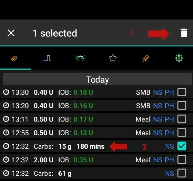

# Berechnung der aktiven Kohlenhydrate (COB)

## Wie berechnet AAPS die aktiven Kohlenhydrate?

Wenn Kohlenhydrate im Rahmen einer Mahlzeit oder als Kohlenhydrat-Korrektur eingegeben werden, wird **AAPS** diese Kohlenhydrate zu den aktiven Kohlenhydraten (**COB**) hinzurechnen und bei den Berechnungen berücksichtigen. **AAPS** berechnet dann die Kohlenhydrat-Aufnahme (Absorption) des Nutzenden anhand der zu den **Glukosewerten** beobachteten Abweichungen. Die Absorptionsrate hängt vom Kohlenhydrat-Empfindlichkeitsfaktor (**"CSF"**) ab. This is not a feature within the user’s **Profile** but is calculated by **AAPS** according to **ISF/I:C** setup, and is determined by how many mg/dL 1 g of carbs will raise the user’s **BG**.

## Faktor der Kohlenhydrat-Empfindlichkeit (Carb Sensitivity Factor)

Die in **AAPS** genutzte Formel ist:

- Aufgenommene KH = Abweichung * IC / ISF.

Der Effekt auf das **Profil** ist:

- _Erhöhung_ **IC** - Durch das Erhöhen des Wertes der in 5 Minuten aufgenommen Kohlenhydrate verkürzt sich die Gesamtzeit der KH-Absorption;

- _Erhöhung_ **ISF** - Durch das Reduzieren des Wertes der in 5 Minuten aufgenommenen Kohlenhydrate verlängert sich die Gesamtzeit der KH-Absorption; und

- _Prozentuale Änderung_ des **Profils** -  Erhöhen/reduzieren beider Werte hat keinen Einfluss auf die Gesamtzeit der KH-Absorption.

Wenn der **ISF** im **Profil**  beispielsweise 100 und der **IC** 5 ist, wäre der Faktor der Kohlenhydrat-Empfindlichkeit (CSF) 20. For every 20 mg/dL the user’s **BG** goes up, 1 g of carbs will be calculated as absorbed by **AAPS**. Eine positiver **IOB**-Wert beinflusst damit auch die **COB**-Berechnung. So, if **AAPS** predicts the user’s **BG** to go down by 20 mg/dL because of **IOB** and it instead stayed flat, **AAPS** would also calculate 1 g of carbs as absorbed.

In Abhängigkeit vom von Dir in **AAPS** gewählten Empfindlichkeits-Algorithmus, werden auch Kohlenhydrate nach dem unten beschriebenen Verfahren aufgenommen (absorbiert).

## Kohlenhydrat-Empfindlichkeit (Carb Sensitivity) - Oref1

Nicht absorbierte Kohlenhydrate werden nach der eingestellten Zeit verworfen, werden also bei Berechnungen nicht mehr berücksichtigt:


```{admonition} Older screenshot
:class: note
The screenshot above is from an earlier **AAPS** version — in **AAPS** 4 the graphs look slightly different, but the **COB** graph carries the same information.
```


## Kohlenhydrat-Empfindlichkeit - Gewichteter Mittelwert

Die Kohlenhydrat-Aufnahme wird so berechnet, dass nach einer vorgegebener Zeit COB = 0 ist:


In der **COB**-Kurve wird ein orangener Punkt angezeigt, wenn die minimale Kohlenhydrat-Aufnahme (min_5m_carbimpact) anstelle eines aus den Entwicklungen des **Glukosewertes** berechneten Wertes verwendet wird.

(CobCalculation-detection-of-wrong-cob-values)=
## Erkennung Fehlerhafter COB-Werte

**AAPS** wird Dich warnen, wenn Du dabei bist einen Bolus abzugeben bei dem **COB**-Werte einer vorherigen Mahlzeit berücksichtigt werden, der Algorithmus aber erkennt, dass die  aktuelle **COB**-Berechnung nicht korrekt ist. In dieser Situation gibt es beim Nutzen des Bolus-Rechners einen zusätzlichen Hinweis im Bestätigungsfenster.

### Wie erkennt AAPS falsche COB-Werte?

Normalerweise erkennt __AAPS__ eine Kohlenhydrat-Aufnahme anhand von **Glukosewert**-Veränderungen. Für den Fall, dass Du Kohlenhydrate eingegeben hast, aber **AAPS** die erwartete Absorption nicht durch **Glukosewert**-Veränderungen erkennen kann, wird als sog. Fallback zur Berechnung der Absorption die [min_5m_carbimpact](#Preferences-min_5m_carbimpact)-Methode verwendet. Da dieses Verfahren nur die minimale Kohlenhydrat-Aufnahme ohne Berücksichtigung von Glukosewert-Änderungen berechnet, kann dies zu falschen COB-Werten führen.


In the screenshot above, 66% of time the carb absorption was calculated by the min_5m_carbimpact instead of the value detected from deviations. Das deutet darauf hin, dass weniger Kohlenhydrate aktiv sind (**COB**), als es vom Algorithmus berechnet wurde.

### Wie kann man mit dieser Warnung umgehen?

- Denke darüber nach die Insulinabgabe abzubrechen - drücke 'Abbrechen' statt OK.
- Berechne die Mahlzeit mit dem Bolus-Rechner erneut, nimm aber den Haken bei **COB** heraus.
- Solltest Du einen Korrekturbolus brauchen, gib ihn manuell ein.
- Vermeide Überdosierung und sog. Insulin Stacking (Überlagerung einzelner Bolus-Wirkkurven)!


### Warum erkennt der Algorithmus COB nicht richtig?

Das kann folgende Gründe haben:
- Die Kohlenhydratmenge wurde bei der Eingabe potenziell überschätzt.
- Sportliche Aktivität oder Bewegung nach der vorangegangenen Mahlzeit.
- Dein IC-Wert (dt. KH-Faktor) muss angepasst werden.
- Dein Wert für min_5m_carbimpact ist falsch (für SMB wird 8 empfohlen, 3 für AMA).


## Manuelle Korrektur der eingegebenen Kohlenhydrate

If carbs are over or underestimated this can be corrected through the **Treatments history** screen as described [here](#screens-bolus-carbs).


## Kohlenhydrate korrigieren - wie KH-Einträge aus den Behandlungen gelöscht werden


The **Treatments history** screen can be used to correct a faulty carb entry by deleting it. Dies kann dann notwendig sein, wenn die Kohlenhydratmenge über- oder unterschätzt wurde:



1. Check and remember actual **COB** and **IOB** on the **AAPS** main screen.
2. Open **Treatments history** (drawer menu → *Treatments history*), tab **Carbs and bolus**. Depending on the pump, the carbs might show together with insulin in one line or as a separate entry (i.e. with Dana RS).
3. **Long-press** the faulty carb entry — the list switches to **selection mode** with a checkbox on every line, and the entry is ticked (marked **1** above). Tick any further entries you want to remove as well.
4. Tap the **🗑 Delete** icon in the top bar (marked **2**) and confirm — the confirmation dialog lists exactly what will be removed.
5. Make sure carbs are removed successfully by checking **COB** on the **AAPS** main screen again.
6. Do the same for **IOB** if there is just one line including carbs and insulin.
7. Wenn die KH nicht wie vorgesehen entfernt wurden und zusätzliche KH hinzugefügt werden, ist der **COB**-Eintrag zu hoch. Das kann dazu führen, dass **AAPS** zu viel Insulin abgibt.
8. Enter the correct carbs amount through the **Carbs** dialog (**Treatments** → **Carbs**) and set the correct event time.
9. If there was just one line including carbs and insulin the user should also re-add the amount of insulin. Make sure to set the correct event time and check **IOB** on the main screen after confirming the new entry.

