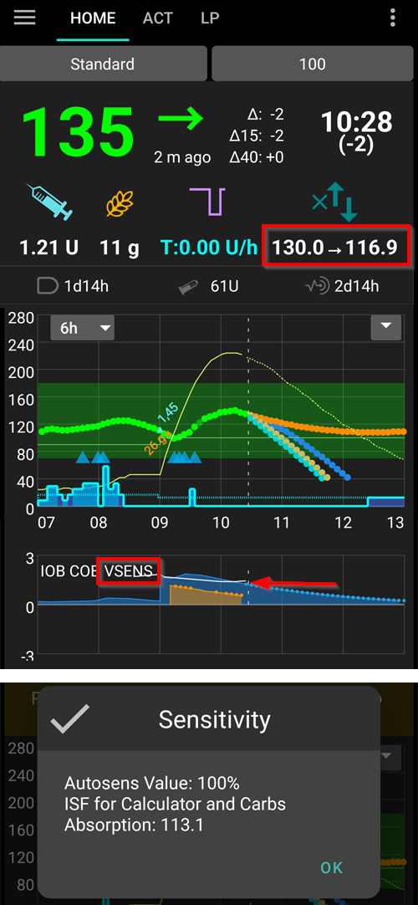

(Open-APS-features-DynamicISF)=
# Dynamischer ISF (DynISF)

Bisher, mit **AMA** und **SMB**, wurde der **ISF** im **Profil** definiert und war für jeden definierten Zeitraum am Tag statisch. In Wirklichkeit ist der **ISF** eines Menschen aber nicht so statisch, sondern hängt vom **BZ** ab: Bei einem hohen BZ braucht man mehr Insulin, um den **BZ** um 50 mg/dl bzw. 3 mmol/l zu senken, als bei einem niedrigeren **BZ**. [Autosens](#Open-APS-features-autosens) war der erste Algorithmus, der versuchte dieses Problem durch Anpassung des **ISF** außerhalb der Mahlzeiten zu lösen.

**Dynamischer ISF** (auch **DynISF** genannt) verfolgt das gleiche Ziel, ist aber weiter entwickelt, da es über den ganzen Tag (auch während der Mahlzeiten-Phasen) genutzt werden kann. Es wird nur erfahrenen Loopern, die sich gut mit der **AAPS**-Steuerungen und -Überwachung auskennen, empfohlen. Lies den Abschnitt [Dinge, die bei der Aktivierung des dynamischen ISF zu beachten sind](#dyn-isf-things-to-consider-when-activating-dynamicisf), bevor Du es ausprobierst.

```{admonition} CAUTION - Automations or Profile Percentage change
:class: warning

**Automatisierungen** sollten immer mit besonderer Vorsicht eingesetzt werden. Das gilt insbesondere für den **dynamischen ISF**.

Wenn Du den **dynamischen ISF** einsetzt, deaktiviere alle **Automatisierungsregeln, die eine temporäre **Profiländerung** vornehmen. Dadurch verhinderst Du, dass der **dynamische ISF** zu starke Korrekturboli abgibt, die zu einer Hypoglykämie führen könnten. Genau dafür ist der **dynamische ISF** gedacht und daher ist es auch nicht mehr nötig, **AAPS** bei hohen **Glukosewerten** durch Automatisierungen dazu zu bringen zusätzliches Insulin zur Korrektur abzugeben.

```

Um den **dynamischen ISF** nutzen zu können, müssen in der **AAPS**-Datenbank mindestens **AAPS**-Daten der letzten 7 Tage vorliegen.

## What does Dynamic ISF do?

**Dynamischer ISF** passt den Faktor für die Insulinempfindlichkeit **ISF** dynamisch an und berücksichtigt dabei:

- Den Tages-Gesamtinsulinbedarf (**TDD**); und
- den aktuellen und die prognostizierten Glukosewerte.

When using **Dynamic ISF**, the **ISF** values entered in the **Profile** are not used at all anymore, except as a fallback if there is not enough TDD data in **AAPS** database (*i.e.* fresh reinstallation of the app).

**SMB/AMA** - ein echtes Beispiel eines **Profils** mit statischem **ISF**, so wie es in der Praxis vorkommt und durch **SMB** und **AMA** genutzt wird.


**Dynamischer ISF** - ein Beispiel eines Benutzer-**ISF**s, der durch den **dynamischen ISF** geändert wird.



Der rot eingekreiste Bereich zeigt: `Profil-ISF` -> `ISF wie er von DynISF` berechnet wurde. <br/> Tippst Du auf diesen Bereich, öffnet sich ein Dialog mit weiteren Informationen, zum Beispiel dem **ISF**, der für den Rechner und die Kohlenhydrat-Resorption verwendet wird (siehe [Weitere Verwendungen des ISF](#dynisf-other-usages-of-isf) unten).

Der **DynISF**-Wert kann auch in einem Diagramm angezeigt werden: Tippe unter den Diagrammen auf dem Startbildschirm auf **Diagramm hinzufügen** und wähle **VSENS** (variable Empfindlichkeit). Er erscheint als weiße Linie (unten im Bild oben).

## How is Dynamic ISF calculated?

**Dynamic ISF** verwendet das Modell von Chris Wilson, um **ISF** anstelle des statischen **ISF**-Wertes zu ermitteln, der im **Profil** festgelegt wurde. Weitergehende Erklärungen findest Du (in englischer Sprache) hier: [Chris Wilson on Insulin Sensitivity (Correction Factor) with Loop and Learn, 2/6/2022](https://www.youtube.com/watch?v=oL49FhOts3c).

Die hinterlegte **Dynamic ISF**-Gleichung lautet: `ISF = 1800 / ((TDD * DynISF-Anpassungsfaktor) * Ln (( aktueller BG / Insulindivisor) + 1 ))`

Die in dieser Gleichung verwendeten Variablen, sind unten genauer beschrieben.<br/> Anmerkung: `Ln` steht für den natürlichen Logarithmus, eine mathematische Funktion.

Die Implementierung verwendet die oben gezeigt Gleichung zur Berechnung des aktuellen **ISF** und in den oref1-[Prognosen für **IOB**, **ZT** (zero-temping) und **UAM**](#aaps-screens-prediction-lines). Es wird auch für **COB** und im Bolus-Rechner verwendet (siehe [Weitere Nutzung des ISF](#dynisf-other-usages-of-isf) unten).

### TDD (Total Daily Dose; dt. Tages-Gesamtinsulinbedarf)
TDD nutzt eine Kombination der folgenden Werte:
1.  durchschnittlicher **TDD** der letzten 7 Tage;
2.  den **TDD** der Vortages; und
3.  einen gewichteten Durchschnitt des Insulinbedarfs der letzten acht (8) Stunden extrapoliert auf 24 Stunden.

Die in der obigen Gleichung verwendete **TDD** wird mit einem Drittel in den obigen Werten gewichtet.

### Dynamischer ISF Anpassungsfaktor

Er wird in den **Einstellungen** festgelegt und macht den **dynamischen ISF** mehr oder weniger aggressiv. Vgl. hierzu den Abschnitt [Einstellungen](#dyn-isf-preferences) unten.

### Insulin-Divisor
Der Insulin-Divisor ist vom Wirkmaximum des genutzten Insulins abhängig und ist umgekehrt proportional zum Wirkmaximum. Für Lyumjev ist dieser Wert 75, für Fiasp 65, und übliches schnell wirkendes Insulin 55.

### ISF für Bolusentscheidungen basiert auf vorhergesagten Glukosewerten

Die dynamische Empfindlichkeit wird mit dem **aktuellen Glukosewert** berechnet und als aktueller ISF in **AAPS** angezeigt. Für Bolusentscheidungen berechnet und verwendet der oref1-Algorithmus stattdessen den **zukünftigen ISF** (engl. Future ISF).

Dies wird getan, um zu hohe Insulinabgaben zu verhindern, wenn der **Glukosewert** niedrig ist oder voraussichtlich niedrig sein wird.

**Future ISF** (dt. zukünftiger ISF) nutzt die gleiche Formel, so wie sie oben beschrieben ist, mit der Ausnahme, dass es den **minimum predicted BG** (dt. niedrigste vorhergesagte Glukosewert) anstelle des **current BG** (dt. aktuellen Glukosewerts) verwenden kann. Der **minimale vorhergesagte BZ**, [wie ihn oref1 berechnet](#aaps-screens-how-predictions-become-a-dosing-decision), ist der niedrigste Wert, den Dein BZ laut den Vorhersagen im gesamten Vorhersagezeitraum erreicht.

* If the current **BG** is above target<br/> **and** if **BG** levels are flat, within +/- 3 mg/dL:<br/>BG is used in the formula as follows: `average(minimum predicted BG, current BG)`.
* If eventual **BG** is above target and glucose levels are increasing,<br/> **or** eventual **BG** is above current **BG**:<br/>BG is used in the formula as follows: `current BG`.
* In allen anderen Fällen wird in der Formel als <br/>Glukosewert der niedrigste vorhergesagte Glukosewert (`minimum predicted BG`) genutzt.

Die Screenshots unten geben eine vereinfachte Erklärung der oben beschriebenen Szenarien. Orange Punkte werden für **predicted BG**, lila-farbene Punkte für **average(predicted BG, current BG)** und blaue Punkte für **current BG** verwendet.


(dynisf-other-usages-of-isf)=
## Weitere Nutzung des ISF

### ISF und COB-Absorption (KH-Verstoffwechselung)

Wie auf der Seite zur [Berechnung der aktiven Kohlenhydrate](../DailyLifeWithAaps/CobCalculation.md) (COB) beschrieben, wird die Verstoffwechselung (KH-Aufnahme) mit dieser Formel berechnet:   
`absorbed_carbs = deviation * ic / isf`  
Bei Verwendung des **dynamischen ISF**, ist der dort verwendete **ISF** der Durchschnitt dynamischen ISF-Werte der letzten 24h.

### ISF im Bolus-Rechner

Im [Bolus-Rechner](#aaps-screens-bolus-wizard) wird der **ISF** genutzt, um bei einem hohen **Glukosewert**, (über dem Ziel), die Korrektur zu berechnen.

Bei aktiviertem **dynamischen ISF**, ist der hier genutzte **ISF** der Durchschnittswert der ISF-Werte der letzten 24 Stunden.

(dyn-isf-preferences)=
## Einstellungen

Hake zum Aktivieren **Dynamische Empfindlichkeit verwenden** in den [Einstellungen > OpenAPS SMB](#Preferences-openaps-smb-settings) an. Mit der Aktivierung werden neue Einstellungsoptionen verfügbar.


(dyn-isf-adjustment-factor)=
### DynamicISF adjustment factor
Der **dynamische ISF** geht von der Grundidee aus, dass Personen, die den gleichen **TDD** haben auch die gleiche Empfindlichkeit haben. Da die Empfindlichkeiten in der Realität aber tatsächlich verschieden sind, kann mit dem **Anpassungsfaktor** eine Anpassung an die eigene Situation vorgenommen werden. Der Faktor legt fest, ob Du empfindlicher oder weniger empfindlich auf Insulin reagierst, als es die „Standard"-Person tut.

Der **Anpassungsfaktor** kann zwischen 1% und 300% liegen. Er wirkt als Multiplikator für den **TDD**-Wert.

* Eine Erhöhung des Wertes über 100% macht **DynISF** aggressiver: Die **ISF**-Werte werden *kleiner* (_d. h._ es wird mehr Insulin benötigt, um die **Glukosewerte** zu senken)
* Eine Absenkung des Wertes unter 100% macht **DynISF** weniger aggressiv: Die **ISF**-Werte werden größer (_d. h. _ es wird weniger Insulin benötigt, um die **Glukosewerte** zu senken).

Der **Anpassungsfaktor** wird auch bei der Aktivierung eines [**prozentualen Profilwechsels**](../DailyLifeWithAaps/ProfileSwitch-ProfilePercentage.md) verändert. Ein niedrigerer **Profil-Prozentsatz** senkt den **Anpassungsfaktor** und ein höherer **Profil-Prozentsatz** hebt in.

For example, if your **Adjustment Factor** is 80%, and **Profile Switch** to 80% is actioned, the resulting **Adjustment Factor** will be `0.8*0.8=0.64`.

Das bedeutet, dass Du bei aktiviertem **dynamischen ISF**, einen **prozentualen Profilwechsel** nutzen kannst, um Deine Empfindlichkeit manuell zu „finetunen“. Dies kann für körperliche Aktivität (niedrigerer Prozentwert), Krankheit (höherer Prozentwert), etc. sehr helfen.

### LGS threshold

**BZ**-Wert, unter dem die Insulinabgabe ausgesetzt wird (Unterbrechung bei niedrigem BZ). Der Standardwert verwendet das Standard-Ziel-Modell. Dieser Wert kann zwischen 60 mg/dl (3,3 mmol/l) und 100 mg/dl (5,5 mmol/l) eingestellt werden. Werte unterhalb von 65 bzw. 3,6 führen dazu, dass das Standard-Modell genutzt wird.

### DynamicISF adjust sensitivity

Diese Einstellung (*„Berechnung der Insulinempfindlichkeit bei Verwendung von DynamicISF anpassen“*) ersetzt Autosens und verwendet das Verhältnis der **TDD** der letzten 24 h zur **TDD** der letzten 7 Tage als Grundlage, um die Basalrate zu erhöhen oder zu senken, genau wie das normale Autosens. Dieser berechnete Wert wird auch verwendet, um das Ziel anzupassen, wenn die Optionen "Empfindlichkeit und Glukosewert anpassen" aktiviert ist. Im Gegensatz zu Autosens wird durch diese Option der **ISF**-Werte nicht angepasst.

(dyn-isf-things-to-consider-when-activating-dynamicisf)=
## Dinge, die bei der Aktivierung des dynamischen ISF zu beachten sind

* **Dynamischer ISF** wird nur erfahrenen Loopern, die sich gut mit der **AAPS**-Steuerungen und -Überwachung auskennen, empfohlen. Du hast idealerweise bereits mit **SMB** eine gute Glukosespiegel-Einstellung erreicht, bevor Du auf den **dynamischen ISF** umsteigst.
* Wie oben schon erwähnt, schalte alle [**Automatisierungen**](../DailyLifeWithAaps/Automations.md), die ein **prozentuales Profil** in Abhängigkeit vom **Glukosewert** aktivieren, aus. Es kann sonst sein, dass zu aggressiv reagiert und zu viel Insulin abgegeben wird! Das ist schon im Algorithmus des **dynamischen ISF** berücksichtigt.
* Ein [prozentuales Proflil](../DailyLifeWithAaps/ProfileSwitch-ProfilePercentage.md) wird bei der Berechnung des dynamischen ISF berücksichtigt (siehe [Dynamischer ISF Anpassungsfaktor](#dyn-isf-adjustment-factor) oben). Es ist schlecht ein **prozentuales Profil**, das nicht 100% entspricht, über einen längeren Zeitraum zu nutzen. Wenn Du erkennst, dass sich Dein **Profil** geändert hat, erstelle ein neues **Profil** mit Deinen überarbeiteten Werten, um das **Profil** mit dem entsprechenden Prozentwert nachzubilden.
* **Dynamischer ISF** funktioniert möglicherweise nicht bei jedem. In den folgenden Situationen kann es ganz konkret sein, dass Du überraschende Ergebnisse erhältst:
  * Variabler Lebensstil (unregelmäßiges Essen oder unregelmäßige körperliche Aktivitäten)
  * Starke Unterschiede im Gesamtinsulinbedarf des Tages (TDD) oder hohe Schwankungen in der täglichen Insulin-Empfindlichkeit.
* Es gibt keine genaue Anleitung, wie der Wert des **Anpassungsfaktors** erstmalig gesetzt werden sollte. Als Ausgangspunkt: Unter der Annahme, dass Deine **Profil**werte korrekt sind, Du im Zielbereich bist und der **Glukosewert**-Verlauf stabil ist, entspricht der **DynISF**-Wert ungefähr dem Wert, den Du vorher in Deinem **Profil** hattest.<br/>Wenn Du erkennst, dass der **dynamische ISF** zu aggressiv ist, senke den **Anpassungsfaktor** und umgekehrt.
* Auch wenn **DynISF** nicht den **Profil-ISF** verwendet, solltest Du, sofern Du erkennst, dass sich Deine Empfindlichkeit stark von dem unterscheidet, was zuvor in Deinem **Profil** gespeichert wurde, Dein Profil mit den geänderten Werten aktualisieren und aktuell halten. Das kann hilfreich sein, wenn Deine **AAPS**-Daten verloren gehen (_z. B._ neues Smartphone, neue **AAPS**-Version …), denn dann wird für die nächsten 7 Tage der **ISF des Profils** als Ersatz verwendet.