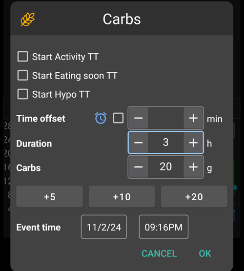
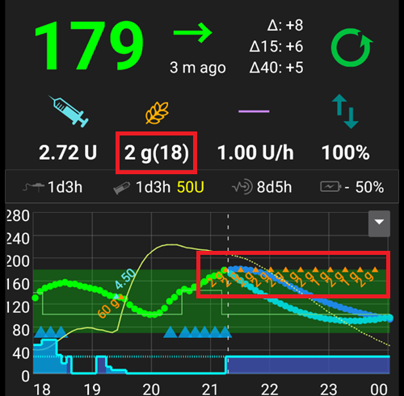
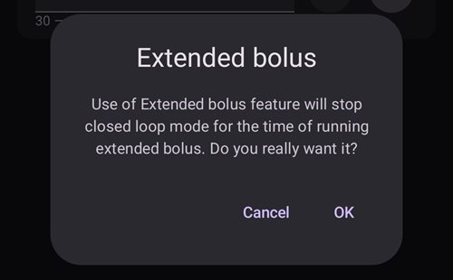

(Extended-Carbs-extended-carbs-ecarbs)=
# Verzögerte Kohlenhydrate / "eCarbs"

## Was sind eCarbs und wann sind sie nützlich?

Im Rahmen einer normalen Pumpen-Therapie sind verzögerte Boli ein guter Weg, um mit fettigen oder sonstigen langsam absorbierenden Mahlzeiten zurecht zu kommen, die die Glukosewerte im Blut länger erhöhen als das Insulin wirkt. Im Zusammenhang mit dem Loopen sind jedoch verzögerte Boli wenig sinnvoll (und werfen technische Schwierigkeiten auf), da sie im Grunde eine feste hohe temporäre Basalrate darstellen, was der normalen Funktionsweise des Loops - der die Basalraten dynamisch anpasst - widerspricht. Details zum [verzögerten Bolus](#extended-bolus-and-why-they-wont-work-in-closed-loop-environment) findest Du unten.

Es gibt aber trotzdem das Bedürfnis, mit solchen Mahlzeiten umzugehen. Deshalb unterstützt AAPS sogenannte verzögerte Kohlenhydrate oder eCarbs.

eCarbs sind Kohlenhydrate, die auf mehrere Stunden verteilt werden. Bei einer Standardmahlzeit, die mehr Kohlenhydrate enthält als Fett/Eiweiß, ist die Eingabe der Kohlenhydrate vor dem Verzehr (ggf. unter Reduzierung des Mahlzeiten-Bolus) normalerweise ausreichend, um eine zu frühe Insulinabgabe zu verhindern.  Aber bei langsamer absorbierenden Mahlzeiten, bei denen eine auf einmal eingegebene Kohlenhydratmenge dazu führen würde, dass der SMB zu viel IOB aufbaut, können eCarbs verwendet werden, um besser zu simulieren, wie die Kohlenhydrate (und alle anderen blutzuckersteigernden Faktoren) wirklich absorbiert werden und sich auf den Blutzuckerspiegel auswirken. Mit diesen Informationen kann der Loop den SMB zur Bewältigung dieser Kohlenhydrate besser einsetzen, was als eine Art dynamischer verzögerter Bolus zu sehen ist (dies sollte auch ohne SMB funktionieren, ist dann aber wahrscheinlich nicht so effektiv).

**Hinweis:** eCarbs sind nicht auf fett- oder eiweißreiche Mahlzeiten beschränkt: Sie können auch in allen Situationen helfen, in denen andere Einflüsse den Glukosewert steigen lassen, z. B. andere Medikamente wie Kortikosteroide.

## Methoden der Verwendung von eCarbs

Um eCarbs einzugeben, öffne den Dialog **Kohlenhydrate** (**Behandlungen** → **Kohlenhydrate**), gib die gesamten Kohlenhydrate ein, setze eine **Dauer** und verschiebe bei Bedarf den Beginn mit **Zeitpunkt der KH-Aufnahme** (*die Zahlen unten sind nur Beispiele, Du musst Deine eigenen Werte ausprobieren, bis der Glukoseverlauf für Deine Anwendungsfälle passt*):

Die eCarbs auf dem Startbildschirm: Die Zahl in Klammern im Feld **COB** zeigt die noch kommenden Kohlenhydrate, und das **COB**-Diagramm zeigt jeden künftigen eCarbs-Eintrag als orangefarbene Markierung. Wenn Du kein **COB**-Diagramm siehst, füge eines mit **Diagramm hinzufügen** unterhalb der Diagramme hinzu (siehe [AAPS-Bildschirme](../DailyLifeWithAaps/AapsScreens.md)).

(AapsScreens-carbs-type)=
## Kohlenhydrat-Typ im Bolus-Rechner: Brot, Kuchen oder Pizza

Im [Bolus-Rechner](#aaps-screens-bolus-wizard) kannst Du mit drei Knöpfen unter dem Feld **Kohlenhydrate** auswählen, wie schnell Deine Mahlzeit aufgenommen wird. Wähle einen davon, bevor Du bestätigst. Je nach Typ verbucht **AAPS** einen Teil der eingegebenen Kohlenhydrate als normale Kohlenhydrate und fügt bei langsamen, reichhaltigen Mahlzeiten später [verzögerte Kohlenhydrate („eCarbs“)](#Extended-Carbs-extended-carbs-ecarbs) hinzu. Tippe auf das Symbol **(i)** neben den Knöpfen, um die typischen Lebensmittel für den gewählten Typ zu sehen und was er mit Deinen Kohlenhydraten macht.

| Typ                 | Typische Lebensmittel (Beispiele aus der App)                                                       | Kohlenhydrate jetzt, für den Bolus verwendet | Hinzugefügte eCarbs                                       |
| ------------------- | --------------------------------------------------------------------------------------------------- | -------------------------------------------- | --------------------------------------------------------- |
| **Brot** (Standard) | Brot, salziges Gebäck, Joghurt, Obst, Kartoffeln, Reis, Hafer, Gemüse                               | 100 %                                        | Keine                                                     |
| **Kuchen**          | Knödel, Nudeln, asiatische Küche (KH- und fettreich), Süß- und Hefeteig, Getreide, Honig, Marmelade | 90 %                                         | 20 %, beginnend 60 Minuten später, verteilt auf 2 Stunden |
| **Pizza**           | Lasagne, Pizza, Hamburger, Pommes, gebackene Kartoffeln, Chips                                      | 80 %                                         | 35 %, beginnend 60 Minuten später, verteilt auf 3 Stunden |

**Beispiel**: Du gibst 100 g ein und wählst **Pizza**. Der Bolus wird für 80 g berechnet, die jetzt erfasst werden. 35 g eCarbs beginnen 1 Stunde später und werden auf 3 Stunden verteilt.

Gut zu wissen:
* Das ist keine einfache Aufteilung: Bei **Kuchen** und **Pizza** ergeben die erfassten Kohlenhydrate zusammen **mehr, als Du eingegeben hast** (110 % bzw. 115 %). Der Zuschlag steckt nur in den eCarbs.
* Der Bolus deckt nur die jetzt gegessenen Kohlenhydrate ab. **AAPS** gibt für die eCarbs keinen Bolus im Voraus ab: Der Loop berücksichtigt sie, sobald sie beginnen, wie alle anderen [eCarbs](#Extended-Carbs-extended-carbs-ecarbs).
* Wenn Du einen **Zeitpunkt der KH-Aufnahme** einstellst, beginnen die eCarbs 60 Minuten danach.
* Der Bestätigungsdialog zeigt die eCarbs in einer eigenen Zeile, _z. B._ "eCarbs 35g / 3h (+60min)".
* Die Gramm werden auf ganze Zahlen abgerundet.
* Prozentsätze, Verzögerungen und Dauern sind fest vorgegeben und lassen sich in den Einstellungen nicht ändern.
* Die Auswahl wird nicht gespeichert: Der Rechner öffnet sich jedes Mal mit **Brot**.

______________________________________________________________________

Ein konkretes Beispiel zum Umgang mit Fett und Eiweiß im Rahmen dieser Funktion wird hier beschrieben: [https://adriansloop.blogspot.com/2018/04/page-margin-0.html](https://adriansloop.blogspot.com/2018/04/page-margin-0.html)

______________________________________________________________________

## Empfohlene Einrichtung, Beispielszenario und wichtige Hinweise

Es wird empfohlen, das APS-Plugin "OpenAPS SMB" zu nutzen, SMB zu aktivieren und die Einstellung *Aktiviere SMB während aktiver Kohlenhydrate* zu aktivieren.

Bei einer Pizza könnte man z. B. über den *Bolus-Rechner* vorab einen (Teil-)Bolus abgeben und dann im Dialog *Kohlenhydrate* die restlichen Kohlenhydrate für eine Dauer von 4-6 Stunden eingeben, beginnend nach 1 oder 2 Stunden.

Schneller geht es, wenn der *Bolus-Rechner* die eCarbs für Dich hinzufügt: Wähle unter dem Feld **Kohlenhydrate** den [Kohlenhydrat-Typ](#AapsScreens-carbs-type) **Kuchen** oder **Pizza** (siehe oben). Mengen und Zeiten sind fest vorgegeben. Wenn Du andere Werte möchtest, nutze stattdessen den Dialog *Kohlenhydrate*.

**Wichtiger Hinweis:** Du musst natürlich ausprobieren und sehen, welche konkreten Werte für dich funktionieren. Du könntest auch die Einstellung *SMB-Basal-Limit in Minuten* vorsichtig anpassen, um den Algorithmus mehr oder weniger aggressiv zu einzustellen. Bei Low-Carb-Ernährung und fett-/eiweißreichen Mahlzeiten reicht es möglicherweise aus, nur eCarbs ohne manuellem Mahlzeitenbolus einzugeben (mehr dazu im Blogbeitrag oben). Wenn eCarbs eingegeben werden, wird im Careportal automatisch eine Notiz angelegt, damit es einfacher ist, die Eingaben zu überprüfen und zu verbessern.

(extended-bolus-and-why-they-wont-work-in-closed-loop-environment)=
## Verzögerte Boli und warum sie im Closed Loop nicht funktionieren

Wie oben bereits erwähnt sind verzögerte oder sog. Multi-Wave-Boli beim Loopen nicht sinnvoll. Details [findest Du unten](#why-extended-boluses-won-t-work-in-a-closed-loop-environment).

(Extended-Carbs-extended-bolus-and-switch-to-open-loop-dana-and-insight-pump-only)=
### Verzögerter Bolus und Wechsel zum Open Loop - nur für Dana- und Insight-Pumpe

Es kam immer wieder der Wunsch auf, verzögerte Boli auch in AAPS zu nutzen, um spezielle Mahlzeiten wie gewohnt behandeln zu können.

Deshalb bietet **AAPS** Nutzern von Dana- und Insight-Pumpen einen verzögerten Bolus an: Öffne **Verwalten** und wähle **Verzögerter Bolus**.

**AAPS** warnt Dich zunächst, dass der Closed Loop angehalten wird, solange der verzögerte Bolus läuft. Tippe auf **OK**, um fortzufahren:

Gib die **Insulin**-Menge und die **Dauer** ein, tippe dann unten auf den Bestätigungsknopf und auf **OK**:

Bei der Insight-Pumpe ist der verzögerte Bolus *nicht verfügbar*, wenn die [TBR-Emulation](#Accu-Chek-Insight-Pump-settings-in-aaps) verwendet wird.

Während der verzögerte Bolus läuft, arbeitet der Loop im Modus **Open Loop** (das Loop-Symbol auf dem Startbildschirm ändert sich). Wenn der verzögerte Bolus endet, wird der Closed Loop automatisch wieder eingeschaltet:

Das Menü **Verwalten** zeigt einen Knopf **Abbrechen** mit der Rate und der abgelaufenen / gesamten Zeit (zum Beispiel **Abbrechen 2.00 IE/h 1/60'**). Tippe darauf, um den verzögerten Bolus vorzeitig zu beenden:

(why-extended-boluses-won-t-work-in-a-closed-loop-environment)=
### Warum ein verzögerter Bolus beim Loopen nicht funktioniert

1. Der Loop bestimmt, dass jetzt 1,55 IE/Std. abgegeben werden soll. Ob das als verzögerter Bolus oder TBR abgegeben wird, ist dem Algorithmus egal. In der Tat verwenden einige der Pumpen den verzögerten Bolus. Was soll dann geschehen? Die meisten Pumpentreiber stoppen dann den verzögerten Bolus -> Man brauchte ihn gar nicht erst starten.

2. Wenn man den verzögerten Bolus als Eingabe hätte, was soll dann damit im Modell geschehen?

   1. Soll er zusammen mit der BR als neutral angesehen werden und darauf geloopt werden? Dann müsste der Loop auch den Bolus verringern können, wenn man z.B. zu niedrig gerät und das gesamte "neutrale" Insulin weggenommen wird?
   2. Soll der verzögerte Bolus einfach dazugezählt werden? Dann soll der Loop in also einfach weiterlaufen lassen? Selbst in der ärgsten Hypo? Das halte ich für nicht so gut: Es wird eine Hypo vorhergesehen aber sie darf nicht verhindert werden?

3. Das IOB, dass der verzögerte Bolus aufbaut materialisiert sich beim nächsten Durchlauf nach 5 Minuten. Entsprechend würde der Loop weniger Basal geben. Es ändert sich also nicht viel... außer, dass die Möglichkeit der Hypo-Vermeidung genommen wird.
