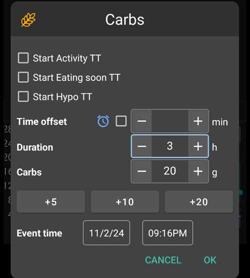
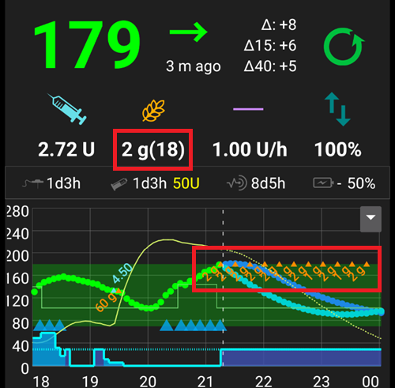
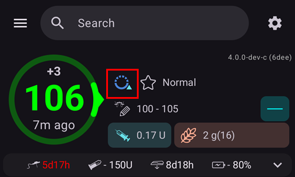

(Extended-Carbs-extended-carbs-ecarbs)=
# Verzögerte Kohlenhydrate / "eCarbs"

## Was sind eCarbs und wann sind sie nützlich?

Im Rahmen einer normalen Pumpen-Therapie sind verzögerte Boli ein guter Weg, um mit fettigen oder sonstigen langsam absorbierenden Mahlzeiten zurecht zu kommen, die die Glukosewerte im Blut länger erhöhen als das Insulin wirkt. Im Zusammenhang mit dem Loopen sind jedoch verzögerte Boli wenig sinnvoll (und werfen technische Schwierigkeiten auf), da sie im Grunde eine feste hohe temporäre Basalrate darstellen, was der normalen Funktionsweise des Loops - der die Basalraten dynamisch anpasst - widerspricht. Details zum [verzögerten Bolus](#extended-bolus-and-why-they-wont-work-in-closed-loop-environment) findest Du unten.

Es gibt aber trotzdem das Bedürfnis, mit solchen Mahlzeiten umzugehen. Which is why AAPS supports so called extended carbs or eCarbs.

eCarbs are carbs that are split up over several hours. Bei einer Standardmahlzeit, die mehr Kohlenhydrate enthält als Fett/Eiweiß, ist die Eingabe der Kohlenhydrate vor dem Verzehr (ggf. unter Reduzierung des Mahlzeiten-Bolus) normalerweise ausreichend, um eine zu frühe Insulinabgabe zu verhindern.  Aber bei langsamer absorbierenden Mahlzeiten, bei denen eine auf einmal eingegebene Kohlenhydratmenge dazu führen würde, dass der SMB zu viel IOB aufbaut, können eCarbs verwendet werden, um besser zu simulieren, wie die Kohlenhydrate (und alle anderen blutzuckersteigernden Faktoren) wirklich absorbiert werden und sich auf den Blutzuckerspiegel auswirken. Mit diesen Informationen kann der Loop den SMB zur Bewältigung dieser Kohlenhydrate besser einsetzen, was als eine Art dynamischer verzögerter Bolus zu sehen ist (dies sollte auch ohne SMB funktionieren, ist dann aber wahrscheinlich nicht so effektiv).

**Note:** eCarbs sind nicht auf fett- oder proteinreiche Mahlzeiten beschränkt: Sie können auch in jeder Situation eingesetzt werden, in der es Einflüsse gibt, die den Blutzucker erhöhen, z. B. andere Medikamente wie Kortison.

## Methoden der Verwendung von eCarbs

To enter eCarbs, open the **Carbs** dialog (**Treatments** → **Carbs**), enter the total carbs, set a **Duration**, and optionally shift the start with **Carb time** (*numbers below are just examples, you will need to try your own values to arrive at satisfactory glucose response for your use-cases*):

The eCarbs on the main screen: the number in brackets in the **COB** field shows the carbs still to come, and the **COB** graph shows each future eCarbs entry as an orange marker. If you don't see a **COB** graph, add one with **Add graph** below the graphs (see [AAPS screens](../DailyLifeWithAaps/AapsScreens.md)).

(AapsScreens-carbs-type)=
## Carbs type in the Bolus wizard: bread, cake or pizza

In the [Bolus wizard](#aaps-screens-bolus-wizard), three buttons below the **Carbs** field let you choose how fast your meal is absorbed. Pick one before you confirm. Depending on the type, **AAPS** takes a part of the carbs you typed as normal carbs, and adds [extended carbs ("eCarbs")](#Extended-Carbs-extended-carbs-ecarbs) later for slow, rich meals. Press the **(i)** icon next to the buttons to see the typical foods for the selected type and what it does to your carbs.

| Type                | Typical foods (as listed in the app)                                                                 | Carbs now, used for the bolus | eCarbs added                                         |
| ------------------- | ---------------------------------------------------------------------------------------------------- | ----------------------------- | ---------------------------------------------------- |
| **Bread** (default) | Bread, savory pastries, yogurt, fruit, potatoes, rice, oatmeal, vegetables                           | 100 %                         | Keine                                                |
| **Cake**            | Dumplings, pasta, Asian dishes rich in carbs and fats, sweet and yeast pastries, cereals, honey, jam | 90 %                          | 20 %, starting 60 minutes later, spread over 2 hours |
| **Pizza**           | Lasagna, pizza, hamburgers, fries, baked potatoes, chips                                             | 80 %                          | 35 %, starting 60 minutes later, spread over 3 hours |

**Example**: you type 100 g and choose **Pizza**. The bolus is calculated for 80 g, recorded now. 35 g of eCarbs start 1 hour later and are spread over 3 hours.

Good to know:
* This is not a simple split: with **Cake** and **Pizza**, the carbs recorded add up to **more than you typed** (110 % and 115 %). The extra is only in the eCarbs.
* The bolus only covers the carbs taken now. **AAPS** does not bolus up front for the eCarbs: the loop takes them into account once they start, like any other [eCarbs](#Extended-Carbs-extended-carbs-ecarbs).
* If you set a **Carb time**, the eCarbs start 60 minutes after that time.
* The confirmation dialog shows the eCarbs on their own line, _e.g._ "eCarbs 35g / 3h (+60min)".
* Grams are rounded down to whole numbers.
* The percentages, delays and durations are fixed; they can't be changed in the settings.
* The choice is not remembered: the wizard opens on **Bread** every time.

______________________________________________________________________

Ein konkretes Beispiel zum Umgang mit Fett und Eiweiß im Rahmen dieser Funktion wird hier beschrieben: [https://adriansloop.blogspot.com/2018/04/page-margin-0.html](https://adriansloop.blogspot.com/2018/04/page-margin-0.html)

______________________________________________________________________

## Empfohlene Einrichtung, Beispielszenario und wichtige Hinweise

Es wird empfohlen, das APS-Plugin "OpenAPS SMB" zu nutzen, SMB zu aktivieren und die Einstellung *Aktiviere SMB während aktiver Kohlenhydrate* zu aktivieren.

A scenario e.g. for a Pizza might be to give a (partial) bolus up front via the *Bolus wizard* and then use the *Carbs* dialog to enter the remaining carbs for a duration of 4-6 hours, starting after 1 or 2 hours.

For a quicker start, the *Bolus wizard* can add eCarbs for you: choose the [carbs type](#AapsScreens-carbs-type) **Cake** or **Pizza** below the **Carbs** field (see above). The amounts and timing are fixed, so use the *Carbs* dialog instead if you want other values.

**Wichtiger Hinweis:** Du musst natürlich ausprobieren und sehen, welche konkreten Werte für dich funktionieren. Du könntest auch die Einstellung *SMB-Basal-Limit in Minuten* vorsichtig anpassen, um den Algorithmus mehr oder weniger aggressiv zu einzustellen. Bei Low-Carb-Ernährung und fett-/eiweißreichen Mahlzeiten reicht es möglicherweise aus, nur eCarbs ohne manuellem Mahlzeitenbolus einzugeben (mehr dazu im Blogbeitrag oben). Wenn eCarbs eingegeben werden, wird im Careportal automatisch eine Notiz angelegt, damit es einfacher ist, die Eingaben zu überprüfen und zu verbessern.

(extended-bolus-and-why-they-wont-work-in-closed-loop-environment)=
## Verzögerter Bolus und warum dieser nicht mit Closed Loop funktioniert?

Wie oben bereits erwähnt sind verzögerte oder sog. Multi-Wave-Boli beim Loopen nicht sinnvoll. Details [findest Du unten](#why-extended-boluses-wont-work-in-a-closed-loop-environment).

(Extended-Carbs-extended-bolus-and-switch-to-open-loop-dana-and-insight-pump-only)=
### Verzögerter Bolus und Wechsel zum Open Loop - nur für Dana- und Insight-Pumpe

Es kam immer wieder der Wunsch auf, verzögerte Boli auch in AAPS zu nutzen, um spezielle Mahlzeiten wie gewohnt behandeln zu können.

That's why **AAPS** offers an extended bolus for users of Dana and Insight pumps: open **Manage** and select **Extended Bolus**.

**AAPS** first warns you that the closed loop will be stopped while the extended bolus runs. Tap **OK** to continue:

Enter the **Insulin** amount and the **Duration**, then tap the confirm button at the bottom and **OK**:

On the Insight pump, the extended bolus is *not available* if [TBR emulation](#Accu-Chek-Insight-Pump-settings-in-aaps) is used.

While the extended bolus is running, the loop runs in **Open Loop** mode (the loop icon on the main screen changes), and closed loop is switched on again automatically when the extended bolus ends:

The **Manage** menu shows a **Cancel** button with the rate and the elapsed / total time (for example **Cancel 2.00 U/h 1/60'**). Tap it to stop the extended bolus early:

(why-extended-boluses-won-t-work-in-a-closed-loop-environment)=
### Warum ein verzögerter Bolus beim Loopen nicht funktioniert

1. Der Loop bestimmt, dass jetzt 1,55 IE/Std. abgegeben werden soll. Ob das als verzögerter Bolus oder TBR abgegeben wird, ist dem Algorithmus egal. In der Tat verwenden einige der Pumpen den verzögerten Bolus. Was soll dann geschehen? Die meisten Pumpentreiber stoppen dann den verzögerten Bolus -> Man brauchte ihn gar nicht erst starten.

2. Wenn man den verzögerten Bolus als Eingabe hätte, was soll dann damit im Modell geschehen?

   1. Soll er zusammen mit der BR als neutral angesehen werden und darauf geloopt werden? Dann müsste der Loop auch den Bolus verringern können, wenn man z.B. zu niedrig gerät und das gesamte "neutrale" Insulin weggenommen wird?
   2. Soll der verzögerte Bolus einfach dazugezählt werden? Dann soll der Loop in also einfach weiterlaufen lassen? Selbst in der ärgsten Hypo? Das halte ich für nicht so gut: Es wird eine Hypo vorhergesehen aber sie darf nicht verhindert werden?

3. Das IOB, dass der verzögerte Bolus aufbaut materialisiert sich beim nächsten Durchlauf nach 5 Minuten. Entsprechend würde der Loop weniger Basal geben. Es ändert sich also nicht viel... außer, dass die Möglichkeit der Hypo-Vermeidung genommen wird.
