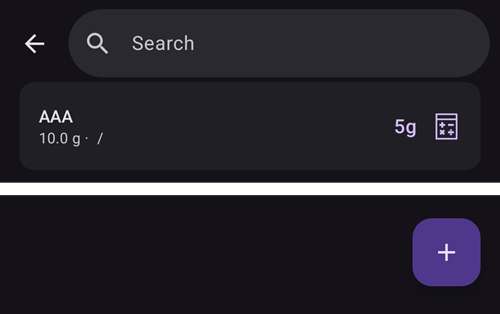

(food)=
# Lebensmittel (Deine Lebensmittel-Datenbank)

Die **Lebensmittel**-Datenbank ist Deine persönliche Liste gespeicherter Lebensmittel. Jeder Eintrag speichert die **Kohlenhydrate** eines Lebensmittels (und auf Wunsch Fett, Eiweiß, Energie und eine Kategorie), sodass Du das, was Du oft isst, an einem Ort sammeln und einen Bolus mit einem gespeicherten Lebensmittel starten kannst, bei dem die Kohlenhydrate schon eingetragen sind.

```{contents} Table of contents
:depth: 2
:local: true
```

---

## Die Lebensmittel-Datenbank öffnen

Öffne den Bildschirm **Verwalten** (untere Navigationsleiste) und wähle **Lebensmittel** (*„Einträge in der Lebensmittel-Datenbank verwalten“*). In **AAPS** v4 ist Lebensmittel **kein Modul mehr** – es muss nichts eingeschaltet werden; es ist ein eigener Bildschirm, den Du über das [Fenster Verwalten](#v4changes-manage) erreichst.

---

## Die Liste der Lebensmittel

Deine Lebensmittel werden als Liste zum Scrollen angezeigt. Jede Zeile zeigt den **Namen** des Lebensmittels, seine **Portion / Einheit / Kategorie** und seine **Kohlenhydrate**:



- **🔍 Suchen** (oben) – filtert die Liste nach dem **Namen** (Groß- und Kleinschreibung spielt keine Rolle).
- **Kategorie-Filter** – mit Auswahlfeldern kannst Du die Liste auf eine **Kategorie** eingrenzen; ist eine Kategorie gewählt, erscheinen Auswahlfelder für ihre **Unterkategorien**. (Tippe erneut auf ein ausgewähltes Feld, um die Auswahl aufzuheben.)
- **➕** (unten rechts) – ein neues Lebensmittel hinzufügen (siehe unten).
- Tippe auf eine Zeile, um dieses Lebensmittel zu **bearbeiten**.

Hat die Liste (oder der aktuelle Filter) keine Einträge, zeigt der Bildschirm **Keine Daten**.

---

## Ein Lebensmittel hinzufügen und bearbeiten

Tippe auf **➕**, um eines hinzuzufügen, oder auf eine vorhandene Zeile, um es zu bearbeiten. Ein Editor öffnet sich als Fenster, das von unten hochklappt (**Lebensmittel hinzufügen** / **Lebensmittel bearbeiten**):


Die Felder sind:

- **Name** – Pflichtfeld (ohne Namen kannst Du nicht speichern).
- **Kategorie** und **Unterkategorie** – optional, zum Gruppieren und Filtern der Lebensmittel.
- **Portion** und **Einheit** – die übliche Portionsgröße; **Einheit** ist standardmäßig **g**.
- **Kohlenhydrate (g)** – die Kohlenhydratmenge des Lebensmittels.
- **Fett (g)**, **Proteine (g)**, **Energie (kJ)** – optionale Nährwerte.

Tippe auf **Speichern**, um es zu speichern, oder auf **Abbrechen**, um es zu verwerfen. Beim Bearbeiten eines vorhandenen Lebensmittels hat der Editor außerdem einen Knopf **Löschen**.

```{admonition} Deleting is undoable
:class: note
Beim Löschen eines Lebensmittels erscheint die Meldung **„Lebensmittel gelöscht“** mit der Aktion **Rückgängig machen**, sodass sich ein versehentliches Löschen leicht zurücknehmen lässt.
```

---

## Ein Lebensmittel für einen Bolus verwenden

Jede Zeile hat einen Knopf **Rechner**. Ein Tippen darauf öffnet den **Bolus-Rechner** mit den **Kohlenhydraten** des Lebensmittels schon eingetragen und seinem **Namen** als Notiz der Behandlung – so bestätigst Du und gibst ab, ohne die Kohlenhydrate erneut einzutippen.

```{admonition} The carbs value is used as-is
:class: note
Die gespeicherte Zahl der **Kohlenhydrate** wird direkt an den Rechner übergeben – **AAPS** multipliziert sie nicht mit der Portion oder mit der Menge, die Du gegessen hast. Isst Du eine andere Menge, passe die Kohlenhydrate im Rechner an, bevor Du bestätigst. (Es gibt *im* Bolus-Rechner oder im Kohlenhydrat-Dialog keine Auswahl von Lebensmitteln; Du startest hier über die Zeile des Lebensmittels.)
```

---

## Woher die Lebensmittel kommen (Synchronisierung mit Nightscout)

Die Lebensmittel-Datenbank wird über **Nightscout** geteilt, aber **nur in eine Richtung**:

- **Herunterladen:** **AAPS** **liest** die Lebensmittel aus der **Lebensmittel-Datenbank** Deiner Nightscout-Seite und hält die lokale Liste damit abgeglichen. Das läuft im Rahmen der Synchronisierung von NSClient, sodass auch ein gekoppelter **Client/Follower** dieselben Lebensmittel bekommt.
- **Hochladen:** **AAPS** überträgt **keine** Lebensmittel **zu** Nightscout – NSClient unterstützt das Hochladen von Lebensmitteln nicht. Lebensmittel, die Du **in AAPS** anlegst oder bearbeitest, bleiben deshalb **auf diesem Gerät** und werden nicht an Nightscout oder Deine anderen Geräte weitergegeben.

```{admonition} Maintain your shared list in Nightscout
:class: important
Weil Lebensmittel **nur heruntergeladen** werden, teilst Du eine Liste zwischen Deinem Smartphone, Deinem Follower/[Client](../RemoteFeatures/ClientMasterControl.md) und dem Rest Deiner Geräte, indem Du sie in **Nightscout** pflegst (mit dessen eingebautem Lebensmittel-Editor). **AAPS** holt sich diese Einträge dann. Ein Lebensmittel, das nur in **AAPS** angelegt wurde, gibt es nur auf diesem Gerät – und es bleibt dort: Beim Herunterladen werden Nightscout-Einträge über ihre Nightscout-ID zugeordnet, also hinzugefügt und aktualisiert, aber ein lokal angelegtes Lebensmittel wird nie überschrieben oder entfernt (ein Lebensmittel wird nur entfernt, wenn seine Kopie in Nightscout gelöscht wird).

Die Lebensmittel-Datenbank gehört auch **nicht** zum signierten Steuerkanal zwischen Master und Client – sie wird ausschließlich als Nightscout-Daten übertragen.
```

---

## Nicht auf der Smartwatch

Die Lebensmittel-Datenbank ist eine Funktion des **Smartphones** – auf einer **Wear OS-Smartwatch** gibt es keine Liste, keine Kachel und kein Menü für Lebensmittel.

---


<!-- =====================================================================
     Screenshots captured from a real master device:
       - food_list.png    (Manage → Food: list row, search, add button)
       - food_editor.png  ("Add Food" editor: name/category/subcategory/portion/unit/carbs/fat/protein/energy)
     No food was created or deleted (the editor was cancelled).
     Sync facts code-verified: download via LoadFoodsWorker.getFoods(); upload disabled
     (DataSyncSelectorV3 processChangedFoods() commented out — "NSCv3 doesn't support food update").
     Maintainers: relocate page + images and fix cross-links as needed.
     ===================================================================== -->
