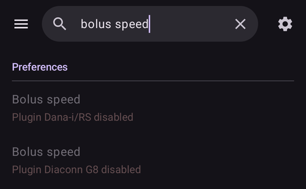

(global-search)=
# Globale Suche

**AAPS** v4 hat oben auf dem Startbildschirm ein Feld für die **globale Suche**. Gib ein Wort ein, und es durchsucht die ganze App auf einmal – Module, Dialoge, Einstellungsbildschirme, einzelne Einstellungen – und, wenn Du online bist, auch die **AndroidAPS-Dokumentation**. Das ist der schnellste Weg zu einer Einstellung oder einem Bildschirm, ohne dass Du Dir merken musst, wo sie liegen.

```{contents} Table of contents
:depth: 2
:local: true
```

---

## Die Suche öffnen

Tippe oben in der **Übersicht** (neben dem Menü ☰) auf das Feld **🔍 Suchen**. Fang an zu tippen, und die Ergebnisse erscheinen schon während der Eingabe (nach einer kurzen Pause), nach Kategorien gruppiert:


Leere das Feld mit dem **✕** oder schließe die Suche mit der **Zurück**-Taste des Geräts.

---

## Auf Englisch *oder* in Deiner eigenen Sprache suchen

Das solltest Du wissen: Die Suche vergleicht **sowohl** mit dem Text in Deiner **gewählten Sprache** **als auch** mit dem ursprünglichen **englischen** Text.

- Ist Deine App zum Beispiel auf Deutsch oder Tschechisch eingestellt, kannst Du das **übersetzte** Wort **oder** das **englische** Wort eingeben – beides findet die Einstellung.
- Ein Treffer im **übersetzten** Titel steht ganz oben, dann folgen der **englische** Titel und danach die übersetzten und englischen **Beschreibungen**.
- Akzente und diakritische Zeichen werden beim Vergleich **ignoriert** (*ů* findet also *u*, *é* findet *e*), und Groß- und Kleinschreibung **spielt keine Rolle**.

So führt Dich eine englische Anleitung oder ein englischer Forenbeitrag trotzdem zur richtigen Einstellung, auch wenn Dein Smartphone alles übersetzt anzeigt.

---

## Was die Suche abdeckt

Die Ergebnisse sind in diese Kategorien gruppiert:

- **Module** – jedes Modul, das in Deinem Build sichtbar ist (dieselben, die unter [Konfiguration](../SettingUpAaps/ConfigBuilder.md) aufgeführt sind). Jede Modul-Zeile hat ihren **Schalter zum Einschalten**, sodass Du ein Modul direkt aus den Ergebnissen ein- oder ausschalten kannst – ein Tippen auf die Zeile eines ausgeschalteten (schaltbaren) Moduls schaltet es ein.
- **Dialoge** – die Bildschirme für Behandlungen, Aktionen und Verwaltung (Bolus-Rechner, Insulin, Verzögerter Bolus, Kalibrierung, Temporäres Ziel, Profil …). Bildschirme, die für Deinen Build nicht gelten, werden weggelassen (zum Beispiel *Mit Master koppeln* auf einem Master oder *Autorisierte Clients* auf einem Client).
- **Einstellungskategorien** – die Einstellungs**bildschirme** und Unterbildschirme, sowohl die eingebauten (Allgemeines, Darstellung, Zugriffsschutz, Alarme, Wartung …) als auch die der Module, dazu die kleinen Einstellungsgruppen, die Du aus Dialogen erreichst (Knöpfe zum Füllen, Schrittweiten der Knöpfe Insulin/Kohlenhydrate, Schwellenwerte der Statusanzeige, Einstellungen des Bolus-Rechners …).
- **Einstellungen** – jede **einzelne Einstellung**, die einen Titel hat. Sie werden nach Deinem Build bzw. Modus gefiltert, sodass Du nur Einstellungen siehst, die wirklich gelten (APS / NSClient / Pumpensteuerung).
- **Dokumentation** – Seiten aus der Online-**AndroidAPS-Dokumentation** (siehe unten).

```{admonition} Settings that belong to a disabled plugin
:class: note
Eine Einstellung, deren Modul gerade **ausgeschaltet** ist, wird trotzdem angezeigt – **ausgegraut** und nicht antippbar – mit dem Hinweis *„Plugin … deaktiviert“*, damit Du siehst, dass es die Einstellung gibt und welches Modul Du einschalten musst, um sie zu erreichen.


```

---

## Ergebnisse aus der Dokumentation (online)

Während die lokale Suche läuft, fragt **AAPS** parallel auch die offizielle **AndroidAPS-Dokumentation** (auf ReadTheDocs) ab. Passende Seiten erscheinen unten in der Gruppe **Dokumentation**, jeweils mit einem 📖-Symbol, dem Titel des Abschnitts und einem kurzen Auszug:


- Ist die Dokumentation in die Sprache Deiner App übersetzt, durchsucht **AAPS** gleichzeitig die übersetzten und die englischen Seiten. Seiten in Deiner Sprache kommen zuerst, dann die englischen Seiten, die nicht schon gefunden wurden.
- Ein Tippen auf ein Ergebnis aus der Dokumentation öffnet die Seite in Deinem **Browser**.
- Die Suche in der Dokumentation braucht **Internet** – bist Du offline, erscheint stattdessen der Hinweis *„Für die Suche in der Dokumentation ist eine Internetverbindung erforderlich“*, und die lokalen Ergebnisse (in der App) funktionieren ganz normal.

---

## Ein Ergebnis öffnen

Tippe auf ein Ergebnis, um direkt dorthin zu gelangen:

- **Modul** → öffnet dieses Modul.
- **Dialog** → öffnet diesen Bildschirm bzw. Dialog.
- **Einstellungskategorie** → öffnet diesen Einstellungsbildschirm.
- **Einstellung** → öffnet die Einstellung **an ihrer Stelle** (springt in ihrem Bildschirm direkt zu ihr).
- **Dokumentation** → öffnet die Seite in Deinem Browser.

Beim Öffnen von Einstellungen und geschützten Aktionen gilt weiterhin Dein **[Zugriffsschutz](#Preferences-protection)** (PIN/Passwort), genau so, als wärst Du von Hand dorthin gegangen. Nachdem Du ein Ergebnis verwendet hast, kommst Du mit **Zurück** wieder zu Deinen Suchergebnissen.

---

## Abkürzungen für Fortgeschrittene

Zwei besondere Suchbegriffe listen eine ganze Kategorie auf einmal auf:

- `%PLUGINS%` – listet **alle** Module auf.
- `%DIALOGS%` – listet **alle** Dialoge bzw. Aktionsbildschirme auf.

---

```{admonition} The index stays current
:class: note
Der Suchindex wird beim ersten Suchen aufgebaut und danach bereitgehalten. Er wird automatisch neu aufgebaut, wenn Du **ein Modul ein- oder ausschaltest** oder **die Sprache der App änderst**, sodass die Ergebnisse immer Deinem aktuellen Stand entsprechen.
```

---


<!-- =====================================================================
     Screenshots captured from a real master device (query "bolus"):
       - search_results.png        (categorized local results: Dialogs / Preference categories / Preferences)
       - search_disabled_plugin.png (greyed-out preference from a disabled plugin)
       - search_documentation.png   (online ReadTheDocs results with 📖 icon + snippets)
     Maintainers: relocate page + images and fix cross-links as needed.
     ===================================================================== -->
