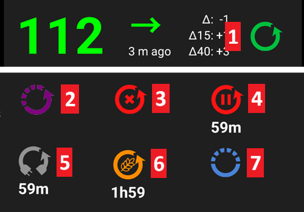
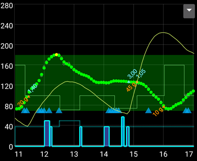

# Wichtigste AAPS-Funktionalitäten

## Loop-Modus

Der Loop-Status wird auf dem Hauptbildschirm mit einem der Symbole unten angezeigt.

**AAPS** bietet mehrere Loop-Modi, z. B. Closed Loop (1), Unterbrechung bei niedrigem BZ (LGS - 2) und Open Loop (3).

Informationen dazu, wie Du den Loop-Modus auswählst, und zu den übrigen Symbolen im Bild (4 bis 6) findest Du unter [AAPS-Bildschirme > Der Startbildschirm > Loop-Status](#AapsScreens-loop-status).

(KeyAapsFeatures-OpenLoop)=

### Open Loop

**AAPS** wertet kontinuierlich alle verfügbaren Daten (IOB, COB, BZ...) aus und erstellt, sofern notwendig, daraus Behandlungsvorschläge (temporäre Basalraten) zur Anpassung Deiner Therapie.

Die Vorschläge werden nicht, wie im Closed Loop, automatisch ausgeführt. Die Vorschläge müssen manuell in die Pumpe (falls eine virtuelle Pumpe verwendet wird) eingegeben oder über einen Tastendruck, wenn **AAPS** mit einer echten Pumpe verbunden ist, ausgeführt werden.

Wenn **AAPS** einen Vorschlag hat, erscheint in der unteren Navigationsleiste des Startbildschirms ein Eintrag **Loop** mit einer Markierung. Tippe darauf, um den Vorschlag („Neue temporäre Basalrate übernehmen“) mit Rate, Dauer und Begründung zu lesen, und tippe dann auf **Ausführen**, um ihn umzusetzen:

Ein Vorschlag gilt nur wenige Minuten. Ist er älter als etwa 9 Minuten oder wurde der Loop in der Zwischenzeit angehalten oder die Pumpe getrennt, lehnt **AAPS** ihn ab und es wird nichts an die Pumpe gesendet (*„Dieser Vorschlag ist zu alt. Es wurde nichts an die Pumpe geschickt. Warte auf den nächsten Vorschlag.“*). Warte auf den nächsten Vorschlag.

Diese Option ist zum Kennenlernen der **AAPS**-Funktionsweise gedacht. Die Option wird auch für nicht unterstützte Pumpen genutzt. Bis zum Ende des **[Ziel 5](#objectives-objective5)** wirst Du, unabhängig davon, welche Auswahl Du hier triffst, im Open Loop bleiben.

(KeyAapsFeatures-LGS)=

### Abschalten der Basalrate bei niedrigen Werten (Low Glucose Suspend - LGS)

In diesem Modus ist [maxIOB](#Open-APS-features-maximum-total-iob-openaps-cant-go-over) auf Null gesetzt.

Das bedeutet, dass bei fallenden Glukosewerten, **AAPS** das Basal für Dich reduzieren kann. Wenn aber die Glukosewerte steigen, wird keine automatische Korrektur vorgenommen. Die Basalrate wird genauso so bleiben, wie sie im aktuellen **Profil** hinterlegt ist. Nur wenn das IOB negativ ist (wegen einer vorangegangenen Abschaltung der Basalrate bei niedrigen Werten), wird, um den **Glukosewert** zu senken, zusätzliches Insulin abgegeben.

Dieser Modus wird mit dem Beginn des **[Ziel 6](#objectives-objective6)** auswählbar.

Du kannst diesen Modus nicht nur selbst auswählen, **AAPS** kann auch von sich aus in ihn wechseln: solange Du an **[Ziel 6](#objectives-objective6)** arbeitest und immer dann, wenn doppelte Glukosewerte erkannt werden (siehe [BZ-Warnzeichen](#aaps-screens-bg-warning-sign)).

(KeyAapsFeatures-ClosedLoop)=

### Closed Loop

**AAPS** wertet kontinierlich alle verfügbaren Daten (IOB, COB, BZ-Wert) aus und passt die Behandlung bei Bedarf automatisch (*d. h.* ohne weiteren Eingriff durch Dich) an, um den eingestellten [Zielbereich oder Zielwert](#profile-glucose-targets) zu erreichen (Bolusabgabe, temporäre Basalrate, Insulinabschaltung zur Hypovermeidung etc.).

Der Closed Loop arbeitet im Rahmen zahlreicher Sicherheitsgrenzen, die Du individuell einstellen kannst.

Der Closed Loop steht ab dem **[Ziel 7](#objectives-objective7)** (oder darüber) zur Verfügung und setzt eine kompatible Pumpe voraus.

(autosens)= (Open-APS-features-autosens)=

## Autosens

- Autosens ist ein Algorithmus, der Glukosewert-Abweichungen (positiv/negativ/neutral) untersucht.
- Er versucht herauszufinden, wie empfindlich/resistent Du aufgrund dieser Abweichungen bist.
- Die oref-Implementierung in **OpenAPS** läuft mit einer Kombination von Daten aus 24 und 8 Stunden. Es wird das "empfindlichere" Ergebnis der beiden Berechnungen verwendet.
- Wenn Du bisher oref1 genutzt hast, wirst Du wahrscheinlich bemerken, dass das System weniger dynamisch auf Veränderungen reagiert, da zwischen 8 und 24 Stunden gewechselt wird.
- Der Wechsel der Kanüle oder ein Profilwechsel setzen Autosens auf 100% zurück. Ausnahme ist ein prozentualer Profilwechsel mit festgelegter Dauer. Bei diesem wird Autosens nicht zurückgesetzt.
- Autosens passt Deine Basalrate und den ISF an (d.h. Nachahmen der Effekte einer Profilverschiebung).
- Wenn Du über einen längeren Zeitraum kontinuierlich Kohlenhydrate zu Dir nimmst, ist Autosens während dieses Zeitraums weniger effektiv, da Kohlenhydrate aus den Berechnungen der **Glukosewert**-Abweichungen ausgenommen werden.
- Die Abweichungen werden in ein **Empfindlichkeitsverhältnis** (einen Prozentwert) umgerechnet: Ein Verhältnis unter 100 % bedeutet, dass AAPS Dich für insulinempfindlicher hält, als Dein **Profil** annimmt (es senkt also die wirksame Basalrate und erhöht den ISF-Wert). Ein Verhältnis über 100 % bedeutet, dass Du resistenter bist (es erhöht also die Basalrate und senkt den ISF-Wert).
- Standardmäßig wird dieses Verhältnis zwischen 0,7 (70 %, empfindlicher) und 1,2 (120 %, resistenter) gehalten, damit ungewöhnliche Daten Deine Dosierung nicht zu weit von Deinem **Profil** wegschieben können. Diese Grenzen kannst Du in den erweiterten Einstellungen der Erkennung der Insulinempfindlichkeit anpassen.
- Autosens und [Autotune](../AdvancedOptions/Autotune.md) gehen dasselbe Grundproblem auf unterschiedlichen Zeitskalen an: Autosens passt Deine *laufende* Dosierung von Minute zu Minute anhand der letzten 8 bis 24 Stunden an, während Autotune Dein *Profil* selbst anhand von Wochen an Daten langsam neu berechnet. Beides gleichzeitig zu nutzen ist normal und so vorgesehen: Die beiden ergänzen sich, statt dasselbe doppelt zu tun.

*Die vollständige technische Beschreibung des Autosens-Algorithmus findest Du in der [Autosens-Dokumentation von OpenAPS](https://openaps.readthedocs.io/en/latest/docs/Customize-Iterate/autosens.html).*

(Open-APS-features-super-micro-bolus-smb)=

## Super Micro Bolus (SMB)

**SMB**, die Kurzform von **Super Micro Bolus**, ist eine OpenAPS-Funktion, die ab 2018 innerhalb des Oref1-Algorithmus eingeführt wurde. Im Gegensatz zu **AMA** verwendet **SMB** keine temporären Basalraten, um den Glukosespiegel zu steuern, sondern hauptsächlich kleine **Supermicroboli**. In Situationen, in denen AMA 1.0 IE Insulin über eine temporäre Basalrate zugeben würde, gibt **SMB** im **5-Minutentakt** mehrere Supermicroboli in kleinen Schritten ab, z.B. 0.4 IE, 0.3 IE, 0.2 IE und 0.1 IE. Gleichzeitig wird die laufende Basalrate aus Sicherheitsgründen für eine bestimmte Dauer auf 0 IE/h gesetzt, damit keine Überdosierung erfolgt (**“zero-temping”**). So kann das System den Glukosewert schneller abfangen als mit der temporären Basalratenerhöhung bei **AMA**.

Für Mahlzeiten mit ausschließlich langsamen Kohlenhydraten kann es - Dank der SMB - ausreichen, dem System die voraussichtliche KH-Menge anzukündigen und den Rest **AAPS** zu überlassen. Dies führt aber womöglich zu höheren postprandialen Spitzen, weil kein Spritz-Ess-Abstand (SEA) eingehalten werden kann. Oder Du gibst, ggf. mit SEA, einen **Anfangsbolus**, der **nur zum Teil** die Kohlenhydrate abdeckt (z.B. 2/3 der geschätzten Menge) ab und lässt den Rest vom **SMB** auffüllen.

SMBs werden im [IOB-Diagramm](#aaps-screens-iob) als blaue Dreiecke angezeigt. [Halte das Diagramm](#aaps-screens-graph-press-and-hold) auf einem Dreieck gedrückt, um zu sehen, wie viel Insulin abgegeben wurde, oder nutze den [Behandlungsverlauf](#aaps-screens-treatments).

Die **SMB**-Funktionalität hat einige Sicherheitsmechanismen:

1. **Größte SMB-Dosis**  
  Die größte einzelne SMB-Dosis kann nur der kleinste Wert sein:
  
        * Wert, der der aktuellen (durch Autosens angepassten) Basalrate für die in „SMB Basal-Limit in Minuten“ eingestellte Dauer entspricht, z. B. die Basalmenge für die nächsten 30 Minuten, oder
        * die Hälfte der aktuell benötigten Insulinmenge, oder
        * der verbleibende Anteil Deines maxIOB-Werts in den Einstellungen.
      

2. **Niedrige temporäre Basalraten**  
  Niedrige temporäre Basalraten (sog. „Low Temps“) oder temporäre Basalraten mit 0 IEU/h (sog. „Zero-Temps“) werden in **SMB** häufiger aktiviert. Dies ist aus Sicherheitsgründen so gewollt und hat bei einem korrekt eingestellten **Profil** auch keine negativen Auswirkungen. In der Hauptgrafik ist die IOB-Kurve (gelbe dünne Linie) aussagekräftiger als der Verlauf der temporären Basalraten.

3. **Unangekündigte Mahlzeiten**  
  Zusätzliche Berechnungen zur Vorhersage des Glukoseverlaufs, z. B. durch **UAM** (unangekündigte Mahlzeiten). **UAM** kann auch ohne manuelle Kohlenhydrat-Eingaben des Nutzers automatisch erkennen, dass die Glukosewerte durch Mahlzeiten, Adrenalin oder anderen Einflüsse signifikant steigen und wird versuchen, dies mit **SMB** abzufangen. Dies funktioniert aber zur Sicherheit auch andersherum und kann bei unvorhergesehen schnellem Glukoseabfall den SMB früher stoppen. Deshalb sollte UAM bei SMB auch immer aktiv sein.

SMB entscheidet nicht selbst, dass Insulin benötigt wird: Es stützt sich auf dieselben zusammengeführten Glukoseprognosen (eventual BG, zero-temp, COB, UAM), die unter [Wie AAPS aus Prognosen eine Dosierungsentscheidung macht](#aaps-screens-how-predictions-become-a-dosing-decision) beschrieben sind. SMB und Zero-Temping sind einfach die beiden Werkzeuge, mit denen AAPS diese Entscheidung umsetzt.

**Du musst [Ziel 9](#objectives-objective9) gestartet haben, um SMBs nutzen zu können.**

Siehe auch die [oref1/SMB-Dokumentation von OpenAPS](https://openaps.readthedocs.io/en/latest/docs/Customize-Iterate/oref1.html#understanding-super-micro-bolus-smb) für die vollständige technische Beschreibung oder [Tims Informationen zu SMB](https://www.diabettech.com/artificial-pancreas/understanding-smb-and-oref1/) für eine Darstellung aus der Community.

Die Einstellungen des OpenAPS SMB ist im Folgenden beschrieben.

(Open-APS-features-max-u-h-a-temp-basal-can-be-set-to)=

### Maximale Basalrate

Diese Sicherheitseinstellung legt fest, welche maximale temporäre Basalrate die Insulinpumpe abgeben darf. Es wird auch als **max-basal** bezeichnet.

Der Wert wird in IE pro Stunde angegeben (IE/h). Es wird empfohlen, hier etwas vernünftiges einzugeben. Ein empfohlener Wert für diesen Parameter ist:

**MAX-BASAL = Höchste Basalrate x 4**

Wenn zum Beispiel die höchste Basalrate in deinem Profil 0.5I E/h war, kannst du das mit 4 multiplizieren, um einen Wert von 2 IE/h zu erhalten.

**AAPS** begrenzt diesen Wert als „harte Grenze“ abhängig von [Einstellungen > Sicherheit > Patientenalter](#preferences-patient-type). Die harten Grenzen sind folgende:

- Kind: 2
- Jugendlicher: 5
- Erwachsener: 10
- Insulinresistenter Erwachsener: 12
- Schwangere: 25

*Siehe auch [Übersicht der fest programmierten Limits](#Open-APS-features-overview-of-hard-coded-limits).*

(Open-APS-features-maximum-total-iob-openaps-cant-go-over)=

### Max. IOB für SMB

Dieser Wert bestimmt das maximale **Insulin an Bord** (Basal- und Bolus-IOB; sog. aktives Insulin)), das **AAPS** im Closed Loop Modus nicht überschreitet. Es wird auch als **maxIOB** bezeichnet.

Liegt das aktuelle IOB (z. B nach einem Mahlzeit-Bolus) über dem festgelegten Wert, dann wird die Insulinabgabe durch den Loop unterbunden, bis die IOB-Grenze wieder unterschritten ist.

Ein guter Anfangswert für diesen Parameter ist:

      maxIOB = mittlerer Mahlzeitenbolus + 3x höchste tägliche Basalrate
    

Sei bei der Anpassung des **max-IOB** vorsichtig. Das ist sehr individuell und hängt stark vom durchschnittlichen Gesamtinsulinbedarf ab (total daily dose = TDD).

**AAPS** begrenzt diesen Wert als „harte Grenze“ abhängig von [Einstellungen > Sicherheit > Patientenalter](#preferences-patient-type). Die harten Grenzen sind folgende:

- Kind: 7
- Jugendlicher: 13
- Erwachsener: 22
- Insulinresistenter Erwachsener: 30
- Schwangere: 70

*Siehe auch [Übersicht der fest programmierten Limits](#Open-APS-features-overview-of-hard-coded-limits).*

Hinweis: Bei der Verwendung von **SMB** wird **max-IOB** anders berechnet als in AMA. In **AMA** ist maxIOB ein Sicherheitsparameter für das Basal-**IOB**, während im SMB-Modus auch Bolus-IOB enthalten ist.

### Dynamische Empfindlichkeit verwenden

Dies ist die Funktion [Dynamischer ISF](../DailyLifeWithAaps/DynamicISF.md). Mit der Aktivierung werden neue Einstellungsoptionen verfügbar. Die Einstellungen werden auf der Seite zum [Dynamischen ISF](#dyn-isf-preferences) beschrieben.

### Autosens verwenden

Das ist die [Autosens](#Open-APS-features-autosens)-Funktion. Mit DynamicISF kann Autosens nicht genutzt werden, da beides unterschiedliche Algorithmen sind, die dieselbe Größe (die Empfindlichkeit) verändern.

Autosens analysiert Deine Glukosewert-Abweichungen (positiv/negativ/neutral). Dabei wird anhand dieser Abweichungen ermittelt, wie empfindlich / resistent Du auf Insulin reagierst und Deine Basalrate und der ISF entsprechend angepasst.

Mit der Aktivierung werden neue Einstellungsoptionen verfügbar.

#### Empfindlichkeit erhöht den Zielwert

Wenn diese Option aktiviert ist, kann die Empfindlichkeitserkennung (Autosens) das Ziel erhöhen, wenn eine höhere (Insulin-)Empfindlichkeit erkannt wird (unter 100%). In diesem Fall wird Dein Ziel um den Prozentsatz der erkannten Empfindlichkeit erhöht.

Wird der Zielwert aufgrund der Erkennung der Insulinempfindlichkeit geändert, wird er auf Deinem Startbildschirm mit grünem Hintergrund angezeigt.

Diese Einstellung ist verfügbar, wenn „Dynamische Empfindlichkeit verwenden“ oder „Autosens verwenden“ aktiviert ist.

#### Resistenz senkt den Zielwert

Wenn diese Option aktiviert ist, kann die Empfindlichkeitserkennung (Autosens) das Ziel absenken, wenn eine Insulinresistenz erkannt wird (über 100%). In diesem Fall wird Dein Ziel um den Prozentsatz der erkannten Resistenz reduziert.

Diese Einstellung ist verfügbar, wenn „Dynamische Empfindlichkeit verwenden“ oder „Autosens verwenden“ aktiviert ist.

### Aktiviere SMB

Aktiviere diese Option, um die SMB-Funktionalität zu nutzen. Ist sie deaktiviert, werden keine **SMBs** abgegeben.

Mit der Aktivierung werden neue Einstellungsoptionen verfügbar.

(Open-APS-features-enable-smb-with-high-temp-targets)=

#### SMB mit hohen temporären Zielen aktivieren

Ist diese Einstellung aktiviert, werden **SMBs** auch dann abgegeben, wenn ein hohes **temporäres Ziel** gesetzt ist (definiert als 100 mg/dl bzw. 5,6 mmol/l und höher, unabhängig vom Zielwert im **Profil**). Sei vorsichtig beim Aktivieren: **SMBs** können zu aggressiv werden, wenn Deine Einstellungen nicht gut abgestimmt sind oder Dein **Profil** häufig schwankt (zum Beispiel bei Kindern).

Ist diese Einstellung deaktiviert, schaltet ein hohes **temporäres Ziel** die **SMBs** aus. Ist diese Option zum Beispiel deaktiviert, kannst Du **SMBs** abschalten, indem Du ein **temporäres Ziel** von 100 mg/dl bzw. 5,6 mmol/l oder höher setzt. Diese Option deaktiviert **SMBs** auch dann, wenn eine andere Bedingung SMB aktivieren würde. Ausnahme ist ein niedriges **temporäres Ziel** wie **Bald essen** (oder jedes **temporäre Ziel** von 98 mg/dl bzw. 5,4 mmol/l und darunter), bei dem weiterhin **SMBs** abgegeben werden können, um den **Glukosewert** zum Zielwert zu bringen.

Diese Einstellung schaltet **SMB** nicht von sich aus ein. Bei einem hohen temporären Ziel wird **SMB** nur abgegeben, wenn auch eine der anderen Einstellungen unten (zum Beispiel **SMB immer aktivieren** oder **Aktiviere SMB während aktiver Kohlenhydrate.**) es erlaubt.

(Open-APS-features-enable-smb-always)=

#### SMB immer aktivieren

Ist diese Einstellung aktiviert, ist SMB immer aktiv (unabhängig von COB, temporären Zielen oder Boli). Wenn diese Einstellung aktiviert ist, sind die übrigen Bedingungen ohne Einfluss und werden nicht berücksichtigt. Wenn jedoch **Aktiviere SMB bei hohem temporären Ziel** ausgeschaltet ist und ein hohes temporäres Ziel aktiv ist, werden SMBs nicht abgegeben.

Diese Einstellung ist nur dann verfügbar, wenn **AAPS** erkennt, dass Du eine [zuverlässige BZ-Quelle](#GettingStarted-TrustedBGSource) mit erweiterter Filterung verwendest. Der FreeStyle Libre 1 wird nicht als zuverlässige Quelle eingestuft, da bei einem Sensorausfall die Gefahr besteht, dass der letzte (und über die Zeit damit falsche) Glukosewert unendlich oft gesendet wird.

Verrauschte (d. h. springende) Werte könnten **AAPS** annehmen lassen, dass der Glukosespiegel wirklich schnell steigt und mit unnötigen SMBs ausgeglichen wird. Weitere Informationen über verrauschte Werte und deren Glättung findest Du [hier](../CompatibleCgms/SmoothingBloodGlucoseData.md).

#### Aktiviere SMB während aktiver Kohlenhydrate.

Wenn diese Einstellung aktiviert ist, werden SMB aktiviert, wenn der COB größer als 0 (z. B. nach Mahlzeiten) ist.

Wenn „SMB immer aktivieren“ eingeschaltet ist, ist diese Einstellung nicht verfügbar.

#### SMB mit niedrigen temporären Zielen aktivieren

Ist diese Einstellung aktiviert, ist SMB aktiv, wenn ein temporäres Ziel gesetzt ist (Bald essen, Aktivität, Hypo, benutzerdefiniert). Ist diese Einstellung aktiviert, **SMB bei hohen temporären Zielen aktivieren** aber deaktiviert, ist SMB bei einem niedrigen temporären Ziel (98 mg/dl bzw. 5,4 mmol/l und darunter) aktiv, bei einem hohen temporären Ziel aber nicht.

Wenn „SMB immer aktivieren“ eingeschaltet ist, ist diese Einstellung nicht verfügbar.

#### Aktiviere SMB nach Mahlzeiten.

Bei eingeschalter Option, sind SMBs für einen Zeitraum von 6h ab dem Zeitpunkt für den KH angekündigt sind aktiv, auch wenn COB mittlerweile 0 ist (keine aktiven KH mehr vorhanden sind).

Aus Sicherheitsgründen ist diese Einstellung nur dann verfügbar, wenn **AAPS** erkennt, dass Du eine zuverlässige BZ-Quelle verwendest. Es wird nicht angezeigt, wenn „SMB immer aktivieren“ eingeschaltet ist.

Diese Einstellung ist nur dann verfügbar, wenn **AAPS** erkennt, dass Du eine [zuverlässige BZ-Quelle](#GettingStarted-TrustedBGSource) mit erweiterter Filterung verwendest. Der FreeStyle Libre 1 wird nicht als zuverlässige Quelle eingestuft, da bei einem Sensorausfall die Gefahr besteht, dass der letzte (und über die Zeit damit falsche) Glukosewert unendlich oft gesendet wird.

Verrauschte (d. h. springende) Werte könnten **AAPS** annehmen lassen, dass der Glukosespiegel wirklich schnell steigt und mit unnötigen SMBs ausgeglichen wird. Weitere Informationen über verrauschte Werte und Datenglättung findest Du [hier](../CompatibleCgms/SmoothingBloodGlucoseData.md).  
Diese Einstellung wird nicht angezeigt, wenn „SMB immer aktivieren“ eingeschaltet ist.

#### SMB-Intervall

Diese Funktion beschränkt die Häufigkeit der SMBs. Dieser Wert bestimmt die Zeit, die zwischen der Abgabe der einzelnen SMBs mindestens vergehen muss. Sobald ein neuer Glukosewert empfangen wird (in der Regel alle 5 Minuten), läuft der Loop und führt die entsprechenden Berechnungen durch. Ziehe 2 Minuten ab, damit der Loop zusätzlich Zeit zum Abschließen hat. Wenn Du beispielsweise möchtest, dass mit jedem Loop-Lauf ein SMB abgegeben wird, dann setze diesen Wert auf 3 Minuten.

Standardwert: 3 Min.

(Open-APS-features-max-minutes-of-basal-to-limit-smb-to)=

#### SMB Basal-Limit in Minuten

Dies ist eine wichtige Sicherheitseinstellung. Dieser Wert legt fest, wie viel SMB in einer bestimmten Zeit auf der Basis der Menge an Basalinsulin abgegeben werden kann, wenn es von COBs abgedeckt wird.

Eine Erhöhung des Wertes macht den SMB aggressiver. Zu Beginn solltest Du mit einem Standardwert von 30 Minuten starten. Wenn Du mehr Erfahrung gesammelt hast, erhöhe den Wert in 15 Minuten-Schritten und schaue Dir die Effekte über mehrere Mahlzeiten hinweg genau an.

Ein Wert über 90 Minuten führt dazu, dass der Algorithmus mit einer temporären 0 IE/h-Basalrate (“zero-temp”) einen fallenden Glukosewert möglicherweise nicht mehr sicher abfangen kann. Daher wird davon abgeraten, einen Wert über 90 Minuten hinaus, zu setzen. Gerade in der Testphase neuer Einstellungen, solltest Du Alarme nutzen, um Dich vor einer Hypo frühzeitig zu warnen.

Standardwert: 30 Min.

#### UAM max Minuten Basalzeit, um SMB zu begrenzen

Mit dieser Einstellung kannst Du die Stärke von SMB während UAM anpassen, wenn keine Kohlenhydrate mehr aktiv sind.

Standardwert: derselbe wie **SMB Basal-Limit in Minuten**.

Diese Einstellung ist nur sichtbar, wenn „Aktiviere SMB“ und „Aktiviere UAM“ eingeschaltet sind.

(enable-uam)=

### Aktiviere UAM

Wenn Du diese Option aktivierst, dann kann der SMB unangekündigte Mahlzeiten erkennen. Das hilft, wenn Du vergessen haben solltest in **AAPS** KH einzugeben, Dich bei der KH-Menge verschätzt hast oder eine fett- und eiweißlastige Mahlzeit länger wirkt. UAM kann also auch ohne manuelle Kohlenhydrat-Eingaben automatisch erkennen, dass die Glukosewerte durch Mahlzeiten, Adrenalin oder anderen Einflüsse signifikant steigen und versuchen, dies mit SMB abzufangen. Dies funktioniert aber auch andersherum: wenn der Glukosewert schnell sinkt, wird der SMB früher gestoppt.

**Deshalb sollte UAM bei SMB auch immer aktiv sein.**

(key-aaps-features-minimal-carbs-required-for-suggestion)=

### Grenzwert für benötigte Kohlenhydrate

Minimale KH-Menge in Gramm, ab der ein Alarm zur Aufnahme von Kohlenhydraten ausgelöst werden soll. Der Algorithmus empfiehlt Dir, etwas zu essen, wenn er feststellt, dass zusätzliche Kohlenhydrate benötigt werden. In diesem Fall erhältst Du eine Benachrichtigung, die Du für 5, 15 oder 30 Minuten stummschalten kannst.

Auf Wunsch können die Kohlenhydrat-Vorschläge an Nightscout gesandt werden. In diesem Fall wird eine Ankündigung angezeigt und verteilt.

In jedem Fall werden die benötigten Kohlenhydrate im COB-Bereich auf Deinem Startbildschirm angezeigt.

### Erweiterte Einstellungen

Die vollständige Referenz aller Parameter (auch der hier nicht beschriebenen Einstellungen) findest Du in der [Dokumentation von OpenAPS zu Einstellungen und Sicherheitseinstellungen](https://openaps.readthedocs.io/en/latest/docs/While%20You%20Wait%20For%20Gear/preferences-and-safety-settings.html).

**Immer kurze durchschnittliche Delta verwenden** Wenn Du diese Funktion aktivierst, verwendet **AAPS** das kurze durchschnittliche Delta des Glukosewerts der letzten 15 Minuten, meist den Durchschnitt der letzten drei Werte. Das hilft **AAPS**, bei verrauschten Datenquellen wie xDrip und Libre ruhiger zu arbeiten.

**Sicherheitsmultiplikator des Basalhöchstwertes** Dies ist eine wichtige Sicherheitseinstellung. Der voreingestellte Wert (der nur in Ausnahmefällen geändert werden muss) ist 3. Das bedeutet, dass **AAPS** daran gehindert wird, eine temporäre Basalrate zu setzen, die das Dreifache der in der Pumpe und/oder dem Profil gesetzten höchsten stündlichen Basalrate übersteigt. Beispiel: Wenn die höchste stündliche Basalrate 1,0 IE/h ist und der Sicherheitsmultiplikator des Basalhöchstwertes auf 3 gesetzt ist, dann kann **AAPS** die temporäre Basalrate höchstens auf einen Wert von 3,0 IE setzen (= 3 x 1,0 IE/h).

Standardwert: 3 (sollte nur in Ausnahmefällen geändert werden und wenn Du weißt, was das bedeutet)

**Sicherheitsmultiplikator der aktuellen Basalrate** Dies ist eine weitere wichtige Sicherheitseinstellung. Der voreingestellte Wert (der nur in Ausnahmefällen geändert werden muss) ist 4. Das bedeutet, dass **AAPS** daran gehindert wird, eine temporäre Basalrate zu setzen, die das Vierfache der in der Pumpe und/oder dem Profil gesetzten höchsten stündlichen Basalrate übersteigt.

Standardwert: 4 (sollte nur in Ausnahmefällen geändert werden und wenn du weisst, was das bedeutet)

* * *

(Open-APS-features-auto-isf)=

## Auto ISF

**Auto ISF** ist ein **experimenteller** Algorithmus für fortgeschrittene Nutzer. Er baut auf OpenAPS SMB auf und ergänzt Regeln, die den Insulinempfindlichkeitsfaktor (ISF) je nach Glukoseverlauf stärker oder schwächer machen.

Es handelt sich um eine Entwicklungsfunktion: Sie lässt sich nur in einem [Dev-Build](../AdvancedOptions/DevBranch.md) mit aktiviertem **Entwickler-Modus** einschalten. In einem regulären Release-Build bleibt sie zwangsweise ausgeschaltet und wird daher unter **Konfiguration → APS** nicht angezeigt. Auch das Abschließen der [Ziele](../SettingUpAaps/CompletingTheObjectives.md) schaltet sie nicht frei.

Nach der Auswahl enthalten die **Einstellungen** die Einstellungen von OpenAPS SMB und zusätzlich eine Gruppe **AutoISF Einstellungen**:

- **AutoISF aktivieren**: schaltet die ISF-Anpassungen ein. Ohne diese Einstellung verhält sich der Algorithmus wie OpenAPS SMB.
- **AutoISF min** und **AutoISF max**: wie schwach bzw. wie stark der ISF werden darf, genauso wie bei den Autosens-Grenzen. Mit dem Standardwert 1,0 ist die Wirkung ausgeschaltet.
- **Gewichtungen**: Jede steuert eine Regel, der Standardwert 0,0 schaltet die Regel aus. 
  - wenn der Glukosewert **schneller steigt**, wird der ISF verstärkt (mehr Insulin);
  - wenn der Glukoseanstieg **sich verlangsamt**, wird der ISF abgeschwächt (weniger Insulin);
  - wenn der Glukosewert **unter dem Zielwert** liegt, wird der ISF abgeschwächt;
  - wenn der Glukosewert **über dem Zielwert** liegt, wird der ISF verstärkt;
  - eine Gewichtung **nach dem Essen** und eine Gewichtung für die **Dauer** wirken nach Mahlzeiten und wenn der Glukosewert lange hoch bleibt.
- **SMB Abgabeverhältnis** (mit Minimum, Maximum und BZ-Bereich): welcher Anteil des benötigten Insulins als SMB abgegeben werden darf.
- **SMB max. Bereichserweiterung**: um welchen Faktor die übliche SMB-Größengrenze ([SMB Basal-Limit in Minuten](#Open-APS-features-max-minutes-of-basal-to-limit-smb-to), standardmäßig 30 Minuten) überschritten werden darf. Der Standardwert 1 ändert nichts, möglich sind Werte bis 5. Erhöhe diesen experimentellen Wert langsam und mit Vorsicht.
- **IOB-Schwellenwert Prozent**: der Prozentsatz des maximalen IOB, oberhalb dessen SMBs deaktiviert werden.

    {admonition} Nur für erfahrene Nutzer
    :class: danger
    Mit seinen Standardwerten ändert Auto ISF nichts. Jeder Wert, den Du erhöhst, macht **AAPS** aggressiver. Ändere immer nur einen Wert, in kleinen Schritten, und beobachte das Ergebnis über mehrere Tage. Sei äußerst vorsichtig mit einem **AutoISF max** über 2,5.

(Open-APS-features-advanced-meal-assist-ama)=

## Erweiterter Mahlzeit-Assistent (AMA)

AMA steht für „advanced meal assist“ und ist eine OpenAPS-Funktion aus 2017 (Oref0). Nachdem du dir einen Bolus gegeben hast, darf AMA schneller eine höhere temporäre Basalrate wählen, vorausgesetzt du gibst die Kohlenhydrate verlässlich ein.

Siehe auch: [OpenAPS-Dokumentation (englisch)](https://newer-docs.readthedocs.io/en/latest/docs/walkthrough/phase-4/advanced-features.html#advanced-meal-assist-or-ama).

### Maximale Basalrate (OpenAPS „max-basal“)

Diese Sicherheitseinstellung hindert **AAPS** daran, jemals eine gefährlich hohe Basalrate zu setzen und begrenzt die temporäre Basalrate auf x IE/h. Es wird empfohlen, hier etwas vernünftiges einzugeben. Eine gute Empfehlung ist, den höchsten stündlichen Basalratenwert in Deinem Profil zu verwenden und diesen mit 4 oder mindestens mit 3 zu multiplizieren. Beispiel: wenn der höchste stündliche Basalratenwert in deinem Profil 1.0 IE/h ist, kannst du diesen mit 4 multiplizieren, wodurch du einen Wert von 4 IE/h erhältst, so dass du "4" als Sicherheitseinstellung setzen kannst.

Du kannst aber keinen beliebigen Wert wählen: AAPS begrenzt als „hartes Limit“ den Wert in Abhängigkeit vom Patientenalter in den Einstellungen. Das „hard limit“ für maxIOB ist bei AMA niedriger als bei SMB. Bei Kindern ist der zulässige Wert am niedrigsten, bei insulinresistenten Erwachsenen am höchsten.

Die in **AAPS** fest hinterlegten Parameter sind:

- Kind: 2
- Jugendlicher: 5
- Erwachsener: 10
- Insulinresistenter Erwachsener: 12
- Schwangere: 25

*Siehe auch [Übersicht der fest programmierten Limits](#Open-APS-features-overview-of-hard-coded-limits).*

### Max. IOB für AMA

Dieser Parameter begrenzt das maximale Basal-IOB, bis zu dem **AAPS** noch arbeitet. Wenn dieses IOB höher ist, dann wird kein weiteres Basalinsulin mehr abgegeben, bis das Basal-IOB wieder unter dem Grenzwert liegt.

Der Standardwert ist 2. Du solltest diesen Parameter aber langsam erhöhen, um zu sehen, wie stark er sich bei Dir auswirkt und welcher Wert am besten passt. Das ist bei jedem anders und hängt auch von der durchschnittlichen Tagesgesamtdosis (TDD) ab. Zur Sicherheit gibt es ein Limit, das auf dem Patientenalter basiert. Das „hard limit“ für maxIOB ist bei AMA niedriger als bei SMB.

- Kind: 3
- Jugendlicher: 5
- Erwachsener: 7
- Insulinresistenter Erwachsener: 12
- Schwangere: 25

*Siehe auch [Übersicht der fest programmierten Limits](#Open-APS-features-overview-of-hard-coded-limits).*

### Autosens verwenden (AMA)

Hier kannst Du auswählen, ob die [Empfindlichkeitserkennung](../DailyLifeWithAaps/SensitivityDetectionAndCob.md) Autosens verwendet werden soll oder nicht.

### Autosens passt Zielwerte an

Wenn Du diese Option aktivierst, dann kann Autosense auch Ziele anpassen (neben Basalrate und ISF). Dadurch kann **AAPS** „aggressiver“ oder weniger aggressiv arbeiten. Der aktuell eingestellte Zielwert wird dadurch möglicherweise schneller erreicht.

### Erweiterte Einstellungen

- Normalerweise musst Du die Einstellungen in diesem Dialog nicht ändern!
- Wenn Du sie trotzdem ändern möchtest, stelle sicher, dass Du verstehst, was Du tust. Die vollständige Parameterreferenz findest Du in der [Dokumentation von OpenAPS zu Einstellungen und Sicherheitseinstellungen](https://openaps.readthedocs.io/en/latest/docs/While%20You%20Wait%20For%20Gear/preferences-and-safety-settings.html).

**Immer kurze durchschnittliche Delta verwenden** Wenn Du diese Funktion aktivierst, verwendet **AAPS** das kurze durchschnittliche Delta des Glukosewerts der letzten 15 Minuten, meist den Durchschnitt der letzten drei Werte. Das hilft **AAPS**, bei verrauschten Datenquellen wie xDrip und Libre ruhiger zu arbeiten.

**Sicherheitsmultiplikator des Basalhöchstwertes** Dies ist eine wichtige Sicherheitseinstellung. Der voreingestellte Wert (der nur in Ausnahmefällen geändert werden muss) ist 3. Das bedeutet, dass **AAPS** daran gehindert wird, eine temporäre Basalrate zu setzen, die das Dreifache der in der Pumpe gesetzten höchsten stündlichen Basalrate übersteigt. Beispiel: Wenn die höchste stündliche Basalrate 1,0 IE/h ist und der Sicherheitsmultiplikator des Basalhöchstwertes auf 3 gesetzt ist, dann kann **AAPS** die temporäre Basalrate höchstens auf einen Wert von 3,0 IE setzen (= 3 x 1,0 IE/h).

Standardwert: 3 (sollte nur in Ausnahmefällen geändert werden und wenn Du weißt, was das bedeutet)

**Sicherheitsmultiplikator der aktuellen Basalrate** Dies ist eine weitere wichtige Sicherheitseinstellung. Der voreingestellte Wert (der nur in Ausnahmefällen geändert werden muss) ist 4. Das bedeutet, dass **AAPS** daran gehindert wird, eine temporäre Basalrate zu setzen, die das Vierfache der in der Pumpe gesetzten höchsten stündlichen Basalrate übersteigt.

Standardwert: 4 (sollte nur in Ausnahmefällen geändert werden und wenn du weisst, was das bedeutet)

**Bolus Snooze DIA Divisor** Die Funktion „Bolus Snooze“ wird dann aktiviert, wenn du einen Essensbolus gegeben hast. **AAPS** reagiert nach den Mahlzeiten für die Dauer des DIA geteilt durch den „Bolus-Snooze“-Parameter nicht mit einer niedrigen temporären Basalrate. Der Standardwert ist 2. Dies bedeutet: Bei einem DIA von 5 Stunden wird der “Bolus snooze” über 5 : 2 = 2,5 Stunden geradlinig auslaufen.

Standardwert: 2

* * *

(Open-APS-features-overview-of-hard-coded-limits)=

## Übersicht der fest programmierten Limits

|            | Kind | Jugendlicher | Erwachsener | Insulinresistenter Erwachsener | Schwangere |
| ---------- | ---- | ------------ | ----------- | ------------------------------ | ---------- |
| MAXBOLUS   | 5    | 10           | 17          | 25                             | 60         |
| MINDIA     | 5    | 5            | 5           | 5                              | 5          |
| MAXDIA     | 9    | 9            | 9           | 9                              | 10         |
| MINIC      | 2    | 2            | 2           | 2                              | 0.3        |
| MAXIC      | 100  | 100          | 100         | 100                            | 100        |
| MAXIOB_AMA | 3    | 5            | 7           | 12                             | 25         |
| MAXIOB_SMB | 7    | 13           | 22          | 30                             | 70         |
| MAXBASAL   | 2    | 5            | 10          | 12                             | 25         |