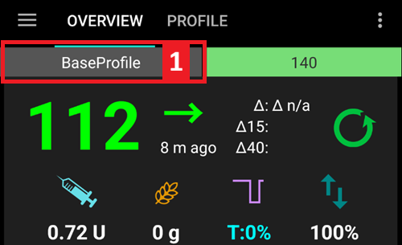
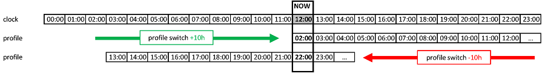

# Profilwechsel & Prozentuale Profilanpassung

Dieser Abschnitt erklärt was ein **Profilwechsel** und eine **prozentuale Anpassung des Profils** sind. Wie Du ein **Profil** erstellst, erfährst Du unter [Dein AAPS-Profil](#your-aaps-profile-create-and-edit-profiles).

Zu Beginn Deiner **AAPS**-Reise, musst Du ein **Profil** erstellen, verstehen, wie Du einen **Profilwechsel** durchführst und die Auswirkungen eines **Prozentsatzes im Profil** innerhalb von **AAPS** verstehen lernen. Die Funktionen **Profilwechsel** und **Prozentsatz des Profils** können besonders hilfreich sein für:

- Der Menstruationszyklus - eine prozentuale Anpassung innerhalb eines **Profils** kann im Reiter **Automatisierung** eingerichtet werden. Damit erhält **AAPS** die Möglichkeit sich an die verschiedene Phasen des Hormonzyklus und an die vorhergesagte Insulinresistenz anpassen.

- Bewegung/Sport - eine prozentuale Anpassung innerhalb eines **Profils** kann im Reiter **Automatisierung** eingerichtet werden, um so für sportliche Aktivität die Abgabe des Basalinsulins zu reduzieren.

- Schichtarbeitende - Du kannst Dein Profil im Reiter **Profil** zeitlich verschieben. Im Feld 'Zeitverschiebung', kannst Du die Anzahl der Stunden angeben, die später/früher ins Bett gegangen oder aufgestanden wird.

Warum einen **Prozentsatz des Profils** statt einer temporären Basalrate verwenden? Um wirksamer zu sein, wendet ein **Prozentsatz des Profils** eine anteilige Verringerung oder Erhöhung auf Basalrate, ISF und I:C an. Damit erreicht man, dass **AAPS** bei der Berechnung der benötigten Insulinmenge berechnet wird, ausgewogen und gut balanciert vorgeht. Eine Reduktion lediglich des Basalinsulin im **AAPS-Profil** führt dazu, dass der Algorithmus weiterhin die bestehenden Faktoren für Korrekturen und Mahlzeiten berücksichtigt.

(ProfileSwitch-change-percentage)=

## Prozentsatz des Profils auf dem Startbildschirm ändern

Du brauchst mindestens ein gespeichertes **Profil**. Ein **Prozentsatz des Profils** wird immer über einen **Profilwechsel** angewendet: Du aktivierst ein **Profil** erneut, diesmal mit einem Prozentsatz.

```{admonition} Du kommst von AAPS 3? :class: note Ein langes Drücken auf den Profilnamen öffnet den Dialog für den Profilwechsel nicht mehr. **Tippe** auf den Profilnamen und dann unten rechts auf den runden Knopf **▶**: Er öffnet dieselben Einstellungen (Prozentsatz, Dauer, temporäres Ziel Aktivität).

    <br />1. Tippe auf dem Startbildschirm **auf den Profilnamen** (neben dem Stern-Symbol). Der [Profil-Bildschirm](#ProfileSwitch-manage-v4) öffnet sich mit der Karte des laufenden **Profils**, die mit **AKTIV** markiert ist.
    
       
    
    2. Um das gleiche **Profil** beizubehalten, lass die Karte **AKTIV** ausgewählt. Um gleichzeitig das **Profil** zu wechseln, wische zu einer anderen Karte.
    3. Tippe unten rechts auf den runden Knopf **▶** (**Aktivieren**). Der Bildschirm **Aktivieren** öffnet sich.
    4. Stelle den **Prozentsatz** mit **−** / **+** ein (in Schritten von 5 %) oder gib ihn ein (30 bis 250 %). Das Feld beginnt immer bei **100 %**: Es zeigt nicht den Prozentsatz, der gerade läuft. Gib zum Beispiel **80** für 20 % weniger Insulin ein oder **120** für 20 % mehr.
    5. Stelle die **Dauer** in Minuten ein:
       * **0** behält den neuen Prozentsatz bei, bis Du einen weiteren **Profilwechsel** machst;
       * jeder andere Wert beendet den Wechsel nach dieser Zeit, und **AAPS** kehrt zu dem **Profil** zurück, das vorher lief.
    
       
    
    6. Tippe unten auf dem Bildschirm auf **▶ Aktivieren**. Prüfe die Zusammenfassung im Dialog **Profilwechsel** und tippe auf **OK**.
    
       
    
    Zurück auf dem Startbildschirm zeigt der Profilname den Prozentsatz und die verbleibende Zeit an, zum Beispiel *Normal (80%) (59')*, und wird gelb, solange ein Wechsel mit Dauer läuft. Ein Stern markiert den Wechsel im BZ-Diagramm. Siehe [Startbildschirm](#aaps-screens-profile--target).
    
    
    
    Um vor dem Ende **zu 100 % zurückzukehren**, wiederhole die Schritte und lass **Prozentsatz** auf 100 und **Dauer** auf 0.
    
    ```{admonition} Prozentsätze mit einem Tippen
    :class: tip
    Wenn Du oft denselben Prozentsatz verwendest (Sport, Krankheit), füge eine [Profil-Verknüpfung](#profile-shortcuts) zur Schnellstart-Leiste hinzu oder erstelle eine [Szene](Scenes.md). Beide wenden ein Profil mit voreingestelltem Prozentsatz und voreingestellter Dauer mit einem Tippen an.
    

(ProfileSwitch-manage-v4)=

## Profile verwalten und aktivieren (Verwalten → Profil)

In **AAPS** v4 werden Profile über den Bildschirm **Verwalten** (untere Navigationsleiste) → **Profil** (*„Profil verwalten und aktivieren“*) verwaltet und aktiviert.

Der Profil-Bildschirm zeigt Deine Profile als **Kartenkarussell zum Wischen**. Die Karte des laufenden Profils ist mit **AKTIV** markiert und zeigt seine gesamte tägliche Basalmenge (z. B. *∑ 30,15 IE*). Unter der ausgewählten Karte siehst Du die Details dieses Profils – den **Insulin**-Typ sowie die Zeitpläne für **IC**, **ISF**, **Basal** und **Ziel** mit Grafiken.

Läuft ein temporärer Wechsel, zeigt die Karte **AKTIV** seinen Prozentsatz und seine Zeitverschiebung mit der Restzeit an, zum Beispiel *110% +2 h · 2 h 40 min*, über einem Fortschrittsbalken. Beides wird alle 30 Sekunden aktualisiert. Die Details darunter haben dann zwei Spalten: die Werte des Profils in Blau und die mit dem Prozentsatz verwendeten Werte in Rot.


Die Knöpfe unten wirken auf das **ausgewählte** Profil: **➕ Hinzufügen**, **✏️ Bearbeiten**, **⧉ Klonen** und **‘️ Löschen** sowie rechts der runde Knopf **▶ Aktivieren**. Wie Du im Editor die vier Zeitpläne (IC / ISF / BAS / TARG) ausfüllst, erfährst Du unter [Profile erstellen und bearbeiten](#your-aaps-profile-create-and-edit-profiles).

**⧉ Klonen** verwendet das Symbol mit zwei Quadraten, das oft für *Kopieren* steht, aber es gibt nichts einzufügen: Die Kopie entsteht in einem Schritt. Bestätige *Profil „Normal“ klonen?*, dann wird am Ende des Karussells ein neues Profil namens *Normal Kopie* hinzugefügt und ausgewählt, bereit für **✏️ Bearbeiten** (dort kannst Du es auch umbenennen). Das ist nicht dasselbe wie das Klonen eines früheren **Profilwechsels** aus der Behandlungshistorie: Dabei entsteht ein neues Profil *mit angewendetem Prozentsatz und angewendeter Zeitverschiebung*. Siehe [Speichere den Profilwechsel, falls Du ihn später nutzen willst](#ProfileSwitch-keep-for-later).

(ProfileSwitch-read-only-mode)= **Nur der Knopf ▶ Aktivieren?** Deine Einstellungen sind geschützt, deshalb öffnet sich der Bildschirm schreibgeschützt. Tippe oben in der Leiste auf den **✏️ Stift** und gib Dein Passwort für Einstellungen ein. Siehe [Schutz der Einstellungen sperrt jetzt auch die Verwaltungsbildschirme](#v4changes-read-only-management).

### Reihenfolge der Profile ändern

Wenn Du mehr als ein Profil hast, kannst Du ihre Reihenfolge im Karussell festlegen: Tippe oben in der Leiste auf das Symbol **Reihenfolge ändern** (⇅, zwei Pfeile nach oben und unten). Die Seitenanzeige wird durch **◀ / ▶ Verschiebe-Knöpfe** mit der Anzeige *Position / Gesamt* ersetzt – schiebe die mittlere Karte nach vorn oder hinten und bestätige mit **✓** (oder verwirf mit **✕**). Die neue Reihenfolge wird einmal gespeichert, wenn Du bestätigst.


### Ein Profil aktivieren

Wähle ein Profil aus und tippe auf **▶ Aktivieren**. Auf dem Bildschirm **Aktivieren** legst Du fest, wie der **Profilwechsel** angewendet wird:


- **Prozentsatz** (30–250 %, beginnt jedes Mal bei 100 %) – skaliert das gesamte Profil. 100 % verwendet es unverändert; 70 % zum Beispiel verringert die Basalrate und die berechnete Insulindosis (sowohl Mahlzeiten- als auch Korrekturboli) um 30 %. Er ändert weder Deine BZ-Zielwerte noch die KH-Resorption. Die vollständige Wirkung findest Du unter [Prozentsatz des Profils](#ProfileSwitch-profile-percentage).
- **Dauer** (0–10080 Minuten, also bis zu 7 Tage) – wie lange der Wechsel gilt. **0 = unbegrenzt** (bis zum nächsten Wechsel); bei einem Wert ungleich null kehrt AAPS nach Ablauf zum vorherigen Profil zurück.
- **Temporäres Ziel / Aktivität** – erscheint nur, wenn Du eine **Dauer** und einen **Prozentsatz** unter 100 % einstellst. Schalte es ein, um für dieselbe Dauer auch ein [temporäres Ziel Aktivität](#TempTargets-activity-temp-target) zu starten, wie Du es vor dem Sport tun würdest.
- **Zeitverschiebung** – zeigt *0h*; tippe auf **Ändern**, um den Zeitplan um bis zu 23 Stunden nach vorn oder zurück zu verschieben (nützlich bei Schichtarbeit oder auf Reisen). Siehe [Zeitverschiebung](#ProfileSwitch-ProfilePercentage-time-shift-of-the-circadian-percentage-profile).
- **Erneut verwenden** – erscheint, wenn der laufende Wechsel einen Prozentsatz ungleich 100 % oder eine Zeitverschiebung hat, zum Beispiel **Erneut verwenden 80% 0h**. Tippe darauf, um denselben Prozentsatz und dieselbe Zeitverschiebung einzutragen, etwa um einen Wechsel zu verlängern, der gleich endet.
    
    

- **Zeit** – standardmäßig *Jetzt*. Du kannst eine andere Zeit wählen, bis zu 24 Stunden in der Vergangenheit oder in der Zukunft. Ein Wechsel mit einer Zeit in der Zukunft beginnt zu dieser Zeit; ein damit gesetztes temporäres Ziel Aktivität beginnt dann ebenfalls zu dieser Zeit.
    
    

- **Notizen** – wird nur angezeigt, wenn [Notizen in Dialogen anzeigen](#Preferences-show-notes-field-in-treatments-dialogs) eingeschaltet ist.

Sind die Basalraten mit dem gewählten Prozentsatz nicht mit Deiner Pumpe kompatibel, erscheint oben eine Warnung und **▶ Aktivieren** bleibt deaktiviert: Wähle einen anderen Prozentsatz.

Tippe auf **▶ Aktivieren** und dann im Bestätigungsdialog auf **OK**. Das laufende Profil trägt dann auf seiner Karte die Markierung **AKTIV**.

```{admonition} Deine Pumpe rundet möglicherweise die Basalraten :class: note Jede Pumpe kann Basalraten nur in ihren eigenen Schritten abgeben (zum Beispiel 0,05 IE/h), deshalb rundet sie die Raten Deines **Profils**. **AAPS** verwendet dann die Basalrate, die die Pumpe tatsächlich abgibt, damit IOB und TDD korrekt bleiben. Gibt die Pumpe pro Tag etwas mehr oder weniger Insulin ab als Dein **Profil**, zeigt Dir die Meldung *„Basalratenprofil in der Pumpe aktualisiert“*, um wie viel, zum Beispiel *„Dadurch gibt sie 10,00 IE statt 10,12 IE pro Tag ab“*.

Meldet die Pumpe eine Basalrate, die weit von Deinem **Profil** abweicht, behält **AAPS** die Basalrate des **Profils** bei und bittet Dich, die Basalraten in der Pumpe zu prüfen.

    <br />```{admonition} Mit Prozentsatz und Zeitverschiebung kommst Du mit einem Profil weit
    :class: note
    Statt viele ähnliche Profile anzulegen, behalte ein Basisprofil und wende es bei wiederkehrenden Situationen (Krankheit, Sport, Reisen) mit einem anderen **Prozentsatz** oder einer **Zeitverschiebung** an. Genau das automatisieren [Szenen](Scenes.md).
    

Ein Profilwechsel ist nicht auf diesen Bildschirm beschränkt. Derselbe Wechsel kann auch von einer **Wear OS-Smartwatch**, einem gekoppelten **Client** (siehe [Master ↔ Client-Steuerung](../RemoteFeatures/ClientMasterControl.md)), einer **[Szene](Scenes.md)** oder einer **Automatisierungs**regel ausgelöst werden.

(ProfileSwitch-profile-percentage)=

## Prozentsatz des Profils

Es ist wichtig, dass Du die grundlegende Funktionsweise der **prozentuale(n) Profilanpassung** verstehst. Durch die prozentuale Erhöhung oder Verringerung innerhalb eines **Profilwechsels** werden alle Parameter die in Deinem **Profil** hinterlegt sind, im gleichen Maße angehoben oder reduziert.

Zum Beispiel: ein **Profilwechsel** auf 130% (bedeutet, dass Du 30% insulinresistenter bist), wird in **AAPS** dazu führen, dass

- die Basalrate wir um 30% **angehoben**; 
- der **ISF** wird **abgeschwächt**: der Wert wird durch 1,3 geteilt;
- der **IC**-Wert wird durch 1,3 geteilt und damit **abgeschwächt**.

Hab' im Hinterkopf, das eine Abschwächung des **ISF** oder des **IC** heißt, dass mehr Insulin abgegeben wird, da die Verhältniswerte größer werden. Dies wird insbesondere dann, wenn Du noch neu in der **AAPS**-Welt bist, leicht übersehen bzw. verwechselt.

Nach der Auswahl passt **AAPS** die Basalrate entsprechend an, und wird von da an sowohl im Closed Loop als auch im Open Loop mit der neu berechneten Basalrate des prozentual erhöhten **Profils** arbeiten.

Die Wirkung einer prozentualen **Profil**anpassung wird in der unten stehenden Tabelle zusammengefasst:

| Profilwechsel  
Prozentsatz |    Effekt    |    I:C  
g/IE     | Beispiel  
15 g |         ISF  
mmol/l/IE  
mg/dl/IE         | IE zum Senken um  
2 mmol/l  
40 mg/dl |
|:---------------------------:|:------------:|:-----------------:|:---------------:|:------------------------------------------:|:--------------------------------------:|
|            90 %             |  Schwächer   | 5/0,9  
=**5,55** |     2,7 IE      | 2,2/0,9  
=**2,4**  
  
40/0,9  
=**44,4** |                 0,8 IE                 |
|          **100%**           | **Standard** |       **5**       |    **3 IE**     |                **2,2  
40**                |               **0,9** IE               |
|            130%             |   Stärker    | 5/1,3  
=**3,85** |     3,9 IE      | 2,2/1,3  
=**1,7**  
  
40/1,3  
=**30,8** |                 1,2 IE                 |

(ProfileSwitch-ProfilePercentage-time-shift-of-the-circadian-percentage-profile)=

## Zeitliche Verschiebung des prozentual angepassten zirkadianen Profils

Die Funktion 'Zeitverschiebung' verschiebt das gesamte, der inneren Uhr angepasste (zirkadiane), **Profil** um die angegebene Stundenanzahl. Dies kann in folgenden Situationen oder für Personengruppen hilfreich sein:

- **Nacht- oder Schichtarbeitende**: Bei Nachtschichten verschiebst Du das **Profil** um so viele Stunden, wie Du später oder früher schlafen gehst oder aufwachst; 
- **Reisen über und durch Zeitzonen**; oder
- **Kinder mit Typ1 Diabetes**, deren Abendroutinen und auftretende Insulinresistenzen in deren **Profil** eingearbeitet sind. Wenn vorher bekannt ist, dass sich die Zubettgeh-Zeit des Kindes verschieben wird, kann dies über die Funktion 'Zeitverschiebung' im **Profil** berücksichtigt werden. **AAPS** kann dann zum vorher festgelegten Zeitraum auf die Insulinresistenzen reagieren.

Es geht immer um die Frage, die **Profil**einstellungen welcher Uhrzeit sollen die aktuell gültigen ersetzen. Diese Uhrzeit muss um x Stunden verschoben werden. Achte daher darauf, in welche Richtung die Zeitverschiebung (wie im folgenden Beispiel beschrieben) erfolgen soll:

- Aktuelle Zeit: 12:00
- **Positive** Zeitverschiebung 
    - 2:00 **+10 h** -> 12:00
    - Die Einstellungen von 2:00 Uhr werden anstelle der normalerweise um 12:00 Uhr programmierten Einstellungen verwendet.
- **Negative** Zeitverschiebung 
    - 22:00 **-10 h** -> 12:00
    - Die Einstellungen von 22:00 Uhr werden anstelle der normalerweise um 12:00 Uhr programmierten Einstellungen verwendet.



Durch diese Momentaufnahmen des **Profils** lässt sich die Vergangenheit viel genauer berechnen, und Änderungen am **Profil** lassen sich nachverfolgen.

(ProfileSwitch-keep-for-later)=

## Speichere den Profilwechsel, falls Du ihn später nutzen willst

Wenn Du einen prozentualen Profilwechsel und/oder einen Profilwechsel mit Zeitverschiebung durchgeführt hast, kannst Du eine Kopie dieses temporären Profils als ein neues Profil erstellen.

Öffne dazu das Menü (☰) → **Behandlungen** und gehe zum Reiter **Profilwechsel**, siehe [Einen Profilwechsel in ein neues Profil klonen](#your-aaps-profile-clone-profile-switch).