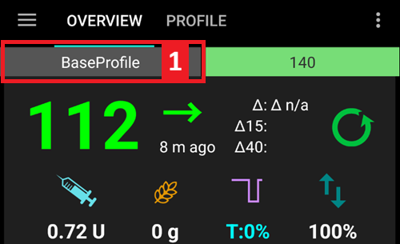

# Profilwechsel & Prozentuale Profilanpassung

Dieser Abschnitt erklärt was ein **Profilwechsel** und eine **prozentuale Anpassung des Profils** sind. You can learn how to create a **Profile** in [Your AAPS Profile](#your-aaps-profile-create-and-edit-profiles).

Zu Beginn Deiner **AAPS**-Reise, musst Du ein **Profil** erstellen, verstehen, wie Du einen **Profilwechsel** durchführst und die Auswirkungen eines **Prozentsatzes im Profil** innerhalb von **AAPS** verstehen lernen. Die Funktionen **Profilwechsel** oder **Prozentsatz des Profils** (anteiliges Profil) können Dir in den folgenden Situationen das Leben einfacher machen:

- Der Menstruationszyklus - eine prozentuale Anpassung innerhalb eines **Profils** kann im Reiter **Automatisierung** eingerichtet werden. Damit erhält **AAPS** die Möglichkeit sich an die verschiedene Phasen des Hormonzyklus und an die vorhergesagte Insulinresistenz anpassen.

- Bewegung/Sport - eine prozentuale Anpassung innerhalb eines **Profils** kann im Reiter **Automatisierung** eingerichtet werden, um so für sportliche Aktivität die Abgabe des Basalinsulins zu reduzieren.

- Schichtarbeitende - Du kannst Dein Profil im Reiter **Profil** zeitlich verschieben. Im Feld 'Zeitverschiebung', kannst Du die Anzahl der Stunden angeben, die später/früher ins Bett gegangen oder aufgestanden wird.

Why use a **Profile Percentage** rather than a temporary basal adjustment? To be more effective in its application a **Profile Percentage** applies a proportionate reduction or increase across: basal, ISF and I:C. Damit erreicht man, dass **AAPS** bei der Berechnung der benötigten Insulinmenge berechnet wird, ausgewogen und gut balanciert vorgeht. Eine Reduktion lediglich des Basalinsulin im **AAPS-Profil** führt dazu, dass der Algorithmus weiterhin die bestehenden Faktoren für Korrekturen und Mahlzeiten berücksichtigt.

(ProfileSwitch-change-percentage)=

## Change the Profile Percentage from the main screen

You need at least one saved **Profile**. A **Profile Percentage** is always applied through a **Profile Switch**: you activate a **Profile** again, this time with a percentage.

```{admonition} Coming from AAPS 3? :class: note A long press on the profile name no longer opens the profile switch dialog. **Tap** the profile name, then tap the round **▶** button at the bottom right: it opens the same settings (percentage, duration, Activity temp target).

    <br />1. On the main screen, **tap the profile name** (next to the star icon). The [Profile screen](#ProfileSwitch-manage-v4) opens on the card of the running **Profile**, marked **ACTIVE**.
    
       
    
    2. To keep the same **Profile**, leave the **ACTIVE** card selected. To change **Profile** at the same time, swipe to another card.
    3. Tap the round **▶** button (**Activate**) at the bottom right. The **Activate** screen opens.
    4. Set the **Percentage** with **−** / **+** (steps of 5 %), or type it in (30 to 250 %). The field always starts at **100 %**: it does not show the percentage that is running now. For example, enter **80** for 20 % less insulin, or **120** for 20 % more.
    5. Set the **Duration** in minutes:
       * **0** keeps the new percentage until you make another **Profile Switch**;
       * any other value ends the switch after that time, and **AAPS** goes back to the **Profile** that was running before.
    
       
    
    6. Tap **▶ Activate** at the bottom of the screen. Check the summary in the **Profile switch** dialog and tap **OK**.
    
       
    
    Back on the main screen, the profile name shows the percentage and the remaining time, for example *Normal (80%) (59')*, and turns yellow while a switch with a duration is running. A star marks the switch on the glucose graph. See [the main screen](#aaps-screens-profile--target).
    
    
    
    To **go back to 100 %** before the end, repeat the steps and keep **Percentage** at 100 and **Duration** at 0.
    
    ```{admonition} One-tap percentages
    :class: tip
    If you often use the same percentage (sport, illness), add a [Profile shortcut](#profile-shortcuts) to the Quick Launch bar, or create a [scene](Scenes.md). Both apply a profile with a preset percentage and duration in one tap.
    

(ProfileSwitch-manage-v4)=

## Managing and activating profiles (Manage → Profile)

In **AAPS** v4 profiles are managed and activated from the **Manage** screen (bottom navigation) → **Profile** (*“Manage and activate profiles”*).

The Profile screen shows your profiles as a **swipeable card carousel**. The card of the running profile is marked **ACTIVE** and shows its total daily basal (e.g. *∑ 30.15 U*). Below the selected card you see that profile's details — **Units**, **Insulin** type, and the **IC**, **ISF**, **basal** and **target** schedules with graphs.


The buttons at the bottom act on the **selected** profile: **➕ Add**, **✏️ Edit**, **⧉ Clone** and **‘️ Delete**, and the round **▶ Activate** button on the right. For how to fill in the four schedules in the editor (IC / ISF / BAS / TARG), see [Create and edit Profiles](#your-aaps-profile-create-and-edit-profiles).

**⧉ Clone** uses the two-squares icon often used for *copy*, but there is nothing to paste: it makes the duplicate in one step. Confirm *Clone profile "Normal"?* and a new profile named *Normal copy* is added at the end of the carousel and selected, ready for **✏️ Edit** (where you can also rename it). This is not the same as cloning a past **Profile Switch** from the Treatments history, which creates a new profile *with the percentage and time shift applied*. See [Keep a profile switch for later use](#ProfileSwitch-keep-for-later).

(ProfileSwitch-read-only-mode)= **Only the ▶ Activate button?** Your settings are protected, so the screen opens read-only. Tap the **✏️ pencil** in the top bar and enter your settings password. See [Settings protection now also locks the management screens](#v4changes-read-only-management).

### Reordering profiles

If you have more than one profile you can choose their order in the carousel: tap the **Reorder** icon (⇅, two arrows pointing up and down) in the top bar. The page indicator is replaced by **◀ / ▶ move buttons** with a *position / total* readout — step the centred card earlier or later, then confirm with **✓** (or discard with **✕**). The new order is saved once, when you confirm.


### Activating a profile

Select a profile and tap **▶ Activate**. The **Activate** screen lets you tailor how the **Profile Switch** is applied:


- **Percentage** (30–250 %, starts at 100 % every time) — scale the whole profile. 100 % uses it as-is; for example 70 % reduces basal and the calculated insulin dose (both meal boluses and corrections) by 30 %. It does not change your glucose targets or carb absorption. See [Profile Percentage](#profile-percentage) for the full effect.
- **Duration** (0–10080 minutes, that is up to 7 days) — how long the switch lasts. **0 = indefinite** (until you switch again); a non-zero value reverts to the previous profile when it ends.
- **Temporary target / Activity** — appears only when you set a **Duration** and a **Percentage** below 100 %. Switch it on to also start an [Activity temp target](#TempTargets-activity-temp-target) for the same duration, as you would before exercise.
- **Time shift** — shows *0h*; tap **Change** to move the schedule forward or back by up to 23 hours (useful for shift work or travel). See [Time shift](#ProfileSwitch-ProfilePercentage-time-shift-of-the-circadian-percentage-profile).
- **Reuse** — appears when the running switch has a percentage other than 100 % or a time shift, for example **Reuse 80% 0h**. Tap it to fill in the same percentage and time shift, for instance to prolong a switch that is about to end.
    
    

- **Time** — *Now* by default. You can pick another time, up to 24 hours before or after now. A switch set in the future starts at that time; an Activity temp target set with it then also starts at that time.
    
    

- **Notes** — only shown if [Show notes in dialogs](#Preferences-show-notes-field-in-treatments-dialogs) is on.

If the basal rates at the chosen percentage are not compatible with your pump, a warning appears at the top and **▶ Activate** stays disabled: choose another percentage.

Tap **▶ Activate**, then **OK** in the confirmation dialog. The running profile then carries the **ACTIVE** badge on its card.

```{admonition} Your pump may round the basal rates :class: note Each pump can only give basal rates in its own steps (for example 0.05 U/h), so it rounds the rates of your **Profile**. **AAPS** then uses the basal the pump really gives, so IOB and TDD stay correct. If the pump gives a little more or less insulin per day than your **Profile**, the notice *"Basal profile in pump updated"* tells you how much, for example *"it gives 10.00 U per day instead of 10.12 U"*.

If the pump reports a basal that is far from your **Profile**, **AAPS** keeps the **Profile** basal and asks you to check the basal rates in the pump.

    <br />```{admonition} Percentage and time shift make one profile go a long way
    :class: note
    Rather than building many similar profiles, keep one base profile and apply it at a different **percentage** or **time shift** for recurring situations (illness, exercise, travel). This is exactly what [scenes](Scenes.md) automate.
    

A profile switch is not limited to this screen. The same switch can also be triggered from a **Wear OS watch**, a paired **client** (see [Master ↔ Client control](../RemoteFeatures/ClientMasterControl.md)), a **[scene](Scenes.md)**, or an **Automation** rule.

## Prozentsatz des Profils

Es ist wichtig, dass Du die grundlegende Funktionsweise der **prozentuale(n) Profilanpassung** verstehst. Durch die prozentuale Erhöhung oder Verringerung innerhalb eines **Profilwechsels** werden alle Parameter die in Deinem **Profil** hinterlegt sind, im gleichen Maße angehoben oder reduziert.

Zum Beispiel: ein **Profilwechsel** auf 130% (bedeutet, dass Du 30% insulinresistenter bist), wird in **AAPS** dazu führen, dass

- die Basalrate wir um 30% **angehoben**; 
- der **ISF** wird **abgeschwächt**: der Wert wird durch 1,3 geteilt;
- der **IC**-Wert wird durch 1,3 geteilt und damit **abgeschwächt**.

Hab' im Hinterkopf, das eine Abschwächung des **ISF** oder des **IC** heißt, dass mehr Insulin abgegeben wird, da die Verhältniswerte größer werden. Dies wird insbesondere dann, wenn Du noch neu in der **AAPS**-Welt bist, leicht übersehen bzw. verwechselt.

Nach der Auswahl passt **AAPS** die Basalrate entsprechend an, und wird von da an sowohl im Closed Loop als auch im Open Loop mit der neu berechneten Basalrate des prozentual erhöhten **Profils** arbeiten.

Die Wirkung einer prozentualen **Profil**anpassung wird in der unten stehenden Tabelle zusammengefasst:

| Profilwechsel  
Prozentsatz |    Effekt    |    I:C  
g/IE     | Beispiel  
15g |         ISF  
mmol/L/UI  
mg/dL/UI         | UI to lower  
2mmol/L  
40mg/dL |
|:---------------------------:|:------------:|:-----------------:|:--------------:|:------------------------------------------:|:-------------------------------:|
|            90 %             |  Schwächer   | 5/0,9  
=**5,55** |     2,7 IE     | 2,2/0,9  
=**2,4**  
  
40/0,9  
=**44,4** |             0,8 IE              |
|          **100%**           | **Standard** |       **5**       |    **3 IE**    |                **2,2  
40**                |           **0,9** IE            |
|            130%             |   Stärker    | 5/1,3  
=**3,85** |     3,9 IE     | 2,2/1,3  
=**1,7**  
  
40/1,3  
=**30,8** |             1,2 IE              |

(ProfileSwitch-ProfilePercentage-time-shift-of-the-circadian-percentage-profile)=

## Zeitliche Verschiebung des prozentual angepassten zirkadianen Profils

Die Funktion 'Zeitverschiebung' verschiebt das gesamte, der inneren Uhr angepasste (zirkadiane), **Profil** um die angegebene Stundenanzahl. Dies kann in folgenden Situationen oder für Personengruppen hilfreich sein:

- **Schichtarbeitende**: Passe Dein **Profil** Deiner Schicht an, indem Du die Anzahl der Stunden angibst, die Du schichtbedingt später ins Bett gehst oder früher aufstehen wirst; 
- **Reisen über und durch Zeitzonen**; oder
- **Kinder mit Typ1 Diabetes**, deren Abendroutinen und auftretende Insulinresistenzen in deren **Profil** eingearbeitet sind. Wenn vorher bekannt ist, dass sich die Zubettgeh-Zeit des Kindes verschieben wird, kann dies über die Funktion 'Zeitverschiebung' im **Profil** berücksichtigt werden. **AAPS** kann dann zum vorher festgelegten Zeitraum auf die Insulinresistenzen reagieren.

Es geht immer um die Frage, die **Profil**einstellungen welcher Uhrzeit sollen die aktuell gültigen ersetzen. Diese Uhrzeit muss um x Stunden verschoben werden. Achte daher darauf, in welche Richtung die Zeitverschiebung (wie im folgenden Beispiel beschrieben) erfolgen soll:

- Aktuelle Zeit: 12:00
- **Positive** Zeitverschiebung 
    - 2:00 **+10 h** -> 12:00
    - Die Einstellungen von 2:00 Uhr werden anstelle der normalerweise um 12:00 Uhr programmierten Einstellungen verwendet.
- **Negative** Zeitverschiebung 
    - 22:00 **-10 h** -> 12:00
    - Die Einstellungen von 22:00 Uhr werden anstelle der normalerweise um 12:00 Uhr programmierten Einstellungen verwendet.


Dadurch, dass eine Momentaufnahme des **Profil**s gemacht wird, kann eine sehr viel präzisere Berechnung der Vergangenheit gemacht werden und es können die Änderungen am **Profil** nachverfolgt werden.

(ProfileSwitch-keep-for-later)=

## Speichere den Profilwechsel, falls Du ihn später nutzen willst

Wenn Du einen prozentualen Profilwechsel und/oder einen Profilwechsel mit Zeitverschiebung durchgeführt hast, kannst Du eine Kopie dieses temporären Profils als ein neues Profil erstellen.

To do this, open the menu (☰) → **Treatments** and go to the **Profile switch** tab, see [Clone a Profile switch to a new Profile](#your-aaps-profile-clone-profile-switch).