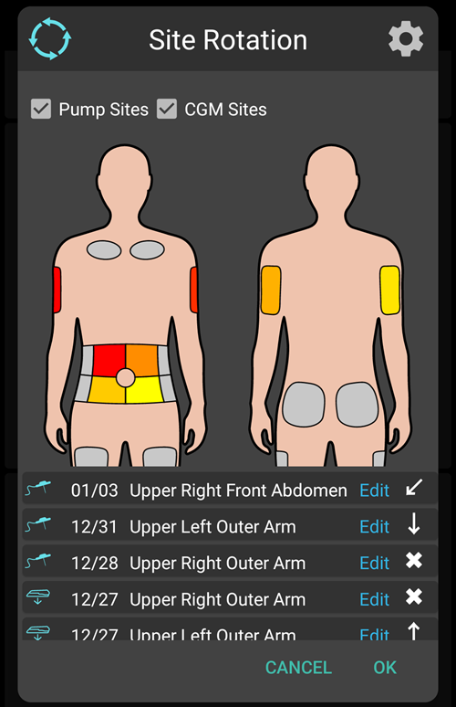
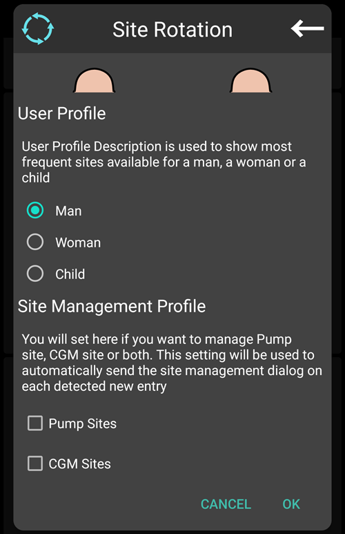
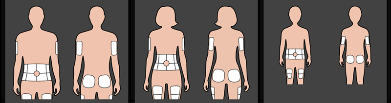
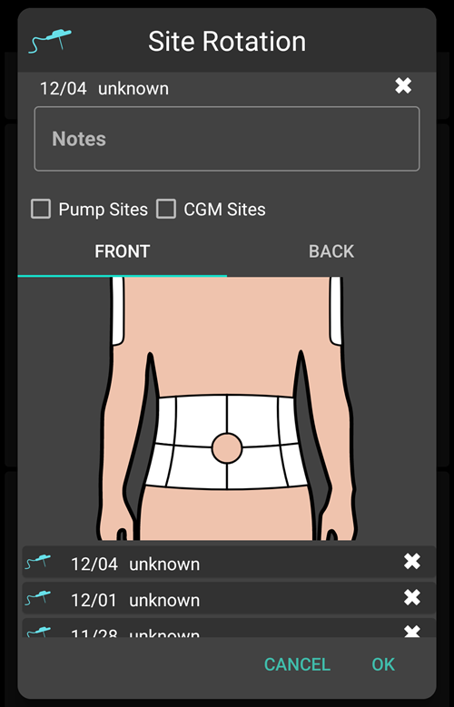
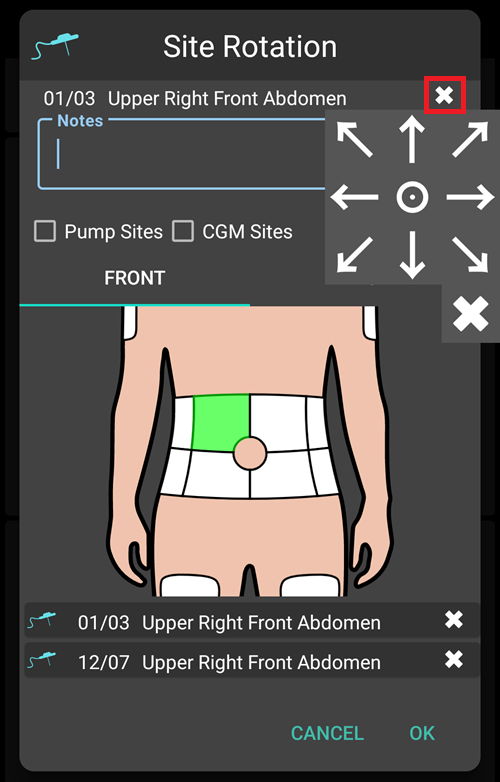
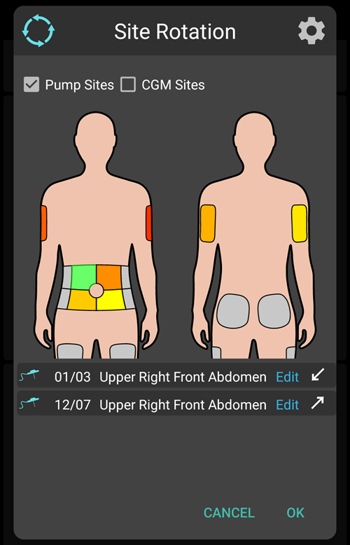

# Pumps and cannulas

## Wechseln des Infusions-Sets: Reservoire und Kanülen

Das unten beschriebene Verfahren gilt nur für Schlauchpumpen und ist nicht ohne weiteres auf Patchpumpen wie den Omnipod, die Medtrum Nano, die Accu-Chek Solo usw. anwendbar. This procedure is sometimes referred to as a "set change", with a "full" set change including the insulin reservoir and cannula, and a "partial" set change referring to a change of cannula only.

Patch pumps fill and prime themselves in their own activation wizard, and their cannula is already in the body. **AAPS** does not offer a prime for them: **Prime/Fill** is not shown in the **Manage** sheet or in QuickLaunch. See the page of your pump in [Compatible pumps](../Getting-Started/CompatiblePumps.md).

Der physische Catridge-/Reservoirwechsel kann nicht über **AAPS** durchgeführt werden und muss direkt über die Pumpe erfolgen. Der erfolgte Wechsel muss in **AAPS** manuell eingetragen werden.

(pumps-cannulas-changing-reservoir-and-cannula)=
### Anleitung zum Wechseln sowohl des Reservoirs als auch der Kanüle

1. In **AAPS**, disconnect the pump: press the [loop icon](#AapsScreens-loop-status) on the main screen and select **Disconnect pump** for 1 hour. The icon changes to a grey plug icon, indicating that the pump is disconnected.

2. Wechsel das Insulinreservoir nun physisch: Koppel die Pumpe vom Körper ab und wechsel das Reservoir/Catridge und die Kanüle wie es die Anweisungen des Herstellers vorsehen.

3. Schlauch und Kanüle entlüften/füllen: Dies kann direkt an der Pumpe erfolgen. Achte darauf, dass keine Blasen mehr im Schlauch sind.

4. Setze die neue Kanüle. Sobald die Kanüle gesetzt ist und die Setznadel entfernt wurde, hat die neue Kanüle noch etwas Luft in der Kanülennadel, die auch entlüftet werden muss. To announce this in **AAPS** and prime the site: open **Prime/Fill** (in the expanded status panel on the main screen, in the **Manage** sheet, or as a [QuickLaunch](QuickLaunch.md) button) and tick **Pump site change** and/or **Insulin cartridge change** as appropriate to record the change. Now press the default insulin cannula prime amount (it is usually around 0.3 U, but check this value is correct for your cannula) and select **OK**. Read the summary message, and confirm to execute the priming by tapping **OK**.

   


5. Reconnect the pump in **AAPS**: press the grey plug icon and select **Reconnect pump** to continue looping.

### Nützliche Informationen zu Insulin/Kanülenwechsel

* Logging a pump site change resets Autosens to 100%. It also resets the corresponding cannula/insulin status lights and ages on the **AAPS** main screen.

* You can set/adjust the default prime amounts in the **Prime/Fill** settings — type "prime" in the main screen search bar to open them (see [Preferences](../SettingUpAaps/Preferences.md)). Schau bitte im Beipackzettel Deines Katheters nach, wie viele Einheiten (je nach Nadel- und Schlauchlänge) für Deinen Katheter zur Befüllung verwendet werden sollten.

* Insulin delivered using the prime function is not taken into account by **AAPS** when calculating insulin on board (IOB), and is marked in the [Treatments history](#aaps-screens-treatments) as "Prime".

* Any insulin bolused from the pump during a pump disconnection will also not be taken into account by **AAPS**. If you happen to bolus directly from the pump while **AAPS** is disconnected, once you reconnect the pump you can announce this insulin (without bolusing it) in the **Insulin** dialog (see [To announce delivered insulin without actually bolusing](#pumps-cannulas-announce-insulin) below).

### Probleme mir Kanüle, Infusionsstelle, Schlauch und/oder Pumpe

If you are confident that you haven't received any insulin for a period of time, despite **AAPS** recording that you have, and you know exactly when the issue started (_e.g._ you remove the cannula and see that the cannula was kinked during the insertion process) you can correct this in **AAPS**, while being aware that the insulin may in fact have been delivered but may be slow to act for some reason.

```{admonition} Caution - Risk of Hypoglycemia
:class: danger
Lösche Boluseinträge in **AAPS** nur mit ÄUSSERSTER Vorsicht. Für den Fall, dass Insulin _tatsächlich abgegeben_ wurde, achte in den kommenden 24h genau auf Deine Glukosewerte.
```

To remove boluses and SMBs which you know have not been delivered, open the **menu** (☰), select [Treatments history](#aaps-screens-treatments) and, on the **Carbs and bolus** tab, conservatively delete the logged boluses starting from the point the incident happened. This will correct the "insulin on board" (IOB) value which is key for **AAPS**' calculations; if you now return to the main screen you will see that the IOB has reduced. Bitte beachte, dass Du das von **AAPS** berechnete Basalinsulin nicht löschen kannst und es daher weiterhin von **AAPS** berücksichtigt wird.

In less obvious cases of insulin delivery problems _e.g._ leakages, occlusions or tunneling where either you are not sure when the issue started, or think some of the insulin was delivered, you need to be careful. You may detect these issues either by "smelling" the insulin, seeing a wet adhesive, encountering high glucose values or by getting an alarm. As you will never know how much insulin you got into your skin (which might be starting to work after a while) it will be hard to determine the correct amount of insulin which needs to be deducted from the current "insulin on board" (IOB) value. Eine mögliche Strategie ist, nachdem Du das Problem mit der Insulinabgabe gelöst hast, das Loopen für 5 Stunden (bzw. für die Wirkdauer Deines genutzten Insulins) zu unterbrechen und erst danach das Loopen wieder aufzunehmen. Damit wird sichergestellt, dass der IOB-Wert beim erneuten Loop-Start korrekt ist.

(pumps-cannulas-disconnecting)=
## Die Pumpe zum Duschen oder für Aktivitäten trennen

Wenn Du Deine Pumpe zum Duschen, Baden und Schwimmen, Kontaktsport oder anderen Aktivitäten abnimmst, musst Du **AAPS** wissen lassen, dass kein Insulin geliefert wird. Nur so kann die IOB-Berechnung korrekt erfolgen. The pump can be disconnected using the [loop icon](#AapsScreens-loop-status) on the main screen: press it and select **Disconnect pump** with the duration you need. If the activity takes longer than planned, open the same dialog again and pick a new duration under **Disconnect pump**: the disconnection is extended and the new duration starts from now. You do not need to reconnect first.

Da Du während der Pumpen-Trennung kein Insulin erhältst, solltest Du alle zwei Stunden wieder verbinden, um das fehlende Basalinsulin nachzuholen. Das kannst Du machen, indem Du Dich verbindest, die fehlenden Basalmengen (_z.B._ der letzten zwei Stunden) bolst, bevor Du Dich dann wieder trennst. Dies sollte helfen, einen schweren Insulinmangel zu vermeiden, der zu diabetischer Ketoazidose (DKA) führen könnte. Wenn es während der Aktivität unpraktisch ist, die Pumpe wieder anzukoppeln (Kanüle ist durch das Tragen eines Neoprenanzugs abgedeckt _usw._), dann kann eine Pen-Injektion auch eine Alternative sein. This manual injection can be logged in **AAPS**, and doesn't have to be logged at the time of injection (just make a note of the time of injection) since you can announce the insulin and backdate the time the insulin was actually given when you reconnect the pump.

(pumps-cannulas-announce-insulin)=
## Abgegebenes Insulin ankündigen, ohne es tatsächlich zu bolen

To announce insulin delivered from the pump either while **AAPS** was disconnected, or from pen injections: open the [Insulin dialog](#aaps-screens-buttons-insulin) (**Treatments** in the bottom navigation, or a QuickLaunch button), enter the amount in units and enable **Bolus will be recorded only**. A **Time** row (set to **Now**) then lets you record the actual time of the injection: you can ignore it if the injection was given recently. If the bolus was given some time ago, use **-** to move the time back (_e.g._ -30 min), or open the row with the chevron to pick the exact date and time. **AAPS** wird dann die Dauer der Insulinwirkung berücksichtigen und das verbleibende Insulin im System entsprechend berechnen.

If you are using **AAPS** as a caregiver, you can remotely disconnect (and reconnect) the pump very easily by [SMS command](../RemoteFeatures/SMSCommands.md) using commands such as "pump disconnect 120" and "pump connect 120". Der Zeitraum für eine Remote-Trennung der Pumpe beträgt 1 - 120 Min. (in diesem Beispiel sind es 120 Minuten). Das ist eine sehr nützliche Funktion, wenn Du das **AAPS**-Smartphone nicht in Reichweite hast, weil es z. B. in einem Pumpengürtel Deines Kindes, das auf dem Weg ins Schwimmbad, vergraben ist oder mit Argus-Augen von einem Teenager bewacht oder etwas benutzt wird.

## Die Pumpe nach einer Aktivität wieder verbinden

Nach einer langen Unterbrechung (1 - 2 Stunden) ist es ziemlich häufig, dass **AAPS** einen negativen IOB errechnet und anzeigt. Wenn Du die Pumpe dann wieder verbindest, kannst Du je nach Vorliebe/aktuellem Glukosespiegel/geplanter Mahlzeit oder kommender Aktivität entweder:

a) Einfach die Pumpe in **AAPS** wieder verbinden (grau nach grün, für Closed Loop) und es **AAPS** überlassen das Insulin wieder abzugeben

_oder_

b) If you want to be more aggressive (for example, you are heading for hyperglycemia), you can open the [Bolus wizard](#aaps-screens-bolus-wizard) and bolus for zero carbs, to immediately deliver the calculated missing insulin as a bolus.

Welche Strategie Du wählen solltest, ist höchst individuell und am besten durch Ausprobieren herauszufinden.


(Aapsscreens-site-rotation)=
## Wechsel der Setzstellen (Site Rotation)

**Manage → Site Rotation** opens the Site Rotation Dialog in View mode:

- With the two buttons at the top (cannula icon and sensor icon), you can show Cannula sites only, Sensor sites only, or both
- All Cannula change and Sensor change event since the past 45 days are available.
- Click on a Site area, or in one entry in the list below to filter the list with only entries in selected area. The selected area will be highlighted in light green color.
- Tap the **pencil** icon next to an entry to open the Edit view and update its Site location, Arrow or Note



- The **cog** icon (upper right) opens the settings: **User profile for site rotation** opens a dialog where you choose **Man**, **Woman** or **Child**, and the **Manage pump site rotation** and **Manage CGM site rotation** switches select which sites you manage.





*Note: this setting will be used to automatically open or not Site Rotation Dialog (Edit mode) when a new entry is done from "Prime/Fill button" or "CGM Sensor Insert button"*

- For Site change done directly from Pump, you have to open the View Mode and Edit the new entry to select Location and Arrow

Edit Mode allows you to select Location, Arrow, and Note associated to selected Entry:

- The entry being edited is shown below the body images, with its type icon (cannula or sensor)
- Front and back views are shown side by side: tap the area where you placed it
- Once a Site selected (highlighted in green), you will see in the list below the list of all entries done in the pas 45 days in this site



- You can add an optional arrow by tapping the arrow icon at the right of the entry: the **Select Arrow** dialog lets you specify a sub-location or the pod orientation



- You can also add a **Note** about the selected site
- Tap the **save** icon (upper right) to record the site

Filtering can be done graphically on the image, or clicking a therapy event in the list To remove filtering, just click on the image outside any sites


