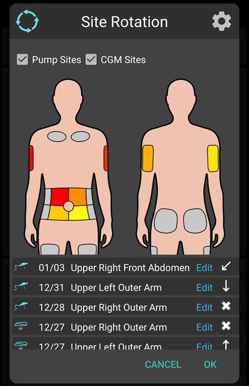
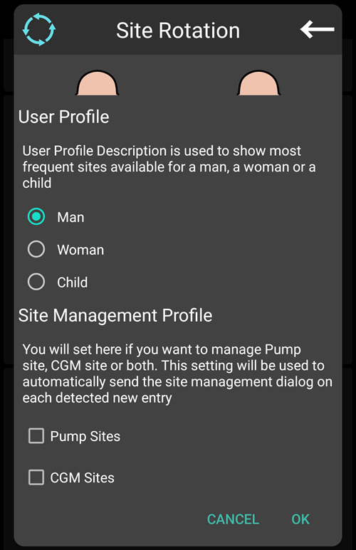
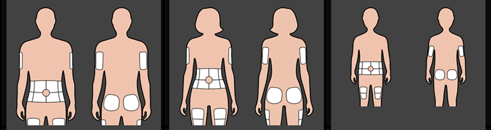
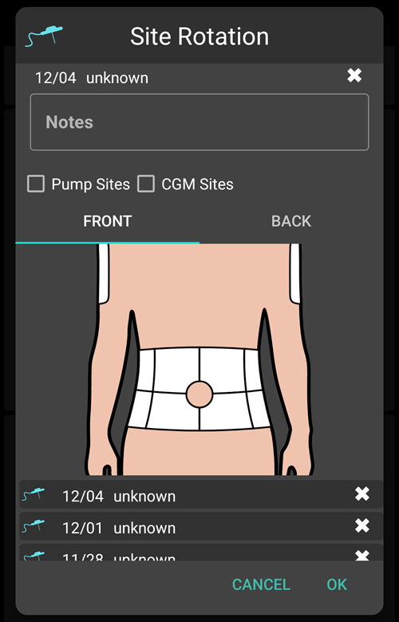
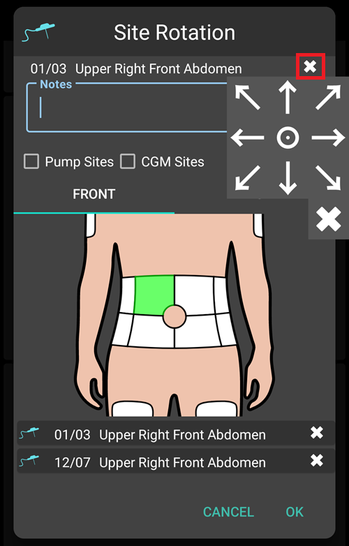
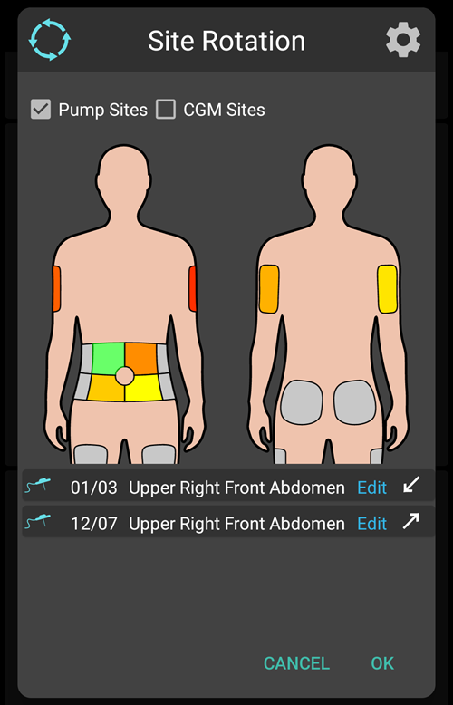

# Pumpen und Kanülen

## Wechseln des Infusions-Sets: Reservoire und Kanülen

Das unten beschriebene Verfahren gilt nur für Schlauchpumpen und ist nicht ohne weiteres auf Patchpumpen wie den Omnipod, die Medtrum Nano, die Accu-Chek Solo usw. anwendbar. Dieser Vorgang wird manchmal als „Infusionsset-Wechsel“ bezeichnet. Ein „kompletter“ Infusionsset-Wechsel umfasst Insulinreservoir und Kanüle, ein „teilweiser“ nur die Kanüle.

Patch-Pumpen füllen und entlüften sich in ihrem eigenen Aktivierungsassistenten selbst, und ihre Kanüle ist bereits im Körper. **AAPS** bietet für sie kein Füllen an: **Nadelwechsel/Füllen** wird weder im Fenster **Bearbeiten** noch im Schnellstart angezeigt. Siehe die Seite Deiner Pumpe unter [Kompatible Pumpen](../Getting-Started/CompatiblePumps.md).

Der physische Catridge-/Reservoirwechsel kann nicht über **AAPS** durchgeführt werden und muss direkt über die Pumpe erfolgen. Der erfolgte Wechsel muss in **AAPS** manuell eingetragen werden.

(pumps-cannulas-changing-reservoir-and-cannula)=
### Anleitung zum Wechseln sowohl des Reservoirs als auch der Kanüle

1. Trenne die Pumpe in **AAPS**: Tippe auf dem Startbildschirm auf das [Loop-Symbol](#AapsScreens-loop-status) und wähle **Pumpe trennen** für 1 Stunde. Das Symbol wird zu einem grauen Stecker und zeigt so an, dass die Pumpe getrennt ist.

2. Wechsel das Insulinreservoir nun physisch: Koppel die Pumpe vom Körper ab und wechsel das Reservoir/Catridge und die Kanüle wie es die Anweisungen des Herstellers vorsehen.

3. Schlauch und Kanüle entlüften/füllen: Dies kann direkt an der Pumpe erfolgen. Achte darauf, dass keine Blasen mehr im Schlauch sind.

4. Setze die neue Kanüle. Sobald die Kanüle gesetzt ist und die Setznadel entfernt wurde, hat die neue Kanüle noch etwas Luft in der Kanülennadel, die auch entlüftet werden muss. Um das in **AAPS** zu erfassen und die Kanüle zu füllen: Öffne **Nadelwechsel/Füllen** (im aufgeklappten Statusbereich auf dem Startbildschirm, im Fenster **Bearbeiten** oder als [Schnellstart](QuickLaunch.md)-Knopf) und setze je nach Bedarf den Haken bei **Katheter-Wechsel erfassen** und/oder **Reservoir-Wechsel erfassen**, um den Wechsel zu erfassen. Tippe nun auf die Standardmenge zum Füllen der Kanüle (meist etwa 0,3 IE, prüfe aber, ob dieser Wert für Deine Kanüle stimmt) und wähle **OK**. Lies die Zusammenfassung und bestätige das Füllen mit **OK**.

   


5. Verbinde die Pumpe in **AAPS** wieder: Tippe auf das graue Steckersymbol und wähle **Pumpe erneut verbinden**, um mit dem Loop weiterzumachen.

### Nützliche Informationen zu Insulin/Kanülenwechsel

* Das Erfassen eines Katheterwechsels setzt Autosens auf 100 % zurück. Außerdem werden die zugehörigen Statusanzeigen und Alter für Kanüle/Insulin auf dem **AAPS**-Startbildschirm zurückgesetzt.

* Die Standardmengen zum Füllen kannst Du in den Einstellungen für **Nadelwechsel/Füllen** festlegen bzw. anpassen. Gib dazu „prime“ in die Suchleiste des Startbildschirms ein, um sie zu öffnen (siehe [Einstellungen](../SettingUpAaps/Preferences.md)). Schau bitte im Beipackzettel Deines Katheters nach, wie viele Einheiten (je nach Nadel- und Schlauchlänge) für Deinen Katheter zur Befüllung verwendet werden sollten.

* Insulin, das über die Füllfunktion abgegeben wird, berücksichtigt **AAPS** bei der Berechnung des aktiven Insulins (IOB) nicht. Es wird im [Behandlungsverlauf](#aaps-screens-treatments) als „Füllen“ markiert.

* Boli, die während die Pumpe getrennt ist, abgegeben werden, werden in **AAPS** nicht berücksichtigt. Wenn Du direkt an der Pumpe einen Bolus abgibst, während **AAPS** getrennt ist, kannst Du dieses Insulin nach dem erneuten Verbinden der Pumpe im Dialog **Insulin** nachtragen, ohne es abzugeben (siehe unten [Abgegebenes Insulin nachtragen, ohne tatsächlich einen Bolus abzugeben](#pumps-cannulas-announce-insulin)).

### Probleme mir Kanüle, Infusionsstelle, Schlauch und/oder Pumpe

Wenn Du sicher bist, dass Du über einen bestimmten Zeitraum kein Insulin bekommen hast, obwohl **AAPS** es erfasst hat, und Du genau weißt, wann das Problem begann (_z. B._ Du entfernst die Kanüle und siehst, dass sie beim Setzen abgeknickt ist), kannst Du das in **AAPS** korrigieren. Bedenke dabei, dass das Insulin vielleicht doch abgegeben wurde, aber aus irgendeinem Grund langsam wirkt.

```{admonition} Caution - Risk of Hypoglycemia
:class: danger
Lösche Boluseinträge in **AAPS** nur mit ÄUSSERSTER Vorsicht. Für den Fall, dass Insulin _tatsächlich abgegeben_ wurde, achte in den kommenden 24h genau auf Deine Glukosewerte.
```

Um Boli und SMBs zu entfernen, von denen Du weißt, dass sie nicht abgegeben wurden, öffne das **Menü** (☰), wähle [Behandlungsverlauf](#aaps-screens-treatments) und lösche im Reiter **Kohlenhydrate & Bolus** vorsichtig die erfassten Boli ab dem Zeitpunkt, an dem das Problem auftrat. Damit wird der Wert des aktiven Insulins (IOB) korrigiert, der für die Berechnungen von **AAPS** entscheidend ist. Wenn Du jetzt zum Startbildschirm zurückgehst, siehst Du, dass das IOB gesunken ist. Bitte beachte, dass Du das von **AAPS** berechnete Basalinsulin nicht löschen kannst und es daher weiterhin von **AAPS** berücksichtigt wird.

Bei weniger eindeutigen Problemen mit der Insulinabgabe, _z. B._ Undichtigkeiten, Verschlüssen oder Tunnelbildung, bei denen Du nicht weißt, wann das Problem begann, oder annimmst, dass ein Teil des Insulins abgegeben wurde, musst Du vorsichtig sein. Solche Probleme bemerkst Du zum Beispiel, wenn Du Insulin „riechst“, das Pflaster feucht ist, die Glukosewerte hoch sind oder ein Alarm kommt. Da Du nie weißt, wie viel Insulin unter die Haut gelangt ist (das nach einer Weile anfangen kann zu wirken), ist es schwer, die richtige Insulinmenge zu bestimmen, die vom aktuellen Wert des aktiven Insulins (IOB) abgezogen werden muss. Eine mögliche Strategie ist, nachdem Du das Problem mit der Insulinabgabe gelöst hast, das Loopen für 5 Stunden (bzw. für die Wirkdauer Deines genutzten Insulins) zu unterbrechen und erst danach das Loopen wieder aufzunehmen. Damit wird sichergestellt, dass der IOB-Wert beim erneuten Loop-Start korrekt ist.

(pumps-cannulas-disconnecting)=
## Die Pumpe zum Duschen oder für Aktivitäten trennen

Wenn Du Deine Pumpe zum Duschen, Baden und Schwimmen, Kontaktsport oder anderen Aktivitäten abnimmst, musst Du **AAPS** wissen lassen, dass kein Insulin geliefert wird. Nur so kann die IOB-Berechnung korrekt erfolgen. Die Pumpe kannst Du über das [Loop-Symbol](#AapsScreens-loop-status) auf dem Startbildschirm trennen: Tippe darauf und wähle **Pumpe trennen** mit der gewünschten Dauer. Dauert die Aktivität länger als geplant, öffne denselben Dialog erneut und wähle unter **Pumpe trennen** eine neue Dauer: Die Trennung wird verlängert, und die neue Dauer beginnt ab jetzt. Du musst die Pumpe vorher nicht wieder verbinden.

Da Du während der Pumpen-Trennung kein Insulin erhältst, solltest Du alle zwei Stunden wieder verbinden, um das fehlende Basalinsulin nachzuholen. Das kannst Du machen, indem Du Dich verbindest, die fehlenden Basalmengen (_z.B._ der letzten zwei Stunden) bolst, bevor Du Dich dann wieder trennst. Dies sollte helfen, einen schweren Insulinmangel zu vermeiden, der zu diabetischer Ketoazidose (DKA) führen könnte. Wenn es während der Aktivität unpraktisch ist, die Pumpe wieder anzukoppeln (Kanüle ist durch das Tragen eines Neoprenanzugs abgedeckt _usw._), dann kann eine Pen-Injektion auch eine Alternative sein. Diese manuelle Injektion kann in **AAPS** erfasst werden und muss nicht zum Zeitpunkt der Injektion erfasst werden (notiere Dir nur die Uhrzeit), denn Du kannst das Insulin beim erneuten Verbinden der Pumpe nachtragen und auf den tatsächlichen Zeitpunkt zurückdatieren.

(pumps-cannulas-announce-insulin)=
## Abgegebenes Insulin ankündigen, ohne es tatsächlich zu bolen

Um Insulin nachzutragen, das von der Pumpe abgegeben wurde, während **AAPS** getrennt war, oder per Pen gespritzt wurde: Öffne den [Insulin-Dialog](#aaps-screens-buttons-insulin) (**Behandlungen** in der unteren Navigationsleiste oder ein Schnellstart-Knopf), gib die Menge in Einheiten ein und aktiviere **Bolus wird nur aufgezeichnet (Die Pumpe gibt kein Insulin ab!)**. In der Zeile **Zeit** (auf **Jetzt** gesetzt) kannst Du dann den tatsächlichen Zeitpunkt der Injektion erfassen. Wenn die Injektion gerade erst erfolgt ist, kannst Du sie ignorieren. Wurde der Bolus vor einiger Zeit abgegeben, stelle die Zeit mit **-** zurück (_z. B._ -30 min) oder öffne die Zeile mit dem Pfeil, um Datum und Uhrzeit genau auszuwählen. **AAPS** wird dann die Dauer der Insulinwirkung berücksichtigen und das verbleibende Insulin im System entsprechend berechnen.

Wenn Du **AAPS** als Betreuer nutzt, kannst Du die Pumpe ganz einfach per [SMS-Befehl](../RemoteFeatures/SMSCommands.md) aus der Ferne trennen (und wieder verbinden), mit Befehlen wie „pump disconnect 120“ und „pump connect 120“. Der Zeitraum für eine Remote-Trennung der Pumpe beträgt 1 - 120 Min. (in diesem Beispiel sind es 120 Minuten). Das ist eine sehr nützliche Funktion, wenn Du das **AAPS**-Smartphone nicht in Reichweite hast, weil es z. B. in einem Pumpengürtel Deines Kindes, das auf dem Weg ins Schwimmbad, vergraben ist oder mit Argus-Augen von einem Teenager bewacht oder etwas benutzt wird.

## Die Pumpe nach einer Aktivität wieder verbinden

Nach einer langen Unterbrechung (1 - 2 Stunden) ist es ziemlich häufig, dass **AAPS** einen negativen IOB errechnet und anzeigt. Wenn Du die Pumpe dann wieder verbindest, kannst Du je nach Vorliebe/aktuellem Glukosespiegel/geplanter Mahlzeit oder kommender Aktivität entweder:

a) Einfach die Pumpe in **AAPS** wieder verbinden (grau nach grün, für Closed Loop) und es **AAPS** überlassen das Insulin wieder abzugeben

_oder_

b) Wenn Du aggressiver vorgehen möchtest (zum Beispiel, weil Du auf eine Hyperglykämie zusteuerst), kannst Du den [Bolus-Rechner](#aaps-screens-bolus-wizard) öffnen und einen Bolus für null Kohlenhydrate berechnen, um das fehlende Insulin sofort als Bolus abzugeben.

Welche Strategie Du wählen solltest, ist höchst individuell und am besten durch Ausprobieren herauszufinden.


(Aapsscreens-site-rotation)=
## Wechsel der Setzstellen (Site Rotation)

**Bearbeiten → Wechsel der Setzstellen** öffnet den Dialog „Wechsel der Setzstellen“ im Ansichtsmodus:

- Mit den beiden Knöpfen oben (Kanülensymbol und Sensorsymbol) kannst Du nur Kanülen-Setzstellen, nur Sensor-Setzstellen oder beides anzeigen
- Alle Kanülen- und Sensorwechsel der letzten 45 Tage sind verfügbar.
- Durch Klicken auf den Setzstellen-Bereich oder die Auswahl eines Listeneintrags werden nur die Einträge des ausgewählten Bereichs angezeigt. Der ausgewählte Bereich wird hellgrün hervorgehoben.
- Tippe auf das Symbol **Stift** neben einem Eintrag, um die Bearbeitungsansicht zu öffnen und Setzstelle, Pfeil oder Notiz zu ändern



- Das Symbol **Zahnrad** (oben rechts) öffnet die Einstellungen: **Benutzerprofil für die Site-Rotation** öffnet einen Dialog, in dem Du **Mann**, **Frau** oder **Kind** auswählst. Mit den Schaltern **Kanülen-Setzstellen verwalten** und **CGM-Setzstellen verwalten** legst Du fest, welche Setzstellen Du verwaltest.





*Hinweis: Diese Einstellung legt fest, ob sich der Dialog „Wechsel der Setzstellen“ (Bearbeitungsmodus) automatisch öffnet, wenn mit dem Knopf „Nadelwechsel/Füllen“ oder „CGM-Sensor gesetzt“ ein neuer Eintrag erstellt wird.*

- Bei Kanülenwechseln, die direkt über die Pumpe erfolgt sind, musst Du den „Bearbeiten-Modus“ öffnen und den neuen Eintrag bearbeiten, um Stelle und Pfeil einzutragen

Im „Bearbeiten-Modus“ kannst Du die Stelle, den Pfeil und die Notizen zum ausgewählten Eintrag wählen:

- Der bearbeitete Eintrag wird unter den Körperbildern mit seinem Typsymbol (Kanüle oder Sensor) angezeigt
- Vorder- und Rückansicht werden nebeneinander gezeigt: Tippe auf die Stelle, an der Du gesetzt hast
- Sobald eine Setzstelle ausgewählt ist (grün hervorgehoben), zeigt die Liste darunter alle Einträge an dieser Setzstelle aus den letzten 45 Tagen.



- Über das Pfeilsymbol rechts neben dem Eintrag kannst Du optional einen Pfeil hinzufügen: Im Dialog **Pfeil auswählen** kannst Du eine genauere Position oder die Ausrichtung des Pods angeben



- Du kannst auch eine **Notiz** zur gewählten Setzstelle hinzufügen
- Tippe auf das Symbol **Speichern** (oben rechts), um die Setzstelle zu erfassen

Durch einen Klick auf das Bild kann graphisch gefiltert werden, oder klicke auf ein Therapieereignis in der Liste. Um die Filter wieder zu löschen, klicke einfach außerhalb der Setzstellen auf das Bild


