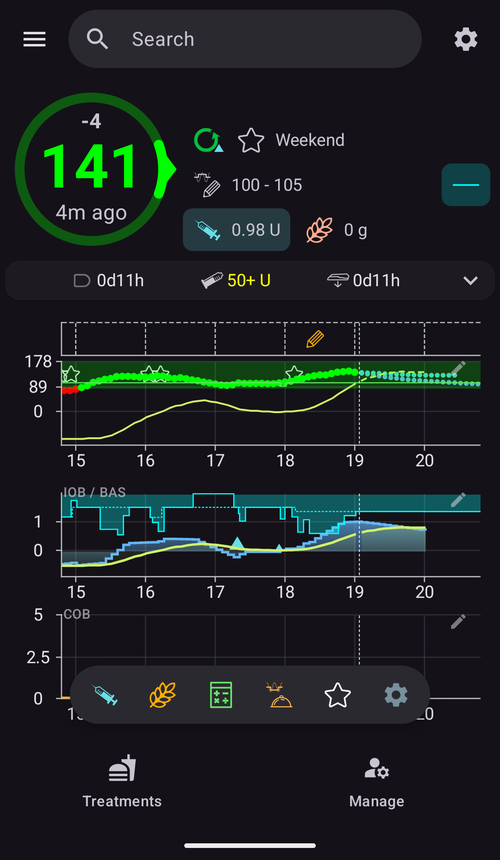
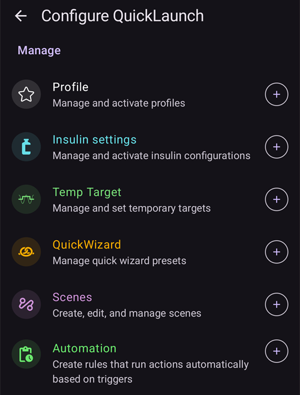
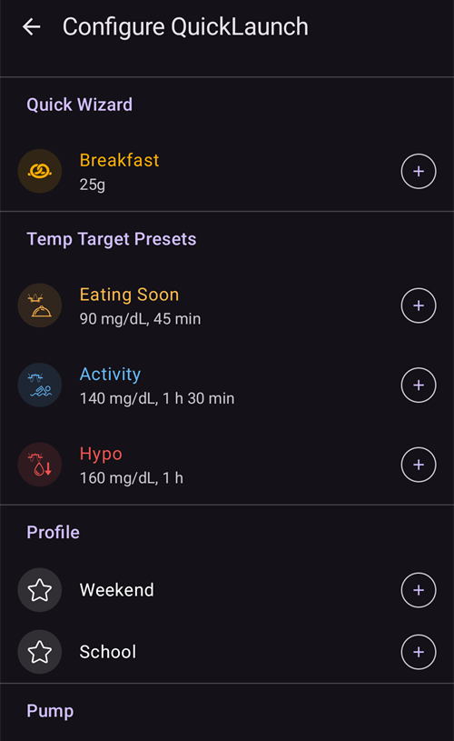

(quicklaunch)=
# Schnellstart (Schnellaktions-Leiste in der Übersicht)

**Schnellstart** ist die kleine **Schnellaktions-Leiste**, die unten in der **AAPS**-Übersicht schwebt, direkt über der unteren Navigationsleiste. Sie ist eine anpassbare Reihe von Knöpfen, die mit einem Tippen ausgelöst werden: Du entscheidest, welche Aktionen dort liegen und in welcher Reihenfolge, damit das, was Du am häufigsten tust, auf dem Startbildschirm immer nur ein Tippen entfernt ist.

```{contents} Table of contents
:depth: 2
:local: true
```


---

## Die Leiste verwenden

Die Leiste befindet sich in der **Übersicht**, zwischen den Diagrammen und der unteren Navigationsleiste:



- **Tippe** auf ein Symbol, um seine Aktion auszuführen – genau so, als hättest Du sie über ihren normalen Bildschirm geöffnet (ein Bolus oder eine Behandlung zeigt weiterhin zuerst die übliche Bestätigung).
- **Drücke lange** auf ein Symbol, um einen **Hinweis** mit dem Namen der Aktion und einer kurzen Beschreibung zu sehen.
- Fügst Du **mehr Knöpfe hinzu, als auf den Bildschirm passen**, wandern die übrigen in ein **Überlaufmenü** (Knopf **⋮** am Ende der Leiste).
- Jedes Symbol behält die **Farbe** seiner Aktion (z. B. Insulin, Kohlenhydrate, temporäres Ziel), damit es auf einen Blick zu erkennen ist.

```{admonition} The toolbar is always there
:class: note
Der letzte Knopf ist immer **Schnellstart konfigurieren** (das Zahnrad **⚙️**). Er lässt sich nicht entfernen, sodass Du den Bildschirm zur Konfiguration immer direkt aus der Leiste erreichst. Standardmäßig enthält die Leiste nur zwei Knöpfe – den **Bolus-Rechner** und dieses Zahnrad.
```

---

## Schnellstart konfigurieren

Tippe in der Leiste auf das Zahnrad **⚙️** (oder öffne **[Konfiguration](../SettingUpAaps/ConfigBuilder.md) → … → Schnellstart konfigurieren**), um den Bildschirm **Schnellstart konfigurieren** zu öffnen (*„Schnellaktions-Buttons in der Übersicht anpassen“*).


Der Bildschirm hat zwei Teile:

- **Ausgewählte Aktionen** (oben) – die Knöpfe, die gerade in Deiner Leiste sind, in der Reihenfolge der Leiste.
- Ein **Katalog** darunter – jede Aktion, die Du hinzufügen kannst, nach Kategorien gruppiert. Jeder Eintrag im Katalog hat einen Knopf **➕**, um ihn hinzuzufügen.

### Ausgewählte Aktionen – sortieren, bearbeiten, entfernen

Jede ausgewählte Aktion hat:

- einen **⠿ Griff** – gedrückt halten und ziehen, um die Knöpfe **neu zu ordnen** (die Reihenfolge hier ist die Reihenfolge in der Leiste),
- einen Knopf **−** – **entfernt** sie aus der Leiste,
- und nur bei einer **Profil**-Verknüpfung einen Knopf **✏️**, um Prozentsatz und Dauer zu bearbeiten (siehe [Profil-Verknüpfungen](#profile-shortcuts)).

Änderungen gelten **sofort** – es gibt kein eigenes *Speichern*. Eine hinzugefügte Aktion landet am Ende der Leiste; von dort kannst Du sie verschieben.

---

## Die Kategorien der Aktionen

Der Katalog gruppiert alles, was Du hinzufügen kannst, in die folgenden Kategorien, in dieser Reihenfolge. Kategorien, die nichts anzubieten haben (z. B. wenn Du keine Szenen hast), werden einfach nicht angezeigt.

### Behandlung

Die alltäglichen Dialoge für Behandlungen und CGM:

- **Insulin** – einen Bolus von Hand abgeben.
- **Kohlenhydrate** – Kohlenhydrate ohne Insulin eintragen.
- **Bolus-Rechner** – den Bolus-Rechner öffnen.
- **Behandlung** – Insulin und Kohlenhydrate zusammen eintragen.
- **CGM** – Deine CGM-App öffnen (z. B. xDrip).
- **Kalibrierung** – den CGM-Sensor kalibrieren.

### Careportal

Die Careportal-Ereignisse und Einträge zur Wartung der Geräte:

- **BZ-Test**, **Notiz**, **Bewegung**, **Frage**, **Ankündigung**,
- **Sensor gesetzt**, **Pumpenbatterie-Wechsel**, **Pumpenkatheter-Wechsel**, **Nadelwechsel/Füllen**, **Wechsel der Setzstellen**.

**Nadelwechsel/Füllen** und **Pumpenbatterie-Wechsel** werden nur angeboten, wenn Deine Pumpe sie verwendet. Patch-Pumpen zum Beispiel füllen und wechseln die Batterie in ihren eigenen Aktivierungsschritten, deshalb werden diese Einträge bei ihnen nicht angezeigt (wie im Fenster **Bearbeiten**).


Das sind dieselben Einträge, die Du sonst über die Fenster **[Behandlungen](#v4changes-treatments)** und **[Bearbeiten](#v4changes-manage)** erreichst – Schnellstart legt nur die, die Du verwendest, in die Übersicht.

### Bearbeiten

Die Bildschirme aus dem Fenster **[Bearbeiten](#v4changes-manage)**, in derselben Reihenfolge, damit Du den, den Du am häufigsten brauchst, aus der Leiste öffnen kannst:

- **Profil**, **Insulineinstellungen** (Insulinkonfigurationen verwalten und aktivieren – bewusst anders benannt als **Insulin**, weil jener Knopf einen Bolus abgibt), **Temporäres Ziel**, **QuickWizard**, **Szenen**, **Automatisierung**, **Lebensmittel**,
- **AAPS-Modus** – den Loop schließen oder öffnen, pausieren oder die Pumpe trennen,
- **Autorisierte Clients** – nur auf einem Master oder einem gekoppelten Client.

Diese Knöpfe öffnen den Bildschirm; sie starten selbst nichts. Um eine Szene oder einen QuickWizard mit einem Tippen zu starten, füge sie aus der Kategorie **Szenen** bzw. **Quick Wizard** weiter unten hinzu.

 

### Quick Wizard

Jede Deiner **[QuickWizard](QuickWizards.md)**-Vorlagen kann als Knopf hinzugefügt werden, sodass eine wiederkehrende Mahlzeit nur ein Tippen von der Übersicht entfernt ist. Der Knopf trägt den Namen der Vorlage und zeigt die Menge an Kohlenhydraten bzw. Insulin; ein Tippen darauf führt den QuickWizard mit seiner üblichen Bestätigung aus.

QuickWizards, die nur auf der Smartwatch angezeigt werden sollen, werden nicht angeboten. Ein QuickWizard-Knopf in der Leiste folgt denselben Regeln wie im Fenster **Behandlungen**: Außerhalb seines [gültigen Zeitraums](#quickwizard_validity) und für kurze Zeit nach der Verwendung ist er ausgeblendet. Er bleibt in Deiner Konfiguration der Leiste und kommt zurück, wenn der QuickWizard wieder verwendet werden kann.

### Szenen

Jede eingeschaltete **[Szene](Scenes.md)** kann als Knopf hinzugefügt werden. Ein Tippen darauf fragt nach einer Bestätigung und aktiviert dann die Szene (dieselben Aktionen, die Du auch über den Bildschirm Szenen bekommst). Diese Kategorie erscheint nur, wenn Du mindestens eine Szene hast.

Der Hinweis und der Katalog zeigen dieselbe Zusammenfassung wie **Bearbeiten → Szenen**, zum Beispiel *„3 Aktionen, 2 h → Abkühlen“*, wobei der Name nach dem Pfeil die Folgeszene ist.

### Automatisierung

Deine Automatisierungsregeln mit **Benutzeraktion** (die, die Du von Hand auslöst) können als Knöpfe hinzugefügt werden. Ein Tippen darauf fragt nach einer Bestätigung und führt dann die Aktionen dieser Regel aus.

```{admonition} Automation buttons run on the master
:class: note
Automatisierungen laufen auf dem **Master**, deshalb werden Automatisierungs-Verknüpfungen nur auf dem Master angeboten und ausgeführt. Auf einem gekoppelten **[Client](../RemoteFeatures/ClientMasterControl.md)** sind sie nicht verfügbar.
```

### Vorlagen für temporäre Ziele

Jede Deiner Vorlagen für **[temporäre Ziele](TempTargets.md)** kann als Knopf hinzugefügt werden (angezeigt werden Name, Zielwert und Dauer, zum Beispiel *„Bald essen – 5.0 mmol/L, 45 min“*). Ein Tippen darauf fragt nach einer Bestätigung und startet dann dieses temporäre Ziel.



(profile-shortcuts)=
### Profil

Jedes **[Profil](ProfileSwitch-ProfilePercentage.md)** kann als **Verknüpfung** hinzugefügt werden, die mit einem Tippen einen **Profilwechsel** ausführt. Anders als die meisten Verknüpfungen hat eine Profil-Verknüpfung einen eigenen **Prozentsatz** und eine eigene **Dauer**, die Du nach dem Hinzufügen mit dem Knopf **✏️** einstellst:

- **Prozentsatz** (30–250 %, in Schritten von 5 %) – passt das Profil beim Aktivieren an. Mit 100 % wird es unverändert verwendet.
- **Dauer** (0–10080 Min., also bis zu 7 Tage, in Schritten von 10 Min.) – wie lange der Wechsel gilt. **0 = Dauerhaft** (bis Du wieder wechselst).


So kannst Du mehrere Knöpfe für **dasselbe** Profil in unterschiedlicher Stärke anlegen – zum Beispiel *„Profil 100 %“* und *„Profil 70 % für 2 h“* – und jedes mit einem einzigen Tippen aktivieren. (Du kannst dasselbe Profil mehrmals mit unterschiedlichen Einstellungen hinzufügen.)

### Module


Schließlich kann jedes **eingeschaltete Modul** mit eigenem Bildschirm als Verknüpfung hinzugefügt werden, um diesen direkt zu öffnen. Sie sind nach Art des Moduls gruppiert – **Pumpe**, **BZ-Quelle**, **APS**, **Loop**, **Erkennung der Insulinempfindlichkeit**, **Glättung**, **Kalibrierung**, **Beschränkungen**, **Kommunikation** und **Allgemeines** –, sodass Du zum Beispiel direkt aus der Übersicht zu Deinem Pumpen- oder Loop-Bildschirm springen kannst.

---

## Schnellstart und Master/Client

Anders als die meisten Deiner Einstellungen wird die **Schnellstart-Leiste für jedes Gerät einzeln eingestellt** – sie wird **lokal gespeichert und nicht abgeglichen** zwischen Deinem Master und gekoppelten Clients, sodass jedes Gerät seine eigenen Knöpfe behält. (Sie *ist* aber in einer **Sicherung bzw. einem Export** der Einstellungen enthalten, sodass eine Wiederherstellung sie auf demselben Gerät zurückbringt.)

Was jedes Gerät in seine Leiste legen kann, hängt trotzdem davon ab, was es hat: QuickWizards, Szenen, Vorlagen für temporäre Ziele und Profile werden alle abgeglichen, sodass der Katalog eines Clients dieselben Einträge anbietet – Du wählst sie nur für jedes Gerät selbst aus. Ein paar Details, die Du wissen solltest:

- Knöpfe, deren Ziel es nicht mehr gibt (ein gelöschter QuickWizard, eine gelöschte Szene oder Vorlage, eine ausgeschaltete Regel), werden **automatisch übersprungen**.
- **Automatisierungs**-Verknüpfungen werden nur auf dem **Master** angeboten und ausgeführt (Automatisierungen laufen auf dem Master). Knöpfe für Szenen, QuickWizards, temporäre Ziele und Profile gibt es auch auf einem Client.
- Tippst Du auf einem Client auf einen Knopf, der auf dem Master laufen muss (ein Bolus, ein temporäres Ziel, ein Profilwechsel oder eine Szene), führt der **Master** ihn aus und formuliert die Bestätigung. Siehe [Master ↔ Client-Steuerung](../RemoteFeatures/ClientMasterControl.md).

---


<!-- =====================================================================
     Screenshots captured from a real master device:
       - quicklaunch_toolbar.png    (cropped close-up of the overview toolbar pill)
       - quicklaunch_overview.png   (full overview showing the toolbar in place)
       - quicklaunch_config.png     (Configure QuickLaunch: Selected actions + Treatment + start of Manage)
       - quicklaunch_dynamic.png    (catalog: Quick Wizard / Scenes / Automation / Temp Target Presets)
       - quicklaunch_categories.png (catalog: Profile shortcuts + plugin categories)
     No QuickLaunch action was actually run (nothing delivered; only scrolled).
     Maintainers: relocate page + images and fix cross-links as needed.
     ===================================================================== -->
