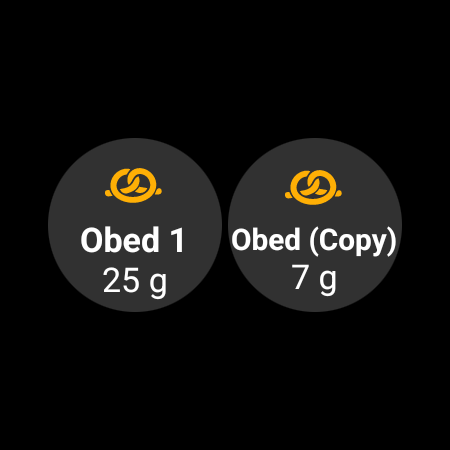

(quickwizards)=
# QuickWizards (Bolus mit einem Tippen)

Ein **QuickWizard** ist ein gespeicherter Knopf für eine wiederkehrende Mahlzeit oder Situation, der mit einem Tippen ausgelöst wird. Er enthält eine feste Menge **Kohlenhydrate** (und wie dafür dosiert wird), sodass Du mit einem einzigen Tippen und einer Bestätigung einen Bolus abgeben – oder nur Kohlenhydrate eintragen – kannst, statt jedes Mal den ganzen Bolus-Rechner zu öffnen.

```{contents} Table of contents
:depth: 2
:local: true
```

---

## QuickWizards öffnen

Öffne den Bildschirm **Bearbeiten** (untere Navigationsleiste) und wähle **QuickWizard** (*„QuickWizard-Voreinstellungen verwalten“*).

---

## QuickWizards verwalten

Deine QuickWizards werden als **Karten zum Durchwischen** angezeigt (jede Karte zeigt den Schaltflächentext, die Kohlenhydrate und den Gültigkeitszeitraum). Der Editor darunter stellt den **ausgewählten** ein; die Leiste unten hat **➕ hinzufügen**, **⧉ klonen**, **🗑️ löschen** und einen Knopf **▶**, um den ausgewählten QuickWizard auszuführen.


Die wichtigsten Felder des Editors sind:

- **Schaltflächentext** – die Beschriftung des Knopfs.
- **Kohlenhydrate** und **Zeitpunkt der KH-Aufnahme** – die Kohlenhydratmenge und ihr zeitlicher Versatz.
- **Gültigkeitszeitraum** – siehe [Gültigkeit](#quickwizard_validity).
- **Rechner-Optionen** und **Geräteauswahl** – siehe unten.

---

## Die drei Modi

Die Auswahl oben im Editor – **Bolus-Rechner / Insulin / Kohlenhydrate** – legt fest, **was der Knopf tut**, wenn Du darauf tippst:

- **Bolus-Rechner** – führt für die eingestellten Kohlenhydrate den vollständigen **Bolus-Rechner** aus und verwendet dabei Deine aktuellen Werte für **BZ, IOB, COB und Trend** (je nach den *Rechner-Optionen* unten). Er gibt den *berechneten* Bolus ab und trägt die Kohlenhydrate ein. Das ist der klassische QuickWizard.
- **Insulin** – gibt eine **feste, vorab eingestellte Insulinmenge** ab, die Du festlegst – ohne Berechnung.
- **Kohlenhydrate** – trägt **nur die eingestellten Kohlenhydrate** ein, **ohne Bolus**.

---

## Rechner-Optionen (Modus Bolus-Rechner)

Für einen Knopf im Modus **Bolus-Rechner** wählst Du, welche Werte in die Berechnung eingehen:

- **BZ verwenden**, **COB verwenden**, **IOB verwenden** (mit *Nur positives IOB*), **Trend verwenden** (*Alle / Nur positive / Nur negative*), **Temporäres Ziel verwenden**, **Alarm verwenden**.
- **Bolus-Prozentsatz** – passt den berechneten Bolus an.
- **eCarbs hinzufügen** – plant zusätzlich verzögerte Kohlenhydrate ein.


---

## Gültigkeit – wann der Knopf erscheint

(quickwizard_validity)= Der **Gültigkeitszeitraum** (*Von / Bis*) legt fest, **wann** ein QuickWizard angezeigt wird und verwendet werden kann. Ein Knopf, der zum Beispiel auf **06:00–10:00** eingestellt ist, erscheint nur morgens – so verstopft ein QuickWizard *Frühstück* beim Abendessen nicht Deinen Bildschirm (und wird nicht versehentlich angetippt). Außerhalb seines Zeitraums ist der Knopf im Fenster **Behandlungen** und in der [Schnellstart-Leiste](QuickLaunch.md) ausgeblendet. Ein Knopf in der Leiste wird nicht gelöscht: Er kommt zurück, wenn der Zeitraum wieder beginnt.

Ist der Gültigkeitszeitraum kürzer als 4 Stunden, wird der Knopf außerdem 30 Minuten nach der Verwendung ausgeblendet, damit dieselbe Mahlzeit nicht versehentlich zweimal eingetragen wird.

---

## Wo Du ihn verwendest

Die Schalter unter **Geräteauswahl** legen fest, wo jeder QuickWizard erscheint:

- **Auf Smartphone anzeigen** – er erscheint im **Fenster [Behandlungen](../Maintenance/V4Changes.md)** (mit der berechneten Dosis direkt auf dem Knopf). Ein QuickWizard, der auf dem Smartphone angezeigt wird, kann auch **als Schnellaktions-Knopf in der Übersicht angeheftet** werden: Öffne *Schnellstart konfigurieren* (das ⚙ in der [Schnellstart](QuickLaunch.md)-Leiste) und füge ihn aus der Kategorie **Quick Wizard** hinzu.
- **Auf Smartwatch anzeigen** – er erscheint auf der **QuickWizard-Kachel von Wear OS** (wische im Kachel-Karussell der Smartwatch dorthin und tippe dann auf einen Knopf, um ihn auszuführen – genau wie bei der [Szenen-Kachel](#scenes-from-watch)).

```{admonition} Don't see Device Selection?
:class: note
Der Bereich **Geräteauswahl** erscheint im Editor nur, wenn das Modul **Wear** eingeschaltet ist und seine Einstellung **Steuerung über Wear OS** aktiviert ist. Ohne sie wird jeder QuickWizard einfach auf dem Smartphone angezeigt.
```

Auf dem Smartphone erscheinen die QuickWizards oben im Fenster **Behandlungen**:


…und als Schnellaktions-Knopf in der Übersicht:




Ein gekoppelter **Client** (**AAPSClient**) kann einen QuickWizard ebenfalls auslösen – der **Master** berechnet und gibt ihn ab (siehe [Master ↔ Client-Steuerung](../RemoteFeatures/ClientMasterControl.md)).

Egal, wo er ausgelöst wird: Ein Tippen auf einen QuickWizard zeigt immer zuerst eine **Bestätigung** (die vom Master formulierte Bestätigung, wenn er von einem Client oder einer Smartwatch ausgelöst wird), bevor etwas abgegeben wird.

Ein QuickWizard wird abgelehnt, wenn seine Dosis über Deinem maximalen Bolus liegt oder seine Kohlenhydrate bzw. eCarbs über Deinen maximalen Kohlenhydraten liegen (zum Beispiel, nachdem Du die Grenze gesenkt hast). Liegen die Kohlenhydrate über der Grenze, ist der Knopf im Fenster **Behandlungen** gesperrt. Passe den QuickWizard oder die Grenze an.

---

## Hinzufügen und entfernen

- **➕ Hinzufügen** – einen neuen QuickWizard anlegen.
- **⧉ Klonen** – einen als Ausgangspunkt kopieren.
- **🗑️ Löschen** – einen entfernen.

Ab zwei QuickWizards kannst Du auch ihre Reihenfolge im Karussell ändern: Tippe oben auf das Symbol **Reihenfolge ändern** (⇅), verschiebe die mittlere Karte mit den **Knöpfen ◀ / ▶** und bestätige mit **✓**. (Die Bedienung ist dieselbe wie beim [Ändern der Reihenfolge der Profile](ProfileSwitch-ProfilePercentage.md).)

QuickWizards gehören zur abgeglichenen Konfiguration und werden deshalb zwischen Deinem Master und gekoppelten Clients geteilt.

---


<!-- =====================================================================
     Screenshots captured from a real master device:
       - quickwizard_editor.png   (Manage → QuickWizard: carousel, mode, carbs, carb time, valid time range)
       - quickwizard_options.png  (Calculator Options, Bolus percentage, Device Selection)
       - quickwizard_overview.png (the QuickWizard quick-action button on the overview)
       - quickwizard_watch_tile.png (the Wear OS QuickWizard tile)
     No QuickWizard was actually run (no bolus delivered).
     Maintainers: relocate page + images and fix cross-links as needed.
     ===================================================================== -->
