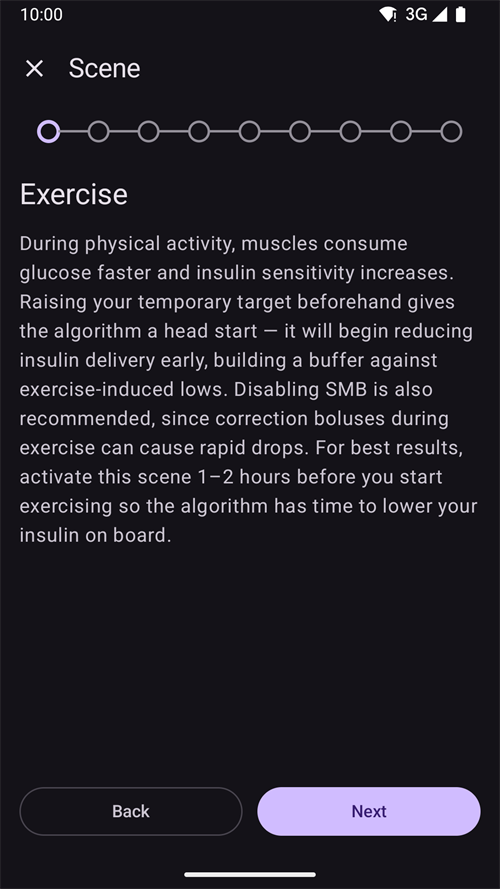
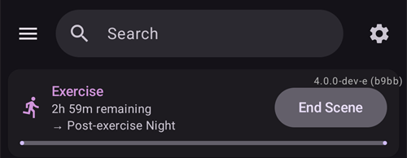

(scenes)=
# Szenen (Voreinstellungen für bestimmte Situationen)

Eine **Szene** ist eine benannte Voreinstellung, die **mehrere Aktionen auf einmal** ausführt – zum Beispiel eine Voreinstellung *Schlaf*, *Bewegung* oder *Krankheitstag*, die mit einem einzigen Tippen Dein Profil wechselt, ein temporäres Ziel setzt, SMB ein- oder ausschaltet und eine Careportal-Notiz einträgt, auf Wunsch für eine festgelegte Dauer.

```{contents} Table of contents
:depth: 2
:local: true
```

---

## Was ist eine Szene

Statt jedes Mal mehrere Dinge von Hand zu ändern, wenn eine wiederkehrende Situation eintritt, richtest Du sie einmal als Szene ein und aktivierst sie mit einem Tippen. Eine Szene kann jede dieser Aktionen bündeln:

- **Profilwechsel** – das Profil wechseln und/oder es prozentual anpassen (z. B. 70 %).
- **Temporäres Ziel** – ein temporäres Ziel setzen (z. B. *Aktivität*, *Bald essen* oder einen eigenen Wert).
- **SMB ein/aus** – Super-Mikroboli aktivieren oder deaktivieren, solange die Szene aktiv ist.
- **AAPS-Modus** – den AAPS-Modus ändern (z. B. auf einen vorsichtigeren Modus).
- **Careportal-Notiz** – ein Ereignis eintragen (z. B. *Bewegung*, *Krankheit*), damit es im Diagramm und in Nightscout erscheint.

Eine Szene hat außerdem eine **Dauer** – eine feste Zeit (Minuten/Stunden/Tage) oder *Unbegrenzt (manuelles Ende)* – und eine **Aktion am Ende**, die ausgeführt wird, wenn sie endet: entweder eine **Benachrichtigung**, oder sie kann in eine andere Szene **übergehen** (zum Beispiel *Krankheitstag → Bewegung*).

---

## Szenen verwalten

Öffne **Verwalten → Szenen**, um Deine Szenen anzusehen, zu erstellen, zu bearbeiten, ein- oder auszuschalten und neu zu ordnen.


Jede Szenen-Karte zeigt:

- ein **Kästchen**, um die Szene ein- oder auszuschalten,
- ein **Symbol** und einen **Namen**,
- eine Zusammenfassung – *„N Aktionen, Dauer“* – und die **→ Folgeszene**, wenn sie in eine andere übergeht,
- und drei Knöpfe: **▶ aktivieren**, **✏️ bearbeiten**, **🗑️ löschen**.

Tippe auf den Knopf **+**, um eine neue Szene zu erstellen.

---

## Eine Szene erstellen oder bearbeiten

### Mit einer Vorlage beginnen

Um eine Szene zu **erstellen**, tippe im Bildschirm Szenen auf den Knopf **+**. Der erste Schritt ist **Mit einer Vorlage beginnen**: Wähle eine fertige Szene für eine typische Situation – *Bewegung*, *Krankheitstag*, *Krankheitstag — Erbrechen*, *Schlaf*, *Nach der Bewegung (Nacht)*, *Vor der Mahlzeit*, *Alkohol*, *Autofahren*, *Baden*, *Lutealphase*, *Heißes Wetter*, *Medizinischer Eingriff* – oder beginne mit einer *Leeren Vorlage*. Jede Vorlage **füllt die empfohlenen Aktionen vor**, und Du kannst in den folgenden Schritten alles anpassen.


Nachdem Du eine Vorlage gewählt hast, wird ihr Zweck erklärt – *wann* und *warum* Du sie verwendest –, bevor es weitergeht:



### Die Aktionen Schritt für Schritt durchgehen

Der Rest des Editors ist ein kurzer Assistent, der Dich **Schritt für Schritt** führt. Jeder Schritt ist eine Art von Aktion mit einem Schalter *„… in die Szene aufnehmen“* – schalte ihn nur bei den Aktionen ein, die diese Szene ausführen soll, und lass die übrigen aus.


Gehe die Schritte mit **Weiter**/**Zurück** durch: *Profilwechsel*, *Temporäres Ziel*, *SMB*, *AAPS-Modus*, *Careportal-Notiz*, dann die **Dauer**, die **Aktion am Ende** (benachrichtigen oder in eine andere Szene übergehen) und zum Schluss **Name und Symbol** der Szene. Speichere, wenn Du fertig bist. (Um eine vorhandene Szene zu **bearbeiten**, tippe auf ihren Knopf **✏️** – Du landest direkt in diesen Schritten.)

Jeder Schritt beginnt mit einer kurzen Erklärung, was die Aktion bewirkt. So sehen die Schritte aus, hier mit der Vorlage *Bewegung*:

**Temporäres Ziel** – wähle eine Deiner Vorlagen für temporäre Ziele:


**SMB** – SMB aktivieren oder deaktivieren, solange die Szene aktiv ist:


**AAPS-Modus** – den AAPS-Modus optional ändern:


**Careportal** – Ereignistyp und Notiz, die eingetragen werden:


**Dauer** – wie lange die Szene aktiv bleibt; 0 bedeutet, bis Du sie selbst beendest:


**Folgeszene** – optional die Szene, die startet, wenn diese endet:


**Szene** – Name und Symbol. Tippe zum Speichern auf **Fertigstellen**:


---

## Eine Szene aktivieren

Aktiviere eine Szene in der Liste **Szenen** (Knopf **▶**) oder über den Eintrag **Szenen** in der unteren Navigationsleiste. Im Fenster **Szenen** der unteren Navigationsleiste zeigt jede Szene dieselbe Zusammenfassung wie in der Liste der Szenen, und der **Stift** oben im Fenster öffnet **Verwalten → Szenen**, um Deine Szenen zu erstellen oder zu bearbeiten.


Ist der [Bolus-Schutz](#Preferences-protection) eingeschaltet, fragt **AAPS** danach, bevor eine Szene startet oder endet. Zum Ändern einer Szene ist dagegen der [Schutz der Einstellungen](#Preferences-settings-protection) nötig.

Bevor irgendetwas übernommen wird, bekommst Du eine **Bestätigung**, die genau auflistet, was die Szene tun wird, damit Du es prüfen kannst:


Geht die Szene in eine andere über, endet die Bestätigung mit **→** und dem Namen dieser Folgeszene, genauso wie in der Liste der Szenen.

Startest Du die Szene über den Eintrag **Szenen** der unteren Navigationsleiste, ist die Bestätigung ein einfacherer Dialog mit derselben Liste von Aktionen. Tippe zum Aktivieren auf **OK**:


Nach Deiner Bestätigung werden die Aktionen ausgeführt, und die **aktive Szene** wird oben in der Übersicht mit einem Knopf **Szene beenden** angezeigt. Geht die Szene in eine andere über, nennt der Hinweis auch diese Folgeszene:



Die Aktionen der Szene bleiben wirksam, bis:

- ihre **Dauer** abläuft (dann wird die **Aktion am Ende** ausgeführt – eine Benachrichtigung oder der Übergang in die nächste Szene), oder
- Du auf **Szene beenden** tippst, um sie von Hand zu beenden. Geht die Szene in eine andere über, hast Du zwei Möglichkeiten: **Zu … springen**, also zur Folgeszene (die aktive Szene endet, und die Folgeszene startet sofort), oder **Szene beenden** (die aktive Szene endet, und die Folgeszene startet nicht).

Eine Szene ohne Folgeszene fragt nur nach Deiner Bestätigung:


Beim Beenden einer Szene werden ihre Änderungen **rückgängig gemacht** (zum Beispiel der Profilwechsel und das temporäre Ziel, die sie gestartet hat).

Solange eine Szene aktiv ist, tragen Profil und Zielwert auf dem Startbildschirm ein kleines Szenen-Symbol, wenn die Szene sie gesetzt hat. Das Fenster **Szenen** der unteren Navigationsleiste bleibt verfügbar, um eine andere Szene zu starten:


Läuft die Dauer von selbst ab, werden die Änderungen sofort rückgängig gemacht, und der Hinweis wechselt zu **Szene beendet** mit einem Knopf **Schließen**. Schließen entfernt nur den Hinweis vom Bildschirm – die Szene selbst ist schon vorbei, deshalb laufen Automatisierungsregeln und eine Folgeszene weiter, ohne darauf zu warten.

---

## Szenen über Automatisierungen auslösen

Eine Szene muss nicht von Hand gestartet werden – die **Automatisierung** kann das für Dich erledigen. Fügst Du einer Automatisierungsregel eine Aktion hinzu (**Verwalten → Automatisierung**), hat die Auswahl der Aktionen eine Kategorie **Szenen**:

- **Szene ausführen** – aktiviert eine Szene, wenn die Bedingungen der Regel erfüllt sind (zum Beispiel zu einer bestimmten Uhrzeit, wenn Du irgendwo ankommst oder wenn die Glukose eine Schwelle überschreitet).
- **Szene aktivieren** / **Szene deaktivieren** – macht eine Szene verfügbar (oder nicht verfügbar), ohne sie zu starten.


Die Automatisierung kann auch **auf eine Szene reagieren**: Die Liste der Bedingungen enthält eine Bedingung **Szene**, sodass eine Regel nur ausgeführt wird, solange eine bestimmte Szene aktiv ist. Zusammen mit der **Aktion am Ende** einer Szene (rückgängig machen, benachrichtigen oder in eine andere Szene übergehen) können Szenen so automatisch starten, aufeinander folgen und enden.

---

## Szenen mit Master/Client und Smartwatch

**Die aktive Szene wird auf allen gekoppelten Geräten abgeglichen** – aktivierst Du sie auf einem Smartphone, zeigen die anderen sie auch an.

Ein gekoppelter **Client** (**AAPSClient**) kann eine Szene ebenfalls aktivieren oder beenden: Die Anfrage geht an den **Master**, der die Bestätigung formuliert und die Szene auf seinem eigenen Stand ausführt. Wie das funktioniert, steht unter [Master ↔ Client-Steuerung](../RemoteFeatures/ClientMasterControl.md).

(scenes-from-watch)=
### Von einer Wear OS-Smartwatch

Szenen gibt es auf einer **Wear OS-Smartwatch** als **Szenen-Kachel**. Wische im Kachel-Karussell der Smartwatch zur Kachel **Szene** (füge sie zuerst aus der Kachel-Liste des Karussells hinzu, falls sie noch nicht da ist) und tippe auf die Szene, die Du starten willst:


Die Kachel hat vier Plätze. Standardmäßig füllt sich jeder Platz **automatisch** mit der nächsten Deiner eingeschalteten Szenen, in der Reihenfolge, die sie auf dem Smartphone haben. Um selbst zu wählen, **drücke lange auf die Kachel** und öffne ihre Einstellungen: Für jeden der vier Plätze kannst Du **Automatisch** beibehalten, eine **bestimmte Szene** festlegen oder **Kein(e)** wählen, um den Platz leer zu lassen. Ein Platz, der auf eine inzwischen gelöschte oder ausgeschaltete Szene festgelegt ist, zeigt **Nicht verfügbar** – wähle dafür eine andere Szene.

Die Smartwatch zeigt dann eine Bestätigung – tippe auf **✓**, um zu aktivieren, oder wische zurück, um abzubrechen:


Genau wie bei einem Client **formuliert der Master die Bestätigung und führt die Szene aus**; die Smartwatch leitet die Anfrage nur weiter (über das Client-Smartphone, wenn die Smartwatch mit einem Client gekoppelt ist).

Solange eine Szene läuft – oder ihr Hinweis **Szene beendet** noch auf dem Smartphone steht –, zeigt die Kachel einen Knopf **Ende** mit dem Namen der Szene darunter. Tippe darauf, um die aktive Szene zu beenden oder den übrig gebliebenen Hinweis zu entfernen, direkt vom Handgelenk aus.

Geht die laufende Szene in eine andere über, zeigt die Kachel außerdem einen Knopf **Überspringen** mit dem Namen der Folgeszene darunter. Das sind dieselben zwei Möglichkeiten wie auf dem Smartphone:

- **Ende** – die aktive Szene endet. Die Bestätigung weist darauf hin, dass die Folgeszene nicht startet.
- **Überspringen** – die aktive Szene endet, und die Folgeszene startet sofort. Die Bestätigung nennt beide Szenen.

Der [Bildschirm Loop-Status](#WearOsSmartwatch-loop-status) der Smartwatch zeigt ebenfalls die aktive Szene, ihre verbleibende Zeit und ihre Folgeszene.

---


<!-- =====================================================================
     Screenshots captured from a real master device:
       - scenes_list.png        (Manage → Scenes management list)
       - templates_picker.png   (create: "Start from template" picker)
       - template_explanation.png (create: chosen template's explanation)
       - scene_editor.png       (scene editor, Profile switch step)
       - scene_confirmation.png (scene activation confirmation — also used on the Client/Master page)
       - scene_active_banner.png (overview active-scene banner with the End Scene button)
       - automation_scene_action.png (Automation action picker — Scenes category)
       - scene_watch_tile.png    (Wear OS Scene tile)
       - scene_watch_confirm.png (Wear OS scene confirmation)
     Maintainers: relocate page + images and fix cross-links as needed.
     ===================================================================== -->
