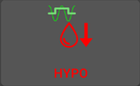
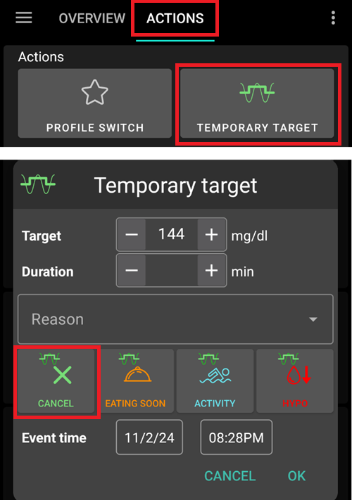
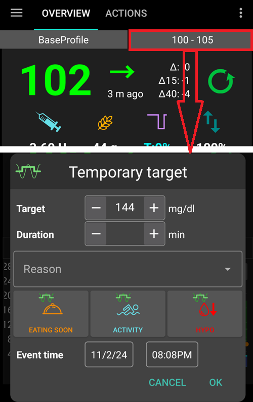
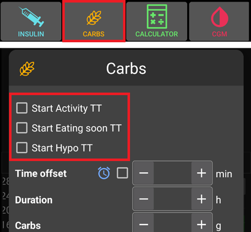
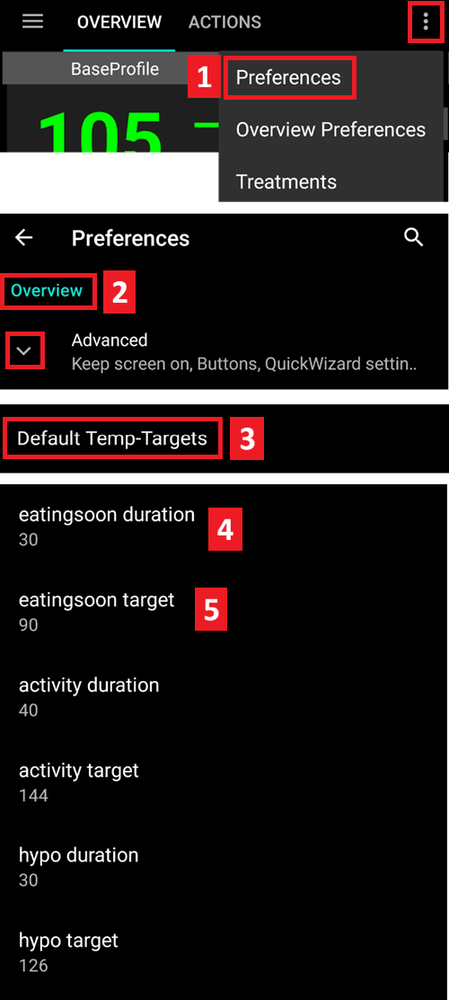
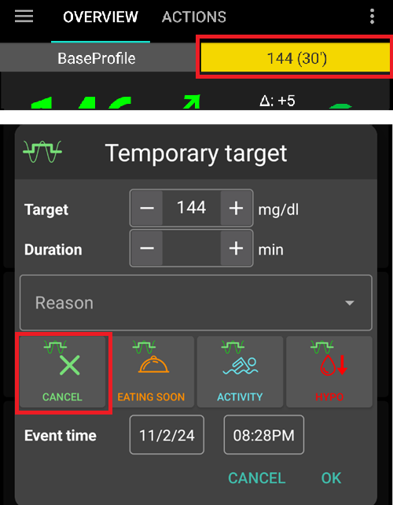
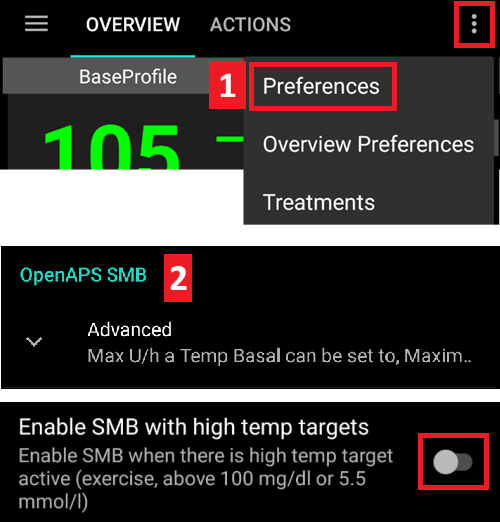

# Temporäre Ziele

## Was sind temporäre Ziele und wie nutzt und richtet man sie ein?

Mit der **AAPS**-Funktion **Temporäres Ziel** (oder **TT** - „temp target“) kannst Du Dein [**Glukose**ziel](#profile-glucose-targets) vor geplanten (körperlichen) Aktivitäten anpassen. **AAPS** verändert dadurch die Insulingaben.

Ein Glukoseziel, insbesondere wenn es nur kurz (weniger als 4 Stunden) gültig ist, muss nicht der *tatsächliche Wert* sein, den Du erreichen möchtest, sondern kann ein guter Weg sein **AAPS** - während der Glukosewert im Zielbereich gehalten wird - aggressiver oder weniger aggressiv zu machen.

Temporäre Ziele können innerhalb dieser Grenzen definiert werden:

|         | Temporäres Ziel        |
| ------- | ---------------------- |
| Minimum | 4 mmol/L or 72 mg/dL   |
| Maximum | 10 mmol/L or 180 mg/dL |

**AAPS** provides three built-in **Temp-Target** presets suitable for exercise (**Activity**), meals (**Eating Soon**) and predicted hypoglycemia (**Hypo**). They live on the **Temp Target** screen (**Manage** → **Temp Target**), which you can also open by simply tapping the **target chip** on the main screen.

Du musst verstehen, was Du mit der Funktion "**Temporäres Ziel**" in **AAPS** erreichen kannst. Das Erreichen eines gewünschten **Glukose**-Ziels hängt von verschiedenen Faktoren ab: der Zuverlässigkeit der **AAPS**-Einstellungen, der Qualität des gesamten **Glukose**-Managements, dem **IOB**, der Insulinempfindlichkeit, der Insulinresistenz, der Trainingsintensität und so weiter.

Es kann 30 Minuten oder länger dauern, um mit einem **Temporären Ziel** das angestrebte **Glukoseziel** zu erreichen. Dir muss bewusst sein, dass **AAPS** das **Glukoseziel** mit Hilfe eines **Temporären Ziels** nicht sofort erreichen kann.

The sections below summarize the features of **Temp-Target- Activity**, **Temp-Target- Eating soon**, and **Temp-Target-Hypo**. The values shown are the shipped defaults — you can [adjust each preset](#TempTargets-change-preset-defaults) to your own needs.

### Temporäres Ziel - Aktivität


**BG Target (default preset, adjustable)**

AAPS will aim to reach 140 mg/dL or 7.8 mmol/L for 1 h 30 min

**Andere Überlegungen, die bei der Auswahl Einfluss haben können**:

**AAPS** wird, in Abhängigkeit vom **Glukosewert**, die Insulingaben „verringern“, um das **Glukosewert**-Ziel zu erreichen. Wenn das **Glukosewert**-Ziel nicht erreichbar ist (z.B. weil es oberhalb des im **Profil** festgelegten **Glukosewert**-Ziels liegt), dann kann **AAPS** die Basalgaben fortsetzen.

Im Closed-Loop-Modus, **SMB**s:

- *können* deaktiviert sein (weiter unten diskutiert); und/oder
- das Basal kann aktiviert werden, wenn **AAPS** negatives **IOB** erkennt oder <0.

Es ist eine Überlegung wert:

- das **temporäre Ziel** 1-2 Stunden vor der geplanten Aktivität zu *setzen*, so dass ausreichend Zeit ist, genügend IOB zu reduzieren. Der richtige Zeitpunkt ist von Person zu Person verschieden und
- ein temporäres (reduziertes) Profil für die Dauer der geplanten Aktivität zu *setzen*, und so ein reduziertes **IOB** zu bekommen
- *ensuring* **TT** is timed to be *deactivated* shortly before the exercise as reduced **IOB** as some users experience a rapid rise in **BG** post exercise.

### Temporäres Ziel - Bald essen


**BG Target (default preset, adjustable)**

AAPS will aim to reach 90 mg/dL or 5.0 mmol/L for 45 minutes

**Andere Überlegungen, die bei der Auswahl Einfluss haben können**:

Im Closed-Loop-Modus, **SMB**s:

- bleiben aktiviert und/oder
- das Basal kann, abhängig von den gewählten **Profil**-Einstellungen, ebenfalls aktiviert werden.

**AAPS** wird, in Abhängigkeit vom **Glukosewert** und innerhalb der gesetzten Parameter in **AAPS**, die Insulingaben „erhöhen“, um das **Glukosewert**-Ziel zu erreichen.

### Temporäres Ziel - Hypo



**BG Target (default preset, adjustable)**

AAPS will aim to reach 160 mg/dL or 8.9 mmol/L for 1 hour

**Andere Überlegungen, die bei der Auswahl Einfluss haben können**:

Im Closed-Loop-Modus, **SMB**s:

- *können* deaktiviert sein (weiter unten diskutiert); und/oder
- das Basal kann aktiviert werden, wenn **AAPS** negatives **IOB** erkennt oder <0.

(TempTargets-manage-v4)=

## Setting and managing temporary targets (Manage → Temp Target)

In **AAPS** v4 you manage your TT **presets** and start a temporary target from the **Manage** screen (bottom navigation) → **Temp Target** (*“Manage and set temporary targets”*).


The screen has three parts:

1. **Preset carousel** (top) — swipe through your TT presets. Each card shows the preset's **name**, **target** and **duration**; the currently running TT is highlighted.
2. **Editor** (middle) — the **Temporary target** and **Duration** that will actually be applied, plus an **Activation** date/time.
3. **Action bar** (bottom) — **➕ add**, **‘️ delete** and the **▶ activate** button.

Selecting a preset card loads its **target** and **duration** into the editor.

```{admonition} Built-in vs custom presets :class: note The built-in presets — **Eating Soon**, **Activity** and **Hypo** — always exist and **cannot be deleted** (you can change their values and save, though). Any presets you create yourself are **custom** and can be edited or deleted freely.

    <br />### Activating a temporary target
    
    Swipe to the preset you want (its values load into the editor), optionally adjust the **target**/**duration** in the editor, then tap **▶ Activate**. A confirmation shows the exact target, duration and reason before anything starts:
    
    
    
    After you confirm, the temporary target starts immediately (or at the chosen **Activation** time) and runs for the set **duration**.
    
    ```{admonition} Editing the numbers is a one-off — it does not change the preset
    :class: important
    The **target** and **duration** in the editor are the values **Activate** will use *right now*. If you change them, that change is **temporary**: it applies only to this activation and **does not modify the saved preset**. This lets you "tweak and activate" a one-off TT (for example activate *Activity* at a slightly different target today) without permanently altering the preset.
    

### Saving changes to a preset

If you *do* want to keep an edited value, **Save** it: when the editor differs from the selected preset, a **Save** icon appears in the top toolbar. Tapping it stores the current **target** and **duration** (and name, for custom presets) back into the selected preset. For the built-in presets, a **Revert to defaults** button (↺) also appears in the action bar: it brings back the preset's default values.


So the rule of thumb is:

- **Activate** → use the numbers **once** (preset unchanged).
- **Save** → make the numbers the preset's **new defaults**.

To put a built-in preset back the way it shipped, select it and tap the **↺ Revert** button — it appears in the action bar only for a **built-in** preset whose values currently differ from its factory defaults, and it restores that preset's original **target** and **duration**.

### Adding and removing presets

- **➕ Add** — create a **new custom preset** from the current editor values. The new card appears in the carousel.
- **‘️ Delete** — remove the selected **custom** preset. Built-in presets (*Eating Soon*, *Activity*, *Hypo*) cannot be deleted.

Once you have at least two **custom** presets, you can also change their order in the carousel: tap the **Reorder** icon (⇅) in the top bar, step the centred card with the **◀ / ▶ move buttons**, then confirm with **✓**. The built-in presets keep their places — only custom presets can be moved. (The controls look the same as [reordering profiles](ProfileSwitch-ProfilePercentage.md).)

Your presets are part of the synced configuration, so they are shared across your master and paired clients.

### Other ways to set a temporary target

A temporary target can also be set without opening this screen:

- with the **TT toggles in the Carbs dialog** — see [below](#TempTargets-carbs-dialog),
- with a **preset button on the [QuickLaunch toolbar](QuickLaunch.md)** — the *Temp Target Presets* category in *Configure QuickLaunch* offers a one-tap button for each of your presets,
- from a **Wear OS watch** (the **Temp Target** menu item / tile),
- from a paired **client** — see [Master ↔ Client control](../RemoteFeatures/ClientMasterControl.md),
- as part of a **[scene](Scenes.md)** (the *Temporary target* action), or
- from an **Automation** rule (*Start temp target* / *Stop temp target*).

* * *

(TempTargets-where-can-i-select-a-temp-target)=

## Wo kann ich ein Temporäres Ziel auswählen und setzen?

The quickest way is to tap the **target chip** on the main screen (it shows your current target range):



This opens the **Temp Target** screen described above — swipe to a preset and tap **▶ Activate**. The same screen is also reachable via **Manage** → **Temp Target**.

(TempTargets-carbs-dialog)= When entering carbs, you don't need to open the **Temp Target** screen at all: the **Carbs dialog** (**Treatments** → **Carbs**) has **Start Hypo TT**, **Start Eating soon TT** and **Start Activity TT** toggles at the top. Switch one on and the corresponding preset is activated together with the carb entry:



    {admonition} Automatic Hypo TT
    :class: note
    If you open the **Carbs dialog** while your glucose is below 72 mg/dL (4 mmol/L), **AAPS** pre-selects the **Start Hypo TT** toggle for you (unless a higher temporary target with a longer remaining duration is already running).

(TempTargets-change-preset-defaults)=

## Wo kann ich die vorgegebenen temporären Ziele ändern und mit meinen eigenen Einstellungen überschreiben?

Each preset's **target** and **duration** are edited directly on the **Temp Target** screen — there is no separate preferences entry for this anymore:

1. Open the **Temp Target** screen (tap the target chip, or **Manage** → **Temp Target**).
2. Swipe to the preset you want to change.
3. Adjust **Temporary target** and/or **Duration** in the editor.
4. Tap the **Save** icon that appears in the top toolbar.



While the editor differs from a built-in preset's factory values, a **↺ Revert** button also appears in the action bar — tap it to restore the preset's original target and duration.

## Wie kann ich ein temporäres Ziel abbrechen?

While a temporary target is running, the target chip on the main screen shows the target and its remaining time. Tap it — on the **Temp Target** screen the running preset is highlighted as **ACTIVE**, and a red **✗ Cancel** button appears at the end of the toolbar at the bottom, just left of the **▶ Activate** button. Tap it and confirm:



A running temporary target can also be stopped from a **Wear OS watch**, from a paired **client**, or by an **Automation** rule (*Stop temp target*).

(TempTargets-hypo-temp-target)=

## Temporäres Ziel für Hypos

Das **temporäre Hypo-Ziel** soll **AAPS** helfen durch reduzieren der Indulinzufuhr niedrige Glukosewerte zu vermeiden. Wenn Du erwartest, dass Dein **Glukosewert** bald niedrig sein wird: Normalerweise sollte **AAPS** das lösen können. Die richtigen und getesteten (stabile) **AAPS**-Einstellungen sind dabei allerdings entscheidend. Ein **Temp-Target Hypo** kann frühzeitig einer erwarteten Hypo entgegenwirken und damit **AAPS** durch das geänderte erhöhte Ziel, Insulin reduzieren lassen.

Manchmal, wenn bei einer Hypo-Behandlung Kohlenhydrate gegessen werden, kann der **Blutzucker** des schnell ansteigen, und **AAPS** wird gegen den schnell steigenden **Blutzucker** korrigieren, indem es **SMBs** abgibt.

Manchmal will man die Abgabe von **SMBs** während eines gesetzten erhöhten temporären Ziels (**Temp-Target Hypo**) aussetzen, um so eine Hypo zu vermeiden. This is achieved by deactivating *'Enable SMB with high temp target'* in **Settings** → **OpenAPS SMB** (see further below):

- In (Advanced, objective 9): the user can enable *“High temp target raises sensitivity”* for **Temp-Targets** of 100 mg/dL (5.6 mmol/L) or higher in OpenAPS SMB, **AAPS** will be more sensitive.

- In (Advanced, objective 9): the user can deactivate *“Enable SMB with high temp target”*, so that even if **AAPS** has COB > 0, “Enable SMB with low temp target” or “Enable SMB always” enabled and OpenAPS SMB active, **AAPS** will not give SMBs while high temp targets are active.

Note: if you open the **Carbs dialog** while your blood glucose is less than 72 mg/dL or 4 mmol/L, **AAPS** pre-selects the **Start Hypo TT** toggle automatically.

(TempTargets-activity-temp-target)=

## Aktivitäten Temp-Target

Vor und während des Trainings benötigst Du möglicherweise ein höheres Ziel, um eine Hypoglykämie während der Aktivität zu verhindern.

Um den Umgang mit dem **temporäres Ziel für Aktivitäten** zu vereinfachen, kannst Du ein für Dich passendes **temporäres Ziel für Aktivitäten** konfigurieren. Indem die Insulinmengen reduziert werden kannst Du Deinen **Glukosewert** anheben, und so das Fallen des **Glukosewertes** verlangsamen und damit eine Hypoglykämie vermeiden.

New users to **AAPS** may need to experiment and personalize their **Temp-Target Activity** default settings in order to optimize this feature to work best for them. Wenn es darum geht, eine stabile Blutzuckerkontrolle während des Trainings zu erreichen, ist jeder ein wenig anders. Weitere Informationen findest Du in den [FAQ unter Sport](#FAQ-sports).

Manche machen einen **Profilwechsel** (ein Profil unter 100% zur reduzierten Insulinabgabe durch **AAPS**) vor und während das **temporäre Ziel für Aktivität** läuft. You can start both in one step: tap the profile name on the main screen, tap the round **▶** button, set a **Percentage** below 100 % and a **Duration**, then switch on **Temporary target / Activity**. See [Change the Profile Percentage](#ProfileSwitch-change-percentage).

Advanced, objective 9: users can enable *'High temp target raises sensitivity'* for **Temp-Targets** of 100 mg/dL (5.6 mmol/L) or higher in OpenAPS **SMB**. A target of 99 mg/dL (5.5 mmol/L) is a normal target, neither high nor low. **AAPS** reagiert dann empfindlicher (sensibler).

Additionally, if *'Enable SMB with high temp target'* is deactivated, **AAPS** will not deliver **SMBs**, even with COB > 0, *'Enable SMB with low temp target'* or *'Enable SMB always'* enabled and OpenAPS **SMB** active.

(TempTargets-eating-soon-temp-target)=

## Temporäres Ziel für „Bald essen“

**Temporäres Ziel für 'Bald essen'** kann ein langsames Abfallen des **Glukosewerts** und eine ausreichendes **IOB** bis zum Beginn der Mahlzeit erreichen.

Das ist eine gute Möglichkeit für diejenigen, die nicht 'vorbolen' (und damit einen SEA einhalten). Die Effektivität des **temporären Ziels für 'Bald essen'** hängt allerdings von verschiedenen Faktoren ab. Um auf einen Vorab-Bolus verzichten zu können spielen u.a. die persönlichen Einstellungen, die Art sich zu ernähren (Low Carb) und ob schnell wirkendes Insulin (wie Fiasp or Lyjumjev) genutzt wird, eine Rolle. Anfangs (bis Du erfahren im Umgang mit **AAPS** bist), solltest Du davon ausgehen auch mit einem **temporären Ziel für 'Bald essen'** weiterhin einen Vorab-Bolus abzugeben. Dies gilt insbesondere, wenn Du Dich kohlenhydratreich ernährst.

Im Artikel ['How to do "eating soon" mode'](https://diyps.org/2015/03/26/how-to-do-eating-soon-mode-diyps-lessons-learned/) oder [hier](https://diyps.org/tag/eating-soon-mode/) erfährst Du mehr zum „Bald essen“-Modus.

Für Fortgeschrittene, [Ziel (objective) 9](#objectives-objective9): Wenn Du OpenAPS SMB nutzt und *“Niedrige temporäre Ziele senken die Sensitivität”* aktivierst, agiert **AAPS** etwas aggressiver. For this option there is a requirement for **Temp-Target** to be 98 mg/dL (5.4 mmol/L) or lower.

## Wie kann ich SMB während eines Temp-Targets deaktivieren?

To action this open **Settings** → **OpenAPS SMB** and deactivate *'Enable SMB with high temp target'*.



This will ensure **AAPS** will not give **SMBs**, even with COB > 0, *'Enable SMB with low temp target'* or *'Enable SMB always'* enabled and OpenAPS SMB active.