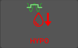
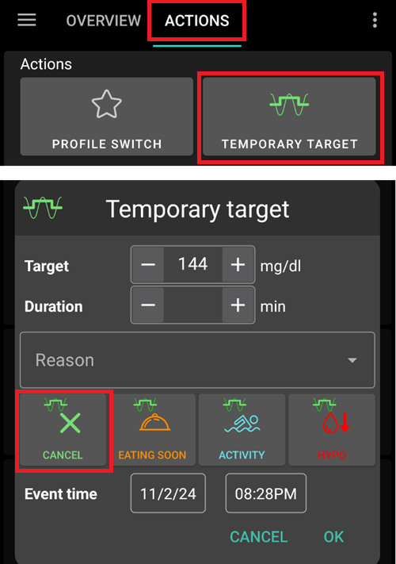
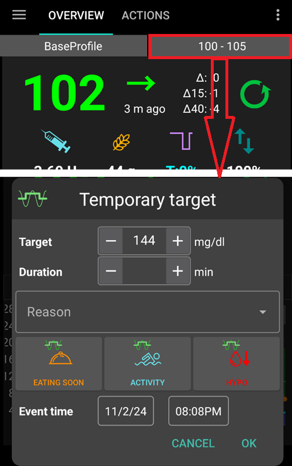
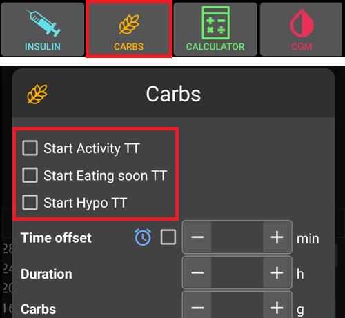
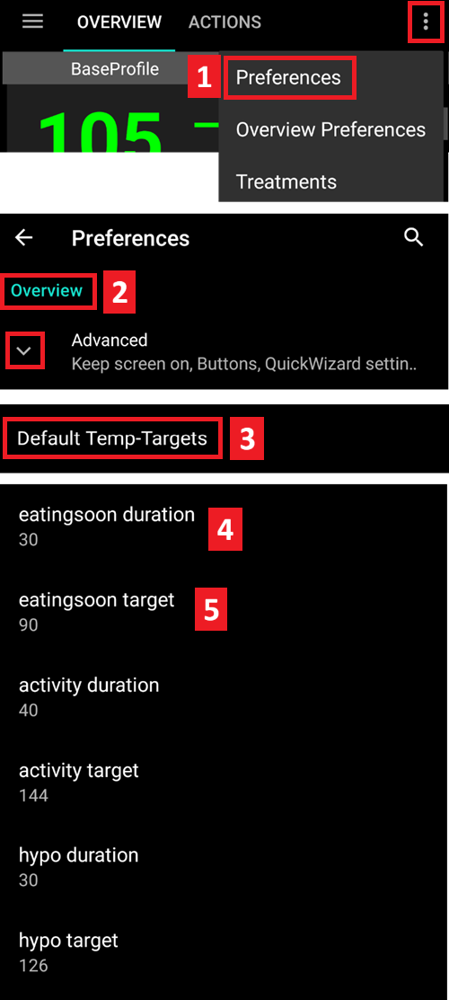
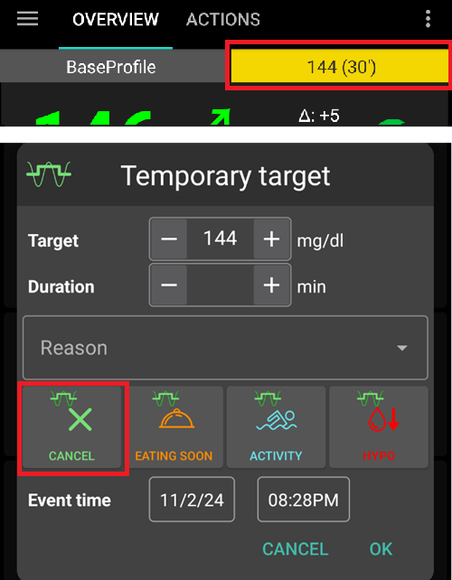
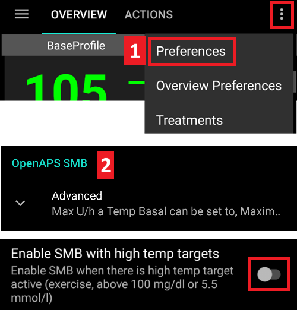

# Temporäre Ziele

## Was sind temporäre Ziele und wie nutzt und richtet man sie ein?

Mit der **AAPS**-Funktion **Temporäres Ziel** (oder **TT** - „temp target“) kannst Du Dein [**Glukose**ziel](#profile-glucose-targets) vor geplanten (körperlichen) Aktivitäten anpassen. **AAPS** verändert dadurch die Insulingaben.

Ein Glukoseziel, insbesondere wenn es nur kurz (weniger als 4 Stunden) gültig ist, muss nicht der *tatsächliche Wert* sein, den Du erreichen möchtest, sondern kann ein guter Weg sein **AAPS** - während der Glukosewert im Zielbereich gehalten wird - aggressiver oder weniger aggressiv zu machen.

Temporäre Ziele können innerhalb dieser Grenzen definiert werden:

|         | Temporäres Ziel          |
| ------- | ------------------------ |
| Minimum | 4 mmol/l oder 72 mg/dl   |
| Maximum | 10 mmol/l oder 180 mg/dl |

**AAPS** bringt drei eingebaute Vorlagen für **temporäre Ziele** mit, passend für Sport (**Aktivität**), Mahlzeiten (**Bald essen**) und eine vorhergesagte Unterzuckerung (**Hypo**). Sie befinden sich im Bildschirm **Temporäre Ziele** (**Verwalten** → **Temporäre Ziele**), den Du auch einfach durch Tippen auf die **Zielwert-Anzeige** auf dem Startbildschirm öffnen kannst.

Du musst verstehen, was Du mit der Funktion "**Temporäres Ziel**" in **AAPS** erreichen kannst. Das Erreichen eines gewünschten **Glukose**-Ziels hängt von verschiedenen Faktoren ab: der Zuverlässigkeit der **AAPS**-Einstellungen, der Qualität des gesamten **Glukose**-Managements, dem **IOB**, der Insulinempfindlichkeit, der Insulinresistenz, der Trainingsintensität und so weiter.

Es kann 30 Minuten oder länger dauern, um mit einem **Temporären Ziel** das angestrebte **Glukoseziel** zu erreichen. Dir muss bewusst sein, dass **AAPS** das **Glukoseziel** mit Hilfe eines **Temporären Ziels** nicht sofort erreichen kann.

Die folgenden Abschnitte fassen zusammen, wie **temporäres Ziel Aktivität**, **temporäres Ziel Bald essen** und **temporäres Ziel Hypo** funktionieren. Die angezeigten Werte sind die Standardwerte bei Auslieferung – Du kannst [jede Vorlage](#TempTargets-change-preset-defaults) an Deine eigenen Bedürfnisse anpassen.

### Temporäres Ziel - Aktivität


**Glukose-Zielwert (Standardvorlage, anpassbar)**

AAPS versucht, für 1 h 30 min einen Wert von 140 mg/dl bzw. 7,8 mmol/l zu erreichen

**Andere Überlegungen, die bei der Auswahl Einfluss haben können**:

**AAPS** wird, in Abhängigkeit vom **Glukosewert**, die Insulingaben „verringern“, um das **Glukosewert**-Ziel zu erreichen. Wenn das **Glukosewert**-Ziel nicht erreichbar ist (z.B. weil es oberhalb des im **Profil** festgelegten **Glukosewert**-Ziels liegt), dann kann **AAPS** die Basalgaben fortsetzen.

Im Closed-Loop-Modus, **SMB**s:

- *können* deaktiviert sein (weiter unten diskutiert); und/oder
- das Basal kann aktiviert werden, wenn **AAPS** negatives **IOB** erkennt oder <0.

Es ist eine Überlegung wert:

- das **temporäre Ziel** 1-2 Stunden vor der geplanten Aktivität zu *setzen*, so dass ausreichend Zeit ist, genügend IOB zu reduzieren. Der richtige Zeitpunkt ist von Person zu Person verschieden und
- ein temporäres (reduziertes) Profil für die Dauer der geplanten Aktivität zu *setzen*, und so ein reduziertes **IOB** zu bekommen
- *wobei* das **temporäre Ziel** so geplant wird, dass es kurz vor dem Sport *endet*, weil das **IOB** dann bereits verringert ist und bei manchen der **Glukosewert** nach dem Sport schnell ansteigt.

### Temporäres Ziel - Bald essen


**Glukose-Zielwert (Standardvorlage, anpassbar)**

AAPS versucht, für 45 Minuten einen Wert von 90 mg/dl bzw. 5,0 mmol/l zu erreichen

**Andere Überlegungen, die bei der Auswahl Einfluss haben können**:

Im Closed-Loop-Modus, **SMB**s:

- bleiben aktiviert und/oder
- das Basal kann, abhängig von den gewählten **Profil**-Einstellungen, ebenfalls aktiviert werden.

**AAPS** wird, in Abhängigkeit vom **Glukosewert** und innerhalb der gesetzten Parameter in **AAPS**, die Insulingaben „erhöhen“, um das **Glukosewert**-Ziel zu erreichen.

### Temporäres Ziel - Hypo



**Glukose-Zielwert (Standardvorlage, anpassbar)**

AAPS versucht, für 1 Stunde einen Wert von 160 mg/dl bzw. 8,9 mmol/l zu erreichen

**Andere Überlegungen, die bei der Auswahl Einfluss haben können**:

Im Closed-Loop-Modus, **SMB**s:

- *können* deaktiviert sein (weiter unten diskutiert); und/oder
- das Basal kann aktiviert werden, wenn **AAPS** negatives **IOB** erkennt oder <0.

(TempTargets-manage-v4)=

## Temporäre Ziele setzen und verwalten (Verwalten → Temporäre Ziele)

In **AAPS** v4 verwaltest Du Deine **Vorlagen** für temporäre Ziele und startest ein temporäres Ziel über den Bildschirm **Verwalten** (untere Navigationsleiste) → **Temporäre Ziele** (*„Temporäre Ziele verwalten und setzen“*).


Der Bildschirm hat drei Teile:

1. **Kartenkarussell der Vorlagen** (oben) – wische durch Deine Vorlagen für temporäre Ziele. Jede Karte zeigt **Name**, **Zielwert** und **Dauer** der Vorlage; das gerade laufende temporäre Ziel ist hervorgehoben.
2. **Editor** (Mitte) – das **Temporäre Ziel** und die **Dauer**, die tatsächlich angewendet werden, dazu Datum und Uhrzeit der **Aktivierung**.
3. **Aktionsleiste** (unten) – **➕ Hinzufügen**, **‘️ Löschen** und der Knopf **▶ Aktivieren**.

Wählst Du eine Karte aus, werden ihr **Zielwert** und ihre **Dauer** in den Editor geladen.

```{admonition} Eingebaute und eigene Vorlagen :class: note Die eingebauten Vorlagen – **Bald essen**, **Aktivität** und **Hypo** – gibt es immer, und sie **können nicht gelöscht werden** (ihre Werte kannst Du aber ändern und speichern). Alle Vorlagen, die Du selbst anlegst, sind **eigene** Vorlagen und lassen sich frei bearbeiten oder löschen.

    <br />### Ein temporäres Ziel aktivieren
    
    Wische zur gewünschten Vorlage (ihre Werte werden in den Editor geladen), passe bei Bedarf **Zielwert**/**Dauer** im Editor an und tippe dann auf **▶ Aktivieren**. Eine Bestätigung zeigt den genauen Zielwert, die Dauer und die Begründung, bevor etwas startet:
    
    
    
    Nachdem Du bestätigt hast, startet das temporäre Ziel sofort (oder zum gewählten Zeitpunkt der **Aktivierung**) und läuft für die eingestellte **Dauer**.
    
    ```{admonition} Das Ändern der Zahlen gilt nur einmal – die Vorlage bleibt unverändert
    :class: important
    **Zielwert** und **Dauer** im Editor sind die Werte, die **Aktivieren** *jetzt* verwendet. Änderst Du sie, ist diese Änderung **vorübergehend**: Sie gilt nur für diese Aktivierung und **verändert die gespeicherte Vorlage nicht**. So kannst Du ein temporäres Ziel einmalig „anpassen und aktivieren“ (zum Beispiel heute *Aktivität* mit einem etwas anderen Zielwert), ohne die Vorlage dauerhaft zu ändern.
    

### Änderungen in einer Vorlage speichern

Möchtest Du einen geänderten Wert *doch* behalten, **speichere** ihn: Weicht der Editor von der ausgewählten Vorlage ab, erscheint in der oberen Leiste das Symbol **Speichern**. Ein Tippen darauf speichert den aktuellen **Zielwert** und die **Dauer** (bei eigenen Vorlagen auch den Namen) in der ausgewählten Vorlage. Bei den eingebauten Vorlagen erscheint in der Aktionsleiste außerdem ein Knopf **Auf Standardwerte zurücksetzen** (↺): Er stellt die Standardwerte der Vorlage wieder her.


Als Faustregel gilt also:

- **Aktivieren** → die Zahlen **einmal** verwenden (Vorlage unverändert).
- **Speichern** → die Zahlen zu den **neuen Standardwerten** der Vorlage machen.

Um eine eingebaute Vorlage auf den Auslieferungszustand zurückzusetzen, wähle sie aus und tippe auf den Knopf **↺ Zurücksetzen** – er erscheint in der Aktionsleiste nur bei einer **eingebauten** Vorlage, deren Werte gerade von den Werkseinstellungen abweichen, und stellt den ursprünglichen **Zielwert** und die ursprüngliche **Dauer** dieser Vorlage wieder her.

### Vorlagen hinzufügen und entfernen

- **➕ Hinzufügen** – legt aus den aktuellen Werten im Editor eine **neue eigene Vorlage** an. Die neue Karte erscheint im Karussell.
- **‘️ Löschen** – entfernt die ausgewählte **eigene** Vorlage. Eingebaute Vorlagen (*Bald essen*, *Aktivität*, *Hypo*) können nicht gelöscht werden.

Sobald Du mindestens zwei **eigene** Vorlagen hast, kannst Du auch ihre Reihenfolge im Karussell ändern: Tippe oben in der Leiste auf das Symbol **Reihenfolge ändern** (⇅), verschiebe die mittlere Karte mit den **◀ / ▶ Verschiebe-Knöpfen** und bestätige mit **✓**. Die eingebauten Vorlagen behalten ihren Platz – nur eigene Vorlagen lassen sich verschieben. (Die Bedienung ist dieselbe wie beim [Ändern der Reihenfolge der Profile](ProfileSwitch-ProfilePercentage.md).)

Deine Vorlagen gehören zur synchronisierten Konfiguration und werden deshalb zwischen Deinem Master und gekoppelten Clients geteilt.

### Weitere Wege, ein temporäres Ziel zu setzen

Ein temporäres Ziel lässt sich auch setzen, ohne diesen Bildschirm zu öffnen:

- mit den **Schaltern für temporäre Ziele im Kohlenhydrat-Dialog** – siehe [unten](#TempTargets-carbs-dialog),
- mit einem **Vorlagen-Knopf in der [Schnellstart-Leiste](QuickLaunch.md)** – die Kategorie *Vorlagen für temporäre Ziele* unter *Schnellstart konfigurieren* bietet für jede Deiner Vorlagen einen Knopf, der sie mit einem Tippen startet,
- von einer **Wear OS-Smartwatch** (Menüpunkt bzw. Kachel **Temporäres Ziel**),
- von einem gekoppelten **Client** – siehe [Master ↔ Client-Steuerung](../RemoteFeatures/ClientMasterControl.md),
- als Teil einer **[Szene](Scenes.md)** (die Aktion *Temporäres Ziel*) oder
- über eine **Automatisierungsregel** (*Temporäres Ziel (TT) starten* / *Temporäres Ziel (TT) stoppen*).

* * *

(TempTargets-where-can-i-select-a-temp-target)=

## Wo kann ich ein Temporäres Ziel auswählen und setzen?

Am schnellsten tippst Du auf dem Startbildschirm auf die **Zielwert-Anzeige** (sie zeigt Deinen aktuellen Zielbereich):



Damit öffnet sich der oben beschriebene Bildschirm **Temporäre Ziele** – wische zu einer Vorlage und tippe auf **▶ Aktivieren**. Derselbe Bildschirm ist auch über **Verwalten** → **Temporäre Ziele** erreichbar.

(TempTargets-carbs-dialog)= Wenn Du Kohlenhydrate eingibst, musst Du den Bildschirm **Temporäre Ziele** gar nicht öffnen: Der **Kohlenhydrat-Dialog** (**Behandlungen** → **Kohlenhydrate**) hat oben die Schalter **Starte Hypo-TT**, **Starte Essens-TT** und **Starte Aktivitäts-TT**. Schaltest Du einen davon ein, wird die passende Vorlage zusammen mit dem KH-Eintrag aktiviert:



    {admonition} Automatisches Hypo-TT
    :class: note
    Öffnest Du den **Kohlenhydrat-Dialog**, während Dein Glukosewert unter 72 mg/dl (4 mmol/l) liegt, wählt **AAPS** den Schalter **Starte Hypo-TT** für Dich vor (es sei denn, es läuft bereits ein höheres temporäres Ziel mit längerer Restdauer).

(TempTargets-change-preset-defaults)=

## Wo kann ich die vorgegebenen temporären Ziele ändern und mit meinen eigenen Einstellungen überschreiben?

**Zielwert** und **Dauer** jeder Vorlage bearbeitest Du direkt im Bildschirm **Temporäre Ziele** – einen eigenen Eintrag in den Einstellungen gibt es dafür nicht mehr:

1. Öffne den Bildschirm **Temporäre Ziele** (tippe auf die Zielwert-Anzeige oder auf **Verwalten** → **Temporäre Ziele**).
2. Wische zu der Vorlage, die Du ändern möchtest.
3. Passe im Editor **Temporäres Ziel** und/oder **Dauer** an.
4. Tippe auf das Symbol **Speichern**, das in der oberen Leiste erscheint.



Solange der Editor von den Werkseinstellungen einer eingebauten Vorlage abweicht, erscheint in der Aktionsleiste außerdem ein Knopf **↺ Zurücksetzen** – tippe darauf, um den ursprünglichen Zielwert und die ursprüngliche Dauer der Vorlage wiederherzustellen.

## Wie kann ich ein temporäres Ziel abbrechen?

Solange ein temporäres Ziel läuft, zeigt die Zielwert-Anzeige auf dem Startbildschirm den Zielwert und die Restzeit. Tippe darauf – im Bildschirm **Temporäre Ziele** ist die laufende Vorlage als **AKTIV** hervorgehoben, und am Ende der unteren Leiste, direkt links neben dem Knopf **▶ Aktivieren**, erscheint ein roter Knopf **✗ Abbrechen**. Tippe darauf und bestätige:



Ein laufendes temporäres Ziel kann auch von einer **Wear OS-Smartwatch**, von einem gekoppelten **Client** oder durch eine **Automatisierungsregel** (*Temporäres Ziel (TT) stoppen*) beendet werden.

(TempTargets-hypo-temp-target)=

## Temporäres Ziel für Hypos

Das **temporäre Hypo-Ziel** soll **AAPS** helfen durch reduzieren der Indulinzufuhr niedrige Glukosewerte zu vermeiden. Wenn Du erwartest, dass Dein **Glukosewert** bald niedrig sein wird: Normalerweise sollte **AAPS** das lösen können. Die richtigen und getesteten (stabile) **AAPS**-Einstellungen sind dabei allerdings entscheidend. Ein **Temp-Target Hypo** kann frühzeitig einer erwarteten Hypo entgegenwirken und damit **AAPS** durch das geänderte erhöhte Ziel, Insulin reduzieren lassen.

Manchmal, wenn bei einer Hypo-Behandlung Kohlenhydrate gegessen werden, kann der **Blutzucker** des schnell ansteigen, und **AAPS** wird gegen den schnell steigenden **Blutzucker** korrigieren, indem es **SMBs** abgibt.

Manchmal will man die Abgabe von **SMBs** während eines gesetzten erhöhten temporären Ziels (**Temp-Target Hypo**) aussetzen, um so eine Hypo zu vermeiden. Dazu deaktivierst Du *„SMB bei hohen temporären Zielen aktivieren“* unter **Einstellungen** → **OpenAPS SMB** (siehe weiter unten):

- Für Fortgeschrittene, Ziel 9: Du kannst in OpenAPS SMB *„Hohes temporäres Ziel erhöht die Insulinempfindlichkeit“* für **temporäre Ziele** ab 100 mg/dl (5,6 mmol/l) aktivieren, dann reagiert **AAPS** empfindlicher.

- Für Fortgeschrittene, Ziel 9: Du kannst *„SMB bei hohen temporären Zielen aktivieren“* deaktivieren. Selbst wenn **AAPS** dann COB > 0 hat, „SMB bei niedrigen temporären Zielen aktivieren“ oder „SMB immer aktivieren“ eingeschaltet und OpenAPS SMB aktiv ist, gibt **AAPS** bei aktiven hohen temporären Zielen keine SMBs ab.

Hinweis: Öffnest Du den **Kohlenhydrat-Dialog**, während Dein Glukosewert unter 72 mg/dl bzw. 4 mmol/l liegt, wählt **AAPS** den Schalter **Starte Hypo-TT** automatisch vor.

(TempTargets-activity-temp-target)=

## Aktivitäten Temp-Target

Vor und während des Trainings benötigst Du möglicherweise ein höheres Ziel, um eine Hypoglykämie während der Aktivität zu verhindern.

Um den Umgang mit dem **temporäres Ziel für Aktivitäten** zu vereinfachen, kannst Du ein für Dich passendes **temporäres Ziel für Aktivitäten** konfigurieren. Indem die Insulinmengen reduziert werden kannst Du Deinen **Glukosewert** anheben, und so das Fallen des **Glukosewertes** verlangsamen und damit eine Hypoglykämie vermeiden.

Wenn Du neu bei **AAPS** bist, musst Du möglicherweise etwas experimentieren und Deine Standardwerte für das **temporäre Ziel Aktivität** anpassen, damit diese Funktion für Dich am besten funktioniert. Wenn es darum geht, eine stabile Blutzuckerkontrolle während des Trainings zu erreichen, ist jeder ein wenig anders. Weitere Informationen findest Du in den [FAQ unter Sport](#FAQ-sports).

Manche aktivieren außerdem vor und während des **temporären Ziels Aktivität** einen **Profilwechsel** (ein Profil unter 100 %, damit **AAPS** weniger Insulin abgibt). Du kannst beides in einem Schritt starten: Tippe auf dem Startbildschirm auf den Profilnamen, tippe auf den runden Knopf **▶**, stelle einen **Prozentsatz** unter 100 % und eine **Dauer** ein und schalte dann **Temporäres Ziel / Aktivität** ein. Siehe [Prozentsatz des Profils auf dem Startbildschirm ändern](#ProfileSwitch-change-percentage).

Für Fortgeschrittene, Ziel 9: Du kannst in OpenAPS **SMB** *„Hohes temporäres Ziel erhöht die Insulinempfindlichkeit“* für **temporäre Ziele** ab 100 mg/dl (5,6 mmol/l) aktivieren. Ein Zielwert von 99 mg/dl (5,5 mmol/l) ist ein normales Ziel, weder hoch noch niedrig. **AAPS** reagiert dann empfindlicher (sensibler).

Ist außerdem *„SMB bei hohen temporären Zielen aktivieren“* deaktiviert, gibt **AAPS** keine **SMBs** ab, auch wenn COB > 0 ist, *„SMB bei niedrigen temporären Zielen aktivieren“* oder *„SMB immer aktivieren“* eingeschaltet und OpenAPS **SMB** aktiv ist.

(TempTargets-eating-soon-temp-target)=

## Temporäres Ziel für „Bald essen“

Ein **temporäres Ziel Bald essen** kann den **Glukosewert** sanft absenken und dafür sorgen, dass vor dem Essen genügend **IOB** vorhanden ist.

Das kann für alle, die keinen Vorab-Bolus abgeben, ein wichtiges Werkzeug sein. Wie wirksam das **temporäre Ziel Bald essen** ist, hängt aber von mehreren Faktoren ab, darunter die persönlichen Einstellungen, ob man sich kohlenhydratarm ernährt und ob ein schnell wirkendes Insulin (wie Fiasp oder Lyumjev) verwendet wird, um auf einen Vorab-Bolus verzichten zu können. Bis Du Erfahrung mit **AAPS** hast, solltest Du normalerweise auch beim **temporären Ziel Bald essen** einen Vorab-Bolus abgeben, besonders wenn Du Dich kohlenhydratreich ernährst.

Im Artikel ['How to do "eating soon" mode'](https://diyps.org/2015/03/26/how-to-do-eating-soon-mode-diyps-lessons-learned/) oder [hier](https://diyps.org/tag/eating-soon-mode/) erfährst Du mehr zum „Bald essen“-Modus.

Für Fortgeschrittene, [Ziel (objective) 9](#objectives-objective9): Wenn Du OpenAPS SMB nutzt und *“Niedrige temporäre Ziele senken die Sensitivität”* aktivierst, agiert **AAPS** etwas aggressiver. Voraussetzung für diese Option ist ein **temporäres Ziel** von 98 mg/dl (5,4 mmol/l) oder darunter.

## Wie kann ich SMB während eines Temp-Targets deaktivieren?

Öffne dazu **Einstellungen** → **OpenAPS SMB** und deaktiviere *„SMB bei hohen temporären Zielen aktivieren“*.



Damit stellst Du sicher, dass **AAPS** keine **SMBs** abgibt, auch wenn COB > 0 ist, *„SMB bei niedrigen temporären Zielen aktivieren“* oder *„SMB immer aktivieren“* eingeschaltet und OpenAPS SMB aktiv ist.