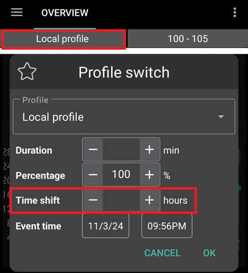
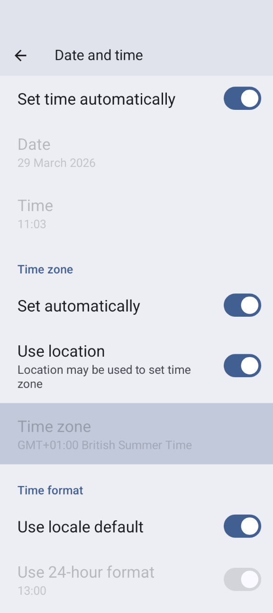
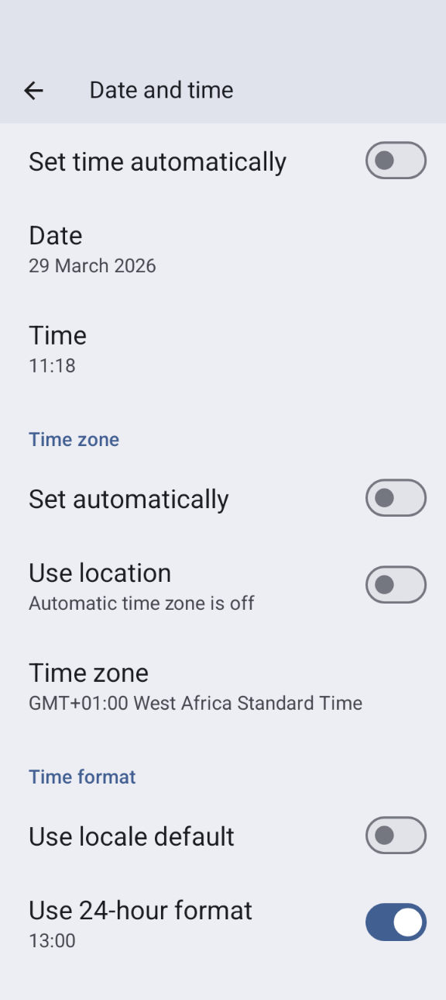

# Zeitzonenänderung und Zeitumstellung (Sommer-/ Winterzeit)

Wenn sich die Zeitzone Deines Smartphones ändert, berechnet **AAPS** **IOB**, Basal und Empfindlichkeit für die Vergangenheit etwa 10 Sekunden nach der Änderung komplett neu. Während das läuft, kann es einen Moment dauern, bis Diagramme und Werte auf dem Startbildschirm aktualisiert sind.

(timezone-traveling-with-pumps)=

## Zeitzonenwechsel mit Omnipod-Dash

* Aktualisiere den Pumpenstatus unter **Bearbeiten → Pumpe**
* Wähle temporär ein anderes **Profil** aus und wechsel danach wieder zurück auf Dein Ausgangs- oder Dein gewünschtes **Profil**

## Zeitzonenwechsel mit DanaR, koreanische DanaR

Es gibt keine Probleme beim Zeitzonenwechsel im Smartphone, da die Pumpe keine Historie verwendet

(timezone-traveling-danarv2-danars)=

## Zeitzonenwechsel mit DanaRv2, DanaRS, Dana-i

Da **AAPS** die Pumpenhistorie nutzt, die Einträge in der Pumpe aber keine Zeitangaben enthalten, benötigen diese Pumpen besondere Aufmerksamkeit. **Wenn Du die Zeitzone auf Deinem Smartphone änderst, bedeutet das, dass die Datensätze mit einer anderen Zeitzone ausgelesen und gedoppelt werden.**

Um dies zu vermeiden, gibt es zwei Möglichkeiten:

### Option 1: Heimatzeit beibehalten und Time Shift des Profils

* Schalte die automatische Einstellung von Datum und Uhrzeit in Deinem Smartphone aus (manueller Zeitzonen-Wechsel).

* Dein Smartphone muss für die gesamte Reise auf Datum und Zeit Deines Heimatortes eingestellt bleiben.

* Führe einen **Profil**wechsel mit Zeitverschiebung entsprechend dem Zeitunterschied Deines Heimatortes zum Zielort durch.
   
   * Tippe auf dem Startbildschirm auf den Namen des **Profils**, um den [Profil-Bildschirm](#ProfileSwitch-manage-v4) zu öffnen
   * Wähle Dein **Profil** und tippe auf **▶ Aktivieren**
   * Stelle die „**Zeitverschiebung**“ passend zu Deinem Reiseziel ein und tippe auf **Aktivieren**.
   
   
   
   * z. B. Wien -> New York: **Profilwechsel** +6 Stunden
   * z. B. Wien -> Sydney: **Profilwechsel** -8 Stunden

### Option 2: Pumpenhistorie löschen

* Schalte die automatische Einstellung von Datum und Uhrzeit in Deinem Smartphone aus (manueller Zeitzonen-Wechsel)

Wenn Du aus dem Flugzeug steigst:

* schalte die Pumpe aus
* ändere die Zeitzone auf dem Smartphone
* schalte das Smartphone aus, schalte die Pumpe an
* lösche die Historie der Pumpe
* ändere die Zeit in der Pumpe
* schalte das Smartphone an
* lasse das Smartphone mit der Pumpe verbinden und verfeinere die Zeiteinstellung

(timezone-traveling-insight)=

## Zeitzonenwechsel mit Insight

Der Treiber passt die Uhrzeit in der Pumpe automatisch an die Zeit im Smartphone an.

Die Insight dokumentiert auch die historischen Einträge, in denen die Zeit geändert wurde und von welcher (alten) Zeit zu welcher (neuen) Zeit. So kann die richtige Zeit in **AAPS** trotz der Zeitänderung bestimmt werden.

Es kann zu Ungenauigkeiten in der **TDDs** kommen. Das sollte allerdings unproblematisch sein.

Der Insight-Nutzer muss sich also nicht um Zeitumstellung oder den Wechsel von Zeitzonen kümmern. Es gibt eine Ausnahme zu dieser Regel: Die Insight Pumpe hat eine kleine interne Batterie, um die Zeit immer aktuell zu halten etc. während Du die "normale" Batterie wechselst. Dauert der Batteriewechsel zu lange, entlädt sich diese interne Batterie. Die Uhr wird dann zurückgesetzt, und nach dem Einlegen einer neuen Batterie wirst Du aufgefordert, Uhrzeit und Datum einzugeben. In diesem Fall werden alle Einträge vor dem Batteriewechsel in der Berechnung in AAPS übersprungen, da die richtige Zeit nicht korrekt erkannt werden kann.

## Zeitzonenwechsel mit Accu-Chek Combo

Der [Combo-Treiber](../CompatiblePumps/Accu-Chek-Combo-Pump-v2.md) passt die Uhrzeit der Pumpe automatisch an die Uhrzeit des Smartphones an. Die Combo kann keine Zeitzonen speichern, nur die Ortszeit, und genau diese programmiert der Treiber in die Pumpe. Zusätzlich wird die Zeitzone in den lokalen AAPS-Einstellungen hinterlegt, um die lokale Pumpenzeit in einen vollständigen Zeitstempel, der die entsprechende Zeitverschiebung enthält, umzurechnen. Du musst hier also nichts tun. Sollten die Abweichungen zwischen Combo und Smartphone zu groß werden, wird die Pumpenzeit automatisch korrigiert.

Es kann etwas dauern bis die Synchronisierung abgeschlossen ist, da die Anpassung nur mit einem langsamen Kommunikations-Protokoll (remote-terminal mode) gemacht werden kann. Das ist eine Combo-Beschränkung, die nicht umgangen werden kann.

## Zeitzonenänderung für Medtrum

Der Treiber passt die Uhrzeit in der Pumpe automatisch an die Zeit im Smartphone an.

Änderungen der Zeitzone haben ggf. einen Einfluss auf den gespeicherten Gesamtinsulinbedarf (TDD). Die übrige Historie bleibt unberührt. Manuelle Anpassungen der Uhrzeit kann zu Problemen mit der Pumpenhistorie und dem **IOB** führen. Falls Du die Uhrzeit manuell anpasst, überprüfe das **IOB** (aktives Insulin).

Wenn sich Zeitzone oder Uhrzeit ändern, werden laufende **TBRs** gestoppt.

(time-adjustment-daylight-savings-time-dst)=

## Zeitumstellung (Sommer-/Winterzeit)

Zeitumstellungen für Sommer- und Winterzeit.

Abhängig von Deiner Pumpe und dem CGM-Setup können Zeitsprünge zu **AAPS**-Problemen führen. Für einige Pumpen ist es deswegen besser, die Zeitumstellung nicht in der Nacht vorzunehmen, sondern diese auf den späten Abend, wenn Du noch wach bist, vorzuziehen.

### Automatische Sommer-/Winterzeitumstellung für die meisten Pumpen

* Allerdings wird der **Loop** für 3 Stunden NACH der Zeitumstellung (meist ab 1 Uhr nachts) deaktiviert, und **AAPS** fällt auf die Basalrate Deines **Profils** zurück. Dies geschieht aus Sicherheitsgründen - **IOB** kann wegen doppelter Boli vor der Zeitumstellung zu hoch sein.
* Mache nach der Zeitumstellung einen **Profilwechsel** zum gewünschten **Profil**, um den **Loop** zu aktivieren: Tippe auf dem Startbildschirm auf den Profilnamen und dann auf den runden Knopf **▶** (siehe [Ein Profil aktivieren](#ProfileSwitch-manage-v4)).
* Vor der Zeitumstellung wirst Du auf der **AAPS**-Übersicht eine Benachrichtigung erhalten, dass der **Loop** vorübergehend deaktiviert wurde. Das wird eine stille Benachrichtigung (ohne Töne, Vibrationen o. ä) sein.

Wenn Du den **AAPS**-Bolus-Rechner zum Bolen verwendest, schließe **COB** und **IOB**-Daten aus, es sei denn, Du bist Dir absolut sicher, dass die Daten korrekt sind. Sei vorsichtig und nutze den Bolus-Rechner in den ersten Stunden nach der Zeitumstellung nicht zum Bolen.

### Zeitumstellung für Accu-Chek Insight

* Zeitumstellung erfolgt automatisch. Keine Maßnahme erforderlich.

### Zeitumstellung für Accu-Chek Combo

* Zeitumstellung erfolgt automatisch. Keine Maßnahme erforderlich.

### Zeitumstellung für Medtrum

* Zeitumstellung erfolgt automatisch. Keine Maßnahme erforderlich.

### Zeitumstellung für Omnipod Dash

* Lass **AAPS** entweder nach der Zeitumstellung vorübergehend auf die Basalrate des Profils zurückfallen, wie oben beschrieben.
* Oder, wenn Du nicht möchtest, dass **AAPS** nachts vorübergehend auf die Basalrate des Profils zurückfällt, kannst Du die Zeitzone schon am Tag vor der Zeitumstellung ändern, um Störungen in der Nacht zu vermeiden. HINWEIS: DIESE OPTION KANN DAZU FÜHREN, DASS DEIN POD VORZEITIG UNBRAUCHBAR WIRD. STELLE BEI DIESEM WEG BITTE SICHER, DASS DU GENUG ERSATZ ZUR HAND HAST.

#### Vor der Zeitumstellung notwendige Maßnahmen

1. Schalte alle Einstellungen Deines Smartphones, die die Zeitzone des Smartphones automatisch anpassen, AUS. Damit kannst Du dann manuell auf eine Zeitzone wechseln, die keine Sommerzeit-Umstellung hat. Wie Du das machst, hängt von Deinem Smartphone und der Android-Version ab.
   
   * Manche Smartphones haben zwei Einstellungen: eine für die automatische Einstellung der Uhrzeit (die idealerweise eingeschaltet bleibt) und eine für die automatische Einstellung der Zeitzone (die Du AUSSCHALTEN musst: **Automatisch festlegen** unter **Zeitzone** im Screenshot unten).
   * Unglücklicherweise haben manche Android-Versionen nur eine Einstellmöglichkeit für beides zusammen. In diesem Fall musst Du eben beide ausschalten.

2. Suche Dir eine Zeitzone, die dieselbe Uhrzeit wie Du hat, aber nicht zwischen Winter- und Sommerzeit wechselt.
   
   * Eine Liste dieser Länder findest Du z.B. auf [https://greenwichmeantime.com/countries](https://greenwichmeantime.com/countries/).
   * Für die Mitteleuropäische Zeit (MEZ) könnte das „Brazzaville“ (Kongo) sein. Stelle die Zeitzone Deines Smartphones auf Kongo um.

3. Aktualisiere in **AAPS** die Pumpe und wechsle zu Deinem gewünschten **Profil**.

4. Prüfe **IOB** und **COB** in **AAPS**. Wenn sie nicht stimmen, deaktiviere den **Loop** für mindestens eine DIA oder die maximale Absorptionszeit der Kohlenhydrate (**Maximale Absorptionsdauer**), je nachdem, was länger ist.

5. Nach der Zeitumstellung notwendige Maßnahmen. Der Zeitpunkt zum Zurückkehren in die lokale Zeitzone ist ideal, wenn der **IOB** niedrig ist. Z. B. eine Stunde vor einer Mahlzeit wie dem Frühstück. Sowohl Dein **COB**, als auch Dein **IOB** sollten idealerweise dabei nahe Null sein.