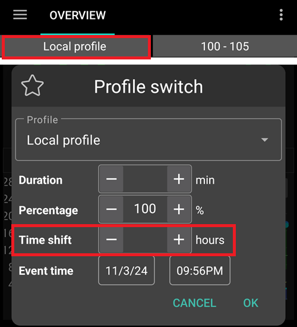
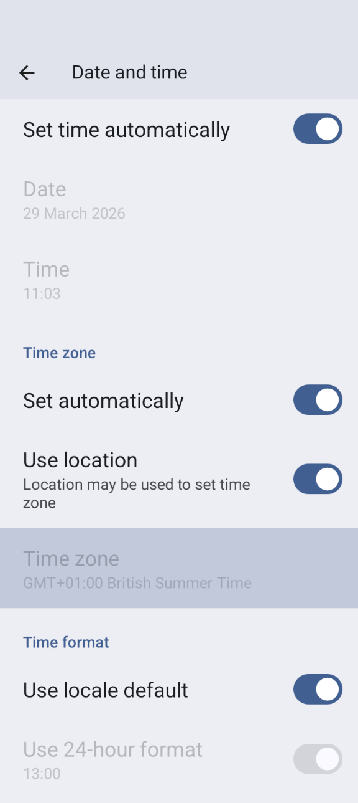
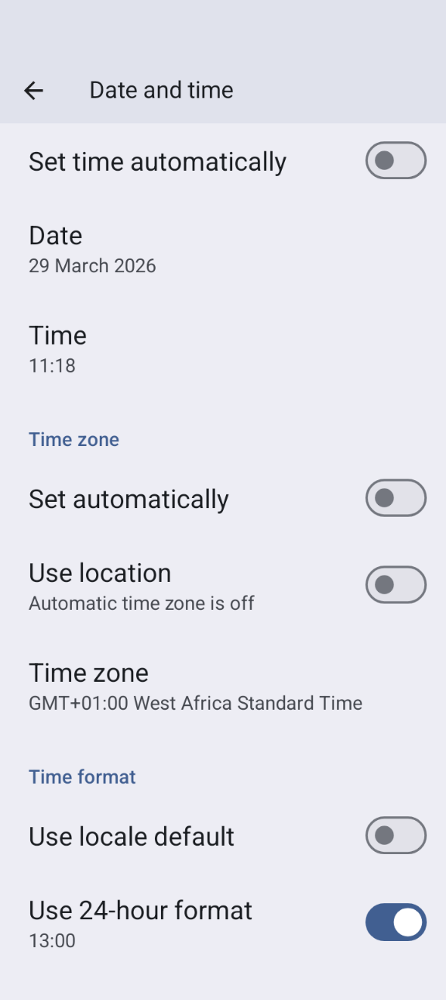

# Zeitzonenänderung und Zeitumstellung (Sommer-/ Winterzeit)

When the time zone of your phone changes, **AAPS** calculates **IOB**, basal and sensitivity for the past again from scratch, about 10 seconds after the change. While this runs, the graphs and values on the main screen may take a moment to update.

(timezone-traveling-with-pumps)=

## Zeitzonenwechsel mit Omnipod-Dash

* Refresh the pump status in **Manage → Pump**
* Wähle temporär ein anderes **Profil** aus und wechsel danach wieder zurück auf Dein Ausgangs- oder Dein gewünschtes **Profil**

## Zeitzonenwechsel mit DanaR, koreanische DanaR

Es gibt keine Probleme beim Zeitzonenwechsel im Smartphone, da die Pumpe keine Historie verwendet

(timezone-traveling-danarv2-danars)=

## Zeitzonenwechsel mit DanaRv2, DanaRS, Dana-i

Da **AAPS** die Pumpenhistorie nutzt, die Einträge in der Pumpe aber keine Zeitangaben enthalten, benötigen diese Pumpen besondere Aufmerksamkeit. **Wenn Du die Zeitzone auf Deinem Smartphone änderst, bedeutet das, dass die Datensätze mit einer anderen Zeitzone ausgelesen und gedoppelt werden.**

Um dies zu vermeiden, gibt es zwei Möglichkeiten:

### Option 1: Heimatzeit beibehalten und Time Shift des Profils

* Schalte die automatische Einstellung von Datum und Uhrzeit in Deinem Smartphone aus (manueller Zeitzonen-Wechsel).

* Dein Smartphone muss für die gesamte Reise auf Datum und Zeit Deines Heimatortes eingestellt bleiben.

* Führe einen **Profil**wechsel mit Zeitverschiebung entsprechend dem Zeitunterschied Deines Heimatortes zum Zielort durch.
   
   * Tap the **Profile** name on the main screen to open the [Profile screen](#ProfileSwitch-manage-v4)
   * Select your **Profile** and tap **▶ Activate**
   * Set '**Time shift**' according to your destination and tap **Activate**.
   
   
   
   * e.g. Vienna -> New York: **Profile Switch** +6 hours
   * e.g. Vienna -> Sydney: **Profile Switch** -8 hours

### Option 2: Pumpenhistorie löschen

* Schalte die automatische Einstellung von Datum und Uhrzeit in Deinem Smartphone aus (manueller Zeitzonen-Wechsel)

Wenn Du aus dem Flugzeug steigst:

* schalte die Pumpe aus
* ändere die Zeitzone auf dem Smartphone
* schalte das Smartphone aus, schalte die Pumpe an
* lösche die Historie der Pumpe
* ändere die Zeit in der Pumpe
* schalte das Smartphone an
* lasse das Smartphone mit der Pumpe verbinden und verfeinere die Zeiteinstellung

(timezone-traveling-insight)=

## Zeitzonenwechsel mit Insight

Der Treiber passt die Uhrzeit in der Pumpe automatisch an die Zeit im Smartphone an.

Die Insight dokumentiert auch die historischen Einträge, in denen die Zeit geändert wurde und von welcher (alten) Zeit zu welcher (neuen) Zeit. So kann die richtige Zeit in **AAPS** trotz der Zeitänderung bestimmt werden.

Es kann zu Ungenauigkeiten in der **TDDs** kommen. Das sollte allerdings unproblematisch sein.

Der Insight-Nutzer muss sich also nicht um Zeitumstellung oder den Wechsel von Zeitzonen kümmern. Es gibt eine Ausnahme zu dieser Regel: Die Insight Pumpe hat eine kleine interne Batterie, um die Zeit immer aktuell zu halten etc. während Du die "normale" Batterie wechselst. Wenn der Batteriewechsel zu lange dauert, kann diese interne Batterie leer werden, die Uhr wird zurückgesetzt und Du wirst gebeten, Zeit und Datum nach dem Einlegen der neuen Batterie neu einzugeben. In diesem Fall werden alle Einträge vor dem Batteriewechsel in der Berechnung in AAPS übersprungen, da die richtige Zeit nicht korrekt erkannt werden kann.

## Zeitzonenwechsel mit Accu-Chek Combo

The [Combo driver](../CompatiblePumps/Accu-Chek-Combo-Pump-v2.md) automatically adjusts the time of the pump to the time of the phone. The Combo cannot store timezones, only local time, which is precisely what the driver programs into the pump. Zusätzlich wird die Zeitzone in den lokalen AAPS-Einstellungen hinterlegt, um die lokale Pumpenzeit in einen vollständigen Zeitstempel, der die entsprechende Zeitverschiebung enthält, umzurechnen. Du musst hier also nichts tun. Sollten die Abweichungen zwischen Combo und Smartphone zu groß werden, wird die Pumpenzeit automatisch korrigiert.

Es kann etwas dauern bis die Synchronisierung abgeschlossen ist, da die Anpassung nur mit einem langsamen Kommunikations-Protokoll (remote-terminal mode) gemacht werden kann. Das ist eine Combo-Beschränkung, die nicht umgangen werden kann.

## Zeitzonenänderung für Medtrum

Der Treiber passt die Uhrzeit in der Pumpe automatisch an die Zeit im Smartphone an.

Änderungen der Zeitzone haben ggf. einen Einfluss auf den gespeicherten Gesamtinsulinbedarf (TDD). Die übrige Historie bleibt unberührt. Manuelle Anpassungen der Uhrzeit kann zu Problemen mit der Pumpenhistorie und dem **IOB** führen. Falls Du die Uhrzeit manuell anpasst, überprüfe das **IOB** (aktives Insulin).

Wenn sich die Zeitzone oder die Uhrzeit ändert, wird eine laufende **TBR** gestoppt.

(time-adjustment-daylight-savings-time-dst)=

## Zeitumstellung (Sommer-/Winterzeit)

Zeitumstellungen für Sommer- und Winterzeit.

Abhängig von Deiner Pumpe und dem CGM-Setup können Zeitsprünge zu **AAPS**-Problemen führen. Für einige Pumpen ist es deswegen besser, die Zeitumstellung nicht in der Nacht vorzunehmen, sondern diese auf den späten Abend, wenn Du noch wach bist, vorzuziehen.

### Automatische Sommer-/Winterzeitumstellung für die meisten Pumpen

* However, the **Loop** will be deactivated for 3 hours AFTER the DST switch (usually 1am onwards) has taken place and **AAPS** will default to background basal as selected in your **Profile**. Dies geschieht aus Sicherheitsgründen - **IOB** kann wegen doppelter Boli vor der Zeitumstellung zu hoch sein.
* After DST has taken place, make a **Profile Switch** to the desired **Profile** to enable the **Loop**: tap the profile name on the main screen, then the round **▶** button (see [Activating a profile](#ProfileSwitch-manage-v4)).
* Vor der Zeitumstellung wirst Du auf der **AAPS**-Übersicht eine Benachrichtigung erhalten, dass der **Loop** vorübergehend deaktiviert wurde. This message will appear without beep, vibration or similar sound.

Wenn Du den **AAPS**-Bolus-Rechner zum Bolen verwendest, schließe **COB** und **IOB**-Daten aus, es sei denn, Du bist Dir absolut sicher, dass die Daten korrekt sind. Sei vorsichtig und nutze den Bolus-Rechner in den ersten Stunden nach der Zeitumstellung nicht zum Bolen.

### Zeitumstellung für Accu-Chek Insight

* Zeitumstellung erfolgt automatisch. Keine Maßnahme erforderlich.

### Zeitumstellung für Accu-Chek Combo

* Zeitumstellung erfolgt automatisch. Keine Maßnahme erforderlich.

### DST for Medtrum

* Zeitumstellung erfolgt automatisch. Keine Maßnahme erforderlich.

### DST for Omnipod Dash

* Either allow **AAPS** to temporarily default background basal after DST has taken place as explained above.
* Otherwise, if you do not want **AAPS** to temporarily default to background basal overnight, you can change the time zone the day prior DST is due to take place to avoid overnight disruption. NOTE THIS OPTION MAY CAUSE YOUR POD TO PREMATURELY EXPIRE. PLEASE HAVE SUPPLIES WITH YOU IF OPTING FOR THE FEATURE BELOW.

#### Vor der Zeitumstellung notwendige Maßnahmen

1. Schalte alle Einstellungen Deines Smartphones, die die Zeitzone des Smartphones automatisch anpassen, AUS. Damit kannst Du dann manuell auf eine Zeitzone wechseln, die keine Sommerzeit-Umstellung hat. Wie Du das machst, hängt von Deinem Smartphone und der Android-Version ab.
   
   * Some phones have two settings, one for automatic setting of the time (which ideally should remain on) and one for automatic setting of the time zone (which you must turn OFF: **Set automatically** under **Time zone** in the screenshot below).
   * Unglücklicherweise haben manche Android-Versionen nur eine Einstellmöglichkeit für beides zusammen. In diesem Fall musst Du eben beide ausschalten.

2. Suche Dir eine Zeitzone, die dieselbe Uhrzeit wie Du hat, aber nicht zwischen Winter- und Sommerzeit wechselt.
   
   * Eine Liste dieser Länder findest Du z.B. auf [https://greenwichmeantime.com/countries](https://greenwichmeantime.com/countries/).
   * For Central European Time (CET) this could be "Brazzaville" (Congo). Change your phone's timezone to Congo.

3. In **AAPS** refresh your pump and switch to your desired **Profile**.

4. Prüfe die **IOB**- und **COB**-Werte in **AAPS**. Sollten die Werte falsch ein, deaktiviere den **Loop** für mindestens die Insulinwirkdauer (DIA) oder „Max-Carb-Time“ (je nachdem welcher Zeitraum länger ist).

5. Nach der Zeitumstellung notwendige Maßnahmen. Der Zeitpunkt zum Zurückkehren in die lokale Zeitzone ist ideal, wenn der **IOB** niedrig ist. Z. B. eine Stunde vor einer Mahlzeit wie dem Frühstück. Sowohl Dein **COB**, als auch Dein **IOB** sollten idealerweise dabei nahe Null sein.