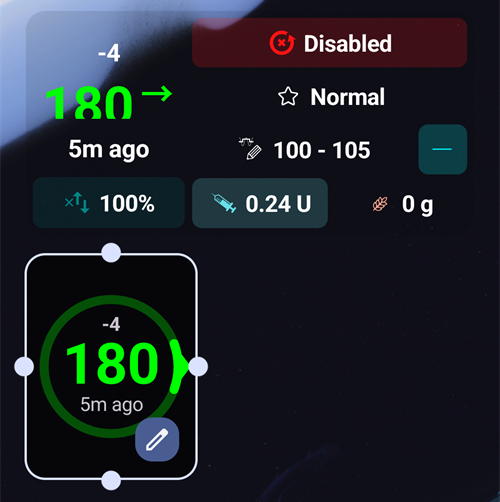

(widgets)=
# Widgets für den Startbildschirm

**AAPS** bietet Widgets, die Du auf dem Startbildschirm Deines Smartphones einfügen kannst. Ein Widget zeigt Deine aktuellen Daten, ohne dass Du die App öffnen musst. Tippe auf ein Widget, um **AAPS** zu öffnen.

```{contents} Table of contents
:depth: 2
:local: true
```

---

## Verfügbare Widgets

Es gibt fünf Widgets. In der Widget-Auswahl von Android stehen sie unter **AAPS**:


| Widget                            | Standardgröße | Was es zeigt                                                                                                                                                                                                                                                                                                      |
| --------------------------------- | ------------- | ----------------------------------------------------------------------------------------------------------------------------------------------------------------------------------------------------------------------------------------------------------------------------------------------------------------- |
| **AAPS Widget**                   | 5 × 2         | Der Statusbereich des Startbildschirms: BZ mit Trend und Delta, der Loop-Modus als Symbol neben dem Profilnamen, Zielwert, Empfindlichkeit (wie auf dem Startbildschirm angezeigt), IOB und COB. Die Texte werden kleiner, damit sie in die Größe passen, die Du dem Widget gibst, statt abgeschnitten zu werden. |
| **AAPS Glukoseanzeige (Kreis)**   | 2 × 2         | Der BZ-Kreis des Startbildschirms: ein Ring in der Farbe des BZ, der Trendbogen, das Delta, der BZ-Wert und die Zeit seit dem letzten Wert.                                                                                                                                                                       |
| **AAPS Klein**                    | 2 × 2         | Profilname, BZ mit Trendpfeil, Zeit seit dem letzten Wert, Delta, IOB und COB.                                                                                                                                                                                                                                    |
| **AAPS BZ + IOB + COB (Kompakt)** | 4 × 1         | Eine Zeile mit BZ und Trendpfeil, IOB und COB.                                                                                                                                                                                                                                                                    |
| **AAPS BZ Diagramm**              | 3 × 1         | Der BZ-Wert mit einem kleinen Diagramm der letzten Werte.                                                                                                                                                                                                                                                         |

Das **AAPS Widget**, die **Glukoseanzeige (Kreis)** und das Widget **Klein** auf einem Startbildschirm:


Das Widget **Kompakt** und das Widget **BZ Diagramm**:


BZ-Werte haben dieselben Farben wie in **AAPS**: grün im Zielbereich, gelb über dem Zielbereich, rot unter dem Zielbereich.

---

## Ein Widget hinzufügen

Die genauen Schritte hängen von Deinem Smartphone und seinem Launcher ab. Auf den meisten Smartphones:

1. Drücke lange auf eine freie Stelle des Startbildschirms und wähle **Widgets**.

   

2. Öffne **AAPS** in der Liste und tippe auf das gewünschte Widget.
3. Tippe auf **Hinzufügen** (oder ziehe das Widget an die gewünschte Stelle).

   

Das Widget wird auf dem Startbildschirm platziert. Direkt nach dem Hinzufügen wird es mit Griffen angezeigt: Ziehe an einem Griff, um das Widget **größer oder kleiner zu machen**, oder ziehe das Widget, um es zu verschieben. Die Glukoseanzeige (Kreis) lässt sich auf jede Größe bringen.



Ist die Seite des Startbildschirms voll, legt das Smartphone das Widget auf eine neue Seite.

---

## Widget-Einstellungen

Tippe auf den Knopf mit dem **Stift**, der direkt nach dem Hinzufügen auf dem Widget angezeigt wird. Später drückst Du lange auf das Widget, um die Griffe und den Stift wieder zu bekommen.

Der Dialog **Widget-Einstellungen** hat zwei Einstellungen:

- **Deckkraft konfigurieren** – wie deckend der Hintergrund des Widgets ist. Bei einem niedrigen Wert scheint das Hintergrundbild durch.
- **Verwende schwarze Farbe** – einen schwarzen Hintergrund statt des Standardhintergrunds verwenden.


Jedes Widget hat seine eigenen Einstellungen.

---

## Gut zu wissen

- Ein Widget dient nur zum **Anzeigen** von Daten. Über ein Widget kannst Du keinen Bolus abgeben und nichts ändern.
- Das Widget wird von **AAPS** aktualisiert. Läuft **AAPS** nicht oder schränkt Android es im Hintergrund ein, zeigt das Widget möglicherweise alte Daten. Prüfe die Zeit seit dem letzten Wert und stelle sicher, dass **AAPS** von der [Akkuoptimierung](#SetupWizard-StoragePermission) ausgenommen ist.
- Bei **AAPSClient**, **AAPSClient2** und **AAPSClient3** ist der Hintergrund des Widgets gelb, blau oder grün, damit Du die Apps auseinanderhalten kannst. Erhöhe die Deckkraft in den Widget-Einstellungen, wenn die Farbe schwer zu erkennen ist. Siehe [Über AAPSClient, AAPSClient2 und AAPSClient3](#remotecontrol-aapsclient-versions).
