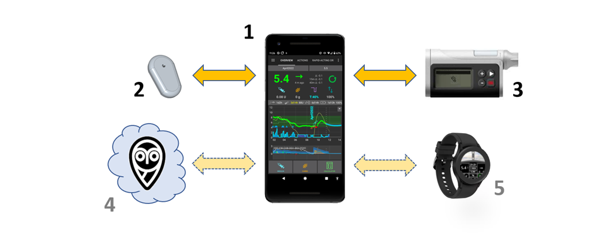
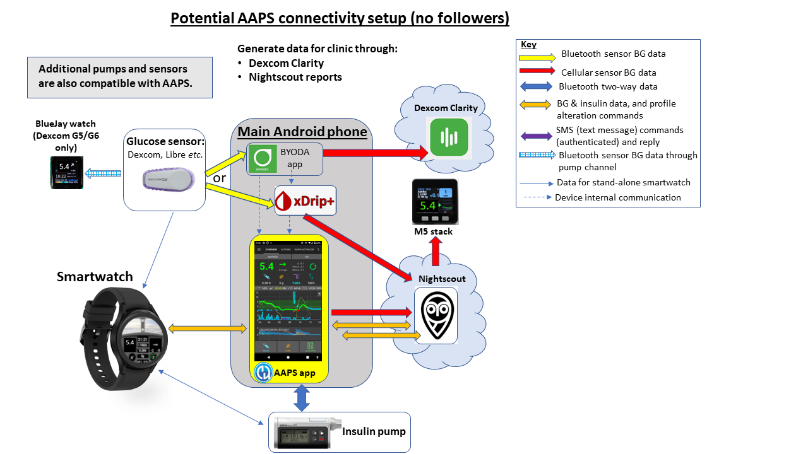
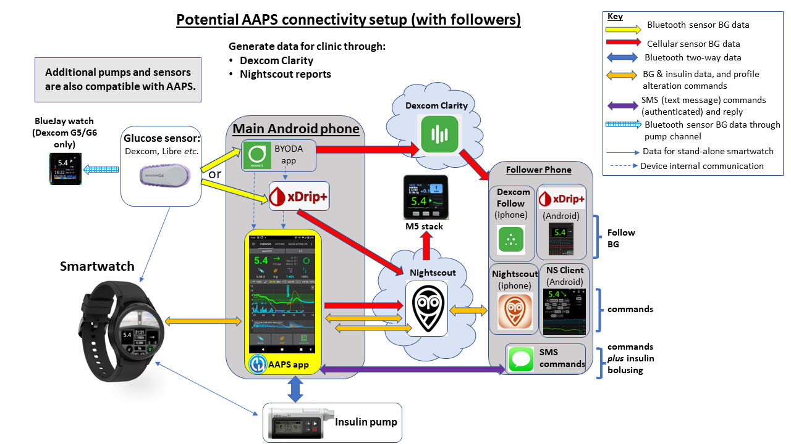

# Einführung in APS und AAPS

```{contents} In this page
:backlinks: entry
:depth: 2
```

## Was ist eine "künstliche Bauchspeicheldrüse” (artifical pancreas system)?

Eine menschliche Bauchspeicheldrüse übernimmt neben der Regulierung des Blutzuckers noch viele andere Dinge im Körper. Der Begriff **„künstliche Bausspeicheldrüse“ (APS)** beschreibt üblicherweise ein System, dass den Blutzuckerspiegel automatisiert im gesunden Bereich hält.

Die einfachste Art dies zu tun ist, den **Glukosewert** zu nutzen, um damit **Berechnungen** vorzunehmen und dann eine vorberechnete **Insulin**menge in den Körper abzugeben. Diese Berechnung wird alle paar Minuten wiederholt, Tag und Nacht (24/7). Es nutzt **Alarme** und **Benachrichtigungen**, um die Benutzenden auf notwendige Eingriffe oder Besonderheiten hinzuweisen. Ein solches System besteht normalerweise aus einem **Glukosesensor**, einer **Insulinpumpe** und einem **Controller**, der die Berechnungen ausführt. Bei **AAPS** und anderen Open-Source-Systemen ist der Controller eine App auf dem Smartphone. Bei den meisten kommerziellen Systemen ist es eine in die Pumpe eingebaute Software, und eine Smartphone-App dient vor allem zur Anzeige und Steuerung.

Für Hintergrundwissen dazu, wie Closed-Loop-Systeme entstanden sind und wie sie funktionieren, ist dieser Übersichtsartikel von 2022 ein guter Einstieg. Beachte aber, dass er älter ist als die meisten heute erhältlichen Systeme und daher keine Übersicht über das aktuelle Marktangebot gibt:

 [Closed-Loop Insulin Delivery Systems: Past, Present, and Future Directions](https://www.frontiersin.org/journals/endocrinology/articles/10.3389/fendo.2022.919942/full) (Templer, _Frontiers in Endocrinology_, 2022).

Sogenannte „Dual-Hormon“-Systeme geben zusätzlich zum Insulin Glukagon ab, um schwere Unterzuckerungen zu verhindern und eine noch engere Glukoseeinstellung zu ermöglichen. Ein erstes System dieser Art wurde in Europa zugelassen, wird aber nur im Rahmen von Studien und Projekten abgegeben; andere sind noch in der Entwicklung. Im freien Handel ist noch keines erhältlich.

Eine künstliche Bauchspeicheldrüse kann man sich als [„Autopiloten für Deinen Diabetes“](https://www.artificialpancreasbook.com/) vorstellen. Was soll das heißen?

In einem Flugzeug erledigt ein Autopilot einen Teil der Arbeit des menschlichen Piloten, der Pilot kann nicht durch den gesamten Flug schlafen. Der Autopilot unterstützt die Arbeit des Piloten. Er nimmt den Piloten die Last ab, das Flugzeug ständig selbst steuern zu müssen, sodass sie sich auf die übergeordnete Überwachung konzentrieren können. Der Autopilot bekommt Signale von verschiedenen Sensoren, ein Computer wertet die Daten zusammen mit den Vorgaben des Piloten aus, nimmt dann die notwendigen Anpassungen vor und warnt den Piloten bei Problemen. Der Pilot muss sich nicht mehr ständig um Entscheidungen kümmern, und dieser Vergleich lässt sich auf **AAPS** übertragen.


(Introduction-what-does-hybrid-closed-loop-mean)=
## Was bedeutet „Hybrid-Closed-Loop“?

Die beste Lösung für Typ-1-Diabetes wäre eine „funktionale Heilung“ (wahrscheinlich die Implantierung von Bauchspeicheldrüsenzellen, die vor der Immunabwehr geschützt sind). Bis es so weit ist, ist ein „Full Closed Loop“ als künstliche Bauchspeicheldrüse für die Typ-1-Diabetes-Community wahrscheinlich die nächstbeste Lösung. Dies ist ein Technologiesystem, das keine Benutzereingabe benötigt (wie z. B. Mahlzeitenbolus abgeben oder körperliche Aktivität "ankündigen"), um eine gute Blutzucker-Kontrolle zu erreichen. Fast alle Systeme im Alltagseinsatz sind „Hybrid“-Closed-Loops, da sie automatisierte Technik mit Eingaben der Anwender kombinieren. Die ersten Full-Closed-Loop-Systeme wurden 2026 in Europa zugelassen, sind aber noch nicht breit verfügbar.

## Wie und warum ist das Loopen begonnen worden?

Die Entwicklung kommerzieller Technologien für Menschen mit Typ-1-Diabetes (T1D) ist sehr langsam. 2013 gründete die T1D Community die #WeAreNotWaiting Bewegung. Diese Bewegung entwickelte Systeme, die bestehende und bewährte Technologie (Insulinpumpen und Sensoren) nutzt, um die Blutzucker-Kontrolle und auch die Lebensqualität zu verbessern. Sie werden OS-AID-Systeme (Open-Source Automated Insulin Delivery, früher DIY-Systeme) genannt, da sie nicht formell von Gesundheitsbehörden (FDA, NHS usw.) zugelassen sind. Es gibt vier große OS-AID-Systeme: [OpenAPS](https://openaps.org/what-is-openaps/), **AAPS**, [Loop](https://loopkit.github.io/loopdocs/#what-is-loop) und [Trio](https://triodocs.org).

Um die Grundlagen des OS-AID-Loopens zu verstehen, ist Dana Lewis Buch „Automated Insulin Delivery“ ein hervorragender Einstieg. Es ist [hier](https://www.artificialpancreasbook.com/) frei erhältlich (oder man kauft sich ein echtes Buch davon). Wenn Du mehr über [OpenAPS](https://openaps.org/what-is-openaps/), aus dem sich **AAPS** entwickelt hat, dann ist die [OpenAPS Website](https://openaps.org/what-is-openaps/) eine hervorragende Quelle.

Inzwischen sind auch mehrere kommerzielle Hybrid-Closed-Loop-Systeme auf den Markt gekommen. Diese unterscheiden sich von den OS-AID-Systemen zum Teil erheblich, vor allem weil viele von ihnen einen „lernenden Algorithmus“ nutzen, der die abgegebene Insulinmenge an Deinen Insulinbedarf der vorangegangenen Tage anpasst. Viele Menschen aus der OS-AID-Community haben kommerzielle Systeme bereits ausprobiert und mit ihrem OS-AID-System verglichen. Mehr darüber, wie sich die verschiedenen Systeme unterscheiden, erfährst Du, wenn Du in den Facebook-Gruppen der jeweiligen Systeme, in der [AAPS-Facebook-Gruppe](https://www.facebook.com/groups/AndroidAPSUsers/) oder auf [Discord](https://discord.com/invite/4fQUWHZ4Mw) nachfragst.

## Was ist Android APS (AAPS)?



**Abbildung 1**. Grundstruktur des Android APS (Artificial Pancreas System), AAPS.

Android APS (**AAPS**) ist ein Hybrid-Closed-Loop-System bzw. ein „künstliches Pankreas-System“ (Artificial Pancreas System, APS). Es berechnet die Insulindosierung mit bewährten [OpenAPS](https://openaps.org/)-Algorithmen (Berechnungsvorschriften), die von der #WeAreNotWaiting Typ-1-Diabetes-Community entwickelt wurden.

Da OpenAPS nur mit bestimmten älteren Insulinpumpen kompatibel ist, wurde **AAPS** (das mit einer breiteren Palette von Insulinpumpen verwendet werden kann) 2016 ursprünglich für ein Familienmitglied mit Typ-1-Diabetes entwickelt. Seit diesen frühen Tagen wurde **AAPS** durch ein Team von freiwilligen Computerentwicklern und anderen Enthusiasten kontinuierlich weiterentwickelt und verfeinert. Viele dieser Personen haben einen Bezug zur Welt des Typ-1-Diabetes. Heute nutzen viele Tausend Menschen weltweit **AAPS**. Das System ist sehr flexibel und anpassbar. Dadurch, dass es System Open-Source ist, ist es auch problemlos mit viel anderer Open-Source-Diabetes Software und vielen Plattformen kompatibel. Die grundlegenden Komponenten des gegenwärtigen **AAPS**-Systems werden oben in **Bild 1** dargestellt.


## Was sind die Grundbestandteile von AAPS?

Das „Gehirn“ von AAPS ist eine **App**, die Du selber erstellen ("bauen") musst. Es gibt für dieses Erstellen sehr detaillierte Schritt-für-Schritt-Anleitungen. Du installierst die **AAPS-App** auf einem [kompatiblen](../Getting-Started/Phones.md) **Android-Smartphone** (**1**). Eine Reihe von Nutzenden bevorzugt es, den "Loop" auf einem separaten Smartphone zu haben und es nicht auf ihrem eigentlichen Haupttelefon. Damit ist es dann auch möglich, Dein bestehendes Systemumfeld (z.B. iOS) weiterzunutzen, und nur für AAPS ein Android-Smartphone zu nutzen.

Das **Android Smartphone** benötigt außer **AAPS** noch eine weitere App. Diese [zusätzliche App](../Getting-Started/CompatiblesCgms.md) empfängt über Bluetooth die Glukosewerte von einem Sensor (**2**) und sendet sie dann im Smartphone an die **AAPS-App**.

Die **AAPS-App** verwendet einen Entscheidungsprozess (**Algorithmus**) von OpenAPS. Einsteiger beginnen mit dem grundlegenden Algorithmus **oref0**, können aber mit zunehmender Erfahrung mit AAPS auf den neueren Algorithmus **oref1** wechseln. Welcher Algorithmus (oref0 und oref1) gewählt werden sollte, hängt stark von Deiner persönlichen Situation ab.  Beim Eintreffen eines neuen Sensorwerts, berücksichtigen beide Algorithmen mehrere Faktoren bei der dann ausgeführten Neuberechnung. Per Bluetooth sendet der Algorithmus dann die Befehle, wie viel Insulin abgegeben werden soll, an die Insulinpumpe (**3**). Sämtliche Informationen können über mobile Daten oder WLAN ins Internet gesendet werden (**4**). Diese Informationen und Daten können mit Followern (wenn nötig) geteilt werden und/oder für Datenanalysen ausgewertet werden. Optional kannst Du auch eine [Smartwatch](../Getting-Started/Watches.md) (**5**) mit dem Smartphone koppeln, um Deine Daten auf einen Blick zu sehen und mit manchen Smartwatches einfache Befehle an **AAPS** zu senden.

## Welche Vorteile hat das AAPS-System?

Der von **AAPS** verwendete OpenAPS-Algorithmus steuert den Blutzzuckerspiegel automatisch auf Basis der vom Nutzenden hinterlegten Parameter (u.a. Basalrate, Korrekturfaktoren, Mahlzeitenfaktoren, Insulinwirkdauer).

Zu den berichteten Vorteilen von **AAPS** gehören umfangreiche Möglichkeiten zur Feinabstimmung, **Automatisierungen** und eine höhere Transparenz des Systems für Patienten bzw. Betreuende. Das kann zu einer besseren Diabeteseinstellung führen (bei Dir oder bei dem Menschen, den Du betreust), was wiederum die Lebensqualität verbessern und für mehr Gelassenheit sorgen kann.

Dadurch, dass Du Deine Zeit investierst, kann **AAPS** zu folgenden Dingen führen:

- Linderung des Stresses und der Belastung durch das Management von Diabetes Typ 1;

- Weniger alltägliche Entscheidungen, die Diabetes Typ 1 mit sich bringt;

- Verringerung der Hypos und deren Behandlungen durch das Berücksichtigen der Echtzeitdaten und der daraus auf die Person abgestimmte dynamische Insulindosierung;

- Ein besseres Verständnis des Insulinmanagements und ein größeres Vertrauen, die eigenen Einstellungen noch besser abzustimmen;

- Die Möglichkeit automatische Anpassungen zu erstellen (**Automatisierungen**), die genau zu Deinen Lebensumständen passen;

- Verbesserung der Schlafqualität und insgesamt eine Verringerung von nächtlichen Eingriffen;

- Remote Monitoring und Steuerung der Insulinabgabe durch Betreuende von Typ 1 Diabetikern; und

- Verringerung all Deiner tragbaren Diabetikergeräte (Empfänger für CGM und Steuergerät für die Pumpe) durch Verwendung eines Android-Telefons, von wo **AAPS** die Steuerung übernimmt.


Zu guter Letzt kann **AAPS** den Menschen helfen, ihren Diabetes besser in den Griff zu bekommen, was zu stabilen Blutzuckerwerten und langfristig besseren Gesundheitsergebnissen führt.

### Besondere Vorteile sind:

#### 1) Eingebaute Sicherheit
Um Dich über die Sicherheitsfunktionen der Algorithmen, bekannt als oref0 und oref1, zu informieren, [klicke hier](https://openaps.org/reference-design/). Der Benutzer hat die Kontrolle über seine eigenen Sicherheitsanforderungen.

#### 2) Flexibilität bei der Hardware

**AAPS** funktioniert mit einer großen Auswahl an Insulinpumpen und Sensoren und bleibt flexibel, wenn sich Dein Leben verändert. Solltest Du z.B. eine Allergie auf ein Dexcom-Pflasterkleber entwickeln, kannst Du ohne größere Probleme auf einen Libre-Sensor umsteigen. Du musst die **AAPS**-App nicht neu erstellen oder neu installieren. Wähle einfach in der **Konfiguration** eine andere Pumpe oder BZ-Quelle aus, um Deine Hardware zu wechseln. **AAPS** ist unabhängig von bestimmten Pumpentreibern und enthält auch eine „virtuelle Pumpe“, sodass Du gefahrlos experimentieren kannst, bevor Du es an Dir selbst anwendest.

#### 3) Hochgradig anpassbar, mit umfangreichen Parametern

Benutzer können einfach Module oder Funktionen hinzufügen oder entfernen und **AAPS** kann sowohl im Modus Open Loop, als auch im Modus Closed Loop verwendet werden. Hier einige Beispiele für die Möglichkeiten mit dem **AAPS** System:

 a) Die Möglichkeit, 30 Minuten vor dem Essen ein niedrigeres **Glukose**-Ziel zu setzen; Du kannst das Ziel bis auf 72 mg/dl (4,0 mmol/l) absenken.

 b) Hast Du wegen Insulinresistenz hohe Glukosewerte, kannst Du in **AAPS** eine **Automatisierungs**regel anlegen, die bei einem Glukosewert über 8 mmol/l (144 mg/dl) zum Beispiel auf ein Profil mit 120 % umschaltet (das erhöht die Basalrate um 20 % und verstärkt auch die anderen Faktoren gegenüber Deinem normalen **Profil**). Die Automatisierung bleibt für den von Dir angegebenen Zeitraum aktiv. Eine solche Automatisierung kann auch nur in Abhängigkeit von bestimmten Wochentagen, Tageszeiten und sogar vom aktuellen Standort aktiviert werden.

 c) Springt Dein Kind ohne Vorankündigung auf dem Trampolin, kann **AAPS** die Insulinabgabe direkt über das Smartphone für eine bestimmte Zeit unterbrechen.

 d) Wird eine Schlauchpumpe nach dem Schwimmen wieder verbunden, berechnet **AAPS** das während der Trennung fehlende Basalinsulin und gibt es je nach aktuellem Glukosewert vorsichtig ab. Jedes nicht benötigte Insulin kann manuell überschrieben werden, indem man das verpasste Basal einfach „annulliert“.

 e) **AAPS** kann mit mehreren Profilen für unterschiedliche Situationen umgehen und zwischen diesen einfach wechseln. Funktionen, die den Algorithmus schneller auf erhöhte Glukosewerte reagieren lassen (wie Super Micro Boli („**SMB**“) und unangekündigte Mahlzeiten („**UAM**“)), lassen sich zum Beispiel so einstellen, dass sie nur tagsüber wirken, wenn Du Dir Sorgen wegen nächtlicher Unterzuckerungen machst.

Dies alles sind Beispiele, das volle Leistungsspektrum bietet große Flexibilität für den Alltag einschließlich Sport, Krankheit, Hormonzyklen _etc_. Es gibt keine Standardlösung für eine solche Automation, sodass es am Ende immer eine individuelle Nutzer*innen-Entscheidung bleibt, wie diese Flexibilität genutzt wird.

#### 4) Fernüberwachung
Es gibt mehrere mögliche Wege zur Überwachung (Sugarmate, Dexcom Follow, xDrip, Android Auto _usw._), die für Eltern bzw. Betreuende und für Erwachsene in bestimmten Situationen (Schlafen/Autofahren) nützlich sind, wenn einstellbare Alarme gebraucht werden. In manchen Apps (xDrip) kannst Du Alarme auch ganz ausschalten. Das ist praktisch, wenn ein frisch gesetzter Sensor noch „einweicht“ bzw. sich einpendelt und Du mit ihm noch nicht loopen möchtest.

#### 5) Remote-Steuerung
Ein bedeutender Vorteil von **AAPS** gegenüber kommerziellen Systemen ist, dass Follower über authentifizierte SMS-Befehle oder eine gekoppelte **AAPSClient**-App viele verschiedene Befehle an das **AAPS**-System zurücksenden können. Diese Funktion nutzen vor allem Eltern von Kindern mit Typ-1-Diabetes, die **AAPS** verwenden, sehr intensiv.

Die Remote-Steuerung kann sehr nützlich sein: zum Beispiel auf dem Spielplatz, wenn Du von Deinem eigenen Smartphone aus einen Vorab-Bolus für einen Snack abgeben möchtest, während Dein Kind beim Spielen ist. Du kannst das System auch über eine Smartwatch überwachen (_z. B._ Garmin) oder einfache Befehle von ihr senden (_z. B._ von einer Wear OS-Smartwatch wie der Samsung Galaxy Watch).

#### 6) Keine kommerziellen Einschränkungen aufgrund der offenen Anwendungsschnittstellen
Über die Verwendung eines Open-Source-Ansatzes hinaus kann der Quellcode von **AAPS** jederzeit eingesehen werden, was das allgemeine Prinzip der Bereitstellung offener Programmierschnittstellen ist. Dies gibt anderen Entwicklern die Möglichkeit, ebenfalls neue Ideen einzubringen. **AAPS** ist eng in Nightscout integriert. Dies beschleunigt die Entwicklung und ermöglicht es den Anwendern, Funktionen hinzuzufügen, um das Leben mit Diabetes noch einfacher zu machen. Gute Beispiele für solche Integrationen sind [Nightscout](https://nightscout.github.io/), [Nightscout Reporter](https://nightscout-reporter.zreptil.de/), xDrip, [M5 Stack](https://github.com/mlukasek/M5_NightscoutMon/wiki) usw. Es besteht ein ständiger Dialog zwischen Open-Source-Entwicklern und den Entwicklern kommerzieller Systeme. Viele Neuerungen aus OS-AID werden nach und nach von kommerziellen Systemen übernommen, wo die Entwicklung verständlicherweise langsamer ist, auch weil Schnittstellen zwischen Systemen verschiedener Firmen (Pumpen, Apps, Sensoren _usw._) sorgfältig ausgehandelt und lizenziert werden müssen. Dies kann auch Innovationen verlangsamen die für den einzelnen Patienten bequem sind (oder für eine kleine Untergruppe von Patienten mit sehr spezifischen Anforderungen), die aber keinen großen finanziellen Gewinn bringen.

#### 7) Detaillierte App-Oberfläche
Mit **AAPS** ist es einfach Dinge wie Insulinstände in der Pumpe, Alter des Katheters, Sensoralter, Pumpenbatterie, Insulin-On-Bord _usw._. Viele Aktionen lassen sich statt an der Pumpe selbst über die **AAPS**-App erledigen (Pumpe füllen, Pumpe trennen _usw._), sodass die Pumpe in Deiner Tasche oder am Gürtel bleiben kann (oder in der Tasche bzw. am Gürtel des Menschen, den Du betreust).

#### 8) Zugänglichkeit und Bezahlbarkeit
**AAPS** gibt Menschen, die sich ein System derzeit nicht selbst leisten können oder keine Kostenübernahme bzw. Versicherung haben, Zugang zu einem Hybrid-Closed-Loop-System, das den kommerziellen Systemen in der Entwicklung konzeptionell um Jahre voraus ist. Zum Einrichten von **AAPS** brauchst Du derzeit einen Reporting-Server (Nightscout oder Tidepool), für den täglichen Betrieb des **AAPS**-Loops ist er aber nicht nötig. Viele nutzen Nightscout weiterhin, um ihre Daten zu sammeln und zur Fernüberwachung. Obwohl **AAPS** selbst kostenlos ist, kann das Einrichten von Nightscout über eine der verschiedenen Plattformen eine Gebühr (€ 0 - €12) nach sich ziehen, je nachdem, welche Unterstützung Sie benötigen (siehe Vergleichstabelle) und ob Sie Nightscout nach dem Setup weiter verwenden wollen oder nicht. **AAPS** arbeitet mit einer großen Auswahl an erschwinglichen [Android-Smartphones](https://docs.google.com/spreadsheets/u/1/d/e/2PACX-1vScCNaIguEZVTVFAgpv1kXHdsHl3fs6xT6RB2Z1CeVJ561AvvqGwxMhlmSHk4J056gMCAQE02sAWJvT/pubhtml?gid=683363241&single=true) (ab ca. €150) zusammen. Verschiedene Versionen sind für bestimmte Standorte und Sprachen verfügbar und AAPS kann auch von [blinden](#accessibility-for-users-aaps-who-are-partially-or-completely-blind) Personen verwendet werden.

#### 9) Unterstützung
Kein automatisiertes Insulinsystem ist perfekt. Kommerzielle und Open-Source-Systeme sind sich in möglichen Fehler (Übertragungsprobleme und temporäre Hardware-Fehler) ähnlich. Es gibt Unterstützung seitens der Community der AAPS-Nutzer auf Facebook, Discord und GitHub. Hier sind Leute von überall auf der Welt, die an Design und Entwicklung beteiligt waren und solche, die **AAPS** derzeit verwenden. Es gibt auch Facebook-Supportgruppen und Hilfe von Kliniken/Handelsunternehmen für die kommerziellen APS-Systeme - es lohnt sich, mit den Anendern zu sprechen. oder frühere Anwender dieser Systeme, um Feedback zu häufigen Fehlern, zur Qualität des Schulungsangebots und zum Niveau der kontinuierlichen Unterstützung zu erhalten.

#### 10) Vorhersagbarkeit, Transparenz und Sicherheit
**AAPS** ist transparent, logisch und vorhersehbar. Dadurch lässt sich leichter erkennen, wann eine Einstellung falsch ist, und sie entsprechend anpassen. Du kannst zu jeder Zeit genau sehen, was das System tut, warum es das tut und die Kontrolle wieder in Deine Hand nehmen, indem Du entsprechende Grenzen setzt. Dies schafft Vertrauen und Dir einen erholsameren Schlaf.

#### 11) Zugriff auf erweiterte Funktionen durch Entwicklungsmodi (dev) einschließlich vollständigem Closed Loop
Diese **AAPS** Dokumentation konzentriert sich auf die Hauptentwicklung im **“master”**-Branch [in Git] von **AAPS**. Forschung und Entwicklung laufen jedoch ständig. Erfahrene Benutzer können die experimentellen Funktionen im **"development"**-Branch erkunden. Die Neuentwicklungen konzentrieren sich auf Strategien zum vollständigen Closed Loop (ohne Bolus für Mahlzeiten _usw._) und versuchen ganz allgemein, das Leben mit Typ-1-Diabetes so angenehm wie möglich zu machen.

#### 12) Möglichkeit, sich an weiteren Verbesserungen zu beteiligen
Diabetes Typ 1 kann sehr frustrierend sein und dazu führen, dass Du Dich alleingelassen fühlst. Seine Diabetes-Technolgie selber unter Kontrolle zu haben und etwas an die Community zurückzugeben ("pay it forward") indem Du andere bei deren Reise unterstützst, kann ein gutes und befriedigendes Gefühl geben. Du kannst Dich selbst weiterbilden, Hindernisse erkennen und auch Deine Beiträge zur Weiterentwicklung und/oder zur Dokumentation leisten. In der Community gibt es andere, die das gleiche Ziel haben und mit denen Du Ideen austauschen und zusammenarbeiten kannst. Dies ist die Grundidee und der Geist von #WeAreNotWaiting.

## Wie unterscheidet sich AAPS von ICT (MDI) und Open Loop?

Die intensivierte konventionelle Insulintherapie (ICT, (a) in **Bild 2** unten - engl. MDI (Multiple Daily Injections)) erfordert die Injektion von Basalinsulin (_z.B._ Tresiba) 1-2 mal am Tag und ein kurz wirksames Insulin (_z.B._ Novorapid, Fiasp) vor den Mahlzeiten bzw. als Korrektur. Open Pumping (b) nutzt eine Pumpe zur Abgabe des schnell wirkenden Insulins in der einprogrammierten Menge als Basalrate, sowie die Abgabe eines Mahlzeiten- und/oder Korrekturbolus. Die Grundlagen eines Looping-Systems sind, dass die Looping-App die BZ-Werte des Sensors verwendet, um die Pumpe anzuweisen, die Insulinlieferung zu stoppen, wenn sie voraussagt, dass Du auf niedrige Werte geraten wirst und Dir zusätzliches Insulin zu geben, wenn die BZ-Werte sich der Voraussage nach einem zu hohen Niveau nähern (c). Obwohl diese Abbildung, im Vergleich zum realen Leben, übermäßig vereinfacht ist, soll sie die wichtigsten Unterschiede der Ansätze zeigen. Mit jedem dieser drei Ansätze ist eine außergewöhnlich gute BZ-Kontrolle möglich.


**Abbildung 2**. Prinzipielle Übersicht: (a) ICT (engl. MDI), (b) Open-Loop-Pumping und (c) Hybrid-Closed-Loop-Pumping.

## Wie unterscheidet sich AAPS von anderen Loop-Systemen?

Mit dem Stand vom 25. Juni 2023 stehen vier große Open Source Closed Loop-Systeme zur Verfügung: [OpenAPS](https://openaps.readthedocs.io/), **AAPS**, [Loop](https://loopkit.github.io/loopdocs/#what-is-loop) und [Trio](https://triodocs.org), (ehemals FreeAPS X). Die Funktionen der verschiedenen Systeme werden in der folgenden Tabelle angezeigt:


| Geräteart  | Name                                                                 | [AAPS](https://wiki.aaps.app)                 | [Loop](https://loopkit.github.io/loopdocs/)   | [OpenAPS](https://openaps.readthedocs.io/en/latest/) | [Trio](https://triodocs.org)                  |
| ---------- | -------------------------------------------------------------------- | --------------------------------------------- | --------------------------------------------- | ---------------------------------------------------- | --------------------------------------------- |
| Smartphone | Android                                                              |          |  |         |  |
| Smartphone | iPhone                                                               |  |          |         |          |
| Rig        | Einplatinencomp. (1)                                                 |  |  |                 |  |
| PUMP       | [Dana I](../CompatiblePumps/DanaRS-Insulin-Pump.md)                  |          |          |         |          |
| PUMP       | [Dana RS](../CompatiblePumps/DanaRS-Insulin-Pump.md)                 |          |          |         |          |
| PUMP       | [Dana R](../CompatiblePumps/DanaR-Insulin-Pump.md)                   |          |  |         |  |
| PUMP       | [Omnipod (Dash)](../CompatiblePumps/OmnipodDASH.md)                  |          |          |         |          |
| PUMP       | [Omnipod (Eros)](../CompatiblePumps/OmnipodEros.md)                  |          |          |         |          |
| PUMP       | [Diaconn G8](../CompatiblePumps/DiaconnG8.md)                        |          |  |         |  |
| PUMP       | [EOPatch 2](../CompatiblePumps/EOPatch2.md)                          |          |  |         |  |
| PUMP       | [Medtrum TouchCare Nano 200U](../CompatiblePumps/MedtrumNano.md)     |          |          |         |          |
| PUMP       | [Medtrum TouchCare 300U](../CompatiblePumps/MedtrumNano.md)          |          |          |         |          |
| PUMP       | [Roche Combo](../CompatiblePumps/Accu-Chek-Combo-Pump-v2.md)         |          |  |         |  |
| PUMP       | [Roche Insight](../CompatiblePumps/Accu-Chek-Insight-Pump.md)        |          |  |         |  |
| PUMP       | [Ältere Medtronik](../CompatiblePumps/MedtronicPump.md)              |          |          |                 |          |
| PUMP       | [Equil 5.3](../CompatiblePumps/Equil5.3.md)                          |          |  |         |  |
| PUMP       | [CareLevo](../CompatiblePumps/CareLevo.md)                           |          |  |         |  |
| CGM        | [Dexcom G7/One+/Stelo](../CompatibleCgms/DexcomG7.md)                |          |          |         |          |
| CGM        | [Dexcom One](../CompatibleCgms/DexcomG6.md)                          |          |          |         |          |
| CGM        | [Dexcom G6](../CompatibleCgms/DexcomG6.md)                           |          |          |                 |          |
| CGM        | [Libre 3/3+](../CompatibleCgms/Libre3.md)                            |          |          |         |          |
| CGM        | [Libre 2/2+](../CompatibleCgms/Libre2.md)                            |          |          |         |          |
| CGM        | [Libre 1](../CompatibleCgms/Libre1.md)                               |          |          |         |          |
| CGM        | [Eversense](../CompatibleCgms/Eversense.md)                          |          |          |         |          |
| CGM        | [MM640g/MM630g](../CompatibleCgms/MM640g.md)                         |          |  |         |  |
| CGM        | [PocTech](../CompatibleCgms/PocTech.md)                              |          |  |         |  |
| CGM        | [Ottai](../CompatibleCgms/OttaiM8.md)                                |          |  |         |  |
| CGM        | [Syai Tag](../CompatibleCgms/SyaiTagX1.md)                           |          |  |         |  |
| CGM        | [Nightscout als BZ-Quelle](../CompatibleCgms/CgmNightscoutUpload.md) |          |          |                 |          |

_Hinweise zur Tabelle:_
1. Ein **Rig** ist ein kleiner Computer, den man mit sich herumtragen kann, ohne einen Monitor. Unterstützte Gerätetypen: Intel Edison + Explorer Board; Raspberry Pi + Explorer HAT; Adafruit RFM69HCW Bonnet. Die ersten APS-Systeme beruhten auf diesem Aufbau, da Mobiltelefone die nötigen Algorithmen noch nicht ausführen konnten. Die Nutzung dieser Systeme ist rückläufig, da die Einrichtung auf Mobiltelefonen einfacher geworden ist und Telefone ein Display enthalten. Auch hat Intel den Verkauf von Intel Edison eingestellt. Die hervorragenden OpenAPS-Algorithmen **oref0** und **oref1** sind nun in AAPS und Trio integriert.


Eine internationale, von Fachleuten überprüfte Konsenserklärung mit praktischen Anleitungen zum Open-Source-Looping wurde von und für Angehörige der Gesundheitsberufe verfasst und 2022 in einer führenden medizinischen Zeitschrift veröffentlicht: [_Lancet Diabetes Endocrinol_, 2022; 10: 58-74](https://www.ncbi.nlm.nih.gov/pmc/articles/PMC8720075/)(_1_). Er ist sehr lesenswert (auch für Deine Diabetesambulanz) und fasst die wichtigsten technischen Unterschiede zwischen den verschiedenen Open-Source-Hybrid-Closed-Loop-Systemen zusammen.

Es ist schwierig, ein „Gefühl“ für ein System zu bekommen, wenn man es nicht benutzt oder sich nicht mit Personen austauscht, die es aktiv nutzen. Stelle Deine Fragen daher auf Facebook/Discord, wo sich viele aktive Nutzende finden. Die meisten finden **AAPS** im Vergleich zu anderen Hybrid-Closed-Loop-Systemen (besonders den kommerziellen) unglaublich ausgefeilt, mit einer riesigen Zahl anpassbarer Einstellungen und Funktionen, wie oben beschrieben. Manche fühlen sich davon anfangs etwas überwältigt, aber es gibt keinen Grund, alle Möglichkeiten auf einmal zu erkunden. Du kannst so langsam oder so schnell vorgehen, wie Du möchtest, und bei jedem Schritt gibt es Hilfe.


## Verwendet AAPS künstliche Intelligenz oder einen Lernalgorithmus?

Die aktuelle Version von **AAPS** (4.0) enthält keine Machine-Learning-Algorithmen, keine Insulinwirkungsmodelle mit mehreren Parametern und keine künstliche Intelligenz. Das System an sich ist, im Hinblick darauf wie es funktioniert, offen und transparent. Es kann sowohl von Patienten und Klinikpersonal verstanden werden und es wird dazu kein Expertenwissen benötigt. Das bedeutet auch: Wenn Dein Tagesablauf stark schwankt (etwa von einer stressigen Arbeitswoche zu einem erholsamen Urlaub) und Du wahrscheinlich deutlich mehr oder weniger Insulin brauchst, kannst Du **AAPS** sofort auf ein schwächeres oder stärkeres, angepasstes Profil umstellen. Ein "lernendes System" wird dies für Dich zwar automatisch anpassen, aber es ist sehr wahrscheinlich, dass die Insulinanpassungen so länger dauern werden.

(which-system-is-right-for-me-or-my-dependent)=
## Welches System passt zu mir oder zu dem Menschen, den ich betreue?

Üblicherweise ist Deine Systemwahl davon abhängig, welche Insulinpumpe Du bereits nutzt oder von Deinem medizinischen Versorger bekommen kannst, und Deinem genutzten Smartphone (Apple oder Android). Die größte Systemauswahl hast Du, wenn Du noch gar keine Insulinpumpe hast. Die Technologie entwickelt sich ständig weiter, Insulinpumpen werden vom Markt genommen und neue Pumpen und Sensoren werden verfügbar. Die meisten Open-Source-Systeme arbeiten mit den Hauptsensoren (Libre und Dexcom) oder integrieren neue Sensoren sehr schnell nach deren Verfügbarkeit. Die Erfahrung zeigt, dass neue Sensoren (auch wegen Sicherheits- und Stabilitätstests) innerhalb eines Jahres integriert werden.

Die meisten **AAPS** Anwender berichten von mehr Zeit im Zielbereich (TiR), von einem niedrigeren HbA1c und von einer verbesserten Lebensqualität, weil sie ein System verwenden, das automatisch Basalraten in der Nacht, während sie schlafen, anpassen kann. Dies gilt für die meisten Hybrid-Closed-Loop Systeme. Manche bevorzugen ein sehr einfaches System, das sich kaum anpassen lässt (dann ist ein kommerzielles System vielleicht das richtige), andere finden diese fehlende Kontrolle sehr frustrierend (dann passt eher ein Open-Source-System). Wenn bei Dir (oder dem Menschen, den Du betreust) Diabetes gerade erst festgestellt wurde, ist ein üblicher Weg, sich zuerst an die ICT (intensivierte konventionelle Insulintherapie, engl. MDI) mit einem Glukosesensor zu gewöhnen, dann auf eine Pumpe umzusteigen, mit der Loopen möglich ist, und schließlich zu **AAPS** zu wechseln. Manche (besonders kleine Kinder) starten aber auch direkt mit einer Pumpe.

Es ist wichtig zu wissen, dass **AAPS**-Nutzende selbständig und proaktiv Probleme mit der Hilfe der Community lösen müssen. Das erfordert eine andere persönliche Haltung als es bei kommerziellen Systemen notwendig ist. **AAPS** gibt Dir mehr Kontrolle und Flexibilität, aber auch Verantwortung, zu der Du bereit sein musst.

## Ist der Einsatz von Open-Source-Systemen wie AAPS sicher?

### Sicherheit des AAPS-Systems
Da kein System ohne Risiko ist, ist die wahrscheinlich bessere Frage: "Ist **AAPS, im Vergleich** zu meinem aktuell genutzten System zur Behandlung von Diabetes Typ-1, sicher?". **AAPS** hat viele Prüfungen und Abgleiche. Eine neuere [Studie](https://www.liebertpub.com/doi/epub/10.1089/dia.2019.0375) untersuchte den Einsatz von **AAPS** in einer Computersimulation, ein wirksamer Weg, um objektiv zu prüfen, wie sicher und wirksam das System ist. Ganz allgemein nutzen weltweit viele Tausend Menschen Open-Source-Systeme zur automatisierten Insulinabgabe, und es werden weltweit immer mehr.

Jedes Gerät, das Funk-Kommunikation nutzt, kann gehackt werden, und das gilt auch für eine nicht loopende Insulinpumpe. Aktuell ist uns kein Fall bekannt, in dem versucht worden ist, das Diabetes-Equipment einer Einzelperson durch einen Hack zu schädigen. Es gibt jedoch mehrere Wege, sich gegen derartige Risiken zu schützen:

1.  Begrenze den maximal abgebbaren Bolus und das maximal mögliche Basal in den Pumpeneinstellungen auf Mengen, die Du als am sichersten empfindest. Das sind feste Grenzen, von denen wir glauben, dass sie durch böswillige Hacker nicht umgangen werden können.

2.  Aktiviere die Alarme Deines CGMs, sowohl für "niedrig" als auch für "hoch".

3.  Halte Deine Insulinabgaben online im Auge. Nightscout-Nutzende können zusätzliche Alarme mit einer großen Vielzahl an Bedingungen (auch für viel wahrscheinlichere Bedingungen als eine böswillige Attacke) einstellen. Zusätzlich zu Alarmen (hoch bzw. niedrig) kann Nightscout auch Diagnosedaten anzeigen, die zeigen, ob die Insulinpumpe wie gewünscht funktioniert, einschließlich des aktuell aktiven Insulins (IOB), der Basalraten-Historie und der Bolus-Historie der Pumpe. Es kann auch so eingestellt werden, dass es frühzeitig auf unerwünschte Zustände wie z.B. vorhergesagte hohe oder niedrige Werte, niedriger Reservoirstand und schwache Pumpenbatterie, hinweist.

Diese Strategie reduziert das Risiko erheblich, wenn ein bösartiger Angriff auf Deine Insulinpumpe erfolgen sollte. Jeder potentielle **AAPS**-Nutzende muss die mit **AAPS** verbundenen Risiken gegen das Risiko anderer Systeme abwägen.

#### Sicherheitsaspekte bezüglich einer allzu schnellen Absenkung der Blutzuckerwerte

Eine schnelle Reduktion des HbA1c und eine verbesserte Blutzuckerkontrolle klingt verlockend. Allerdings kann das _zu schnelle_Senken des durchschnittlichen Blutzuckerspiegels, durch Start eines Closed-Loop-Systems zu permanenten Schäden führen, auch an den Augen, und schmerzhafter Neuropathie, die nie mehr verschwindet. Solche Schäden lassen sich einfach vermeiden, indem man die Werte langsamer reduziert. Wenn Du derzeit einen erhöhten HbA1c hast und zu AAPS (oder einem anderen Closed-Loop-System) wechselst, besprich dieses potentielle Risiko bitte mit Deinem Klinik-Team, bevor Du startest, und lege gemeinsam einen Zeitraum fest, in dem Du den Glukosespiegel sicher schrittweise senkst. Allgemeine Informationen darüber, wie Du Deinen BZ-Spiegel sicher reduzieren kannst, mit Links zur medizinischen Literatur, findest Du im Abschnitt, der sich mit Sicherheit auseinandersetzt [hier](#preparing-safety-first).

#### Medizinische Sicherheit bezüglich Geräte, Verbrauchsmaterialien und anderer Medikamente

Verwende eine getestete, voll funktionierende, FDA oder CE zugelassene Insulinpumpe für Deine künstliche Bauchspeicheldrüse. Gleiches gilt für das CGM-System. Veränderungen an Hard- oder Software dieser Komponenten können zu unerwarteter Insulinabgabe und damit zu erheblichen Risiken für den Anwender führen. Verwende keine defekten, modifizierten oder selbstgebastelten Insulinpumpen oder CGM-Empfänger, um ein AAPS-System zu erstellen oder zu betreiben.

Verwende Originalzubehör wie Inserter, Katheter und Insulinbehälter, die vom Hersteller für Deine Pumpe und Dein CGM zugelassen sind. Die Verwendung von nicht geprüftem oder modifiziertem Zubehör kann zu Ungenauigkeiten des CGM-Systems und Insulinabgabefehlern führen. Insulin ist höchst gefährlich, wenn es falsch dosiert wird. Spiele nicht mit Deinem Leben, indem Du Deine Diabetesausrüstung hackst.

SGLT-2 Inhibitoren (Gliflozine) sollten bei der Verwendung von **AAPS** nicht eingenommen werden, da sie den Blutzuckerspiegel unberechenbar senken. Es ist gefährlich, diesen Effekt mit einem System zu kombinieren, das die Basalsätze senkt, um die BZ-Werte zu erhöhen. Mehr Details dazu findest Du im [Hauptabschnitt Sicherheit](#preparing-safety-first).

(introduction-how-can-i-approach-discussing-aaps-with-my-clinical-team)=
## Wie kann ich mit meinem Klinikteam über AAPS ins Gespräch kommen?

Die Benutzer sind aufgefordert, mit ihren Ärzten über ihre Absicht zu sprechen, **AAPS** zu verwenden. Scheue Dich bitte nicht, offen mit Deinem Diabetes-Team zu sprechen, wenn Du **AAPS** (oder einen anderen OS-AID-Loop) verwenden möchtest. Transparenz und Vertrauen zwischen Patient und Arzt sind von größter Bedeutung.

### Vorgeschlagene Vorgehensweise:
Sprich mit Deinem Arzt, um herauszufinden, wie vertraut er mit Diabetestechnologie wie CGMs, Pumpen, Hybrid-Loops und kommerziellen Loops ist und welche Einstellung er dazu hat. Dein Arzt/Endokrinologe sollte mit der grundlegenden Technologie vertraut sein und bereit sein, mit Dir die letzten Fortschritte bei kommerziellen Loop-Produkten zu besprechen, die in Eurem Gebiet erhältlich sind.

#### Beispielfälle vor Ort

Frag Deine Ärzte bzw. Diabetologen nach ihrer Meinung zu OS-AID-Loops _im Vergleich zu_ kommerziellen Systemen und schätze ein, wie viel sie darüber wissen. Kennen sie **AAPS**, und können sie Erfahrungen aus der Betreuung von Patienten mit OS-AID-Loops weitergeben?

Frag, ob Dein Team bereits Patienten betreut, die mit OS-AID loopen. Aufgrund der ärztlichen Schweigepflicht können die Ärzte die Daten anderer Patienten nicht an Dich weitergeben, ohne die Zustimmung der Betroffenen einzuholen. Wenn Du möchtest, **kannst** Du sie aber bitten, **Deine** Kontaktdaten an einen Patienten weiterzugeben, der bereits mit OS-AID loopt und mit dem es nach Einschätzung der Ärztin oder des Arztes „passen“ könnte, und mitteilen, dass Du Dich über eine Kontaktaufnahme zum Austausch über OS-AID-Loops freuen würdest. Ärzte sind dazu nicht verpflichtet, aber einige sind froh darüber, da sie die Bedeutung der Peer-to-Peer-Unterstützung im Diabetes Management von Typ 1 erkennen. Es kann auch hilfreich sein, OS-AID-Looper in Deiner Nähe kennenzulernen. Dies ist natürlich Dir selbst überlassen und ist nicht unbedingt notwendig.

#### Beispielfälle auf nationaler und internationaler Ebene

Wenn Du das Gefühl hast, dass Du von Deinem Team beim Loopen mit **AAPS** nicht genügend unterstützt wirst, können folgende Diskussionspunkte hilfreich sein:

a) Das **AAPS** System wurde von Patienten und deren Betreuern entworfen. Es wurde letztendlich für die Sicherheit konzipiert, aber auch auf Grundlage einer fundierten Patientenerfahrung. Weltweit gibt es viele Tausend Anwender von **AAPS**. Wahrscheinlich gibt es deshalb unter den Patienten Deiner Klinik weitere, die mit OS-AID loopen (ob das bekannt ist oder nicht).

b) Eine aktuelle, von Fachleuten überprüfte Leitlinie in der international führenden medizinischen Fachzeitschrift [The Lancet](https://www.ncbi.nlm.nih.gov/pmc/articles/PMC8720075/pdf/nihms-1765784.pdf)(_1_) bestätigt, dass OS-AID-Loops **sicher** und **wirksam zur Verbesserung der Diabeteseinstellung** sind, einschließlich der Zeit im Zielbereich. In führenden Fachzeitschriften wie [Nature](https://doi.org/10.1038/d41586-023-02648-9)(_3_) erscheinen regelmäßig Artikel über die Fortschritte der OS-AID-Community.

Durch den Einstieg mit **AAPS** erreicht man eine _schrittweise_ Umstellung von der "Open"-Loop-Pumpenbehandlung, über die Einstellung niedriger BZ-Werte, bis hin zum hybriden "Closed" Loop, wodurch eine Reihe von Zielen erreicht werden. Daher gibt es ein strukturiertes Programm, bei dem der Benutzer in jeder Phase ein gewisses Maß an Kompetenz nachweisen und seine Grundeinstellungen (Basalrate, Insulinempfindlichkeit (ISF) und Kohlehydratfaktor (ICR, I:C, IC)) feinabstimmen muss, bevor er in den Closed Loop kann.

d) Technische Unterstützung bekommst Du von der OS-AID-Community über GitHub, Discord und geschlossene Facebook-Gruppen.

e) Du kannst **sowohl CGM-Berichte als auch Insulin-Looping/Pumpen-Protokolle** als kombinierte Berichte bei Kliniksitzungen mitbringen (über Nightscout oder Tidepool), entweder ausgedruckt oder auf dem Bildschirm (wenn Du Laptop/Tablet dabeihast). Die Straffung sowohl der CGM- als auch der Insulindaten, erlaubt es Deinem Diabetes-Team, die Zeit für die Analyse Deiner Berichte effektiver zu nutzen und die Diskusion Deiner Fortschritte zu unterstützen.

f) Wenn es immer noch starke Einwände Deines Diabetes-Teams gibt, gib dem Team Ausdrucke des hier im Text verlinkten Referenzartikels und auch den Link zum Abschnitt **AAPS** für Kliniken: [Für Mediziner und Fachpersonal - Eine allgemeine Einführung in und eine Anleitung für**AAPS**](../UsefulLinks/ClinicianGuideToAaps.md)

#### Unterstützung für OS-AID-Loops durch andere Behandelnde

Die in [Lancet Diabetes Endocrinology](https://www.ncbi.nlm.nih.gov/pmc/articles/PMC8720075/)(_1_) veröffentlichte Arbeit (gemeinsam geleitet von King’s und dem Guy’s and St Thomas’ NHS Foundation Trust sowie von Dr. Sufyan Hussain, beratender Diabetologe und Honorardozent am King’s in London) bietet:

a) **Sicherheit** für Fachleute, dass OS-AID-Systeme bzw. Open Source eine „sichere und wirksame Behandlungsoption“ für Typ-1-Diabetes sind, sowie Orientierung zu Empfehlungen, Gesprächen, Unterstützung und Dokumentation;

b) **Erkenntnis**, dass Open-Source-Systeme zur automatischen Insulinverabreichung ("AID" = Automated Insulin Delivery) die "Time in Range" (TIR) erhöhen und gleichzeitig die Variabilität der Blutzuckerkonzentration sowie die Anzahl der Hypo- und Hyperglykämie-Episoden in verschiedenen Altersgruppen, Geschlechtern und Gemeinschaften verringern können;

c) **Empfehlung**, dass Mitarbeiter des Gesundheitswesens **Typ-1-Patienten oder ihre Betreuer unterstützen** sollten, die sich dafür entscheiden, ihren Diabetes mit einem Open-Source-AID-System zu verwalten;

d) Empfehlung, dass die Mitarbeiter des Gesundheitswesens versuchen sollten, sich über alle Behandlungsmöglichkeiten zu informieren, die den Patienten zugutekommen könnten, einschließlich verfügbarer Open-Source-AID-Systeme.  Wenn Angehörige der Gesundheitsberufe nicht über die Mittel verfügen, sich selbst weiterzubilden, oder wenn sie rechtliche oder behördliche Bedenken haben, sollten sie eine **Kooperation oder eine Zusammenarbeit mit anderen Angehörigen der Gesundheitsberufe** in Erwägung ziehen, die dies tun;

e) Betonung, dass alle Nutzer von CGMs jederzeit in Echtzeit und offen Zugang zu **ihren eigenen Gesundheitsdaten** haben sollten

f) Betonung, dass diese quelloffenen Systeme nicht denselben regulatorischen Bewertungen unterzogen wurden wie kommerziell verfügbare medizinische Technologien und dass es keine kommerzielle technische Unterstützung gibt. Allerdings ist **eine umfangreiche Unterstützung durch die Gemeinschaft verfügbar**; und

g) Eine Empfehlung, dass **Regulierung und Rechtsrahmen** aktualisiert werden sollten, um Klarheit über die ethische und effektive Behandlung solcher Open-Source-Systeme zu schaffen.

In einem anderen Artikel in [Medical Law International, 2021](http://pure-oai.bham.ac.uk/ws/files/120241375/0968533221997510.pdf)(_4_) wird auch darauf hingewiesen, dass das UK General Medical Council in seinen "Einwilligungsrichtlinien" großen Wert darauf legt, dass Arzt und Patient gemeinsam Entscheidungen treffen. Die Ärztin oder der Arzt sollte die möglichen Vorteile, Risiken, Belastungen und Nebenwirkungen eines OS-AID-APS erklären und kann eine bestimmte Option empfehlen, ohne Druck auf den Patienten auszuüben.

Letztlich muss der Patient diese Faktoren sowie alle für ihn relevanten nicht-klinischen Aspekte abwägen und entscheiden, welche Behandlungsoption er gegebenenfalls akzeptiert.

Stellt eine Ärztin oder ein Arzt in der Klinik fest, dass ein Patient mit einem OS-AID-System loopt, entbindet sie das nicht von der Pflicht, den Patienten zu betreuen, nur weil sie die betreffende Technik nicht verordnet haben; Behandelnde müssen ihre Patienten weiterhin überwachen.

Ärzten ist es (zumindest im Vereinigten Königreich) nicht verboten, nicht zugelassene Arzneimittel zu verschreiben, und sie können nach ihrem klinischen Ermessen handeln. Sie sollten deshalb nach ihrem klinischen Urteil entscheiden, ob ein OS-AID-APS für einen bestimmten Patienten geeignet ist, und die aus ihrer Sicht bestehenden Vor- und Nachteile mit ihm besprechen.

#### Die oben genannten Artikel sowie weitere nützliche Links und Stellungnahmen sind unten aufgeführt:

1. Open-source automated insulin delivery: international consensus statement and practical guidance for health-care professionals [dt.: Automatisierte Insulinabgabe mit offenen Quellen: internationale Konsenserklärung und praktische Anleitung für Angehörige der Gesundheitsberufe] [_Lancet Diabetes Endocrinol_, (2022) _10_, 58–74](https://www.ncbi.nlm.nih.gov/pmc/articles/PMC8720075/)
2. [In Silico Trials of an Open-Source Android-Based Artificial Pancreas: A New Paradigm to Test Safety and Efficacy of Do-It-Yourself Systems, 2020 [dt.: In-Silico-Studien einer Android-basierten künstlichen Bauchspeicheldrüse mit offenem Quellcode: Ein neues Paradigma zur Prüfung der Sicherheit und Wirksamkeit von Do-It-Yourself-Systemen]](https://www.liebertpub.com/doi/epub/10.1089/dia.2019.0375)
3. A DIY ‘bionic pancreas’ is changing diabetes care — what's next? [dt.: Eine selbst gebaute "bionische Bauchspeicheldrüse" verändert die Diabetesbehandlung - wie geht es weiter?] [_Nature_ (2023), _620_, 940-941](https://doi.org/10.1038/d41586-023-02648-9)
4. Prescribing unapproved medical devices? The case of DIY artificial pancreas systems [ [dt.: Verschreibung von nicht zugelassenen Medizinprodukten? Der Fall der Do-it-yourself-Systeme bei künstlichen Bauchspeicheldrüsen] _Medical law international_, (2021), _21_, 42-68](http://pure-oai.bham.ac.uk/ws/files/120241375/0968533221997510.pdf)
5. [Berlin Institute of Health position statement [dt.: Stellungnahme des Berliner Instituts für Gesundheit], 2022](https://www.bihealth.org/en/notices/do-it-yourself-solutions-for-people-with-diabetes-are-safe-and-recommended)
6. Do-It-Yourself Automated Insulin Delivery: A Health-care Practitioner User’s Guide (Diabetes Canada position and guide) [_Canadian Journal of Diabetes_ (2023), _47_, E8, 389-397](https://www.canadianjournalofdiabetes.com/article/S1499-2671(23)00138-7/fulltext)
7.  Netherlands (EN/NL) - for clinicians - [how to help people on open source automated insulin delivery systems](https://www.diabetotech.com/blog/how-to-help-people-on-open-source-automated-insulin-delivery-systems) [dt.: Niederlande (EN/NL) - für Kliniken - Wie man Menschen mit Open-Source-Systemen für die automatische Insulinabgabe helfen kann]
8. First Use of Open-Source Automated Insulin Delivery AndroidAPS in Full Closed-Loop Scenario: Pancreas4ALL Randomized Pilot Study [_Diabetes Technol. Ther._, 25, _5_, 2023](https://www.liebertpub.com/doi/pdf/10.1089/dia.2022.0562?casa_token=D13eFx5vCwwAAAAA:MYvO8hChbViXVJFgov1T11RXBPx2N_wOMThLHwl3TVUxbCuANegPrIFRC5R5VXx_S71FoQYW-qg)
9. Pre-school and school-aged children benefit from the switch from a sensor-augmented pump to an AndroidAPS hybrid closed loop: A retrospective analysis [_Pediatr. Diabetes_ 2021, _22_, 594-604. 2021](https://onlinelibrary.wiley.com/doi/epdf/10.1111/pedi.13190)
10. Outcomes of the OPEN project, an EU-funded project into the Outcomes of Patient’s Evidence with Novel, Do-it-Yourself Artificial Pancreas Technology (https://www.open-diabetes.eu/publications)


## F: Warum kann ich AAPS nicht einfach herunterladen und sofort nutzen?

Die **AAPS**-App ist nicht in Google Play herunterladbar - Du musst die App aus rechtlichen Gründen selbst aus dem verfügbaren Quellcode erstellen. **AAPS** ist in keinem Land lizenziert, d.h. es gibt keine Genehmigung einer Aufsichtsbehörde. **AAPS** gilt als persönliches, medizinisches Experiment und wird auf eigenes Risiko durchgeführt.

Die Einrichtung des Systems muss mit Ruhe, Entschlossenheit und schrittweiser Erweiterung des eigenen technischen Wissens erfolgen. Alle Informationen und Unterstützung findest Du in diesem Dokument, online oder bekommst sie von anderen, die durch diesen Prozess bereits durchgegangen sind. Weltweit haben viele Tausend Menschen **AAPS** erfolgreich erstellt und nutzen es derzeit.

Für die **AAPS**-Entwickler ist Sicherheit und eine gute **AAPS**-Benutzererfahrung von vorrangiger Bedeutung. Das ist auch der Grund warum es unerlässlich für jeden Nutzenden (oder Betreuenden, wenn das System für ein Kind genutzt wird) ist, dass der Nutzende:

- das AAPS-System selbst aufbaut und die **Ziele** durcharbeitet, so dass er zu dem Zeitpunkt, an dem er den "Closed Loop" macht, einigermaßen gute personalisierte Einstellungen hat und die Grundlagen der Funktionsweise von **AAPS** versteht;

- ihr System sichern, indem sie wichtige Dateien (wie den Keystore und die Einstellungsdatei .json) exportieren und an einem sicheren Ort speichern, damit sie bei Bedarf schnell wieder einrichten können;

- auf eine neue Master-Version aktualisiert, sobald diese verfügbar wird, und

- das System aktuell und im Auge behält, um sicher zu sein, dass es richtig funktioniert.

## Was macht die Konnektivität des AAPS-Systems aus?

**Abbildung 3 (unten)** zeigt ein Beispiel des **AAPS**-Systems für einen Anwender, bei dem keine Follower mit dem System interagieren müssen. Zusätzliche, nicht gezeigte Open-Source-Software und Plattformen können ebenfalls integriert werden.




**Abbildung 4 (unten)** zeigt die vollen Möglichkeiten des **AAPS**-Systems für einen Anwender, der Follower hat und bei dem das System per Fernüberwachung verfolgt und per Remote-Steuerung angepasst werden muss (wie bei einem Kind mit Typ-1-Diabetes). Zusätzliche, nicht gezeigte Open-Source-Software und Plattformen können ebenfalls integriert werden.



## Wie läuft die stetige Weiterentwicklung und Verbesserung von AAPS?

Die meisten **AAPS**-Benutzer verwenden die vollständig getestete **Master**-Version von AAPS, die - bevor sie für die Community freigeben wurde - auf Fehler und Probleme ausgiebig getestet wurde. Neuerungen und Verbesserungen werden hinter den Kulissen durch die Entwickler ausprobiert und in „Entwickler“ (**dev**)-Versionen von **AAPS** mit einer kleineren Nutzergruppe, die gerne hilft Fehler zu finden, zu reporten und daraus neue Entwickler-Versionen zu generieren, getestet. Gut funktionierende Neuerungen und Verbesserungen werden dann in eine neue **AAPS**-„Master“-Version überführt und für die Allgemeinheit freigegeben. Jede neue Master-Version wird in der Facebook-Gruppe bekannt gegeben, so dass die regulären **AAPS**-Benutzer über die neue Version informiert sind und auf diese Master-Version aktualisieren können.

Einige erfahrene und mit dem System vertraute **AAPS**-Benutzer verwenden Entwicklerversionen der **AAPS**-App und experimentieren mit neuen Technologien. Es kann für weniger abenteuerlustigen Nutzer interessant sein von diesen Experimenten zu erfahren, ohne es selbst machen zu müssen! Im Allgemeinen wird auch in der Facebook-Gruppe von diesen Experimenten berichtet.

Eine gute Lektüre rund um die Details zu diesen Experimenten und Diskussionen über neueste Technologieentwicklungen ist:

Tim Street [https://www.diabettech.com/](https://www.diabettech.com/)

David Burren [https://bionicwookie.com/](https://bionicwookie.com/)

## Wer kann von AAPS profitieren?

| Nutzergruppe                                        |
| --------------------------------------------------- |
| ✔️ Typ-1-Diabetiker                                 |
| ✔️ Betreuer oder Elternteil eines Typ-1-Diabetikers |
| ✔️ Blinde Typ-1-Diabetiker                          |
| ✔️ *Ärzte und Fachkräfte im Gesundheitswesen        |

Die obige Tabelle setzt voraus, dass Zugang zu einem CGM und einer Insulinpumpe besteht.

*Alle Daten von **AAPS** können medizinischen Fachkräften über Datenaustauschplattformen zur Verfügung gestellt werden, einschließlich Nightscout, das die Aufzeichnung und Echtzeitüberwachung von CGM-Daten, Insulinabgabe, Kohlenhydratangaben, Prognosen und Einstellungen ermöglicht. Aus Nightscout können Tages- und Wochenberichte erzeugt werden, die in Diskussionen eines Diabetes-Teams mit einem Typ 1-Patienten hilfreich sein können, da sie genauere Daten zur glykämischen Kontrolle und Verhaltensüberlegungen beisteuern.

(accessibility-for-users-aaps-who-are-partially-or-completely-blind)=

### Barrierefreiheit für sehbehinderte und blinde AAPS-Anwender

#### Tägliche Verwendung von AAPS:
AAPS kann von Blinden verwendet werden. Auf Android-Geräten stellt das Betriebssystem ein Programm namens TalkBack zur Verfügung. Dies ermöglicht die Bildschirmorientierung über die Sprachausgabe als Teil des Betriebssystems. Mit TalkBack kannst Du sowohl Dein Smartphone als auch AAPS bedienen, ohne dass Du es sehen musst.

#### Das Erstellen der AAPS-App:
Als Benutzer wirst Du die AAPS-App in Android Studio erstellen. Zu diesem Zweck verwenden viele Microsoft Windows, wo es den Screenreader analog zu TalkBack gibt. Da Android Studio eine Java-Anwendung ist, muss die Komponente "Java Access Bridge" in der Systemsteuerung aktiviert werden. Andernfalls wird der Screenreader des PCs nicht in Android Studio sprechen.

Wie Du das machst, hängt von Deinem Betriebssystem ab. Zwei Methoden sind nachfolgend aufgeführt:

1) Gib im Windows-Start-Menü "Systemsteuerung" im Suchfeld ein und öffne diese mit Enter. Es öffnet sich "Einstellungen des Computers anpassen".

Öffne "Erleichterte Bedienung", dann "Center für erleichterte Bedienung".

Dann öffne "Computer ohne Bildschirm verwenden" mit Enter.

Wähle unter **Text laut vorlesen** die Optionen **Sprachausgabe aktivieren** und **Audiobeschreibung aktivieren** und klicke dann auf **Übernehmen**.

oder:

2) Drücke die Windowstaste und gib "Systemsteuerung" in das Suchfeld ein. Öffne diese mit Enter. Es öffnet sich "Einstellungen des Computers anpassen".

Drücke die Taste E, um zum „Center für erleichterte Bedienung“ zu gelangen, und öffne es mit der Eingabetaste.

Dann öffne "Computer ohne Bildschirm verwenden" mit Enter.

Dort, ziemlich am Ende der Liste, findest Du die Checkbox "Java Access Bridge aktivieren". Wähle diese.

Fertig, einfach das Fenster schließen! Der Screenreader sollte jetzt funktionieren.


Interessiert, wie Du mit der Einrichtung von AAPS beginnst? Sieh im Abschnitt [Vorbereitung](../Getting-Started/PreparingForAaps.md) nach.
