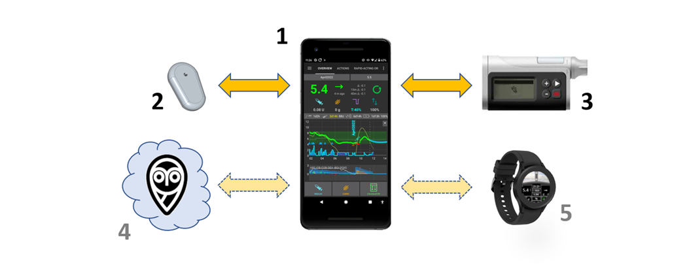
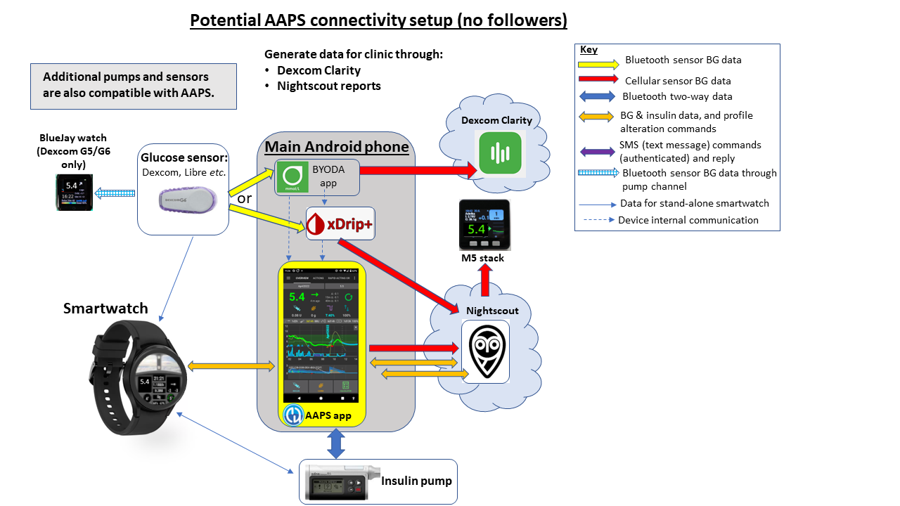
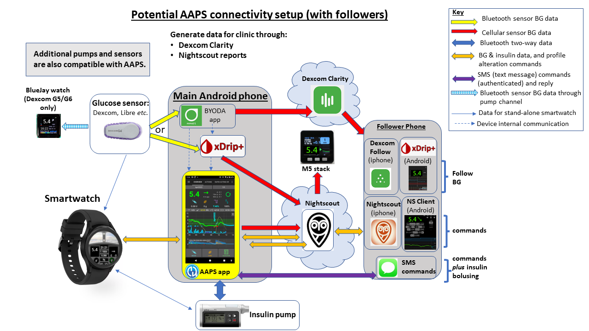

# Einführung in APS und AAPS

```{contents} In this page
:backlinks: entry
:depth: 2
```

## Was ist eine "künstliche Bauchspeicheldrüse” (artifical pancreas system)?

Eine menschliche Bauchspeicheldrüse übernimmt neben der Regulierung des Blutzuckers noch viele andere Dinge im Körper. Der Begriff **„künstliche Bausspeicheldrüse“ (APS)** beschreibt üblicherweise ein System, dass den Blutzuckerspiegel automatisiert im gesunden Bereich hält.

Die einfachste Art dies zu tun ist, den **Glukosewert** zu nutzen, um damit **Berechnungen** vorzunehmen und dann eine vorberechnete **Insulin**menge in den Körper abzugeben. Diese Berechnung wird alle paar Minuten wiederholt, Tag und Nacht (24/7). Es nutzt **Alarme** und **Benachrichtigungen**, um die Benutzenden auf notwendige Eingriffe oder Besonderheiten hinzuweisen. This system is typically made up of a **glucose sensor**, an **insulin pump** and a **controller** which runs the calculations. In **AAPS** and other open-source systems the controller is an app on a phone. In most commercial systems it is software built into the pump itself, with a phone app used mainly for display and control.

For background on how closed-loop systems developed and how they work, this 2022 review article is a good starting point. Bear in mind it predates most of the systems available today, so it is not a guide to what is currently on the market:

 [Closed-Loop Insulin Delivery Systems: Past, Present, and Future Directions](https://www.frontiersin.org/journals/endocrinology/articles/10.3389/fendo.2022.919942/full) (Templer, _Frontiers in Endocrinology_, 2022).

So-called “dual-hormone” systems infuse glucagon alongside insulin, with the aim of preventing severe hypos and allowing even tighter blood glucose control. A first system of this kind has been approved in Europe, but it is supplied only through studies and projects, and others are still in development. None is on general sale yet.

Eine künstliche Bauchspeicheldrüse kann man sich als [„Autopiloten für Deinen Diabetes“](https://www.artificialpancreasbook.com/) vorstellen. Was soll das heißen?

In einem Flugzeug erledigt ein Autopilot einen Teil der Arbeit des menschlichen Piloten, der Pilot kann nicht durch den gesamten Flug schlafen. Der Autopilot unterstützt die Arbeit des Piloten. It relieves them of the burden of constantly having to manage the aircraft, allowing the pilot to concentrate on wider monitoring. The autopilot receives signals from various sensors, a computer evaluates the data together with the pilot’s specifications and then makes the necessary adjustments, alerting the pilot to any concerns. The pilot no longer has to worry about continually making decisions and this analogy can be applied to **AAPS**.


(Introduction-what-does-hybrid-closed-loop-mean)=
## Was bedeutet „Hybrid-Closed-Loop“?

Die beste Lösung für Typ-1-Diabetes wäre eine „funktionale Heilung“ (wahrscheinlich die Implantierung von Bauchspeicheldrüsenzellen, die vor der Immunabwehr geschützt sind). While the type 1 diabetic (T1D) community waits for that, a “full closed loop” artificial pancreas is probably the next best thing. Dies ist ein Technologiesystem, das keine Benutzereingabe benötigt (wie z. B. Mahlzeitenbolus abgeben oder körperliche Aktivität "ankündigen"), um eine gute Blutzucker-Kontrolle zu erreichen. Nearly every system in everyday use is a “hybrid” closed loop, because it uses a combination of automated technology and user input. The first full closed loop systems were approved in Europe in 2026, but none is widely available yet.

## Wie und warum ist das Loopen begonnen worden?

Die Entwicklung kommerzieller Technologien für Menschen mit Typ-1-Diabetes (T1D) ist sehr langsam. 2013 gründete die T1D Community die #WeAreNotWaiting Bewegung. Diese Bewegung entwickelte Systeme, die bestehende und bewährte Technologie (Insulinpumpen und Sensoren) nutzt, um die Blutzucker-Kontrolle und auch die Lebensqualität zu verbessern. These are known as OS-AID (Open-Source Automated Insulin Delivery) systems (formerly DIY systems), because they are not formally approved by health bodies (FDA, NHS etc). There are four main OS-AID systems available: [OpenAPS](https://openaps.org/what-is-openaps/), **AAPS**, [Loop](https://loopkit.github.io/loopdocs/#what-is-loop) and [Trio](https://triodocs.org).

A great way to understand the fundamentals of OS-AID looping is to read Dana Lewis’s book “Automated Insulin Delivery”. Es ist [hier](https://www.artificialpancreasbook.com/) frei erhältlich (oder man kauft sich ein echtes Buch davon). Wenn Du mehr über [OpenAPS](https://openaps.org/what-is-openaps/), aus dem sich **AAPS** entwickelt hat, dann ist die [OpenAPS Website](https://openaps.org/what-is-openaps/) eine hervorragende Quelle.

Several commercial hybrid closed loop systems have also been launched. These are very different to OS-AID systems, mainly because many of them include a “learning algorithm” which adjusts how much insulin is delivered according to your insulin needs from previous days. Many people in the OS-AID community have already tried out commercial systems and compared them with their OS-AID system. You can find out more about how the different systems compare by asking on the dedicated Facebook groups for those systems, on the [AAPS Facebook group](https://www.facebook.com/groups/AndroidAPSUsers/) or on [Discord](https://discord.com/invite/4fQUWHZ4Mw).

## Was ist Android APS (AAPS)?



**Abbildung 1**. Grundstruktur des Android APS (Artificial Pancreas System), AAPS.

Android APS (**AAPS**) ist ein Hybrid-Closed-Loop-System oder eine "künstliche Bauchspeicheldrüse" (Artificial Pancreas System = APS). It makes its insulin dosing calculations using established [OpenAPS](https://openaps.org/) algorithms (a set of rules) developed by the #WeAreNotWaiting T1D community.

Since OpenAPS is only compatible with certain older insulin pumps, **AAPS** (which can be used with a wider range of insulin pumps) was first developed in 2016 for a family member with type 1 diabetes. Seit diesen frühen Tagen wurde **AAPS** durch ein Team von freiwilligen Computerentwicklern und anderen Enthusiasten kontinuierlich weiterentwickelt und verfeinert. Viele dieser Personen haben einen Bezug zur Welt des Typ-1-Diabetes. Today, **AAPS** is used by many thousands of people worldwide. Das System ist sehr flexibel und anpassbar. Dadurch, dass es System Open-Source ist, ist es auch problemlos mit viel anderer Open-Source-Diabetes Software und vielen Plattformen kompatibel. Die grundlegenden Komponenten des gegenwärtigen **AAPS**-Systems werden oben in **Bild 1** dargestellt.


## Was sind die Grundbestandteile von AAPS?

Das „Gehirn“ von AAPS ist eine **App**, die Du selber erstellen ("bauen") musst. Es gibt für dieses Erstellen sehr detaillierte Schritt-für-Schritt-Anleitungen. Du installierst die **AAPS-App** auf einem [kompatiblen](../Getting-Started/Phones.md) **Android-Smartphone** (**1**). Eine Reihe von Nutzenden bevorzugt es, den "Loop" auf einem separaten Smartphone zu haben und es nicht auf ihrem eigentlichen Haupttelefon. Damit ist es dann auch möglich, Dein bestehendes Systemumfeld (z.B. iOS) weiterzunutzen, und nur für AAPS ein Android-Smartphone zu nutzen.

Das **Android Smartphone** benötigt außer **AAPS** noch eine weitere App. This [additional app](../Getting-Started/CompatiblesCgms.md) receives glucose data from a sensor (**2**) by Bluetooth, and then sends the data internally on the phone to the **AAPS app**.

Die **AAPS-App** verwendet einen Entscheidungsprozess (**Algorithmus**) von OpenAPS. Neulinge starten mit dem Basis-Algorithmus **oref0** und können mit zunehmender Erfahrung auf den neueren **oref1**-Algorithmus wechseln. Welcher Algorithmus (oref0 und oref1) gewählt werden sollte, hängt stark von Deiner persönlichen Situation ab.  Beim Eintreffen eines neuen Sensorwerts, berücksichtigen beide Algorithmen mehrere Faktoren bei der dann ausgeführten Neuberechnung. The algorithm then sends instructions to the insulin pump (**3**) on how much insulin to deliver by Bluetooth. All the information can be sent by mobile data or Wi-Fi to the internet (**4**). Diese Informationen und Daten können mit Followern (wenn nötig) geteilt werden und/oder für Datenanalysen ausgewertet werden. Optionally, you can also pair a [smartwatch](../Getting-Started/Watches.md) (**5**) with the phone to see your data at a glance and, with some watches, send basic commands to **AAPS**.

## Welche Vorteile hat das AAPS-System?

Der von **AAPS** verwendete OpenAPS-Algorithmus steuert den Blutzzuckerspiegel automatisch auf Basis der vom Nutzenden hinterlegten Parameter (u.a. Basalrate, Korrekturfaktoren, Mahlzeitenfaktoren, Insulinwirkdauer).

Some of the reported advantages of using **AAPS** are extensive fine-tunable options, **Automations** and increased transparency of the system for the patient/caregiver. This can result in better control over your diabetes (or that of someone you are caring for), which in turn may give improved quality of life and increased peace of mind.

Dadurch, dass Du Deine Zeit investierst, kann **AAPS** zu folgenden Dingen führen:

- Linderung des Stresses und der Belastung durch das Management von Diabetes Typ 1;

- Weniger alltägliche Entscheidungen, die Diabetes Typ 1 mit sich bringt;

- Verringerung der Hypos und deren Behandlungen durch das Berücksichtigen der Echtzeitdaten und der daraus auf die Person abgestimmte dynamische Insulindosierung;

- Ein besseres Verständnis des Insulinmanagements und ein größeres Vertrauen, die eigenen Einstellungen noch besser abzustimmen;

- Die Möglichkeit automatische Anpassungen zu erstellen (**Automatisierungen**), die genau zu Deinen Lebensumständen passen;

- Verbesserung der Schlafqualität und insgesamt eine Verringerung von nächtlichen Eingriffen;

- Remote Monitoring und Steuerung der Insulinabgabe durch Betreuende von Typ 1 Diabetikern; und

- Verringerung all Deiner tragbaren Diabetikergeräte (Empfänger für CGM und Fernsteuerung für die Pumpe) durch Verwendung eines Android-Telefons, von wo **AAPS** die Steuerung übernimmt.


Zu guter Letzt kann **AAPS** den Menschen helfen, ihren Diabetes besser in den Griff zu bekommen, was zu stabilen Blutzuckerwerten und langfristig besseren Gesundheitsergebnissen führt.

### Besondere Vorteile sind:

#### 1) Eingebaute Sicherheit
Um Dich über die Sicherheitsfunktionen der Algorithmen, bekannt als oref0 und oref1, zu informieren, [klicke hier](https://openaps.org/reference-design/). Der Benutzer hat die Kontrolle über seine eigenen Sicherheitsanforderungen.

#### 2) Hardware flexibility

**AAPS** works with a wide range of insulin pumps and sensors and offers flexibility as life changes. Solltest Du z.B. eine Allergie auf ein Dexcom-Pflasterkleber entwickeln, kannst Du ohne größere Probleme auf einen Libre-Sensor umsteigen. Users don't have to rebuild or reinstall the **AAPS** app, just select a different pump or BG source in **Configuration** to change your hardware. **AAPS** is independent of particular pump drivers and also contains a "virtual pump" so users can safely experiment before using it on themselves.

#### 3) Highly customisable, with wide parameters

Benutzer können einfach Module oder Funktionen hinzufügen oder entfernen und **AAPS** kann sowohl im Modus Open Loop, als auch im Modus Closed Loop verwendet werden. Hier einige Beispiele für die Möglichkeiten mit dem **AAPS** System:

 a) The ability to set a lower **BG** target 30 min before eating; you can set the target as low as 72 mg/dL (4.0 mmol/L).

 b) Wenn Du z.B. aufgrund von Insulinresistenz hohe Glukosewerte hast, kannst Du in **AAPS** eine **Automatisierung** erstellen und aktivieren, die bei einem Glukosewert über 144 mg/dl (8 mmol/dl) einen Profilwechsel auf 120 % vornimmt (das führt zu einer Erhöhung der Basalrate um 20 % und einer 20 prozentigen Verstärkung der der anderen Faktoren verglichen mit dem Ausgangs**profil**). Die Automatisierung bleibt für den von Dir angegebenen Zeitraum aktiv. Eine solche Automatisierung kann auch nur in Abhängigkeit von bestimmten Wochentagen, Tageszeiten und sogar vom aktuellen Standort aktiviert werden.

 c) Wenn Dein Kind ohne Vorankündigung beispielsweise auf's Trampolin geht, kann in **AAPS** die Insulingabe (Basalrate) direkt über das Smartphone für einen bestimmten Zeitraum ausgesetzt werden.

 d) Wurde eine Schlauch-Pumpe beispielsweise zum Schwimmen abgekoppelt und wird nun wieder verbunden, berechnet **AAPS** das fehlende Basalinsulin und holt die Basalgabe je nach BZ-Wert vorsichtig nach. Jedes nicht benötigte Insulin kann manuell überschrieben werden, indem man das verpasste Basal einfach „annulliert“.

 e) **AAPS** kann mit mehreren Profilen für unterschiedliche Situationen umgehen und zwischen diesen einfach wechseln. Zum Beispiel kann man Funktionen, die den Algorithmus beschleunigen, um erhöhte BZ-Werte zu senken (wie Supermikro-Bolus („**SMB**“), unangekündigte Mahlzeiten („**UAM**“), nur tagsüber funktionieren lassen, wenn man sich Sorgen um nächtliche Hypos macht.

Dies alles sind Beispiele, das volle Leistungsspektrum bietet große Flexibilität für den Alltag einschließlich Sport, Krankheit, Hormonzyklen _etc_. Es gibt keine Standardlösung für eine solche Automation, sodass es am Ende immer eine individuelle Nutzer*innen-Entscheidung bleibt, wie diese Flexibilität genutzt wird.

#### 4) Remote monitoring
There are multiple possible monitoring channels (Sugarmate, Dexcom Follow, xDrip, Android Auto _etc._) which are useful for parents/carers and adults in certain scenarios (sleeping/driving) who need customisable alerts. In some apps (xDrip) you can also turn alarms off totally, which is great if you have a new sensor “soaking” or settling down that you don’t want to loop with yet.

#### 5) Remote control
A significant advantage of **AAPS** over commercial systems is that it is possible for followers, using authenticated text (SMS) commands or a paired **AAPSClient** app to send a wide range of commands back to the **AAPS** system. This feature is used extensively by parents of kids with type 1 diabetes who use **AAPS**.

The remote control features can be very useful: for example, in the playground, if you want to pre-bolus for a snack from your own phone, and your child is busy playing. It is also possible to monitor the system from a smartwatch (_e.g._ Garmin) or send basic commands from it (_e.g._ a Wear OS watch such as the Samsung Galaxy Watch).

#### 6) No commercial constraints, due to open application interfaces
Über die Verwendung eines Open-Source-Ansatzes hinaus kann der Quellcode von **AAPS** jederzeit eingesehen werden, was das allgemeine Prinzip der Bereitstellung offener Programmierschnittstellen ist. Dies gibt anderen Entwicklern die Möglichkeit, ebenfalls neue Ideen einzubringen. **AAPS** ist eng in Nightscout integriert. Dies beschleunigt die Entwicklung und ermöglicht es den Anwendern, Funktionen hinzuzufügen, um das Leben mit Diabetes noch einfacher zu machen. Good examples for such integrations are [Nightscout](https://nightscout.github.io/), [Nightscout Reporter](https://nightscout-reporter.zreptil.de/), xDrip, [M5 stack](https://github.com/mlukasek/M5_NightscoutMon/wiki) etc. Es besteht ein ständiger Dialog zwischen Open-Source-Entwicklern und den Entwicklern kommerzieller Systeme. Many of the OS-AID innovations are gradually adopted by commercial systems, where developments are understandably slower, partly because interfaces between systems from different companies (pumps, apps, sensors _etc_) need to be carefully negotiated and licenced. Dies kann auch Innovationen verlangsamen die für den einzelnen Patienten bequem sind (oder für eine kleine Untergruppe von Patienten mit sehr spezifischen Anforderungen), die aber keinen großen finanziellen Gewinn bringen.

#### 7) Detailed app interface
Mit **AAPS** ist es einfach Dinge wie Insulinstände in der Pumpe, Alter des Katheters, Sensoralter, Pumpenbatterie, Insulin-On-Bord _usw._. Many actions can be done through the **AAPS** app (priming the pump, disconnecting the pump _etc_.), instead of on the pump itself, which means the pump can stay in your pocket or belt (or that of someone you are caring for).

#### 8) Accessibility and affordability
**AAPS** gives people who currently can’t afford to self-fund, or don’t have funding/insurance, access to a hybrid closed looping system which is conceptually years ahead, in terms of development, of the commercial systems. You currently need a reporting server (Nightscout or Tidepool) to set up **AAPS**, although it is not required for day-to-day running of the **AAPS** loop. Many people continue to use Nightscout for collecting their data, and for remote monitoring. Obwohl **AAPS** selbst kostenlos ist, kann das Einrichten von Nightscout über eine der verschiedenen Plattformen eine Gebühr (€ 0 - €12) nach sich ziehen, je nachdem, welche Unterstützung Sie benötigen (siehe Vergleichstabelle) und ob Sie Nightscout nach dem Setup weiter verwenden wollen oder nicht. **AAPS** arbeitet mit einer großen Auswahl an erschwinglichen [Android-Smartphones](https://docs.google.com/spreadsheets/u/1/d/e/2PACX-1vScCNaIguEZVTVFAgpv1kXHdsHl3fs6xT6RB2Z1CeVJ561AvvqGwxMhlmSHk4J056gMCAQE02sAWJvT/pubhtml?gid=683363241&single=true) (ab ca. €150) zusammen. Verschiedene Versionen sind für bestimmte Standorte und Sprachen verfügbar und AAPS kann auch von [blinden](#accessibility-for-users-aaps-who-are-partially-or-completely-blind) Personen verwendet werden.

#### 9) Support
Kein automatisiertes Insulinsystem ist perfekt. Kommerzielle und Open-Source-Systeme sind sich in möglichen Fehler (Übertragungsprobleme und temporäre Hardware-Fehler) ähnlich. Es gibt Unterstützung seitens der Community der AAPS-Nutzer auf Facebook, Discord und GitHub. Hier sind Leute von überall auf der Welt, die an Design und Entwicklung beteiligt waren und solche, die **AAPS** derzeit verwenden. Es gibt auch Facebook-Supportgruppen und Hilfe von Kliniken/Handelsunternehmen für die kommerziellen APS-Systeme - es lohnt sich, mit den Anendern zu sprechen. oder frühere Anwender dieser Systeme, um Feedback zu häufigen Fehlern, zur Qualität des Schulungsangebots und zum Niveau der kontinuierlichen Unterstützung zu erhalten.

#### 10) Predictability, transparency and safety
**AAPS** is transparent, logical and predictable, which may make it easier to know when a setting is wrong, and to adjust it accordingly. Du kannst zu jeder Zeit genau sehen, was das System tut, warum es das tut und die Kontrolle wieder in Deine Hand nehmen, indem Du entsprechende Grenzen setzt. Dies schafft Vertrauen und Dir einen erholsameren Schlaf.

#### 11) Access to advanced features through development (dev) modes including full closed loop
Diese **AAPS** Dokumentation konzentriert sich auf die Hauptentwicklung im **“master”**-Branch [in Git] von **AAPS**. Forschung und Entwicklung laufen jedoch ständig. Erfahrene Benutzer können die experimentellen Funktionen im **"development"**-Branch erkunden. Die Neuentwicklungen konzentrieren sich auf Strategien zum vollständigen Closed Loop (ohne Bolus für Mahlzeiten _usw._) und versuchen ganz allgemein, das Leben mit Typ-1-Diabetes so angenehm wie möglich zu machen.

#### 12) Ability to contribute yourself to further improvements
Diabetes Typ 1 kann sehr frustrierend sein und dazu führen, dass Du Dich alleingelassen fühlst. Seine Diabetes-Technolgie selber unter Kontrolle zu haben und etwas an die Community zurückzugeben ("pay it forward") indem Du andere bei deren Reise unterstützst, kann ein gutes und befriedigendes Gefühl geben. Du kannst Dich selbst weiterbilden, Hindernisse erkennen und auch Deine Beiträge zur Weiterentwicklung und/oder zur Dokumentation leisten. In der Community gibt es andere, die das gleiche Ziel haben und mit denen Du Ideen austauschen und zusammenarbeiten kannst. Dies ist die Grundidee und der Geist von #WeAreNotWaiting.

## Wie unterscheidet sich AAPS von ICT (MDI) und Open Loop?

Die intensivierte konventionelle Insulintherapie (ICT, (a) in **Bild 2** unten - engl. MDI (Multiple Daily Injections)) erfordert die Injektion von Basalinsulin (_z.B._ Tresiba) 1-2 mal am Tag und ein kurz wirksames Insulin (_z.B._ Novorapid, Fiasp) vor den Mahlzeiten bzw. als Korrektur. Open Pumping (b) nutzt eine Pumpe zur Abgabe des schnell wirkenden Insulins in der einprogrammierten Menge als Basalrate, sowie die Abgabe eines Mahlzeiten- und/oder Korrekturbolus. Die Grundlagen eines Looping-Systems sind, dass die Looping-App die BZ-Werte des Sensors verwendet, um die Pumpe anzuweisen, die Insulinlieferung zu stoppen, wenn sie voraussagt, dass Du auf niedrige Werte geraten wirst und Dir zusätzliches Insulin zu geben, wenn die BZ-Werte sich der Voraussage nach einem zu hohen Niveau nähern (c). Obwohl diese Abbildung, im Vergleich zum realen Leben, übermäßig vereinfacht ist, soll sie die wichtigsten Unterschiede der Ansätze zeigen. Mit jedem dieser drei Ansätze ist eine außergewöhnlich gute BZ-Kontrolle möglich.


**Abbildung 2**. Prinzipielle Übersicht: (a) ICT (engl. MDI), (b) Open-Loop-Pumping und (c) Hybrid-Closed-Loop-Pumping.

## Wie unterscheidet sich AAPS von anderen Loop-Systemen?

Mit dem Stand vom 25. Juni 2023 stehen vier große Open Source Closed Loop-Systeme zur Verfügung: [OpenAPS](https://openaps.readthedocs.io/), **AAPS**, [Loop](https://loopkit.github.io/loopdocs/#what-is-loop) und [Trio](https://triodocs.org), (ehemals FreeAPS X). Die Funktionen der verschiedenen Systeme werden in der folgenden Tabelle angezeigt:


| Device type | Name                                                                 | [AAPS](https://wiki.aaps.app)                 | [Loop](https://loopkit.github.io/loopdocs/)   | [OpenAPS](https://openaps.readthedocs.io/en/latest/) | [Trio](https://triodocs.org)                  |
| ----------- | -------------------------------------------------------------------- | --------------------------------------------- | --------------------------------------------- | ---------------------------------------------------- | --------------------------------------------- |
| Smartphone  | Android                                                              |          |  |         |  |
| Smartphone  | iPhone                                                               |  |          |         |          |
| Rig         | Einplatinencomp. (1)                                                 |  |  |                 |  |
| PUMPE       | [Dana I](../CompatiblePumps/DanaRS-Insulin-Pump.md)                  |          |          |         |          |
| PUMPE       | [Dana RS](../CompatiblePumps/DanaRS-Insulin-Pump.md)                 |          |          |         |          |
| PUMPE       | [Dana R](../CompatiblePumps/DanaR-Insulin-Pump.md)                   |          |  |         |  |
| PUMPE       | [Omnipod (Dash)](../CompatiblePumps/OmnipodDASH.md)                  |          |          |         |          |
| PUMPE       | [Omnipod (Eros)](../CompatiblePumps/OmnipodEros.md)                  |          |          |         |          |
| PUMPE       | [Diaconn G8](../CompatiblePumps/DiaconnG8.md)                        |          |  |         |  |
| PUMPE       | [EOPatch 2](../CompatiblePumps/EOPatch2.md)                          |          |  |         |  |
| PUMPE       | [Medtrum TouchCare Nano 200U](../CompatiblePumps/MedtrumNano.md)     |          |          |         |          |
| PUMPE       | [Medtrum TouchCare 300U](../CompatiblePumps/MedtrumNano.md)          |          |          |         |          |
| PUMPE       | [Roche Combo](../CompatiblePumps/Accu-Chek-Combo-Pump-v2.md)         |          |  |         |  |
| PUMPE       | [Roche Insight](../CompatiblePumps/Accu-Chek-Insight-Pump.md)        |          |  |         |  |
| PUMPE       | [Ältere Medtronik](../CompatiblePumps/MedtronicPump.md)              |          |          |                 |          |
| PUMPE       | [Equil 5.3](../CompatiblePumps/Equil5.3.md)                          |          |  |         |  |
| PUMPE       | [CareLevo](../CompatiblePumps/CareLevo.md)                           |          |  |         |  |
| CGM         | [Dexcom G7/One+/Stelo](../CompatibleCgms/DexcomG7.md)                |          |          |         |          |
| CGM         | [Dexcom One](../CompatibleCgms/DexcomG6.md)                          |          |          |         |          |
| CGM         | [Dexcom G6](../CompatibleCgms/DexcomG6.md)                           |          |          |                 |          |
| CGM         | [Libre 3/3+](../CompatibleCgms/Libre3.md)                            |          |          |         |          |
| CGM         | [Libre 2/2+](../CompatibleCgms/Libre2.md)                            |          |          |         |          |
| CGM         | [Libre 1](../CompatibleCgms/Libre1.md)                               |          |          |         |          |
| CGM         | [Eversense](../CompatibleCgms/Eversense.md)                          |          |          |         |          |
| CGM         | [MM640g/MM630g](../CompatibleCgms/MM640g.md)                         |          |  |         |  |
| CGM         | [PocTech](../CompatibleCgms/PocTech.md)                              |          |  |         |  |
| CGM         | [Ottai](../CompatibleCgms/OttaiM8.md)                                |          |  |         |  |
| CGM         | [Syai Tag](../CompatibleCgms/SyaiTagX1.md)                           |          |  |         |  |
| CGM         | [Nightscout als BZ-Quelle](../CompatibleCgms/CgmNightscoutUpload.md) |          |          |                 |          |

_Hinweise zur Tabelle:_
1. Ein **Rig** ist ein kleiner Computer, den man mit sich herumtragen kann, ohne einen Monitor. Unterstützte Gerätetypen: Intel Edison + Explorer Board; Raspberry Pi + Explorer HAT; Adafruit RFM69HCW Bonnet. The first APS systems were based on this setup, as mobile phones were not capable of running the required algorithms. Die Nutzung dieser Systeme ist rückläufig, da die Einrichtung auf Mobiltelefonen einfacher geworden ist und Telefone ein Display enthalten. Auch hat Intel den Verkauf von Intel Edison eingestellt. Die hervorragenden OpenAPS-Algorithmen **oref0** und **oref1** sind nun in AAPS und Trio integriert.


Eine internationale, von Fachleuten überprüfte Konsenserklärung mit praktischen Anleitungen zum Open-Source-Looping wurde von und für Angehörige der Gesundheitsberufe verfasst und 2022 in einer führenden medizinischen Zeitschrift veröffentlicht: [_Lancet Diabetes Endocrinol_, 2022; 10: 58-74](https://www.ncbi.nlm.nih.gov/pmc/articles/PMC8720075/)(_1_). It is well worth a read (including for your diabetes clinic) and summarizes the main technical differences between the different open-source hybrid closed loop systems.

Es ist schwierig, ein „Gefühl“ für ein System zu bekommen, wenn man es nicht benutzt oder sich nicht mit Personen austauscht, die es aktiv nutzen. Stelle Deine Fragen daher auf Facebook/Discord, wo sich viele aktive Nutzende finden. Most people find that **AAPS** is incredibly sophisticated in comparison to other hybrid closed loop systems (particularly the commercial systems), with a huge number of potentially customizable settings and features, discussed above. Some people can find this a little overwhelming at the beginning, but there is no rush to investigate all the possibilities at once. You can progress as slowly or as fast as you would like, and there is help available at every step of the way.


## Verwendet AAPS künstliche Intelligenz oder einen Lernalgorithmus?

The current version of **AAPS** (4.0) does not have any machine learning algorithms, multiple-parameter insulin response models, or artificial intelligence. Das System an sich ist, im Hinblick darauf wie es funktioniert, offen und transparent. Es kann sowohl von Patienten und Klinikpersonal verstanden werden und es wird dazu kein Expertenwissen benötigt. It also means that if you have a sharply varying schedule (maybe switching from a stressful week at work to a relaxing holiday) and are likely to need a significantly different amount of insulin, you can immediately switch **AAPS** to run a weaker/stronger customized profile. Ein "lernendes System" wird dies für Dich zwar automatisch anpassen, aber es ist sehr wahrscheinlich, dass die Insulinanpassungen so länger dauern werden.

(which-system-is-right-for-me-or-my-dependent)=
## Which system is right for me or someone I am caring for?

Üblicherweise ist Deine Systemwahl davon abhängig, welche Insulinpumpe Du bereits nutzt oder von Deinem medizinischen Versorger bekommen kannst, und Deinem genutzten Smartphone (Apple oder Android). Die größte Systemauswahl hast Du, wenn Du noch gar keine Insulinpumpe hast. Die Technologie entwickelt sich ständig weiter, Insulinpumpen werden vom Markt genommen und neue Pumpen und Sensoren werden verfügbar. Die meisten Open-Source-Systeme arbeiten mit den Hauptsensoren (Libre und Dexcom) oder integrieren neue Sensoren sehr schnell nach deren Verfügbarkeit. Die Erfahrung zeigt, dass neue Sensoren (auch wegen Sicherheits- und Stabilitätstests) innerhalb eines Jahres integriert werden.

Die meisten **AAPS** Anwender berichten von mehr Zeit im Zielbereich (TiR), von einem niedrigeren HbA1c und von einer verbesserten Lebensqualität, weil sie ein System verwenden, das automatisch Basalraten in der Nacht, während sie schlafen, anpassen kann. Dies gilt für die meisten Hybrid-Closed-Loop Systeme. Some people have a preference for a very simple system which is not very customizable (which means you may prefer a commercial system), and others find this lack of control very frustrating (you may prefer an open-source system). If you (or someone you are caring for) are newly diagnosed, a common route is to get used to using MDI plus a glucose sensor first, then progress to a pump which has the potential for looping, then progress to **AAPS**, but some people (especially small kids) may go straight to a pump.

Es ist wichtig zu wissen, dass **AAPS**-Nutzende selbständig und proaktiv Probleme mit der Hilfe der Community lösen müssen. Das erfordert eine andere persönliche Haltung als es bei kommerziellen Systemen notwendig ist. **AAPS** gibt Dir mehr Kontrolle und Flexibilität, aber auch Verantwortung, zu der Du bereit sein musst.

## Ist der Einsatz von Open-Source-Systemen wie AAPS sicher?

### Sicherheit des AAPS-Systems
Da kein System ohne Risiko ist, ist die wahrscheinlich bessere Frage: "Ist **AAPS, im Vergleich** zu meinem aktuell genutzten System zur Behandlung von Diabetes Typ-1, sicher?". **AAPS** hat viele Prüfungen und Abgleiche. A recent [paper](https://www.liebertpub.com/doi/epub/10.1089/dia.2019.0375) looked at the use of **AAPS** in a computer-simulated setup, which was an effective way to objectively trial how safe and effective the system is. More generally, many thousands of individuals worldwide are using open-source automated-insulin delivery systems, and uptake continues to increase globally.

Jedes Gerät, das Funk-Kommunikation nutzt, kann gehackt werden, und das gilt auch für eine nicht loopende Insulinpumpe. Aktuell ist uns kein Fall bekannt, in dem versucht worden ist, das Diabetes-Equipment einer Einzelperson durch einen Hack zu schädigen. Es gibt jedoch mehrere Wege, sich gegen derartige Risiken zu schützen:

1.  Begrenze den maximal abgebbaren Bolus und das maximal mögliche Basal in den Pumpeneinstellungen auf Mengen, die Du als am sichersten empfindest. Das sind feste Grenzen, von denen wir glauben, dass sie durch böswillige Hacker nicht umgangen werden können.

2.  Aktiviere die Alarme Deines CGMs, sowohl für "niedrig" als auch für "hoch".

3.  Halte Deine Insulinabgaben online im Auge. Nightscout-Nutzende können zusätzliche Alarme mit einer großen Vielzahl an Bedingungen (auch für viel wahrscheinlichere Bedingungen als eine böswillige Attacke) einstellen. Zusätzlich zu Alarmen (hoch bzw. niedrig) kann Nightscout auch Diagnosedaten anzeigen, die zeigen, ob die Insulinpumpe wie gewünscht funktioniert, einschließlich des aktuell aktiven Insulins (IOB), der Basalraten-Historie und der Bolus-Historie der Pumpe. Es kann auch so eingestellt werden, dass es frühzeitig auf unerwünschte Zustände wie z.B. vorhergesagte hohe oder niedrige Werte, niedriger Reservoirstand und schwache Pumpenbatterie, hinweist.

Diese Strategie reduziert das Risiko erheblich, wenn ein bösartiger Angriff auf Deine Insulinpumpe erfolgen sollte. Jeder potentielle **AAPS**-Nutzende muss die mit **AAPS** verbundenen Risiken gegen das Risiko anderer Systeme abwägen.

#### Sicherheitsaspekte bezüglich einer allzu schnellen Absenkung der Blutzuckerwerte

Eine schnelle Reduktion des HbA1c und eine verbesserte Blutzuckerkontrolle klingt verlockend. Allerdings kann das _zu schnelle_Senken des durchschnittlichen Blutzuckerspiegels, durch Start eines Closed-Loop-Systems zu permanenten Schäden führen, auch an den Augen, und schmerzhafter Neuropathie, die nie mehr verschwindet. Solche Schäden lassen sich einfach vermeiden, indem man die Werte langsamer reduziert. Wenn Du derzeit einen erhöhten HbA1c hast und zu AAPS (oder einem anderen Closed-Loop-System) wechselst, besprich dieses potentielle Risiko bitte mit Deinem Klinik-Team, bevor Du startest, und lege gemeinsam einen Zeitraum fest, in dem Du den Glukosespiegel sicher schrittweise senkst. Allgemeine Informationen darüber, wie Du Deinen BZ-Spiegel sicher reduzieren kannst, mit Links zur medizinischen Literatur, findest Du im Abschnitt, der sich mit Sicherheit auseinandersetzt [hier](#preparing-safety-first).

#### Medizinische Sicherheit bezüglich Geräte, Verbrauchsmaterialien und anderer Medikamente

Verwende eine getestete, voll funktionierende, FDA oder CE zugelassene Insulinpumpe für Deine künstliche Bauchspeicheldrüse. Gleiches gilt für das CGM-System. Veränderungen an Hard- oder Software dieser Komponenten können zu unerwarteter Insulinabgabe und damit zu erheblichen Risiken für den Anwender führen. Verwende keine defekten, modifizierten oder selbstgebastelten Insulinpumpen oder CGM-Empfänger, um ein AAPS-System zu erstellen oder zu betreiben.

Verwende Originalzubehör wie Inserter, Katheter und Insulinbehälter, die vom Hersteller für Deine Pumpe und Dein CGM zugelassen sind. Die Verwendung von nicht geprüftem oder modifiziertem Zubehör kann zu Ungenauigkeiten des CGM-Systems und Insulinabgabefehlern führen. Insulin ist höchst gefährlich, wenn es falsch dosiert wird. Spiele nicht mit Deinem Leben, indem Du Deine Diabetesausrüstung hackst.

SGLT-2 Inhibitoren (Gliflozine) sollten bei der Verwendung von **AAPS** nicht eingenommen werden, da sie den Blutzuckerspiegel unberechenbar senken. Es ist gefährlich, diesen Effekt mit einem System zu kombinieren, das die Basalsätze senkt, um die BZ-Werte zu erhöhen. Mehr Details dazu findest Du im [Hauptabschnitt Sicherheit](#preparing-safety-first).

(introduction-how-can-i-approach-discussing-aaps-with-my-clinical-team)=
## Wie kann ich mit meinem Klinikteam über AAPS ins Gespräch kommen?

Die Benutzer sind aufgefordert, mit ihren Ärzten über ihre Absicht zu sprechen, **AAPS** zu verwenden. Please do not be afraid to have an honest conversation with your diabetes team if you intend to use **AAPS** (or any other OS-AID loop, for that matter). Transparenz und Vertrauen zwischen Patient und Arzt sind von größter Bedeutung.

### Vorgeschlagene Vorgehensweise:
Sprich mit Deinem Arzt, um herauszufinden, wie vertraut er mit Diabetestechnologie wie CGMs, Pumpen, Hybrid-Loops und kommerziellen Loops ist und welche Einstellung er dazu hat. Dein Arzt/Endokrinologe sollte mit der grundlegenden Technologie vertraut sein und bereit sein, mit Dir die letzten Fortschritte bei kommerziellen Loop-Produkten zu besprechen, die in Eurem Gebiet erhältlich sind.

#### Beispielfälle vor Ort

Obtain your clinicians/endocrinologists’ views on OS-AID loop _vs_ commercial looping, and gauge their knowledge in this area. Are they familiar with **AAPS** and can they share with you any helpful experience of working with patients with OS-AID looping?

Ask if your team has any patients under their care who already use OS-AID looping. Aufgrund der ärztlichen Schweigepflicht können die Ärzte die Daten anderer Patienten nicht an Dich weitergeben, ohne die Zustimmung der Betroffenen einzuholen. However, if you want to, you **can** ask them to pass **your** contact details to an existing OS-AID looping patient if there is one the clinician feels you might "click” with, suggesting that you would be happy for the patient to contact you to discuss OS-AID looping. Ärzte sind dazu nicht verpflichtet, aber einige sind froh darüber, da sie die Bedeutung der Peer-to-Peer-Unterstützung im Diabetes Management von Typ 1 erkennen. You may also find it useful to meet local friendly OS-AID loopers. Dies ist natürlich Dir selbst überlassen und ist nicht unbedingt notwendig.

#### Beispielfälle auf nationaler und internationaler Ebene

Wenn Du das Gefühl hast, dass Du von Deinem Team beim Loopen mit **AAPS** nicht genügend unterstützt wirst, können folgende Diskussionspunkte hilfreich sein:

a) Das **AAPS** System wurde von Patienten und deren Betreuern entworfen. Es wurde letztendlich für die Sicherheit konzipiert, aber auch auf Grundlage einer fundierten Patientenerfahrung. There are many thousands of **AAPS** users worldwide. There is therefore likely to be other patients using OS-AID looping in your clinic's patient population (whether they know about it or not).

b) Recent peer-reviewed published guidance in the internationally leading medical journal [The Lancet](https://www.ncbi.nlm.nih.gov/pmc/articles/PMC8720075/pdf/nihms-1765784.pdf)_(1)_ has confirmed that OS-AID loops are **safe** and **effective at improving diabetic control**, including time in range. There are regular articles in leading journals like [Nature](https://doi.org/10.1038/d41586-023-02648-9)_(3)_ which highlight the progress of the OS-AID looping community.

Durch den Einstieg mit **AAPS** erreicht man eine _schrittweise_ Umstellung von der "Open"-Loop-Pumpenbehandlung, über die Einstellung niedriger BZ-Werte, bis hin zum hybriden "Closed" Loop, wodurch eine Reihe von Zielen erreicht werden. Daher gibt es ein strukturiertes Programm, bei dem der Benutzer in jeder Phase ein gewisses Maß an Kompetenz nachweisen und seine Grundeinstellungen (Basalrate, Insulinempfindlichkeit (ISF) und Kohlehydratfaktor (ICR, I:C, IC)) feinabstimmen muss, bevor er in den Closed Loop kann.

d) Technical support is available to you from the OS-AID community through GitHub, Discord and Facebook closed groups.

e) Du kannst **sowohl CGM-Berichte als auch Insulin-Looping/Pumpen-Protokolle** als kombinierte Berichte bei Kliniksitzungen mitbringen (über Nightscout oder Tidepool), entweder ausgedruckt oder auf dem Bildschirm (wenn Du Laptop/Tablet dabeihast). Die Straffung sowohl der CGM- als auch der Insulindaten, erlaubt es Deinem Diabetes-Team, die Zeit für die Analyse Deiner Berichte effektiver zu nutzen und die Diskusion Deiner Fortschritte zu unterstützen.

f) Wenn es immer noch starke Einwände Deines Diabetes-Teams gibt, gib dem Team Ausdrucke des hier im Text verlinkten Referenzartikels und auch den Link zum Abschnitt **AAPS** für Kliniken: [Für Mediziner und Fachpersonal - Eine allgemeine Einführung in und eine Anleitung für**AAPS**](../UsefulLinks/ClinicianGuideToAaps.md)

#### Support for OS-AID looping by other clinicians

Die in der Fachzeitschrift [Lancet Diabetes Endocrinology](https://www.ncbi.nlm.nih.gov/pmc/articles/PMC8720075/)(_1_)[ veröffentlichte Arbeit (unter Mitwirkung von Kings' und Guy's and St Thomas' NHS Foundation Trust und unter Mitwirkung von Dr. Sufyan Hussain, einem beratenden Diabetologen und ehrenamtlichen Dozenten von King's in London) bietet:

a) **Assurance** for professionals that OS-AID artificial pancreas systems/ open source as a “safe and effective treatment” option for type 1 diabetes and provides guidance on recommendations, discussions, supports, documentation;

b) **Erkenntnis**, dass Open-Source-Systeme zur automatischen Insulinverabreichung ("AID" = Automated Insulin Delivery) die "Time in Range" (TIR) erhöhen und gleichzeitig die Variabilität der Blutzuckerkonzentration sowie die Anzahl der Hypo- und Hyperglykämie-Episoden in verschiedenen Altersgruppen, Geschlechtern und Gemeinschaften verringern können;

c) **Empfehlung**, dass Mitarbeiter des Gesundheitswesens **Typ-1-Patienten oder ihre Betreuer unterstützen** sollten, die sich dafür entscheiden, ihren Diabetes mit einem Open-Source-AID-System zu verwalten;

d) Empfehlung, dass die Mitarbeiter des Gesundheitswesens versuchen sollten, sich über alle Behandlungsmöglichkeiten zu informieren, die den Patienten zugutekommen könnten, einschließlich verfügbarer Open-Source-AID-Systeme.  Wenn Angehörige der Gesundheitsberufe nicht über die Mittel verfügen, sich selbst weiterzubilden, oder wenn sie rechtliche oder behördliche Bedenken haben, sollten sie eine **Kooperation oder eine Zusammenarbeit mit anderen Angehörigen der Gesundheitsberufe** in Erwägung ziehen, die dies tun;

e) Betonung, dass alle Nutzer von CGMs jederzeit in Echtzeit und offen Zugang zu **ihren eigenen Gesundheitsdaten** haben sollten

f) Betonung, dass diese quelloffenen Systeme nicht denselben regulatorischen Bewertungen unterzogen wurden wie kommerziell verfügbare medizinische Technologien und dass es keine kommerzielle technische Unterstützung gibt. Allerdings ist **eine umfangreiche Unterstützung durch die Gemeinschaft verfügbar**; und

g) Eine Empfehlung, dass **Regulierung und Rechtsrahmen** aktualisiert werden sollten, um Klarheit über die ethische und effektive Behandlung solcher Open-Source-Systeme zu schaffen.

In einem anderen Artikel in [Medical Law International, 2021](http://pure-oai.bham.ac.uk/ws/files/120241375/0968533221997510.pdf)(_4_) wird auch darauf hingewiesen, dass das UK General Medical Council in seinen "Einwilligungsrichtlinien" großen Wert darauf legt, dass Arzt und Patient gemeinsam Entscheidungen treffen. The doctor should explain the potential benefits, risks, burdens and side-effects on OS-AID APS and may recommend a particular option without pressuring the patient.

Letztlich muss der Patient diese Faktoren sowie alle für ihn relevanten nicht-klinischen Aspekte abwägen und entscheiden, welche Behandlungsoption er gegebenenfalls akzeptiert.

If a doctor discovers in a clinic that their patient is looping with an OS-AID system, they are not exempted from their obligations to monitor the patient, simply because they did not prescribe the particular piece of technology the patient is using; clinicians must continue to monitor patients.

Ärzten ist es (zumindest im Vereinigten Königreich) nicht verboten, nicht zugelassene Arzneimittel zu verschreiben, und sie können nach ihrem klinischen Ermessen handeln. They should therefore use their clinical judgement to decide if an OS-AID APS is suitable for a specific patient, and discuss what they consider to be the pros and cons with the patient.

#### Die oben genannten Artikel sowie weitere nützliche Links und Stellungnahmen sind unten aufgeführt:

1. Open-source automated insulin delivery: international consensus statement and practical guidance for health-care professionals [dt.: Automatisierte Insulinabgabe mit offenen Quellen: internationale Konsenserklärung und praktische Anleitung für Angehörige der Gesundheitsberufe] [_Lancet Diabetes Endocrinol_, (2022) _10_, 58–74](https://www.ncbi.nlm.nih.gov/pmc/articles/PMC8720075/)
2. [In Silico Trials of an Open-Source Android-Based Artificial Pancreas: A New Paradigm to Test Safety and Efficacy of Do-It-Yourself Systems, 2020 [dt.: In-Silico-Studien einer Android-basierten künstlichen Bauchspeicheldrüse mit offenem Quellcode: Ein neues Paradigma zur Prüfung der Sicherheit und Wirksamkeit von Do-It-Yourself-Systemen]](https://www.liebertpub.com/doi/epub/10.1089/dia.2019.0375)
3. A DIY ‘bionic pancreas’ is changing diabetes care — what's next? [dt.: Eine selbst gebaute "bionische Bauchspeicheldrüse" verändert die Diabetesbehandlung - wie geht es weiter?] [_Nature_ (2023), _620_, 940-941](https://doi.org/10.1038/d41586-023-02648-9)
4. Prescribing unapproved medical devices? The case of DIY artificial pancreas systems [ [dt.: Verschreibung von nicht zugelassenen Medizinprodukten? Der Fall der Do-it-yourself-Systeme bei künstlichen Bauchspeicheldrüsen] _Medical law international_, (2021), _21_, 42-68](http://pure-oai.bham.ac.uk/ws/files/120241375/0968533221997510.pdf)
5. [Berlin Institute of Health position statement [dt.: Stellungnahme des Berliner Instituts für Gesundheit], 2022](https://www.bihealth.org/en/notices/do-it-yourself-solutions-for-people-with-diabetes-are-safe-and-recommended)
6. Do-It-Yourself Automated Insulin Delivery: A Health-care Practitioner User’s Guide (Diabetes Canada position and guide) [dt.: Automatisierte Insulinabgabe zum Selbermachen: Ein Leitfaden für medizinische Fachkräfte (Position und Leitfaden von Diabetes Canada)] [_Canadian Journal of Diabetes_, (2023)_47_, E8, 389-397](https://www.canadianjournalofdiabetes.com/article/S1499-2671(23)00138-7/fulltext)
7.  Netherlands (EN/NL) - for clinicians - [how to help people on open source automated insulin delivery systems](https://www.diabetotech.com/blog/how-to-help-people-on-open-source-automated-insulin-delivery-systems) [dt.: Niederlande (EN/NL) - für Kliniken - Wie man Menschen mit Open-Source-Systemen für die automatische Insulinabgabe helfen kann]
8. First Use of Open-Source Automated Insulin Delivery AndroidAPS in Full Closed-Loop Scenario: Pancreas4ALLRandomized Pilot Study [dt.: Erster Einsatz des Open-Source-Systems zur automatischen Insulinabgabe, AndroidAPS, in einem vollständigen Closed-Loop-Szenario: Randomisierte Pilotstudie Pancreas4ALL] [_Diabetes Technol. Ther._, 25, _5_, 2023](https://www.liebertpub.com/doi/pdf/10.1089/dia.2022.0562?casa_token=D13eFx5vCwwAAAAA:MYvO8hChbViXVJFgov1T11RXBPx2N_wOMThLHwl3TVUxbCuANegPrIFRC5R5VXx_S71FoQYW-qg)
9. Pre-school and school-aged children benefit from the switch from a sensor-augmented pump to an AndroidAPS hybrid closed loop: A retrospective analysis [dt.: Kinder im Vorschul- und Schulalter profitieren von der Umstellung von einer sensorgestützten Pumpe auf einen AndroidAPS-Hybrid-Closed-Loop: Eine retrospektive Analyse] [_Pediatr. Diabetes_ 2021, _22_, 594-604. 2021](https://onlinelibrary.wiley.com/doi/epdf/10.1111/pedi.13190)
10. Outcomes of the OPEN project, an EU-funded project into the Outcomes of Patient’s Evidence with Novel, Do-it-Yourself Artificial Pancreas Technology \[dt.: Ergebnisse des OPEN-Projekts, eines von der EU finanzierten Projekts zur Untersuchung der Ergebnisse von Patienten mit neuartiger Do-it-yourself-Technologie für die künstliche Bauchspeicheldrüse\] (https://www.open-diabetes.eu/publications)


## F: Warum kann ich AAPS nicht einfach herunterladen und sofort nutzen?

Die **AAPS**-App ist nicht in Google Play herunterladbar - Du musst die App aus rechtlichen Gründen selbst aus dem verfügbaren Quellcode erstellen. **AAPS** ist in keinem Land lizenziert, d.h. es gibt keine Genehmigung einer Aufsichtsbehörde. **AAPS** gilt als persönliches, medizinisches Experiment und wird auf eigenes Risiko durchgeführt.

Die Einrichtung des Systems muss mit Ruhe, Entschlossenheit und schrittweiser Erweiterung des eigenen technischen Wissens erfolgen. Alle Informationen und Unterstützung findest Du in diesem Dokument, online oder bekommst sie von anderen, die durch diesen Prozess bereits durchgegangen sind. Many thousands of people have successfully built and are currently using **AAPS** worldwide.

Für die **AAPS**-Entwickler ist Sicherheit und eine gute **AAPS**-Benutzererfahrung von vorrangiger Bedeutung. Das ist auch der Grund warum es unerlässlich für jeden Nutzenden (oder Betreuenden, wenn das System für ein Kind genutzt wird) ist, dass der Nutzende:

- das AAPS-System selbst aufbaut und die **Ziele** durcharbeitet, so dass er zu dem Zeitpunkt, an dem er den "Closed Loop" macht, einigermaßen gute personalisierte Einstellungen hat und die Grundlagen der Funktionsweise von **AAPS** versteht;

- backs up their system by exporting and saving important files (like keystore and settings .json file) somewhere safe, so you can set up again quickly if needed;

- auf eine neue Master-Version aktualisiert, sobald diese verfügbar wird, und

- das System aktuell und im Auge behält, um sicher zu sein, dass es richtig funktioniert.

## Was macht die Connectivity des AAPS-Systems aus?

**Figure 3 (below)** shows one example of the **AAPS** system for a user who does not require any followers interacting with the system. Zusätzliche, nicht gezeigte Open-Source-Software und Plattformen können ebenfalls integriert werden.




**Figure 4 (below)** shows the full potential of the **AAPS** system for a user who has followers and needs to monitor and adjust the system remotely (like a child with type 1 diabetes). Zusätzliche, nicht gezeigte Open-Source-Software und Plattformen können ebenfalls integriert werden.



## Wie läuft die stetige Weiterentwicklung und Verbesserung von AAPS?

Die meisten **AAPS**-Benutzer verwenden die vollständig getestete **Master**-Version von AAPS, die - bevor sie für die Community freigeben wurde - auf Fehler und Probleme ausgiebig getestet wurde. Neuerungen und Verbesserungen werden hinter den Kulissen durch die Entwickler ausprobiert und in „Entwickler“ (**dev**)-Versionen von **AAPS** mit einer kleineren Nutzergruppe, die gerne hilft Fehler zu finden, zu reporten und daraus neue Entwickler-Versionen zu generieren, getestet. Gut funktionierende Neuerungen und Verbesserungen werden dann in eine neue **AAPS**-„Master“-Version überführt und für die Allgemeinheit freigegeben. Jede neue Master-Version wird in der Facebook-Gruppe bekannt gegeben, so dass die regulären **AAPS**-Benutzer über die neue Version informiert sind und auf diese Master-Version aktualisieren können.

Einige erfahrene und mit dem System vertraute **AAPS**-Benutzer verwenden Entwicklerversionen der **AAPS**-App und experimentieren mit neuen Technologien. Es kann für weniger abenteuerlustigen Nutzer interessant sein von diesen Experimenten zu erfahren, ohne es selbst machen zu müssen! Im Allgemeinen wird auch in der Facebook-Gruppe von diesen Experimenten berichtet.

Eine gute Lektüre rund um die Details zu diesen Experimenten und Diskussionen über neueste Technologieentwicklungen ist:

Tim Street [https://www.diabettech.com/](https://www.diabettech.com/)

David Burren [https://bionicwookie.com/](https://bionicwookie.com/)

## Wer kann von AAPS profitieren?

| Nutzergruppe                                        |
| --------------------------------------------------- |
| ✔️ Typ-1-Diabetiker                                 |
| ✔️ Betreuer oder Elternteil eines Typ-1-Diabetikers |
| ✔️ Blinde Typ-1-Diabetiker                          |
| ✔️ *clinicians and healthcare professionals         |

The above table assumes that the user has access to both a continuous glucose monitor and an insulin pump.

*Alle Daten von **AAPS** können medizinischen Fachkräften über Datenaustauschplattformen zur Verfügung gestellt werden, einschließlich Nightscout, das die Aufzeichnung und Echtzeitüberwachung von CGM-Daten, Insulinabgabe, Kohlenhydratangaben, Prognosen und Einstellungen ermöglicht. Aus Nightscout können Tages- und Wochenberichte erzeugt werden, die in Diskussionen eines Diabetes-Teams mit einem Typ 1-Patienten hilfreich sein können, da sie genauere Daten zur glykämischen Kontrolle und Verhaltensüberlegungen beisteuern.

(accessibility-for-users-aaps-who-are-partially-or-completely-blind)=

### Accessibility for AAPS users who are partially or completely blind

#### Tägliche Verwendung von AAPS:
AAPS kann von Blinden verwendet werden. Auf Android-Geräten stellt das Betriebssystem ein Programm namens TalkBack zur Verfügung. Dies ermöglicht die Bildschirmorientierung über die Sprachausgabe als Teil des Betriebssystems. Mit TalkBack kannst Du sowohl Dein Smartphone als auch AAPS bedienen, ohne dass Du es sehen musst.

#### Das Erstellen der AAPS-App:
Als Benutzer wirst Du die AAPS-App in Android Studio erstellen. Zu diesem Zweck verwenden viele Microsoft Windows, wo es den Screenreader analog zu TalkBack gibt. Da Android Studio eine Java-Anwendung ist, muss die Komponente "Java Access Bridge" in der Systemsteuerung aktiviert werden. Andernfalls wird der Screenreader des PCs nicht in Android Studio sprechen.

Wie Du das machst, hängt von Deinem Betriebssystem ab. Zwei Methoden sind nachfolgend aufgeführt:

1) Gib im Windows-Start-Menü "Systemsteuerung" im Suchfeld ein und öffne diese mit Enter. Es öffnet sich "Einstellungen des Computers anpassen".

Öffne "Erleichterte Bedienung", dann "Center für erleichterte Bedienung".

Dann öffne "Computer ohne Bildschirm verwenden" mit Enter.

Under **Hear text read aloud**, select **turn on narrator** and **turn on audio display**, then click **apply**.

oder:

2) Drücke die Windowstaste und gib "Systemsteuerung" in das Suchfeld ein. Öffne diese mit Enter. Es öffnet sich "Einstellungen des Computers anpassen".

Drücke "C" um zum "Center für erleichterte Bedienung" zu gelangen. Öffne dieses mit Enter.

Dann öffne "Computer ohne Bildschirm verwenden" mit Enter.

Dort, ziemlich am Ende der Liste, findest Du die Checkbox "Java Access Bridge aktivieren". Wähle diese.

Fertig, einfach das Fenster schließen! Der Screenreader sollte jetzt funktionieren.


Interessiert, wie Du mit der Einrichtung von AAPS beginnst? Sieh im Abschnitt [Vorbereitung](../Getting-Started/PreparingForAaps.md) nach.
