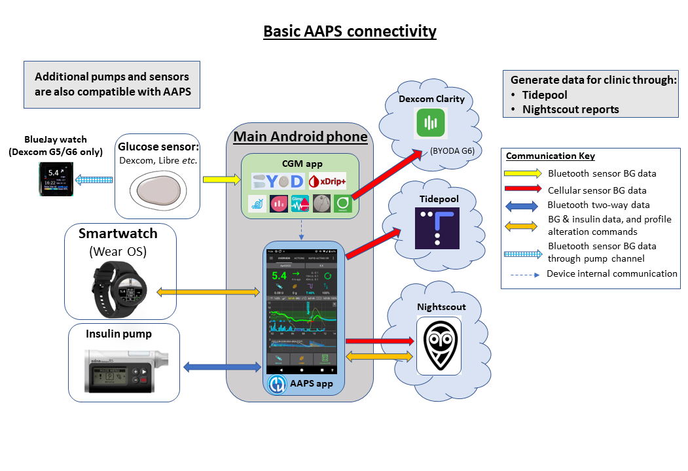
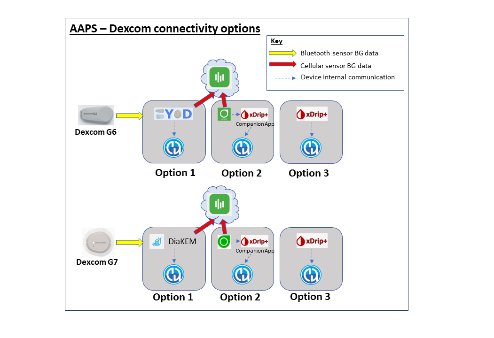
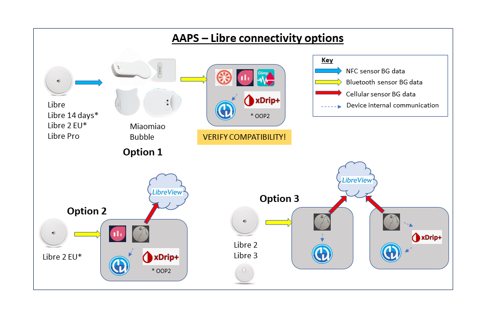
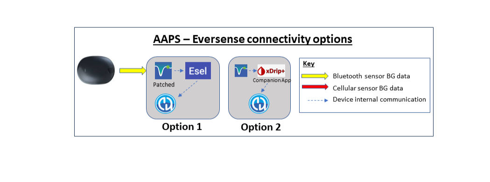

# Vorbereitungen, um mit AAPS zu starten

Willkommen. This documentation aims to guide users who are preparing to set up and start using the Android Artificial Pancreas System (**AAPS**).

## Deinen Weg durch die Dokumentation finden

Ein **Index** und eine Erklärung der Dokumentenstruktur findest Du [hier](../index.md). Alternativ klickst Du auf das Symbol **AAPS** oben links in der Dokumentation. Dort findest Du eine Zusammenfassung der jeweiligen Zielsetzung der einzelnen Abschnitte in der Dokumentation. Du kannst auch mit Hilfe der Überschriften auf der linken Seite durch die Navigation navigieren. Zusätzlich gibt es eine praktische Suchfunktion direkt unterhalb des **AAPS**-Symbols.

Unser Ziel ist es, sowohl die **AAPS**-Möglichkeiten als auch dessen Beschränkungen leicht verständlich zu beschreiben. Es kann enttäuschend sein, wenn Du, nachdem Du bereits einiges an Zeit in das Lesen der Dokumentation investiert hast, feststellst, dass Deine Insulinpumpe oder Dein Sensor nicht mit **AAPS** kompatibel ist oder <0>AAPS</0> andere Funktionalitäten bietet, als Du Dir erhofft hast.

Viele Details in der **AAPS**-Dokumentation sind aus Erfahrungen entstanden und sind erst dann besonders nachvollziehbar, wenn **AAPS** tatsächlich genutzt wird. Genauso wie es fast unmöglich ist, eine Sportart nur durch das Lesen der Regeln zu lernen, ist es für den sicheren Umgang mit **AAPS** wichtig, die Grundlagen des Systems zu verstehen und das Wissen konkret auf Dein (neu) laufendes **AAPS** anzuwenden.

(preparing-safety-first)=

## Sicherheitshinweise
„Mit großen Möglichkeiten kommt auch eine große Verantwortung…”

### Technische Sicherheit
**AAPS** hat umfangreiche Sicherheitsfunktionen. Diese beschränken das System und werden schrittweise durch das stufenweise Abschließen einer Reihe von [Zielen](../SettingUpAaps/CompletingTheObjectives.md) entfernt. Diese beinhalten das Testen bestimmter Parameter und die Beantwortung mehrerer Multiple-Choice-Fragen. **AAPS**-Funktionen werden mit dem erfolgreichen Abschluss des jeweiligen Ziels freigeschaltet. Dieses Vorgehen ermöglicht durch das schrittweise Kennenlernen der verschiedenen **AAPS**-Funktionen einen sicheren Übergang aus dem 'Open Loop' in den 'Closed Loop'.

Die [Ziele (Objectives)](../SettingUpAaps/CompletingTheObjectives.md) sollen den bestmöglichen Einstieg in **AAPS** ermöglichen, und dabei die typischen Fehler und Nutzungsmuster, die **AAPS**-Entwickler bei Neulingen beobachtet haben, adressieren. Weil Einsteiger unerfahren sind und zu schnell mit **AAPS** loslegen wollen oder wichtige Punkte übersehen haben, können Fehler passieren. The [Objectives](../SettingUpAaps/CompletingTheObjectives.md) aim to minimize these issues.

### Medizinische Sicherheit
```{admonition} Avoid permanent and painful damage to your eyes and nerves
:class: danger
Vorsicht ist bei einer (zu) schnellen Verbesserung der Blutzuckerkontrolle und des HbA1c notwendig 
```

Ein wichtiger Sicherheitsaspekt ist, dass eine **schnelle Reduzierung des HbA1c und eine verbesserte Blutzuckerkontrolle bei Personen mit einem über einen längeren Zeitraum erhöhten Glukosespiegel dauerhaften Schaden** verursachen können. Many people with diabetes are unaware of this, and not all clinicians make their patients aware of this issue.

Dieser Schaden kann **Sehverlust und dauerhafte Neuropathie (Schmerz)** beinhalten. Es ist möglich, diesen Schaden zu vermeiden, indem der durchschnittliche Glukosespiegel langsamer reduziert wird. Wenn Du derzeit einen erhöhten HbA1c hast und zu **AAPS** (oder einem anderen Closed-Loop-System) wechselst, besprich dieses potentielle Risiko _bitte_ mit Deinem Klinik-Team, bevor Du startest, und lege gemeinsam einen Zeitraum fest, in dem Du den Glukosespiegel sicher schrittweise senkst. You can easily set higher glucose targets in **AAPS** initially (currently, the highest target you can select is 11.1 mmol/L but you can also maintain a purposefully weak profile if needed), and then reduce the target as the months pass.

#### Wie schnell kann ich meinen HbA1c reduzieren, ohne dauerhaften Schaden zu riskieren?

Eine retrospektive [Studie](https://pubmed.ncbi.nlm.nih.gov/1464975/) von 76 Patienten berichtet davon, dass das Risiko einer fortschreitenden Retinopathie um das 1,6 bis 2,4-fache und 3,8-fache steigt, wenn der HbA1c innerhalb eines Zeitraums von 6 Monaten um 1%, 2% bzw. 3% gesunken ist. Sie schlugen vor, dass die **"Verringerung des HbA1c-Wertes während eines Zeitraums von 6 Monaten auf weniger als 2% beschränkt werden sollte, um das Fortschreiten der Retinopathie zu verhindern. ..Ein zu schneller Rückgang beim Beginn der glykämischen Kontrolle kann zu einer schwerwiegenden oder vorübergehenden Verschärfung des Fortschreitens der Retinopathie führen.“**

Nachbemerkung: If you use different HbA1c units (mmol/mol rather than %), click [here](https://www.diabetes.co.uk/hba1c-units-converter.html) for an HbA1c calculator tool.

In einer weiteren retrospektiven [Bewertung](https://academic.oup.com/brain/article/138/1/43/337923) von 954 Patienten haben Forschende Folgendes festgestellt:

**"Mit einer Verringerung des HbA1c um 2–3 Prozentpunkte innerhalb von 3 Monaten gab es ein absolutes 20%-iges Risiko eine behandlungsbedürftigen Neuropathie bei Diabetes zu entwickeln. Mit einer Reduktion des HbA1c um >4% über 3 Monate überstieg das Risiko eine behandlungsbedürftigen Neuropathie bei Diabetes zu entwicklen 80 %."**

Ein [Kommentar](https://academic.oup.com/brain/article/138/1/2/340563) zu dieser Arbeit bestätigte, dass das Ziel zur Vermeidung von Komplikationen **sein sollte, den A1c über 3 Monate hinweg um <2 % zu reduzieren.** Weitere Rezensionen zum Thema [findest Du hier](https://www.ncbi.nlm.nih.gov/pmc/articles/PMC6587545/pdf/DOM-21-454.pdf) und [hier](https://www.mdpi.com/1999-4923/15/7/1791).

It is generally recognized that _newly_ diagnosed type 1 diabetics (who often have very high HbA1c at diagnosis, before starting insulin therapy) appear to be able to rapidly reduce their HbA1c immediately after diagnosis without encountering these risks to the same extent, because they have not had elevated blood glucose levels for such a sustained period. Dennoch ist es überlegenswert, dies mit Deinem Diabetes-Team zu besprechen.

(PreparingForAaps-no-sglt-2-inhibitors)=
### Keine SGLT-2-Hemmern

```{admonition} NO SGLT-2 inhibitors
:class: danger
SGLT-2 Hemmer, auch Gliflozins genannt, hemmen die Resorption (Aufnahme) von Glukose in der Niere. Gliflozine senken den Blutzuckerspiel unkalkulierbar, und DÜRFEN NICHT genommen werden, wenn ein Closed Loop System wie AAPS genutzt wird! Damit würde ein enormes Risiko für eine Ketoazidose und/oder eine Hypoglykämie bestehen! Besonders gefährlich ist die Kombination dieses Medikaments mit einem System, das die Basalrate senkt, um die Glukosewerte zu erhöhen. 

In a nutshell:
- **Example 1: risk of Hypo**
>During lunch, you use **AAPS** to bolus based on consuming 45 g of glucose. The problem is that, unbeknownst to AAPS, the inhibitors cause the body to eliminate some of the carbs. This leaves your body with too much insulin compared to the absorbed carbs, resulting in hypoglycemia.

- **Example 2: risk of Ketoacidosis**
>The inhibitors eliminate some of the carbs in the background, causing a reduction in your BG. **AAPS** will automatically instruct the pump to decrease insulin intake, including basal. Over time this can result in your BG remaining below target value, to the point where the body does not have enough background insulin to absorb any carbs, resulting in ketoacidosis. Ordinarily, ketoacidosis develops in T1D patients because their pump fails, which would trigger alerts on their phone and be noticeable due to a high BG value. However, the danger with gliflozins is that there would be no AAPS alerts, as the pump remains operational and the BG potentially remains within target.

Bekannte Handelsnamen von SGLT-2 Hemmern sind: Invokana, Forxiga, Jardiance, Steglatro und Zynquista und andere.
```


### Grundprinzipien des Loopens mit AAPS

Die Grundprinzipien und Konzepte des Loopens müssen vom Nutzenden verstanden werden, bevor **AAPS** verwendet wird. Dies wird erreicht, indem Du Zeit in das Lesen der **AAPS**-Dokumentation investierst und die Ziele (Objectives), die Dir eine gute Ausgangslage für den sicheren und effektiven Umgang mit **AAPS** ermöglichen sollen, abschließt. Der Umfang der **AAPS**-Dokumentation mag am Anfang erschlagend wirken, aber bleib' geduldig und vertraue dem Prozess - mit dem richtigen Vorgehen wirst Du es erreichen!

Wie schnell man vorankommt, hängt stark vom Einzelnen ab. Sei Dir aber bewusst, dass das Erreichen aller Ziele (Objectives) typischerweise ca. 6-9 Wochen benötigt. Many people start to build, install and set up **AAPS** well in advance of starting to use it. Um das zu unterstützen, hat das System eine "virtuelle Pumpe", die beim Abschluss der ersten Ziele genutzt werden kann, um sich mit **AAPS** vertraut zu machen, ohne es tatsächlich zur Insulinabgabe zu nutzen. A detailed breakdown of the timeline is given below, be aware that by objective 7 of **AAPS** you are closed looping, the later objectives add in additional features like **SMB** and **automations** which are useful to some users, but not essential to the core function of **AAPS**.

Dein Erfolg mit **AAPS** hängt von Deiner Proaktivität, Deinem Willen Glukosewerte zu hinterfragen und Deiner Flexibilität die notwendigen **AAPS**-Anpassungen für bessere Ergebnisse zu machen, ab. Genauso wie es nahezu unmöglich ist, eine Sportart allein über das Regelwerk zu erlernen, ist es auch mit **AAPS**.

#### Rechne mit Verzögerungen und kleineren Stolpersteinen auf dem Weg alles einzurichten und ans Laufen zu bekommen

In der Anfangsphase das **AAPS**-System aufzubauen und auch beim späteren Nachjustieren, kann es Schwierigkeiten in der Kommunikation alle Komponenten des Loops (und potentieller Follower) untereinander geben. Einige Fehler können erst gelöst werden, wenn **AAPS** im Alltag benutzt wird, aber jede Menge Hilfe ist in der Facebook-Gruppe und auf Discord verfügbar. Bitte berücksichtige das entsprechend und nutze "gute" Zeiten, wie z.B. einen ruhigen Vormittag oder ein Wochenende (d.h. nicht mitten in der Nacht oder wenn Du müde bist oder ein wichtiges Meeting ansteht oder Du reist), diese Probleme anzugehen und zu lösen.

#### Technologie-Kompatibilität

**AAPS** ist nur mit bestimmten Insulinpumpen, CGMs und Smartphones kompatibel. Einige Systeme/Technologien sind möglicherweise nicht in jedem Land verfügbar. Um Enttäuschungen oder Frustrationen vorzubeugen, lies bitte die Abschnitte [CGM](../Getting-Started/CompatiblesCgms.md), [Insulinpumpen](../Getting-Started/CompatiblePumps.md) und [Smartphones](../Getting-Started/Phones.md).

#### Zeit die App zu erstellen und zum vollständigen Loopen weiterzugehen

Der Zeitbedarf, um **AAPS** zu erstellen, hängt von Deiner Erfahrung und Deinem technischen Verständnis bzw. Fähigkeiten ab. In der Regel benötigt ein unerfahrener Nutzer (mit Hilfe der Community) einen halben bis ganzen Tag, um **AAPS** zu erstellen. Durch Deine zunehmende Erfahrung wird der Prozess bei **AAPS**-Folgeversionen deutlich schneller gehen.

Several parts of this documentation are dedicated to helping you through the build process:

- [Building AAPS](../SettingUpAaps/BuildingAaps.md) takes you step-by-step through building the app and installing it on your phone;

- the [FAQ](../UsefulLinks/FAQ.md) answers common questions and explains the errors most likely to occur; and

- the [Troubleshooting](../GettingHelp/GeneralTroubleshooting.md) hub collects solutions to the most frequent problems, organised by topic.

How long it takes to get to closed looping depends on the individual; an approximate timeline for reaching full looping with **AAPS** is given [below](#preparing-how-long-will-it-take).


#### Exportdatei des Keystore & der Konfigurationseinstellungen

Ein "keystore" ist eine mit einem Passwort verschlüsselte Datei, die ausschließlich zu Deiner Kopie von **AAPS** passt. Durch die Nutzung des "keystore" stellt Dein Android-Smartphone sicher, dass nur Du Deine Kopie der App aktualisieren kannst. Kurzum, als Teil der **AAPS**-Erstellung, solltest Du:

1.  Save your keystore file (.jks file used to sign your app) in a safe place;

2.  Notiere das Passwort für Deine Keystore-Datei.

Wie Du den Keystore sicherst, hängt davon ab, wie Du AAPS erstellst:

- **Android Studio Build (Computer)**: Der Keystore wird beim Erstellen angelegt. Wo Du ihn speichern solltest, steht unter [Signierte APK erstellen](#Building-APK-generate-signed-apk).
- **AAPS Builder**: Bewahre die Sicherungsdatei `aaps-keystore.jks` auf, die Dir die Einrichtungsseite beim Anlegen Deines Schlüssels angeboten hat, zusammen mit Passwort und Alias. Hast Du Deinen eigenen Keystore hochgeladen, bewahre diese Datei auf.
- **Browser-Build mit Fork**: Nutze den dafür vorgesehenen Workflow [Export keystore](#ci-keystore-export), um eine Kopie in Deinem Google Drive abzulegen.

Damit kannst Du die Keystore-Datei für jedes Update auf eine neue **AAPS**-Version nutzen. Im Durchschnitt werden zwei AAPS-Updates pro Jahr nötig.

Zusätzlich bietet **AAPS** die Möglichkeit, [alle Konfigurationseinstellungen zu exportieren](../Maintenance/ExportImportSettings.md). Damit kannst Du das System z.B. bei einem Smartphone-Wechsel oder bei einer Neuinstallation/Update der App sicher wieder herstellen und es mit einer nur kurzen Unterbrechung weiter nutzen. 

#### Problembehandlung

Wenn Du Dir bei irgendetwas unsicher bist, gehe bitte auf die AAPS-Community zu - es gibt keine dummen Fragen! Alle Nutzenden, egal mit welcher Erfahrung, sollen sich bestärkt fühlen, Fragen zu stellen. Da es viele **AAPS**-Nutzende gibt, werden Fragen in der Regel schnell beantwortet.

##### [Frage in der AAPS Facebook-Gruppe](https://www.facebook.com/groups/AndroidAPSUsers/)

##### [Frage im AAPS Discord Kanal](https://discord.gg/4fQUWHZ4Mw)


#### [Wo finde ich Hilfe](../UsefulLinks/BackgroundReading.md)?

Dieser Abschnitt zielt darauf ab, neuen Benutzern Links zu Ressourcen bereitzustellen, um Hilfe zu erhalten, einschließlich des Zugriffs auf den Community Support, welcher aus neuen und erfahrenen Benutzern besteht, die Fragen klären und die üblichen Fallstricke lösen können, die mit AAPS einhergehen.

#### [Abschnitt für Mediziner und Fachpersonal](../UsefulLinks/ClinicianGuideToAaps.md)

Dieser [Abschnitt ist für Mediziner und Fachpersonal](../UsefulLinks/ClinicianGuideToAaps.md), die mehr über AAPS und Open Source Artificial Pancreas Technolgie lernen möchten. In der Einleitung gibt es auch Hilfestellung dazu, [wie Du das mit Deinem Diabetes-Team besprechen kannst](#introduction-how-can-i-approach-discussing-aaps-with-my-clinical-team).

## Was werden wir bauen und installieren?

Dieses Diagramm gibt einen Überblick über die Schlüsselkomponenten (sowohl Hardware als auch Software) des **AAPS** Systems:




Neben den drei grundlegenden Hardwarekomponenten (Smartphone, Insulinpumpe und Glukosesensor) benötigen wir auch: 1) Die **AAPS**-App 2) Einen Server für Berichte und 3) Eine App zum Auslesen Deines Sensors (CGM)

### Eine Android Smartphone-App: **AAPS**

**AAPS** is an app that runs on Android smartphones & devices. Du wirst die **AAPS**-App auf Dein Smartphone (per E-Mail, USB-Kabel _etc._) übertragen und installieren. Du wirst die **AAPS**-App auf Dein Smartphone (per E-Mail, USB-Kabel _etc._) übertragen und installieren.

### 2) A reporting server: Nightscout (Tidepool*)

In order to fully take advantage of **AAPS**, you need to set up a Nightscout server. Du kannst das [selbst machen](https://nightscout.github.io/nightscout/new_user/#free-diy) oder alternativ einen kommerziellen Anbieter gegen eine kleine Gebühr mit dem Aufsetzen und Betreiben des Nightscout-Services ([managed service](https://nightscout.github.io/#nightscout-as-a-service)) für Dich beauftragen. Nightscout wird genutzt, um über die Zeit hinweg Daten von **AAPS** zu sammeln und kann daraus detaillierte Berichte erstellen, die Zusammenhänge von CGM- und Insulinmustern zeigt. Eltern und Betreuende können Nightscout auch dazu nutzen, um remote mit der **AAPS**-Anwendung zu kommunizieren und das Diabetes-Management des Kindes im Auge zu behalten. Die Funktionen zur Remote-Kommunikation beinhaltet Echtzeit-Informationen der Glukosewerte und dem Insulinspiegel, Remote-Bolus (über SMS) und Ankündigung von Mahlzeiten. Attempting to analyze your diabetes performance by looking at CGM data separately from the pump data is like driving a car where the driver is blind and the passenger describes the scene. Tidepool is also available as an alternative to Nightscout.

### 3) Eine App zum Auslesen Deines Sensors (CGM)

Um Glukosewerte zu empfangen und an **AAPS** weiterzureichen, benötigst Du die zu Deinem Sensor passende und kompatible App. Die verschiedenen Optionen werden unten gezeigt und weitere Informationen findest Du im Abschnitt [kompatible Sensoren (CGMs)](../Getting-Started/CompatiblesCgms.md):

  

### Pflege des **AAPS**-Systems

Mit dem Erscheinen von verbesserten Versionen müssen **Nightscout** und **AAPS** ungefähr einmal pro Jahr aktualisiert werden. In einigen Fällen kann das Update verschoben werden, in anderen Fällen wird es dringend empfohlen oder ist aus Sicherheitsgründen zwingend erforderlich. In Facebook-Gruppen und Discord-Kanälen wird über diese Updates informiert werden. Die Release Notes werden das entsprechende Szenario beschreiben. Dadurch das viele Leute gleichzeitig durch den Update-Prozess gehen, werden sich deren Fragen mit Deinen ähneln und Dir die Antworten darauf auch helfen.

(preparing-how-long-will-it-take)=
## Wie lange wird es dauern, alles einzurichten?

Wie schon erwähnt, ist die **AAPS**-Nutzung eher eine „Reise“, die es notwendig macht, dass Du Deine Zeit in sie investierst. Es ist kein einmaliger Aufwand. Aktuelle Schätzungen für das Erstellen, die Installation und Konfiguration von **AAPS** und **CGM**-Software, sowie den Übergang von Open Loop zu Hybrid Closed Loop mit **AAPS**, gehen von ca. 4 bis 6 Monaten aus. Daher wird empfohlen sich als Erstes auf das Erstellen (Build) der **AAPS**-App zu konzentrieren und so schnell wie möglich die ersten Aufgaben bzw. Ziele (Objectives) anzugehen. Das gilt auch, wenn Du aktuell noch ein anderes "Insulinabgabesystem" haben solltest, da Du bis zum Ziel 5 eine "virtuelle Pumpe" nutzen kannst.

Einige der Ziele verlangen, dass eine bestimmte Anzahl von Tagen in ihnen verbracht wird, um so die neue Funktionalität vollständig verstehen zu können. It is not possible to bypass this waiting time; these minimum waiting times have been set for your own safety.

Ein ungefährer Zeitrahmen ist:

| Aufgaben                                                                       |     Ungefähre Dauer      |
| ------------------------------------------------------------------------------ |:------------------------:|
| Erstmaliges Lesen der Dokumentation                                            |         1-2 Tage         |
| Configuring GitHub to allow the browser build                                  |        1-4 hours         |
| Einen Berichtsserver einrichten                                                |         1 Stunde         |
| Installing a CGM app (xDrip, BYODA, …)                                         |         1 Stunde         |
| Configuring CGM → xDrip → APPS initially                                       |         1 Stunde         |
| AAPS → Pumpe initial konfigurieren                                             |         1 Stunde         |
| AAPS → Nightscout/Tidepool (nur für Berichte) initial konfigurieren            |         1 Stunde         |
| Optional: Nightscout ↔ **AAPS** & NS-Follower konfigurieren                    |         1 Stunde         |
| Ziel 1: Visualisierung und Überwachung einrichten                              |         1 Stunde         |
| Ziel 2: Lerne, wie AAPS bedient wird                                           |         2 Stunde         |
| Ziel 3: Belege Dein Wissen                                                     |     bis zu 14 Tagen      |
| Ziel 4: Starte den Open Loop                                                   |    Mindestens 7 Tage     |
| Ziel 5: Deinen Open Loop verstehen                                             |  wurden 7 Tage erreicht  |
| Ziel 6: Den Closed Loop (mit Abschaltung bei niedrigen Glukose-Werten) starten | Mindestens 5 bis 14 Tage |
| Ziel 7: Feinabstimmung des Closed Loop                                         | Mindestens 1 bis 7 Tage  |
| Ziel 8: Basal und Faktoren anpassen, Autosens aktivieren                       | Mindestens 7 bis 14 Tage |
| Ziel 9: Aktivieren des Super Micro Bolus (SMB)                                 |    Mindestens 28 Tage    |
| Ziel 10: Automatisierung                                                       |    Mindestens 28 Tage    |

Sobald Du **AAPS** voll nutzt, musst Du immer noch regelmäßig Deine Einstellungen nachjustieren, um so Dein gesamtes Diabetes-Management verbessern zu können.

## Voraussetzungen

### Medizinische Überlegungen

Zusätzlich zu den medizinischen Warnungen in den [Sicherheitshinweisen](#preparing-safety-first) gibt es in Abhängigkeit vom in der Pumpe verwendeten Insulin weitere Parameter.

#### Insulinwahl

**AAPS**-Berechnungen gehen von einer Insulinkonzentration von 100U/ml aus. You configure your insulin in **Manage → Insulin settings**: set its **Peak** and **DIA**, or use **Load peak from** to fill in the standard peak time of one of the presets:

- **Novorapid** (also for Humalog and NovoLog)
- **Fiasp**
- **Lyumjev**

Advanced users can enter any peak time (35 to 120 minutes) directly, for example for a mixture of insulins. See [Insulin settings](#Config-Builder-insulin).


### Technisches

Diese Dokumentation möchte die notwendige technische Expertise auf ein absolutes Minimum beschränken. To build the **AAPS** app, you have several options — see [Building AAPS](../SettingUpAaps/BuildingAaps.md) for an overview:

- **Browser build** (recommended): build the app directly from your smartphone using GitHub Actions, with no computer or Android Studio required. With [AAPS Builder](../SettingUpAaps/BrowserBuildAapsBuilder.md) you only need a GitHub account: you download the app directly from GitHub. The fork method also needs a Google account to store the app in your Google Drive.
- **Android Studio build**: build the app on your computer using Android Studio. This is mostly used by developers who intend to make code changes.
- **Command-line build**: for users who prefer to build locally without installing Android Studio.

Beyond building the app, you also need to set up a reporting server, configure several Android phone apps and develop expertise in diabetes management. This can be achieved by moving step-by-step, being patient, and with help from the **AAPS** community. If you are already able to navigate the internet and manage your own Gmail emails, building **AAPS** is a feasible task. Nimm Dir einfach Zeit.

### Smartphones

#### AAPS und Android-Versionen

The current version of **AAPS** (4.0) requires an Android smartphone with Google **Android 12.0 or above**. Wenn Du vorhast ein neues Smartphones zu kaufen (Stand: Januar 2026), wird Android 16 empfohlen.<br/> Aus Sicherheitsgründen wird dringend empfohlen, **AAPS**-Version immer auf dem neuesten Stand zu halten. Für Menschen, die kein Gerät mit Android 12.0 (oder neuer) nutzen können, stehen weiterhin ältere **AAPS**-Versionen für ältere Android-Versionen zur Verfügung, siehe dazu auch die [Release Notes](#maintenance-android-version-aaps-version).

#### Smartphone-Modell wählen
Welches genaue Modell Du kaufen solltest, hängt von den gewünschten Funktionen ab. Die [Smartphones](../Getting-Started/Phones.md)-Seite enthält von Nutzendenden getestete und empfohlene Setups.

Das Smartphone sollte regelmäßig Sicherheitsupdates erhalten und stets auf der aktuellen Android-Version gehalten werden. Wenn Du mit AAPS noch nicht sehr vertraut bist oder kein technischer Experte bist, solltest Du mit dem jeweiligen Update warten, bis andere das Update erfolgreich gemacht haben und in den verschiedenen Foren bestätigt haben, dass es problemlos durchgeführt werden kann.

```{admonition} Delaying Samsung phone updates
:class: warning
Samsung has an unfortunate track record of forcing updates on their phones, which can cause Bluetooth connectivity issues. To disable these forced updates, you need to switch the phone to "developer mode":

1. Go to **Settings** > **About phone** > **Software information**, then tap **Build number** until it confirms you have unlocked developer mode.
2. Go back to the main **Settings** menu, where you should see a new **Developer options** menu item.
3. Open **Developer options**, scroll to find **Auto system update**, and turn it off.
```

```{admonition} Google Play Protect potential issue
:class: Warnung
Es gab einige Meldungen, dass Google Play Protect **AAPS** jeden Morgen willkürlich stoppt. If this happens, you will have to go to the Google Play options and disable **Google Play Protect**. Not all phone models or all Android versions are affected.
```

```{admonition} Android developer verification
:class: note
From September 2026, Google is gradually introducing [Android developer verification](#android-developer-verification), which changes how a self-built app is installed on the phone. Building **AAPS** is not affected, and free installation methods remain available — see the linked page for details.
```

