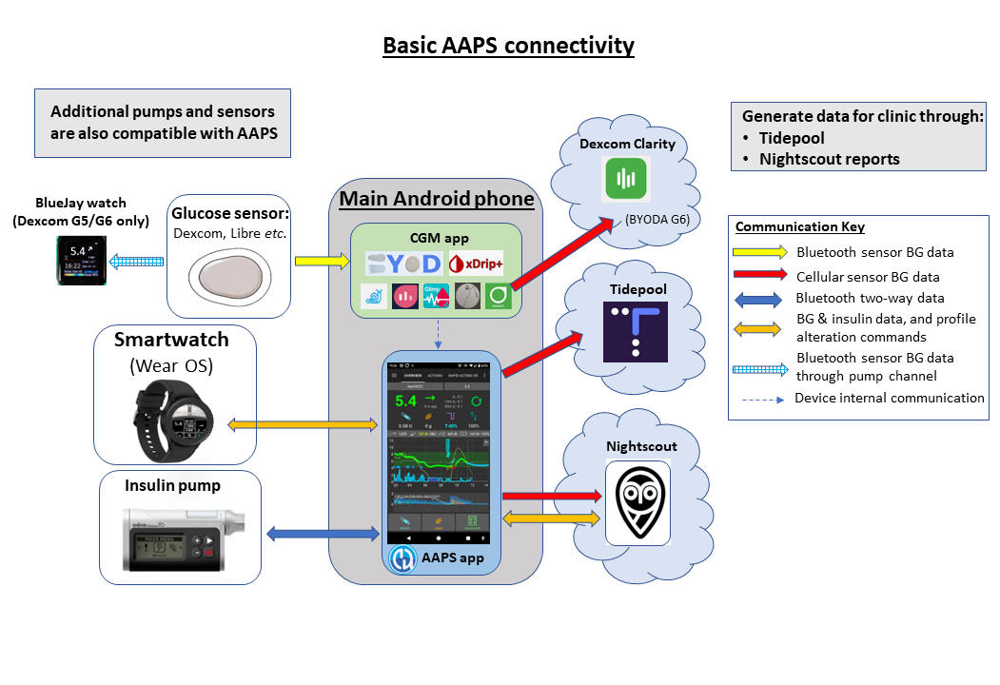
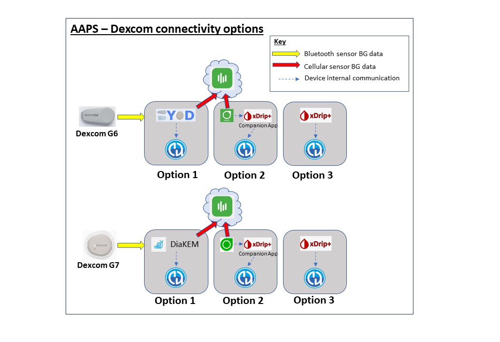
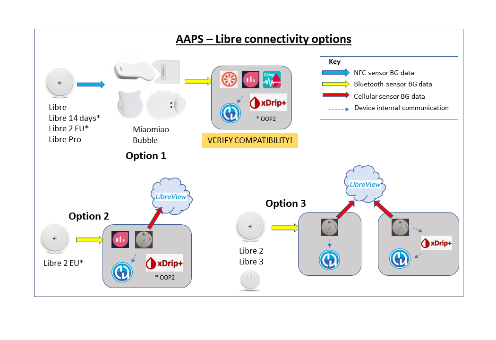
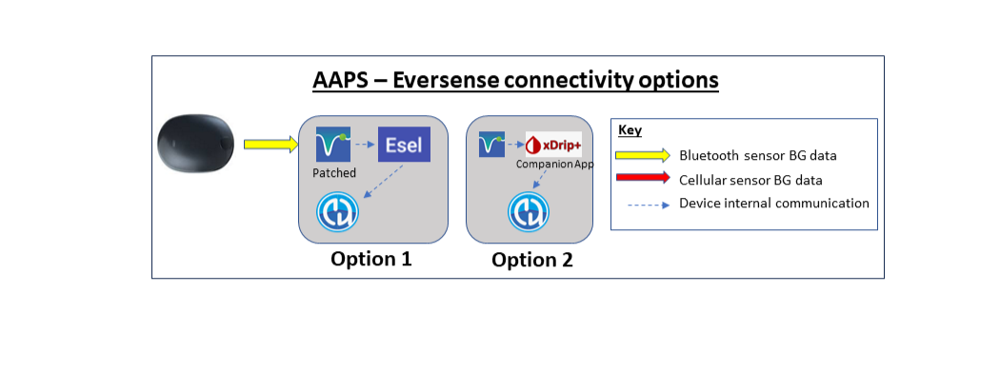

# Vorbereitungen, um mit AAPS zu starten

Willkommen. Diese Dokumentation soll Nutzer begleiten, die sich darauf vorbereiten, das Android Artificial Pancreas System (**AAPS**) einzurichten und zu nutzen.

## Deinen Weg durch die Dokumentation finden

Ein **Index** und eine Erklärung der Dokumentenstruktur findest Du [hier](../index.md). Alternativ klickst Du auf das Symbol **AAPS** oben links in der Dokumentation. Dort findest Du eine Zusammenfassung der jeweiligen Zielsetzung der einzelnen Abschnitte in der Dokumentation. Du kannst auch mit Hilfe der Überschriften auf der linken Seite durch die Navigation navigieren. Zusätzlich gibt es eine praktische Suchfunktion direkt unterhalb des **AAPS**-Symbols.

Unser Ziel ist es, sowohl die **AAPS**-Möglichkeiten als auch dessen Beschränkungen leicht verständlich zu beschreiben. Es kann enttäuschend sein, wenn Du, nachdem Du bereits einiges an Zeit in das Lesen der Dokumentation investiert hast, feststellst, dass Deine Insulinpumpe oder Dein Sensor nicht mit **AAPS** kompatibel ist oder <0>AAPS</0> andere Funktionalitäten bietet, als Du Dir erhofft hast.

Viele Details in der **AAPS**-Dokumentation sind aus Erfahrungen entstanden und sind erst dann besonders nachvollziehbar, wenn **AAPS** tatsächlich genutzt wird. Genauso wie es fast unmöglich ist, eine Sportart nur durch das Lesen der Regeln zu lernen, ist es für den sicheren Umgang mit **AAPS** wichtig, die Grundlagen des Systems zu verstehen und das Wissen konkret auf Dein (neu) laufendes **AAPS** anzuwenden.

(preparing-safety-first)=

## Sicherheitshinweise
„Mit großen Möglichkeiten kommt auch eine große Verantwortung…”

### Technische Sicherheit
**AAPS** hat umfangreiche Sicherheitsfunktionen. Diese beschränken das System und werden schrittweise durch das stufenweise Abschließen einer Reihe von [Zielen](../SettingUpAaps/CompletingTheObjectives.md) entfernt. Diese beinhalten das Testen bestimmter Parameter und die Beantwortung mehrerer Multiple-Choice-Fragen. **AAPS**-Funktionen werden mit dem erfolgreichen Abschluss des jeweiligen Ziels freigeschaltet. Dieses Vorgehen ermöglicht durch das schrittweise Kennenlernen der verschiedenen **AAPS**-Funktionen einen sicheren Übergang aus dem 'Open Loop' in den 'Closed Loop'.

Die [Ziele (Objectives)](../SettingUpAaps/CompletingTheObjectives.md) sollen den bestmöglichen Einstieg in **AAPS** ermöglichen, und dabei die typischen Fehler und Nutzungsmuster, die **AAPS**-Entwickler bei Neulingen beobachtet haben, adressieren. Weil Einsteiger unerfahren sind und zu schnell mit **AAPS** loslegen wollen oder wichtige Punkte übersehen haben, können Fehler passieren. Die [Ziele](../SettingUpAaps/CompletingTheObjectives.md) sollen diese Probleme möglichst gering halten.

### Medizinische Sicherheit
```{admonition} Avoid permanent and painful damage to your eyes and nerves
:class: danger
Vorsicht ist bei einer (zu) schnellen Verbesserung der Blutzuckerkontrolle und des HbA1c notwendig 
```

Ein wichtiger Sicherheitsaspekt ist, dass eine **schnelle Reduzierung des HbA1c und eine verbesserte Blutzuckerkontrolle bei Personen mit einem über einen längeren Zeitraum erhöhten Glukosespiegel dauerhaften Schaden** verursachen können. Vielen Menschen mit Diabetes ist das nicht bewusst, und nicht alle Ärzte weisen ihre Patienten auf dieses Problem hin.

Dieser Schaden kann **Sehverlust und dauerhafte Neuropathie (Schmerz)** beinhalten. Es ist möglich, diesen Schaden zu vermeiden, indem der durchschnittliche Glukosespiegel langsamer reduziert wird. Wenn Du derzeit einen erhöhten HbA1c hast und zu **AAPS** (oder einem anderen Closed-Loop-System) wechselst, besprich dieses potentielle Risiko _bitte_ mit Deinem Klinik-Team, bevor Du startest, und lege gemeinsam einen Zeitraum fest, in dem Du den Glukosespiegel sicher schrittweise senkst. Du kannst in **AAPS** anfangs einfach höhere Glukose-Zielwerte einstellen (derzeit ist der höchste wählbare Zielwert 11,1 mmol/l bzw. 200 mg/dl, Du kannst aber bei Bedarf auch bewusst ein schwaches Profil beibehalten) und den Zielwert dann im Lauf der Monate senken.

#### Wie schnell kann ich meinen HbA1c reduzieren, ohne dauerhaften Schaden zu riskieren?

Eine retrospektive [Studie](https://pubmed.ncbi.nlm.nih.gov/1464975/) mit 76 Patienten ergab, dass sich das Risiko für das Fortschreiten einer Retinopathie um das 1,6-, 2,4- bzw. 3,8-Fache erhöhte, wenn der HbA1c innerhalb von 6 Monaten um 1 %, 2 % bzw. 3 % sank. Sie schlugen vor, dass die **"Verringerung des HbA1c-Wertes während eines Zeitraums von 6 Monaten auf weniger als 2% beschränkt werden sollte, um das Fortschreiten der Retinopathie zu verhindern. ..Ein zu schneller Rückgang beim Beginn der glykämischen Kontrolle kann zu einer schwerwiegenden oder vorübergehenden Verschärfung des Fortschreitens der Retinopathie führen.“**

Nachbemerkung: Wenn Du andere HbA1c-Einheiten verwendest (mmol/mol statt %), findest Du [hier](https://www.diabetes.co.uk/hba1c-units-converter.html) einen HbA1c-Rechner.

In einer weiteren retrospektiven [Bewertung](https://academic.oup.com/brain/article/138/1/43/337923) von 954 Patienten haben Forschende Folgendes festgestellt:

**"Mit einer Verringerung des HbA1c um 2–3 Prozentpunkte innerhalb von 3 Monaten gab es ein absolutes 20%-iges Risiko eine behandlungsbedürftigen Neuropathie bei Diabetes zu entwickeln. Mit einer Reduktion des HbA1c um >4% über 3 Monate überstieg das Risiko eine behandlungsbedürftigen Neuropathie bei Diabetes zu entwicklen 80 %."**

Ein [Kommentar](https://academic.oup.com/brain/article/138/1/2/340563) zu dieser Arbeit bestätigte, dass das Ziel zur Vermeidung von Komplikationen **sein sollte, den A1c über 3 Monate hinweg um <2 % zu reduzieren.** Weitere Rezensionen zum Thema [findest Du hier](https://www.ncbi.nlm.nih.gov/pmc/articles/PMC6587545/pdf/DOM-21-454.pdf) und [hier](https://www.mdpi.com/1999-4923/15/7/1791).

Es ist allgemein anerkannt, dass Menschen mit _neu_ diagnostiziertem Typ-1-Diabetes (die bei der Diagnose, vor Beginn der Insulintherapie, oft einen sehr hohen HbA1c haben) ihren HbA1c direkt nach der Diagnose offenbar schnell senken können, ohne diesen Risiken im gleichen Maß ausgesetzt zu sein, weil ihre Glukosewerte noch nicht so lange erhöht waren. Dennoch ist es überlegenswert, dies mit Deinem Diabetes-Team zu besprechen.

(PreparingForAaps-no-sglt-2-inhibitors)=
### Keine SGLT-2-Hemmern

```{admonition} NO SGLT-2 inhibitors
:class: danger
SGLT-2 Hemmer, auch Gliflozins genannt, hemmen die Resorption (Aufnahme) von Glukose in der Niere. Gliflozine senken den Blutzuckerspiel unkalkulierbar, und DÜRFEN NICHT genommen werden, wenn ein Closed Loop System wie AAPS genutzt wird! Damit würde ein enormes Risiko für eine Ketoazidose und/oder eine Hypoglykämie bestehen! Besonders gefährlich ist die Kombination dieses Medikaments mit einem System, das die Basalrate senkt, um die Glukosewerte zu erhöhen. 

Kurz gesagt:
- **Beispiel 1: Risiko einer Unterzuckerung**
>Zum Mittagessen gibst Du mit **AAPS** einen Bolus für 45 g Kohlenhydrate ab. Das Problem ist, dass die Hemmer den Körper dazu bringen, einen Teil der Kohlenhydrate auszuscheiden, ohne dass AAPS davon weiß. Dadurch hat Dein Körper im Verhältnis zu den aufgenommenen Kohlenhydraten zu viel Insulin, und es kommt zur Unterzuckerung.

- **Beispiel 2: Risiko einer Ketoazidose**
>Die Hemmer scheiden im Hintergrund einen Teil der Kohlenhydrate aus, wodurch Dein Glukosewert sinkt. **AAPS** weist die Pumpe dann automatisch an, die Insulinabgabe zu verringern, auch die Basalrate. Mit der Zeit kann das dazu führen, dass Dein Glukosewert unter dem Zielwert bleibt, bis der Körper nicht mehr genug Basalinsulin hat, um Kohlenhydrate aufzunehmen. Die Folge ist eine Ketoazidose. Normalerweise entsteht eine Ketoazidose bei Menschen mit Typ-1-Diabetes, weil ihre Pumpe ausfällt. Das würde Alarme auf dem Smartphone auslösen und wäre an einem hohen Glukosewert erkennbar. Die Gefahr bei Gliflozinen ist aber, dass AAPS keinen Alarm auslöst, weil die Pumpe weiterläuft und der Glukosewert möglicherweise im Zielbereich bleibt.

Bekannte Handelsnamen von SGLT-2 Hemmern sind: Invokana, Forxiga, Jardiance, Steglatro und Zynquista und andere.
```


### Grundprinzipien des Loopens mit AAPS

Die Grundprinzipien und Konzepte des Loopens müssen vom Nutzenden verstanden werden, bevor **AAPS** verwendet wird. Dies wird erreicht, indem Du Zeit in das Lesen der **AAPS**-Dokumentation investierst und die Ziele (Objectives), die Dir eine gute Ausgangslage für den sicheren und effektiven Umgang mit **AAPS** ermöglichen sollen, abschließt. Der Umfang der **AAPS**-Dokumentation mag am Anfang erschlagend wirken, aber bleib' geduldig und vertraue dem Prozess - mit dem richtigen Vorgehen wirst Du es erreichen!

Wie schnell man vorankommt, hängt stark vom Einzelnen ab. Sei Dir aber bewusst, dass das Erreichen aller Ziele (Objectives) typischerweise ca. 6-9 Wochen benötigt. Viele beginnen schon lange vor der eigentlichen Nutzung damit, **AAPS** zu erstellen, zu installieren und einzurichten. Um das zu unterstützen, hat das System eine "virtuelle Pumpe", die beim Abschluss der ersten Ziele genutzt werden kann, um sich mit **AAPS** vertraut zu machen, ohne es tatsächlich zur Insulinabgabe zu nutzen. Unten findest Du eine ausführliche Zeitleiste. Beachte, dass Du mit Ziel 7 von **AAPS** im Closed Loop bist. Die späteren Ziele fügen zusätzliche Funktionen wie **SMB** und **Automatisierungen** hinzu, die für manche Nutzer hilfreich, für die Grundfunktion von **AAPS** aber nicht nötig sind.

Dein Erfolg mit **AAPS** hängt von Deiner Proaktivität, Deinem Willen Glukosewerte zu hinterfragen und Deiner Flexibilität die notwendigen **AAPS**-Anpassungen für bessere Ergebnisse zu machen, ab. Genauso wie es nahezu unmöglich ist, eine Sportart allein über das Regelwerk zu erlernen, ist es auch mit **AAPS**.

#### Rechne mit Verzögerungen und kleineren Stolpersteinen auf dem Weg alles einzurichten und ans Laufen zu bekommen

In der Anfangsphase das **AAPS**-System aufzubauen und auch beim späteren Nachjustieren, kann es Schwierigkeiten in der Kommunikation alle Komponenten des Loops (und potentieller Follower) untereinander geben. Einige Fehler können erst gelöst werden, wenn **AAPS** im Alltag benutzt wird, aber jede Menge Hilfe ist in der Facebook-Gruppe und auf Discord verfügbar. Bitte berücksichtige das entsprechend und nutze "gute" Zeiten, wie z.B. einen ruhigen Vormittag oder ein Wochenende (d.h. nicht mitten in der Nacht oder wenn Du müde bist oder ein wichtiges Meeting ansteht oder Du reist), diese Probleme anzugehen und zu lösen.

#### Technologie-Kompatibilität

**AAPS** ist nur mit bestimmten Insulinpumpen, CGMs und Smartphones kompatibel. Einige Systeme/Technologien sind möglicherweise nicht in jedem Land verfügbar. Um Enttäuschungen oder Frustrationen vorzubeugen, lies bitte die Abschnitte [CGM](../Getting-Started/CompatiblesCgms.md), [Insulinpumpen](../Getting-Started/CompatiblePumps.md) und [Smartphones](../Getting-Started/Phones.md).

#### Zeit die App zu erstellen und zum vollständigen Loopen weiterzugehen

Wie lange das Erstellen der **AAPS**-App dauert, hängt von Deiner Erfahrung und Deinen technischen Fähigkeiten ab. In der Regel benötigt ein unerfahrener Nutzer (mit Hilfe der Community) einen halben bis ganzen Tag, um **AAPS** zu erstellen. Durch Deine zunehmende Erfahrung wird der Prozess bei **AAPS**-Folgeversionen deutlich schneller gehen.

Mehrere Teile dieser Dokumentation helfen Dir durch den Erstellungsprozess:

- [AAPS erstellen](../SettingUpAaps/BuildingAaps.md) führt Dich Schritt für Schritt durch das Erstellen der App und ihre Installation auf Deinem Smartphone;

- die [FAQ](../UsefulLinks/FAQ.md) beantworten häufige Fragen und erklären die Fehler, die am ehesten auftreten; und

- die Sammelseite [Fehlerbehebung](../GettingHelp/GeneralTroubleshooting.md) fasst Lösungen für die häufigsten Probleme nach Themen sortiert zusammen.

Wie lange es bis zum Closed Loop dauert, ist individuell verschieden. Eine ungefähre Zeitleiste bis zum vollständigen Loopen mit **AAPS** findest Du [unten](#preparing-how-long-will-it-take).


#### Exportdatei des Keystore & der Konfigurationseinstellungen

Ein "keystore" ist eine mit einem Passwort verschlüsselte Datei, die ausschließlich zu Deiner Kopie von **AAPS** passt. Durch die Nutzung des "keystore" stellt Dein Android-Smartphone sicher, dass nur Du Deine Kopie der App aktualisieren kannst. Kurzum, als Teil der **AAPS**-Erstellung, solltest Du:

1.  Bewahre Deine Keystore-Datei (die .jks-Datei, mit der Deine App signiert wird) an einem sicheren Ort auf;

2.  Notiere das Passwort für Deine Keystore-Datei.

Wie Du den Keystore sicherst, hängt davon ab, wie Du AAPS erstellst:

- **Android Studio Build (Computer)**: Der Keystore wird beim Erstellen angelegt. Wo Du ihn speichern solltest, steht unter [Signierte APK erstellen](#Building-APK-generate-signed-apk).
- **AAPS Builder**: Bewahre die Sicherungsdatei `aaps-keystore.jks` auf, die Dir die Einrichtungsseite beim Anlegen Deines Schlüssels angeboten hat, zusammen mit Passwort und Alias. Hast Du Deinen eigenen Keystore hochgeladen, bewahre diese Datei auf.
- **Browser-Build mit Fork**: Nutze den dafür vorgesehenen Workflow [Export keystore](#ci-keystore-export), um eine Kopie in Deinem Google Drive abzulegen.

Damit kannst Du die Keystore-Datei für jedes Update auf eine neue **AAPS**-Version nutzen. Im Durchschnitt werden zwei AAPS-Updates pro Jahr nötig.

Zusätzlich bietet **AAPS** die Möglichkeit, [alle Konfigurationseinstellungen zu exportieren](../Maintenance/ExportImportSettings.md). Damit kannst Du das System z.B. bei einem Smartphone-Wechsel oder bei einer Neuinstallation/Update der App sicher wieder herstellen und es mit einer nur kurzen Unterbrechung weiter nutzen. 

#### Fehlerbehebung

Wenn Du Dir bei irgendetwas unsicher bist, gehe bitte auf die AAPS-Community zu - es gibt keine dummen Fragen! Alle Nutzenden, egal mit welcher Erfahrung, sollen sich bestärkt fühlen, Fragen zu stellen. Da es viele **AAPS**-Nutzende gibt, werden Fragen in der Regel schnell beantwortet.

##### [Frage in der AAPS Facebook-Gruppe](https://www.facebook.com/groups/AndroidAPSUsers/)

##### [Frage im AAPS Discord Kanal](https://discord.gg/4fQUWHZ4Mw)


#### [Wo finde ich Hilfe](../GettingHelp/WhereCanIGetHelp.md)?

Dieser Abschnitt zielt darauf ab, neuen Benutzern Links zu Ressourcen bereitzustellen, um Hilfe zu erhalten, einschließlich des Zugriffs auf den Community Support, welcher aus neuen und erfahrenen Benutzern besteht, die Fragen klären und die üblichen Fallstricke lösen können, die mit AAPS einhergehen.

#### [Abschnitt für Mediziner und Fachpersonal](../UsefulLinks/ClinicianGuideToAaps.md)

Dieser [Abschnitt ist für Mediziner und Fachpersonal](../UsefulLinks/ClinicianGuideToAaps.md), die mehr über AAPS und Open Source Artificial Pancreas Technolgie lernen möchten. In der Einleitung gibt es auch Hilfestellung dazu, [wie Du das mit Deinem Diabetes-Team besprechen kannst](#introduction-how-can-i-approach-discussing-aaps-with-my-clinical-team).

## Was werden wir bauen und installieren?

Dieses Diagramm gibt einen Überblick über die Schlüsselkomponenten (sowohl Hardware als auch Software) des **AAPS** Systems:




Neben den drei grundlegenden Hardwarekomponenten (Smartphone, Insulinpumpe und Glukosesensor) benötigen wir auch: 1) Die **AAPS**-App 2) Einen Server für Berichte und 3) Eine App zum Auslesen Deines Sensors (CGM)

### Eine Android Smartphone-App: **AAPS**

**AAPS** ist eine App, die auf Android-Smartphones & -Geräten läuft. Du wirst die **AAPS**-App auf Dein Smartphone (per E-Mail, USB-Kabel _etc._) übertragen und installieren. Du wirst die **AAPS**-App auf Dein Smartphone (per E-Mail, USB-Kabel _etc._) übertragen und installieren.

### 2) Ein Berichtsserver: Nightscout (Tidepool*)

Um **AAPS** voll auszuschöpfen, musst Du einen Nightscout-Server einrichten. Du kannst das [selbst machen](https://nightscout.github.io/nightscout/new_user/#free-diy) oder alternativ einen kommerziellen Anbieter gegen eine kleine Gebühr mit dem Aufsetzen und Betreiben des Nightscout-Services ([managed service](https://nightscout.github.io/#nightscout-as-a-service)) für Dich beauftragen. Nightscout wird genutzt, um über die Zeit hinweg Daten von **AAPS** zu sammeln und kann daraus detaillierte Berichte erstellen, die Zusammenhänge von CGM- und Insulinmustern zeigt. Eltern und Betreuende können Nightscout auch dazu nutzen, um remote mit der **AAPS**-Anwendung zu kommunizieren und das Diabetes-Management des Kindes im Auge zu behalten. Die Funktionen zur Remote-Kommunikation beinhaltet Echtzeit-Informationen der Glukosewerte und dem Insulinspiegel, Remote-Bolus (über SMS) und Ankündigung von Mahlzeiten. Deine Diabetestherapie zu beurteilen, indem Du CGM-Daten getrennt von den Pumpendaten betrachtest, ist wie Autofahren mit einem blinden Fahrer, dem der Beifahrer die Umgebung beschreibt. Als Alternative zu Nightscout steht auch Tidepool zur Verfügung.

### 3) Eine App zum Auslesen Deines Sensors (CGM)

Um Glukosewerte zu empfangen und an **AAPS** weiterzureichen, benötigst Du die zu Deinem Sensor passende und kompatible App. Die verschiedenen Optionen werden unten gezeigt und weitere Informationen findest Du im Abschnitt [kompatible Sensoren (CGMs)](../Getting-Started/CompatiblesCgms.md):

  

### Pflege des **AAPS**-Systems

Mit dem Erscheinen von verbesserten Versionen müssen **Nightscout** und **AAPS** ungefähr einmal pro Jahr aktualisiert werden. In einigen Fällen kann das Update verschoben werden, in anderen Fällen wird es dringend empfohlen oder ist aus Sicherheitsgründen zwingend erforderlich. In Facebook-Gruppen und Discord-Kanälen wird über diese Updates informiert werden. Die Release Notes werden das entsprechende Szenario beschreiben. Dadurch das viele Leute gleichzeitig durch den Update-Prozess gehen, werden sich deren Fragen mit Deinen ähneln und Dir die Antworten darauf auch helfen.

(preparing-how-long-will-it-take)=
## Wie lange wird es dauern, alles einzurichten?

Wie schon erwähnt, ist die **AAPS**-Nutzung eher eine „Reise“, die es notwendig macht, dass Du Deine Zeit in sie investierst. Es ist kein einmaliger Aufwand. Aktuelle Schätzungen für das Erstellen, die Installation und Konfiguration von **AAPS** und **CGM**-Software, sowie den Übergang von Open Loop zu Hybrid Closed Loop mit **AAPS**, gehen von ca. 4 bis 6 Monaten aus. Daher wird empfohlen sich als Erstes auf das Erstellen (Build) der **AAPS**-App zu konzentrieren und so schnell wie möglich die ersten Aufgaben bzw. Ziele (Objectives) anzugehen. Das gilt auch, wenn Du aktuell noch ein anderes "Insulinabgabesystem" haben solltest, da Du bis zum Ziel 5 eine "virtuelle Pumpe" nutzen kannst.

Einige der Ziele verlangen, dass eine bestimmte Anzahl von Tagen in ihnen verbracht wird, um so die neue Funktionalität vollständig verstehen zu können. Diese Wartezeit lässt sich nicht umgehen. Die Mindestwartezeiten wurden zu Deiner eigenen Sicherheit festgelegt.

Ein ungefährer Zeitrahmen ist:

| Aufgaben                                                                       |     Ungefähre Dauer      |
| ------------------------------------------------------------------------------ |:------------------------:|
| Erstmaliges Lesen der Dokumentation                                            |         1-2 Tage         |
| GitHub für den Browser-Build einrichten                                        |       1-4 Stunden        |
| Einen Berichtsserver einrichten                                                |         1 Stunde         |
| Eine CGM-App installieren (xDrip, BYODA, …)                                    |         1 Stunde         |
| CGM → xDrip → AAPS erstmals einrichten                                         |         1 Stunde         |
| AAPS → Pumpe initial konfigurieren                                             |         1 Stunde         |
| AAPS → Nightscout/Tidepool (nur für Berichte) initial konfigurieren            |         1 Stunde         |
| Optional: Nightscout ↔ **AAPS** & NS-Follower einrichten                       |         1 Stunde         |
| Ziel 1: Visualisierung und Überwachung einrichten                              |         1 Stunde         |
| Ziel 2: Lerne, wie AAPS bedient wird                                           |        2 Stunden         |
| Ziel 3: Belege Dein Wissen                                                     |     bis zu 14 Tagen      |
| Ziel 4: Starte den Open Loop                                                   |    Mindestens 7 Tage     |
| Ziel 5: Deinen Open Loop verstehen                                             |  wurden 7 Tage erreicht  |
| Ziel 6: Den Closed Loop (mit Abschaltung bei niedrigen Glukose-Werten) starten | Mindestens 5 bis 14 Tage |
| Ziel 7: Feinabstimmung des Closed Loop                                         | Mindestens 1 bis 7 Tage  |
| Ziel 8: Basal und Faktoren anpassen, Autosens aktivieren                       | Mindestens 7 bis 14 Tage |
| Ziel 9: Aktivieren des Super Micro Bolus (SMB)                                 |    Mindestens 28 Tage    |
| Ziel 10: Automatisierung                                                       |    Mindestens 28 Tage    |

Sobald Du **AAPS** voll nutzt, musst Du immer noch regelmäßig Deine Einstellungen nachjustieren, um so Dein gesamtes Diabetes-Management verbessern zu können.

## Voraussetzungen

### Medizinische Überlegungen

Zusätzlich zu den medizinischen Warnungen in den [Sicherheitshinweisen](#preparing-safety-first) gibt es in Abhängigkeit vom in der Pumpe verwendeten Insulin weitere Parameter.

#### Insulinwahl

**AAPS**-Berechnungen gehen von einer Insulinkonzentration von 100U/ml aus. Dein Insulin richtest Du unter **Bearbeiten → Insulineinstellungen** ein: Stelle **Wirkmaximum** und **DIA** ein oder nutze **Wirkmaximum laden aus**, um die übliche Zeit bis zum Wirkmaximum einer der Vorlagen zu übernehmen:

- **Novorapid** (auch für Humalog und NovoLog)
- **Fiasp**
- **Lyumjev**

Erfahrene Nutzer können jede Zeit bis zum Wirkmaximum (35 bis 120 Minuten) direkt eingeben, zum Beispiel für eine Mischung von Insulinen. Siehe [Insulineinstellungen](#Config-Builder-insulin).


### Technisches

Diese Dokumentation möchte die notwendige technische Expertise auf ein absolutes Minimum beschränken. Um die **AAPS**-App zu erstellen, hast Du mehrere Möglichkeiten, siehe [AAPS erstellen](../SettingUpAaps/BuildingAaps.md) für einen Überblick:

- **Browser-Build** (empfohlen): Erstelle die App direkt auf Deinem Smartphone mit GitHub Actions, ohne Computer oder Android Studio. Mit dem [AAPS Builder](../SettingUpAaps/BrowserBuildAapsBuilder.md) brauchst Du nur ein GitHub-Konto: Du lädst die App direkt von GitHub herunter. Für die Fork-Methode brauchst Du zusätzlich ein Google-Konto, um die App in Deinem Google Drive zu speichern.
- **Build mit Android Studio**: Erstelle die App auf Deinem Computer mit Android Studio. Das nutzen vor allem Entwickler, die den Code ändern wollen.
- **CLI-Build**: für Nutzer, die lieber lokal erstellen, ohne Android Studio zu installieren.

Neben dem Erstellen der App musst Du auch einen Berichtsserver einrichten, mehrere Android-Apps konfigurieren und Erfahrung im Diabetesmanagement aufbauen. Das gelingt, wenn Du Schritt für Schritt vorgehst, geduldig bist und Dir von der **AAPS**-Community helfen lässt. Wenn Du Dich im Internet zurechtfindest und Deine Gmail-E-Mails selbst verwaltest, ist das Erstellen von **AAPS** für Dich machbar. Nimm Dir einfach Zeit.

### Smartphones

#### AAPS und Android-Versionen

Die aktuelle **AAPS**-Version (4.0) setzt ein Android Smartphone mit Google **Android 12.0 oder höher** voraus. Wenn Du vorhast ein neues Smartphones zu kaufen (Stand: Januar 2026), wird Android 16 empfohlen.<br/> Aus Sicherheitsgründen wird dringend empfohlen, **AAPS**-Version immer auf dem neuesten Stand zu halten. Für Menschen, die kein Gerät mit Android 12.0 (oder neuer) nutzen können, stehen weiterhin ältere **AAPS**-Versionen für ältere Android-Versionen zur Verfügung, siehe dazu auch die [Release Notes](#maintenance-android-version-aaps-version).

#### Smartphone-Modell wählen
Welches genaue Modell Du kaufen solltest, hängt von den gewünschten Funktionen ab. Die [Smartphones](../Getting-Started/Phones.md)-Seite enthält von Nutzendenden getestete und empfohlene Setups.

Das Smartphone sollte regelmäßig Sicherheitsupdates erhalten und stets auf der aktuellen Android-Version gehalten werden. Wenn Du mit AAPS noch nicht sehr vertraut bist oder kein technischer Experte bist, solltest Du mit dem jeweiligen Update warten, bis andere das Update erfolgreich gemacht haben und in den verschiedenen Foren bestätigt haben, dass es problemlos durchgeführt werden kann.

```{admonition} Delaying Samsung phone updates
:class: warning
Samsung erzwingt leider immer wieder Updates auf seinen Smartphones, die Probleme mit der Bluetooth-Verbindung verursachen können. Um diese erzwungenen Updates abzuschalten, musst Du das Smartphone in den „Entwicklermodus“ versetzen:

1. Gehe zu **Einstellungen** > **Telefoninfo** > **Softwareinformationen** und tippe dann so oft auf **Buildnummer**, bis bestätigt wird, dass der Entwicklermodus freigeschaltet ist.
2. Gehe zurück zum Hauptmenü **Einstellungen**. Dort sollte jetzt der neue Menüpunkt **Entwickleroptionen** erscheinen.
3. Öffne **Entwickleroptionen**, scrolle zu **Automatische Systemupdates** und schalte es aus.
```

```{admonition} Google Play Protect potential issue
:class: Warnung
Es gab einige Meldungen, dass Google Play Protect **AAPS** jeden Morgen willkürlich stoppt. In diesem Fall musst Du in die Google Play-Optionen gehen und **Google Play Protect** deaktivieren. Nicht alle Smartphone-Modelle und Android-Versionen sind betroffen.
```

```{admonition} Android developer verification
:class: note
Ab September 2026 führt Google nach und nach die [Android-Entwicklerverifizierung](#android-developer-verification) ein. Sie ändert, wie eine selbst erstellte App auf dem Smartphone installiert wird. Das Erstellen von **AAPS** ist davon nicht betroffen, und es gibt weiterhin kostenlose Installationsmethoden, Details siehe die verlinkte Seite.
```

