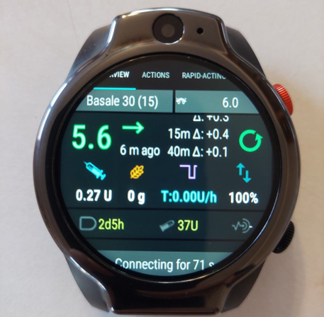
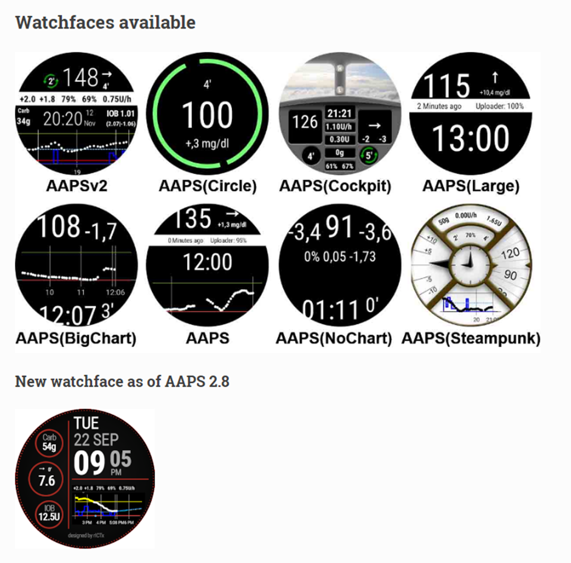
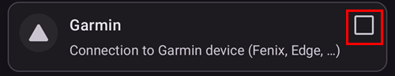
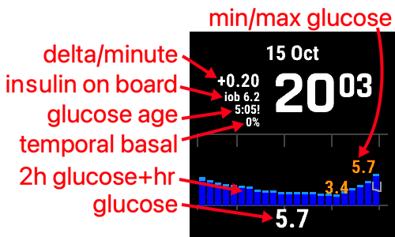
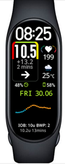

# Smartwatches und AAPS

Mit verschiedenen Smartwatches können einige der in **AAPS** verfügbaren Informationen angezeigt oder Remote-Aktionen ausgeführt werden.

Eine direkte und vollständige **AAPS**-Steuerung (Pumpe und Sensor) über die Smartwatch ist mit „Full-Android-Smartwatches“ möglich. Sie sind in diesem Konstrukt wie ein kleines [Smartphone](./Phones.md).

Über einige Smartwatches können Behandlungen (oder mehr) eingegeben werden, das Smartphone bleibt dabei weiterhin für **AAPS** führend.

Smartwatches werden mehr und mehr mit **AAPS**,_sowohl_ für Erwachsene mit Diabetes, als Betreuende/Eltern von Kindern mit Diabetes, eingesetzt.

## Generelle Vorteile Smartwatches mit **AAPS** zu nutzen


Smartwatches können - je nach Modell - auf unterschiedliche Weise mit **AAPS** genutzt werden. Sie können **AAPS**ganz oder teilweise steuern oder einfach verwendet werden, um Glukosewerte, aktives Insulin und andere Parameter remote zu überprüfen.

Die Integration einer Smartwatch mit **AAPS** kann in vielen Situationen nützlich sein. Z.B. beim Auto- oder Motorradfahren oder bei sportlichen Aktivitäten. Manche empfinden einen Blick auf die Smartwatch (in einer Besprechung, auf einer Feier, am Esstisch usw.) als unauffälliger als einen Blick auf das Smartphone. Aus Sicherheitssicht kann eine Smartwatch auch unterwegs von Vorteil sein: Das **AAPS**-Smartphone kann außer Sichtweite verstaut bleiben (etwa in einer Tasche), während Du die Smartwatch zur Remote-Steuerung nutzt.

## Besondere Vorteile für **AAPS**-nutzende Eltern/Betreuende

Bei einem Kind kann eine Betreuungsperson, wenn das **AAPS**-Smartphone des Kindes in der Nähe ist, mit einer Smartwatch überwachen oder Änderungen vornehmen, ohne das **AAPS**-Smartphone benutzen zu müssen. Das kann besonders komfortabel sein, wenn das **AAPS**-Smartphone in einem Pumpengürtel versteckt getragen wird.

Eine Smartwatch kann entweder _zusätzlich_ oder als _Alternative_ zu den Smartphone-basierten Optionen verwendet werden, um remote zu steuern oder auch [nur zu folgen](../RemoteFeatures/FollowingOnly.md).

Ein weiterer Vorteil liegt darin, dass die Verbindung mit der Smartwatch per Bluetooth erfolgt (anders als ein Follower-Smartphone der Eltern/Betreuenden, das eine Internetverbindung über Mobilfunk oder WLAN benötigt) und so auch in Situationen ohne Internetverbindung (an abgelegenen Orten, auf einem Boot oder auf halber Höhe eines Berges) auf AAPS zugreifen kann. Sind beide Geräte (**AAPS**-Smartphone und Smartwatch) im selben WLAN, können sie auch WLAN nutzen.

## Verschiedene Arten die Smartwatch mit AAPS zu nutzen

Derzeit gibt es fünf Möglichkeiten, Smartwatches mit **AAPS** zu verwenden. Diese werden in der folgenden Tabelle beschrieben: 

| Smartwatch-Setup              | Funktionalitäten                                 | Voraussetzungen                                                                                                                                                                                                                                                                                                                    |
| ----------------------------- | ------------------------------------------------ | ---------------------------------------------------------------------------------------------------------------------------------------------------------------------------------------------------------------------------------------------------------------------------------------------------------------------------------- |
| Stand-Alone                   | AAPS ohne Smartphone                             | Full-Android-Smartwatch (prüfe Android-Mindestanforderung)</br> auf der **app-fullRelease** läuft                                                                                                                                                                                                                                  |
| Vollständige Remote-Steuerung | Die meisten AAPS-Funktionen                      | Android **Wear OS**-Smartwatch(Android/API prüfen)</br>mit **wear-fullRelease**                                                                                                                                                                                                                                                    |
| Remote-Steuerung              | AAPSClient-Funktionen                            | Android **Wear OS**-Smartwatch (Android/API prüfen)</br>mit **[wear-aapsclientRelease](https://github.com/nightscout/AndroidAPS/releases)**                                                                                                                                                                                        |
| Remote-Steuerung              | Einige AAPSClient-Funktionen                     | Garmin-Smartwatches</br>(nur ältere Samsung-Tizen- und Fitbit-Setups, nicht empfohlen)</br>Siehe unten.                                                                                                                                                                                                                            |
| Anzeige                       | Glukose, Trend, IOB, COB, Loop- und Pumpenstatus | Viele Smartwatches über eine Begleit-App auf dem **AAPS**-Smartphone, die vom Broadcast [Externe Begleit-Apps](#watches-external-companion-apps) gespeist wird: [WatchDrip+](https://bigdigital.home.blog/) (Xiaomi, Amazfit), [GlucoDataHandler](https://github.com/pachi81/GlucoDataHandler) (Wear OS), G-Watch</br>Siehe unten. |

## Bevor Du Dir eine Smartwatch kaufst …

Welches genau Modell Du kaufen solltest, hängt von den gewünschten Funktionalitäten ab. Nützliche Informationen findest Du auf der Seite [Smartphones](#Phones-list-of-tested-phones), unter anderem eine Liste getesteter Smartphones, die auch einige Smartwatches enthält.

Beliebte Smartwatch-Marken sind Samsung Galaxy, Garmin, Fossil und Mi Band. Die verschiedenen Einsatzmöglichkeiten, die in der obigen Tabelle zusammengefasst sind, werden im Folgenden näher erläutert. Das soll Dir helfen, die Smartwatch auszuwählen, die am besten zu Deinen Bedürfnissen passt.

Wenn Du eine Smartwatch mit dem Ziel das **AAPS**-Smartphone remote steuern zu wollen anschaffst, solltest Du insbesondere darauf achten, dass beide Geräte kompatibel zueinander sind (besonders dann, wenn Du ein älteres oder ungewöhnliches Smartphone hast).

Wenn Du nur die Glukosewerte sehen möchtest, und darüber hinaus nicht mit **AAPS** interagieren möchtest, steht Dir eine größere Auswahl an einfachen, erschwinglichen Smartwatches zur Verfügung.

Der beste Weg, eine Smartwatch auszusuchen, ist in den entsprechenden **AAPS** Discord- oder Facebook-Gruppen nach Beiträgen mit dem Stichwort "watch" zu suchen. Lies Dir die Erfahrungen anderer durch und stelle konkrete Fragen, wenn ältere Beiträge Deine Frage nicht beantworten.

## Full Android

Klingt attraktiv, oder? Derzeit experimentieren allerdings nur wenige Begeisterte mit **AAPS** auf einer Stand-Alone-Smartwatch. Es gibt nur wenige Smartwatches mit einer brauchbaren Oberfläche, die auch gut mit **AAPS** und Deiner CGM-App im Stand-Alone-Betrieb funktionieren. Beliebte Modelle sind die LEMFO LEM 15 Pro und 16. Du musst die vollständige **AAPS** APK (die Apk, die normalerweise auf einem Smartphone installiert wird) anstelle der **AAPS** "wear" apk auf die Smartwatch laden.

Auch wenn es derzeit keinen eindeutigen Spezifikationen gibt, die erkennen lassen, ob eine Smartwatch als Standalone **AAPS** nutzbar ist, gibt es einige Parameter, die gute Indikatoren sind:

1) Android 12 oder höher. 2)  Die Möglichkeit zu haben das Watchface aus dem "Square-Modus" zu holen, um Text zum einfacheren Lesen zu vergrößern. 3) Sehr gute Akkulaufzeit. 4) Gute Bluetooth-Reichweite.

Die meisten Frustrationen mit Standalone **AAPS**-Smartwatches entstehen aus der Interaktion mit einem winzigen Bildschirm, und der Tatsache, dass die aktuelle AAPS-Voll-App-Benutzeroberfläche nicht für eine Smartwatch konzipiert wurde. Wegen des kleinen Bildschirms bearbeitest Du **AAPS**-Einstellungen auf der Smartwatch vielleicht lieber mit einem Eingabestift, und einige AAPS-Knöpfe sind auf dem Bildschirm der Smartwatch eventuell nicht sichtbar.

Ein weiteres Problem ist es eine Smartwatch mit langer Akkulaufzeit, die in der Regel klobig und dick sind, zu finden. Typische Probleme mit denen gekämpft werden sind Betriebssystem- und Energiespar-Einstellungen, das Starten von Sensoren über die Smartwatch, geringe Bluetooth-Reichweite (um die Verbindung mit Pumpe und Sensor zu halten) und fraglicher Wasserfestigkeit. Beispiele finden sich in den Fotos unten.



Wenn Du eine Stand-Alone-Smartwatch einrichten möchtest, lies die Beiträge und Kommentare in der **AAPS**-Facebook-Gruppe (gute Suchbegriffe sind „standalone“ und „Lemfo“) und auf Discord.

## Wear OS

**AAPS**-Code enthält eine App-Erweiterung, die auf [**Wear OS**-Smartwatches](https://wearos.google.com/#oem-carousel) installiert werden kann.


Überprüfe, dass Deine Smartwatch die **AAPS**-[Anforderungen](#maintenance-android-version-aaps-version) erfüllt.

### Was _ist_ Wear OS?

Die ersten drei Smartwatch-Optionen setzen **Wear OS** als Betriebssystem voraus.

**Wear OS** ist das Betriebssystem, das auf einigen modernen Android Smartwatches läuft. Wenn die Smartwatch nur als _kompatibel_ mit Android und iOS beschrieben wird, bedeutet das nicht, dass sie Wear OS verwendet. Möglicherweise handelt es sich dann dabei um ein anderes Betriebssystem, das nicht mit **AAPS** kompatibel ist. Damit sich eine beliebige Version von **AAPS** oder **AAPSClient** installieren und nutzen lässt, muss auf der Smartwatch **Wear OS 3.0, 3.2 oder 3.5** (Android 11, API-Level 30) **oder neuer** laufen. Jede Wear OS-Version folgt der Android-Version, auf der sie beruht: **Wear OS 3** entspricht Android 11 (API-Level 30), **Wear OS 4** Android 13 (API-Level 33), **Wear OS 5** Android 14 (API-Level 34) und **Wear OS 6** Android 16 (API-Level 36). Auf Smartwatches mit Wear OS 2 läuft **AAPS** nicht.

Wenn Du die **AAPS** wear.apk auf Deiner **Wear OS**-Smartwatch installierst, kannst Du aus einer Vielzahl verschiedener **AAPS**-Watchfaces auswählen. Alternativ kannst Du auch das Standard-Watchface Deiner Smartwatch mit **AAPS** Informationen erweitern (sog. "complications"). Eine Komplikation ist jede Funktionalität, die zusätzlich zur Uhrzeit hinaus auf dem Watchface angezeigt wird.

```{note}
Neuere Änderungen an **Wear OS** machen die eigenen **AAPS**-Watchfaces nach und nach unbrauchbar (je höher die Wear OS-Version, desto stärker), die **Komplikationen** funktionieren aber weiter. Lies vor dem Kauf oder Update einer Smartwatch [Änderungen an Watchfaces in Wear OS](#wearos-watchface-changes).
```


### Wie könnte meine Smartwatch aussehen?

Nach der [Installation von **AAPS** auf Deiner Smartwatch](../WearOS/WearOsSmartwatch.md), kannst Du automatisch, eines der speziellen **AAPS**-Watchfaces auswählen. Bei den meisten Smartwatches drückst Du dazu so lange auf den Startbildschirm, bis dieser schrumpft, wischt dann nach rechts und kannst dann eine andere Anzeige auswählen:



Dies sind die Standardanzeigen, die Bestandteil von **AAPS** sind. Es gibt [weitere Watchfaces](#WearOS_changing-to-AAPS-watchface) und Du kannst auch [Komplikationen](#Watchfaces-complications) verwenden.

### Wie würde ich eine Wear OS Smartwatch im Alltag nutzen?

Weitere Details über die Smartwatches, deren Nutzung im Alltag und wie Du Deine eigenen Watchfaces erstellst (und teilen kannst), findest Du im Abschnitt [Wear-AAPS auf einer Smartwatch](../WearOS/WearOsSmartwatch.md).

(Watchfaces-tizen)= (watches-external-companion-apps)=

## Externe Begleit-Apps

**AAPS** kann seinen Status an andere Apps auf demselben Smartphone senden: Glukosewert und Trend, IOB, COB, Basal und temporäre Basalrate, Profilname, Loop-Status, Akku von Smartphone und Pumpe, Reservoirfüllstand und Bolusfortschritt. Mehrere Begleit-Apps für Smartwatches lesen diesen Broadcast und zeigen die Daten auf Smartwatches an, die **AAPS** nicht direkt unterstützt. Um die Daten zu senden, aktiviere **Externe Begleit-Apps** unter **Konfiguration** > **Kommunikation** (siehe [Externe Begleit-Apps](#external-companion-apps) auf der Seite Konfiguration). Der Broadcast wird mit jedem neuen Messwert gesendet und lässt sich nicht anfordern: Ein Aktualisieren-Knopf in der Begleit-App hat keine Wirkung auf **AAPS**.


Begleit-Apps, die diesen Broadcast nutzen:

- [WatchDrip+](https://bigdigital.home.blog/) für Smartwatches von Xiaomi und Amazfit, siehe unten [Smartwatches von Xiaomi und Amazfit](#watches-xiaomi-amazfit).
- [GlucoDataHandler](https://github.com/pachi81/GlucoDataHandler) für Wear OS-Smartwatches, als Komplikation oder Widget. Er ist eine nützliche Ausweichlösung für Wear OS-Versionen, auf denen die **AAPS**-Watchfaces unzuverlässig sind, siehe [AAPS auf Deiner Wear OS-Smartwatch einrichten](../WearOS/WearOsSmartwatch.md). Seine Begleit-App GlucoDataAuto zeigt dieselben Daten im Auto mit Android Auto an.
- [G-Watch-App](https://play.google.com/store/apps/details?id=sk.trupici.g_watch) für Samsung-Tizen-Smartwatches und ihre spätere Wear OS-Portierung. In früheren **AAPS**-Versionen hieß das Modul nach dieser App **Samsung Tizen**.

```{warning}
Die **G-Watch-App** und ihre **Wear OS**-Portierung werden nicht mehr gepflegt, und Samsung hat seine Smartwatches von Tizen auf Wear OS umgestellt. G-Watch ist nur noch für bestehende ältere Setups relevant und wird für eine neue Installation nicht empfohlen. Die neuesten Infos findest Du in der zugehörigen [Facebook-Gruppe](https://www.facebook.com/groups/gwatchapp).
```

(Watchfaces-garmin)=

## Garmin

Im Garmin-ConnectIQ-Store gibt es einige Watchfaces für Garmin, die mit [AAPS](https://apps.garmin.com/search?keywords=androidaps) zusammenarbeiten.



[AAPS Glucose Watch](https://apps.garmin.com/apps/3d163641-8b13-456e-84c3-470ecd781fb1) hat eine direkte **AAPS**-Integration. Es zeigt neben den Glukosewerten auch Daten über den Loop-Status (aktives Insulin, temporäres Basal) und sendet den Puls an **AAPS**. Es ist im ConnectIQ-Store erhältlich. Aktiviere das Modul **Garmin** unter **Konfiguration → Kommunikation**. 

1. Höchster und niedrigster Glukosewert im Diagramm
2. Glukoseänderung pro Minute
3. Aktives Insulin (IOB)
4. Zeit seit dem letzten Glukosewert (Minuten:Sekunden)
5. Temporäre Basalrate in Prozent der Basalrate im Profil
6. Glukose-Diagramm der letzten 2 Stunden
7. Aktueller Glukosewert


## Fitbit

```{warning}
Google überführt Fitbit in Google Health und entfernt in der EU Apps und Watchfaces von Drittanbietern von Fitbit-Smartwatches. Fitbit-Watchfaces sind daher **keine empfohlene Option mehr**, und der Kauf einer Fitbit für die Nutzung mit **AAPS** wird nicht empfohlen.
```

Für bestehende Fitbit-Smartwatches nennen die [Nightscout-Seiten](https://nightscout.github.io/nightscout/wearable/#fitbit) einige Optionen nur zur Überwachung, etwa [Glance](https://glancewatchface.com/). Auch das sind Watchfaces von Drittanbietern, deshalb gilt dieselbe Einschränkung in der EU.

## Follower-Funktion

Diese Smartwatches können einige **AAPS**-Informationen anzeigen, andere benötigen dazu andere Zusatz-Apps.

Es gibt eine große Auswahl an erschwinglichen Smartwatches, die Glukosewerte anzeigen können. Nutzt Du Nightscout, findest Du einen guten Überblick über die verschiedenen Möglichkeiten auf den [Nightscout-Seiten](https://nightscout.github.io/nightscout/wearable/#).

Hier fassen wir einige der bei **AAPS**-Nutzenden populären Follower-Optionen zusammen:

(watches-xiaomi-amazfit)=
### Xiaomi und Amazfit Uhren

**WatchDrip+** ist eine von der Community entwickelte Begleit-App, die Glukose- und Loop-Daten auf verschiedenen Smartwatch-Modellen anzeigt, vor allem von Xiaomi (_z. B._ Mi Band) und Amazfit:



Ab Version 0.5 liest **WatchDrip+** die Daten direkt aus **AAPS**, ohne xDrip+ als Zwischenstation. Auf dem **AAPS**-Smartphone:

1. Aktiviere **Externe Begleit-Apps** unter **Konfiguration** > **Kommunikation**, siehe [oben](#watches-external-companion-apps). Das liefert den aktuellen Glukosewert, Delta, Trendpfeil, IOB und Pumpenstatus.
2. Aktiviere das Modul **xDrip** unter **Konfiguration** > **Kommunikation** und schalte in seinen Einstellungen **Status an xDrip+ senden** ein. Das liefert die IOB/COB-Statuszeile, und das Glukose-Diagramm auf der Smartwatch füllt sich nach einigen Messwerten.
3. Wenn xDrip+ auf dem Smartphone installiert ist, deaktiviere dort die **Broadcast Service API** (xDrip+ > Einstellungen > Inter-App Einstellungen), damit die Smartwatch die Daten nicht doppelt bekommt. Hat xDrip+ die Daten nur an die Smartwatch weitergeleitet, kannst Du es deinstallieren.

Der Aktualisieren-Knopf von WatchDrip+ hat mit **AAPS** keine Wirkung: Die Daten kommen mit jedem neuen Messwert.


Mehr darüber, auch zur Einrichtung, findest Du auf der [Website von WatchDrip+](https://bigdigital.home.blog/). Der Vorteil dieser Smartwatches ist die geringe Größe und der günstige Preis. Sie sind insbesondere für Kinder und Menschen mit dünnen Handgelenken interessant.

### Pebble Smartwatch


Pebble Smartwatches ([Produktion mittlerweile eingestellt](https://en.wikipedia.org/wiki/Pebble_(watch))) wurden von 2013 bis 2016 verkauft, und sind zum Teil gebraucht noch erhältlich. Fitbit übernahm das Pebble-Vermögen. Pebble-Nutzende können die Urchin Uhr verwenden, um Nightscout-Daten anzuzeigen. Informationen, die angezeigt werden: Aktives Insulin, die aktive temporäre Basalrate und Glukosewert-Vorhersagen. Im Open Loop kannst Du mit IFTTT ein Applet erstellen, das bei einer Benachrichtigung von **AAPS** eine SMS oder eine Pushover-Benachrichtigung sendet.

### [Bluejay Smartwatches](https://bluejay.website/)


Dies ist eine besondere Technologie, die Glukosedaten **direkt** vom Dexcom Transmitter empfangen kann. Kaum bekannt ist, dass Dexcom G6/G7-Transmitter die aktuellen Glukosewerte tatsächlich auf _zwei_ getrennten Kanälen senden: einem Kanal für das Smartphone und einem für Medizingeräte. Die Bluejay-Smartwatches lassen sich so einstellen, dass sie die Glukosewerte auf einem der beiden Kanäle empfangen. Nutzt **AAPS** den Smartphone-Kanal, können die Bluejay-Smartwatches den medizinischen Kanal verwenden.

Der große Vorteil: Die Smartwatch ist sowohl vom Smartphone als auch vom Loop-System unabhängig. Beispiel: Wenn Du die Insulinpumpe und das **AAPS**-Smartphone am Strand oder im Freizeitpark trennst, und Du entfernst Dich vom **AAPS**-Smartphone, kannst Du trotzdem die Dexcom-Glukosewerte auf der BlueJay Smartwatch direkt empfangen.

Die ursprüngliche **Bluejay GTS** wird nicht mehr hergestellt und kann den Dexcom G7 nicht lesen. Die späteren Modelle (U1, dann die aktuelle **U3**, zum Zeitpunkt des Schreibens im Early Access erhältlich) sind vollwertige Android-Smartwatches mit xDrip, die die Werte direkt vom Dexcom G6 und G7 empfangen. Der Hersteller beschreibt die Smartwatch als Forschungswerkzeug, nicht für den medizinischen Gebrauch. Als Nachteile wird berichtet, dass sie nicht immer alle 5 Minuten einen Wert empfängt und dass der Akku oft geladen werden muss. Aktuelles Modell und Verfügbarkeit findest Du auf der [Website von Bluejay](https://bluejay.website/).

### Apple Watch

[Nightscout mit Deiner Smartwatch](https://nightscout.github.io/nightscout/wearable/#) folgen.

Die Apple Watch unterstützt jetzt eine direkte Verbindung zum G7 und kann gleichzeitig auch mit **AAPS** verwendet werden.

