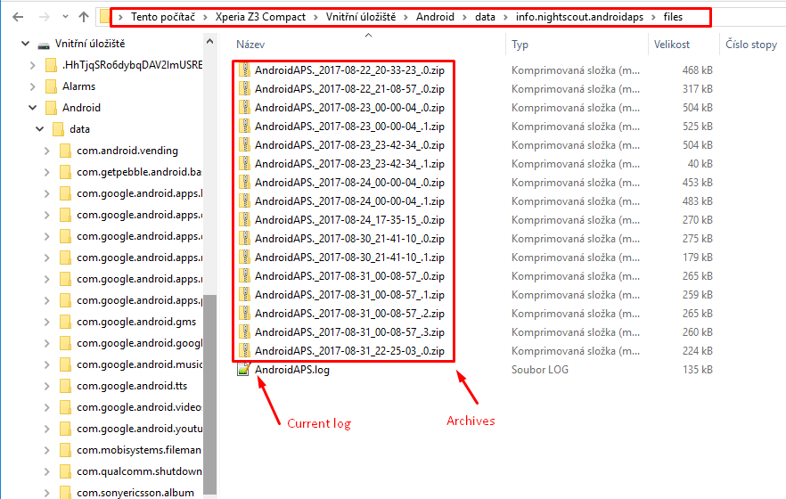

(Accessing-logfiles-accessing-logfiles)=

# Auf die Protokolldateien zugreifen

* Verbinde das Smartphone mit dem Computer im Dateiübertragungsmodus
* Suche im AAPS-Datenverzeichnis `Android\data\info.nightscout.androidaps\files` nach den Protokolldateien.  
    Die Benennung des Root-Speicher-Ordners kann je nach Smartphone etwas variieren.
* Für den [AAPSClient](#RemoteControl_aapsclient) ist es `Android\data\info.nightscout.aapsclient\files`.
* Hinweis: Der Speicherort der Logs hat sich in **AAPS 3.3** geändert. Wenn notwendig, schaue in der Dokumentation der Vorgängerversion nach.

* Das aktuelle Log ist eine .log-Datei, die Du auf verschiedene Arten ansehen kannst, zum Beispiel mit [LogCat](https://developer.android.com/studio/debug/am-logcat.html) in Android Studio, mit einer beliebigen Log-Viewer-App für Android oder einfach als reinen Text. 
* Ältere Logdateien werden als Zipdatei komprimiert und in Verzeichnissen gespeichert, die nach Datum/Uhrzeit sortiert sind. 
* Wenn du deine Logdatei in [discord](https://discord.gg/4fQUWHZ4Mw) teilen willst, um über ein mögliches Problem zu berichten, dann entpacke sie und lade das Verzeichnis hoch, dessen Datum dem Auftreten des Fehlers entspricht.