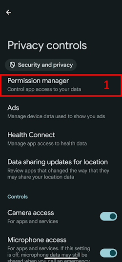
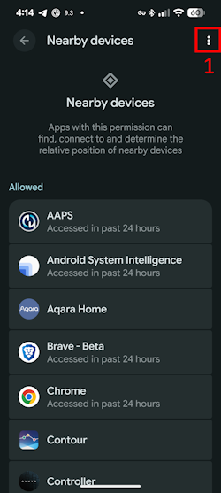

(bluetoothtroubleshooting-bluetooth-related-issues)=

# Bluetooth-Probleme

Einige Benutzer haben Probleme bei der Aktivierung des Omnipod DASH, Verbindungsprobleme mit der Medtrum Nano und haben andere Pod-Fehler, die auf Bluetooth-Probleme hinweisen, erhalten. Viele dieser Probleme sind auf eines der folgenden Probleme zurückzuführen.

Einige dieser Probleme betreffen wahrscheinlich auch andere Bluetooth Insulinpumpen. Die Medtrum Nano und auch der Omnipod DASH haben bekannte Probleme mit der „Geräte in der Nähe“-Berechtigung.

---

(bluetoothtroubleshooting-cannot-start-omnipod-with-android-16)=

## Omnipod kann nicht mit Android 16 gestartet werden
- Android 16 needs at a minimum **AAPS** version 3.3.2.1 for the Omnipod DASH to work correctly, as this version has fixes added to specifically address known problems introduced in Android 16 for Omnipod.

---

(bluetoothtroubleshooting-bluetooth-battery-optimisation)=

## Bluetooth-Akku-Optimierung

Newer versions of Android have enabled Battery optimisation for the system Bluetooth app. Dies führt erwiesenerrmaßen zu einigen Problemen bei Pumpen und CGMs, die Bluetooth nutzen.

If you followed the [Setup Wizard](../SettingUpAaps/SetupWizard.md) and followed the configuration settings in the [Bluetooth Battery Optimisation](#setup-wizard-bluetooth-battery-optimisation) section then this setting should be correct, however if you followed an older version of this guide it's possible you have not changed this setting.

Verify this is correctly configured if you have pump and CGM disconnections.

---

(bluetoothtroubleshooting-apps-using-nearby-device-permission)=

## Apps, die die Android-Berechtigung „Geräte in der Nähe“ verwenden, können Verbindungsabbrüche und Pod-Aktivierungsprobleme verursachen

Du kannst mit Android durch ein Berechtigungsmodell genau festlegen, was jede App tun darf und wie sie auf Dein Smartphone zugreifen darf. For each app installed you can choose to allow or deny specific permissions, e.g. access files on the device, access to Bluetooth, scan for nearby devices etc.

**AAPS** requires a number of specific permissions to function, one which is required to ensure that Pods work is the "Nearby devices" permission. Es gibt viele andere Anwendungen, die diese Berechtigung ebenfalls benötigen. Die Community hat herausgefunden, dass eine Reihe von Anwendungen, wenn ihnen diese Berechtigung gegeben wird, Probleme bei der Aktivierung neuer Pods auf einigen Geräten verursachen können.

(bluetoothtroubleshooting-apps-using-nearby-device-permission-known-apps)=

### Apps that use "Nearby device" permissions and are known to have caused problems:

Die in dieser Liste aufgeführten Apps wurden an einer oder mehreren Stellen in der Community als Verursacher der Probleme mit Omnipod-DASH-Geräten und in einigen Fällen auch der Medtrum Nano diskutiert.

```{admonition} Updating the list
:class: note
Ping @XiTatiON im Discord-Kanal #omnipod-dash an, um Apps, die zur Liste hinzugefügt werden sollen, zu besprechen.
```

- **myBMW** MyBMW hat die Verbindung zu Medtrum Nano und Omnipod DASH getrennt. Die MyBMW-App fragt nur einmal nach der Erlaubnis „Geräte in der Nähe finden“. Wenn Du die Erlaubnis nicht gibst, funktioniert sie immer noch absolut OK

- **Amazon Alexa**  Removing "Nearby devices" for Alexa app resolved problem for some people but will break the ability to pair Matter IoT devices

- **MINI app**  Appears the app is based on myBMW app and might mirror its behavior as a result

- **BM2** Solar Battery Monitoring app, used in some camper van and camping solar setups: when the app was running, it prevented activation of a new Pod. Force Stopping the app while activating a new pod is a workaround to the issue. Das Ausführen der App danach schien die Funktion des DASH (auf einem Pixel 8 Pro mit Android 16) zu beeinträchtigen.

(bluetoothtroubleshooting-revoke-nearby-device-permission)=

### How to revoke "Nearby device" permissions for other apps:
If you are facing issues activating a new Pod and you are running on the correct supported version of **AAPS** for your version of Android, it may be necessary to revoke the permission for other apps while activating a new Pod.

Follow this procedure to revoke the "Nearby device" permission for all apps except **AAPS**:

```{admonition} Menus and settings
:class: note
Die Screenshots und Anweisungen in dieser Anleitung stammen von einer Standard-Android 16 Installation auf einem Google Pixel 8 Pro. Other manufacturers and devices will likely not exactly match these menus and settings descriptions, adjust the steps to suit the device you have and if you are stuck see [Where to get help for dash](#omnipod-dash-where-to-get-help-for-dash) section on how to reach out to the community for support.
```

1. Öffne die Android-Einstellungen auf Deinem Smartphone, scrolle nach unten und tippe auf **Sicherheit und Datenschutz (1)**.

    

2. Scrolle nach unten und tippe auf **Datenschutz (1)**.

   

3. Tippe auf **Berechtigungsnutzung (1)**.

   

3. Scrolle herunter und tippe auf **Geräte in der Nähe (1)**.

   

4. Gehe durch die App-Liste und tippe auf die App, der Du die **Geräte in der Nähe**-Berechtigung entziehen möchtest.

   In dieser Anleitung wird der App **Android Auto (1)** die Berechtigung entzogen.

   Um zu vermeiden, dass mehr Pods unbrauchbar werden, raten wir zuerst allen Apps außer **AAPS** die Berechtigung zu entziehen.

```{admonition} Which app to select?
:class: tip
Wenn Du nicht genau weißt, welche App das Problem verursacht (denke auch daran zuerst die Liste der bekannten Problem-Apps zu prüfen) und Du Dir erlauben kannst einige Pods unbrauchbar zu machen, aktiviere vor jeder neuen Pod-Aktivierung die Berechtigung für eine weitere App. Mach das solange, bis Du erkennen kannst, welche App konkret das Pod-Probleme verursacht. Wenn Du neue problematische Apps identifizierst, lass es uns bitte im #omnipod-dash Discord-Kanal wissen.
```

   

5. Um die Berechtigung zu entziehen, tippe bitte auf **Nicht zulassen (1)** und dann auf **Trotzdem nicht zulassen (2)**. Wenn Du alles richtig gemacht hast, dann sollte **Nicht zulassen (3)** als Option ausgewählt sein. Du kommst zum **Geräte in der Nähe**-Menü zurück, indem Du auf den **Zurückpfeil (4)** drückst und diese Einstellung bei Bedarf bei anderen Apps änderst.

      

(bluetoothtroubleshooting-re-enable-nearby-device-permission)=

### How to re-enable "Nearby device" permissions for system apps and other apps:

1. If required Reference the **"How to revoke 'Nearby device' permissions for other apps"** section on how to get to the app privacy settings, then once in the **Nearby device** configuration proceed to 2.

2. Gehe durch die App-Liste und tippe auf die App, der Du die **Geräte in der Nähe**-Berechtigung erlauben möchtest.

   In dieser Anleitung wird der App **Android Auto (1)** die Berechtigung zugewiesen.

   Du wirst erkennen, dass **Android Auto (1)** in der App-Liste fehlt, nachdem die Berechtigung entzogen wurde. Das liegt daran, dass die **Android Auto**-App eine **System-App** ist und System-Apps standardmäßig versteckt sind.

   

3. To show hidden system apps press the **three-dot menu (⋮) (1)** in the top right corner, then press **"Show system" (2)**. Du solltest nun auch die versteckte System-App **Android Auto (3)** in der Liste sehen können.

```{admonition} Find your app
:class: tip
Wenn eine App „widerrufen“ ist, musst Du nach unten scrollen. „Widerrufene Apps“ erscheinen in der Liste ganz unten.
```

     

5. Follow the guidance in **"How to revoke 'Nearby device' permissions for other apps"** in reverse to re-enable permissions for each app.

---

(bluetoothtroubleshooting-android-15-bluetooth-connection-problems)=

## Android 15 - Häufige auftretende Bluetooth-Verbindungsprobleme

Nach einem Android-Upgrade oder dem Umzug auf ein neueres Smartphone verliert **AAPS** häufig die Bluetooth-Verbindung zur Pumpe. Mit einem Neustart des Smartphones verschwindet das Problem vorübergehend. If you use an **Omnipod DASH** and your phone runs Android 15, turning on the **Bluetooth bonding** setting may help improve the stability of the Bluetooth connection. To turn it on:

```{admonition} Android 16
:class: warning
Only turn on **Bluetooth bonding** on Android 15, and only if you experience connectivity issues. DO NOT turn on bonding on Android 16.
```

1. Open the [Dash settings](#omnipod-dash-settings): open the DASH pump screen with **Manage** > **Pump** and press the **Settings** (gear) icon in the top-right corner.

   

2. Open the **Advanced Settings** section and turn on **Bluetooth bonding**.

   

3. If the phone shows a pairing request, accept it.

4. Starte dein Smartphone neu.
