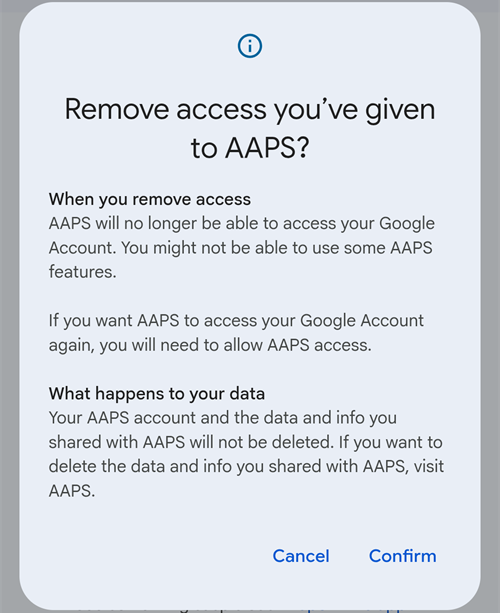
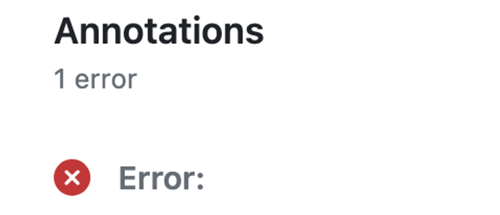

(aaps-ci-troubleshooting)=

# Browser-Build: Fehlerbehebung

```{note}
Diese Seite sammelt Tipps zur Fehlerbehebung beim [Browser-Build](../SettingUpAaps/BrowserBuild.md).

Du nutzt den **AAPS-Builder**? Fang mit dessen eigenem [Abschnitt zur Fehlerbehebung](#aaps-builder-troubleshooting) an. Die untenstehenden Abschnitte zu Google Drive gelten auch für diese.
```

## AAPS-CI Fehlerbehebung

(aaps-ci-read-the-logs)=
### First: find out what went wrong

When a build fails, GitHub keeps a log of every step. The log tells you which step failed and why. Read it before you try anything else: the error message is what you look for on this page, and what helpers will ask for.

1. In your GitHub copy of AndroidAPS, open **Actions**. A failed build has a red cross. Tap its name.

   

2. The run summary shows **Failure** and, below, the job that failed (**Build AAPS**, with a red cross).

   

3. Scroll down to **Annotations** and tap the red **Build AAPS** line.

   

4. The job opens. Steps with a grey tick worked. The step with the red cross is the one that failed: GitHub opens it for you. The steps after it were skipped (grey circle).

   

5. Read the lines just above `Error: Process completed with exit code 1.`: they explain the problem. In this example, the step **Retrieving Google Drive access token** failed with `invalid_grant` and `Token has been expired or revoked.`, see [Google Refresh Token Expired](#aaps-ci-google-token-expired).

   

```{tip}
Asking for help? Share the name of the failed step and the error lines (a screenshot like the one above is fine). Never share the content of your secrets.
```

(aaps-ci-update-secret)=
#### Update a secret

Many fixes mean replacing the value of a secret. In your GitHub copy of AndroidAPS, go to **Settings** → **Secrets and variables** → **Actions** and tap the pencil next to the secret.


Enter or paste the new value and tap **Update secret**. GitHub never shows the old value: the field is always empty.


(aaps-ci-rerun)=
#### Run the build again after a fix

Once you have fixed the cause, you do not need to start from scratch: open the failed run, tap **...** (top right), then **Re-run failed jobs**.


Tap **Re-run jobs**. You can also start a new build from **Run workflow** as usual.


(aaps-ci-preparation-web)=
### aaps-ci-preparation Webseite
  - The preparation page is displayed by a temporary local server (for example Simple Web Server on a computer), which also receives the Google refresh token.
  - If you see the screen below, the local server has stopped or is not reachable.
  - Close the preparation page, check that the local server is running, then reopen aaps-ci-preparation.html the same way as in Step 2 and complete the remaining steps. Das ist vor allem nötig, wenn Du bei der Einrichtung die erste Verbindung zu Google herstellst.

  

(aaps-ci-google-token-expired)=
### Google Refresh Token Expired
  - Google OAuth2 Refresh Token laufen nach 6 Monaten Inaktivität ab und können auch aus anderen Gründen ungültig werden (z. B. Password des Google-Kontos wurde geändert oder der Zugriff wurde manuell entzogen). Weitere Details dazu findest Du in der [Google OAuth2 Dokumentation](https://developers.google.com/identity/protocols/oauth2).
  - In the [build log](#aaps-ci-read-the-logs), the step **Retrieving Google Drive access token** fails with `invalid_grant` and `Token has been expired or revoked.`:

  

  - If your build fails due to an expired or revoked Google refresh token, you will need to redo the [Google Drive Auth](#aaps-ci-google-drive-auth) steps to obtain a new `GDRIVE_OAUTH2` token, [update the secret](#aaps-ci-update-secret) in your GitHub repository, then [re-run the build](#aaps-ci-rerun).
  - Schlägt die Autorisierung erneut fehl oder fragt Google nicht mehr nach Deiner Zustimmung, entferne zuerst den bestehenden AAPS-Zugriff aus Deinem Google-Konto, siehe unten.

(aaps-ci-google-remove-access)=
### AAPS-Zugriff aus Deinem Google-Konto entfernen und Autorisierung neu starten
  - Wenn die Google Drive Autorisierung immer wieder fehlschlägt oder Du sauber von vorn beginnen möchtest, entferne zuerst den Zugriff, den Du AAPS früher erteilt hast. Wiederhole danach die Autorisierung.
  - Öffne auf Deinem Smartphone [https://myaccount.google.com](https://myaccount.google.com), tippe auf **Sicherheit**, scrolle nach unten zu Deine Verbindungen zu Drittanbieter-Apps und & Diensten und öffne die Liste der verknüpften Apps. Du kannst auch direkt [https://myaccount.google.com/connections](https://myaccount.google.com/connections) aufrufen.
  - Tippe in der Liste auf **AAPS**.

  

  - Die Seite zeigt den Zugriff, den Du AAPS erteilt hast (die Google-Drive-Dateien, die mit der App genutzt werden). Tippe auf **Alle löschen**, um die Verbindung zu entfernen, oder auf **Details ansehen**, um sie Dir vorher anzuschauen.

  

  - On the details page, tap **Remove all access**.

  

  - Tap **Confirm**.

  

  - Google confirms that AAPS no longer has access. AAPS erscheint danach nicht mehr in der Liste der verknüpften Apps.

  

  - Starte die Autorisierung jetzt sauber neu: Schließe **sowohl** die Vorbereitungsseite <0>als auch</0> die Dateimanager-App, öffne aaps-ci-preparation.html erneut über den Dateimanager und wiederhole die Schritte zur [Google Drive Autorisierung](#aaps-ci-google-drive-auth). Google fragt Dich erneut nach dem Zugriff, und die Seite erzeugt ein neues `GDRIVE_OAUTH2`-Token.
  - [Update the `GDRIVE_OAUTH2` secret](#aaps-ci-update-secret) in your GitHub repository with the new token, then [re-run the build](#aaps-ci-rerun).

(aaps-ci-disable-software)=
### Software, die bei der OAUTH-Verifizierung stören könnte, deaktivieren
  - Deaktiviere sämtliche VPN- oder Sicherheits-Apps (Firewall, Antimalware, ...) auf dem Smartphone, bevor Du versuchst den OAUTH-Key abzurufen.

(aaps-ci-actions-permission)=
### Prüfe die GitHub-Berechtigungen (Actions Permission Settings)
  - Stelle sicher, dass die GitHub-Actions-Richtlinien auf „Allow all actions and resusable workflows“ gesetzt sind (Settings → Actions → General). If you change it, press **Save** below the options.

  

`actions/checkout@v4` und `actions/setup-java@v4` dürfen nicht in `xxxxx/AndroidAPS` genutzt werden. Actions in diesem Workflow müssen aus einem Repository, das `xxxxx` gehört, stammen

(aaps-ci-workflow-permissions)=
### GitHub-Workflow-Berechtigungen prüfen (Workflow Permissions)
  - Schlägt der Build sofort mit dem Fehler „Invalid workflow file“ fehl, ähnlich wie unten gezeigt, sind die Standard-Workflow-Berechtigungen Deines Repositorys zu stark eingeschränkt:

```
Invalid workflow file
The workflow is not valid. .github/workflows/aaps-ci.yml (Line: 361, Col: 3):
Error calling workflow 'xxxxx/AndroidAPS/.github/workflows/cleanup-workflow-runs.yml@...'.
The nested job 'cleanup' is requesting 'actions: write', but is only allowed 'actions: none'.
```

  - Stelle sicher, dass unter Workflow permissions die Option „Read and write permissions“ gesetzt ist (Settings → Actions → General → Workflow permissions). Speichere und starte den Build-Workflow erneut.

  

(aaps-ci-password-special-characters)=
### Build Fails Checking The Keystore Password
  - In the [build log](#aaps-ci-read-the-logs), the step **Validating keystore, alias and password** fails with `Either KEYSTORE_BASE64, KEYSTORE_PASSWORD, KEY_PASSWORD, or KEY_ALIAS is incorrect`, followed by `Keystore was tampered with, or password was incorrect`. The build stops there: the keystore and passwords are checked before AAPS is built.

  

  - The build workflow keeps every character of your passwords intact. Enter `KEYSTORE_PASSWORD` and `KEY_PASSWORD` exactly as they are, without adding a backslash or any other escape character. If you added backslashes, [update the secrets](#aaps-ci-update-secret) with the password exactly as it is. The example below is wrong: the password is `Example2026`, the backslash was added.

  

  - If the build still fails when signing the APK although your password is correct, and the password contains `$`, a backtick, `"` or `\`, the workflow file in your fork is older than September 2026 and still parses these characters. [Sync your fork](#Update-to-new-version-update-your-repo) with the latest dev, then re-run the build workflow.
  - Der senkrechte Strich `|` ist ein Sonderfall. Die Vorbereitungsseite von [Option 1](#aaps-ci-option1) fasst Keystore, Passwörter und Alias in einem einzigen Secret `KEYSTORE_SET` zusammen, getrennt durch `|`, und der Workflow trennt es an diesem Zeichen wieder auf. Das Passwort, das die Vorbereitungsseite erzeugt, enthält nur Buchstaben und Ziffern. Bei Option 1 kann das Problem also nicht auftreten. Es tritt nur auf, wenn Du ein `KEYSTORE_SET`-Secret selbst aus einem Passwort mit `|` zusammengesetzt hast. Lösche in diesem Fall `KEYSTORE_SET` und lege stattdessen die einzelnen Secrets von [Option 2](#aaps-ci-option2) an.
