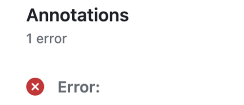

(aaps-ci-troubleshooting)=

# Browser-Build: Fehlerbehebung

```{note}
This page collects troubleshooting tips for the [Browser build](../SettingUpAaps/BrowserBuild.md).
```

(aaps-builder-troubleshooting)=

## AAPS Builder

### Step 1: the repository

(aaps-builder-ts-repo-exists)=

#### "my-aaps already exists in this account"


You already have this repository, for example from an earlier attempt. Close the GitHub tab, keep that name in step 1 of the setup page and go on. If you already did steps 2 and 3 for it, your key is still in it: continue with [step 4](#aaps-builder-step4). If it was made with an earlier version of the setup page, update its workflow once as explained in [Updating AAPS](#aaps-builder-updates). You prefer a fresh start? Type another name, for example `my-aaps-2`, and use the same keystore in step 2.

(aaps-builder-ts-user-not-found)=

#### "No GitHub user with this name"


- **"No GitHub user with this name"** in Schritt 1: Gib Deinen GitHub-Benutzernamen so ein, wie er in Deinem GitHub-Profil steht, nicht Deine E-Mail-Adresse.
- **Kein Knopf „Build AAPS“ oder „Run workflow“, oder das Repository ist leer**: Das Repository wurde nicht aus der Vorlage angelegt. Lösche es (**Settings** → unten auf der Seite → **Delete this repository**) und führe [Schritt 1](#aaps-builder-step1) mit dem Knopf **Create my private repository** erneut aus.

### Step 3: the secret

(aaps-builder-ts-404)=

#### "Page not found" (404)


- **"Page not found" (404), wenn die Einrichtungsseite GitHub öffnet**: Melde Dich im selben Browser bei github.com an (bei privaten Repositorys zeigt GitHub 404 an, wenn Du nicht angemeldet bist). Bist Du angemeldet, passt der Benutzername oder Repository-Name aus Schritt 1 der Einrichtungsseite nicht zu Deinem Repository. Gib die exakten Namen ein.

### Step 4: the build

(aaps-builder-ts-workflow-not-found)=

#### "This workflow does not exist"


Right after the repository is created, GitHub may not have read its workflow file yet: **Build AAPS** is missing from the **Actions** tab, and there is no **Run workflow** button. Any small change to the file makes GitHub read it:

1. In your repository, open **Code**, then the folder `.github`, then `workflows`, then the file `build.yml`.
2. Tap the **⋯** menu at the top right of the file, then **Edit file… In place** (on a computer, click the pencil).

   

3. Tap at the very end of the text and add an empty line (Enter). Tap **Commit changes…** at the top.

   

4. Tap **Commit changes** again.

   

5. Open the **Actions** tab again: **Build AAPS** is now in the list of workflows (on a phone, the list opens with the icon at the left of **All workflows**). Tap it, then **Run workflow**.

   

(aaps-builder-ts-build-failed)=

#### The build failed (red cross)

1. On the setup page, tap **Open my builds** and tap the build with the red cross.

   

2. The page of the build shows **Failure**, and which part failed: **AAPS / Check** (the repository, the secret, the version or the variant: nothing was built) or **AAPS / Build AAPS**.

   

3. Scroll down to **Annotations**, with your finger on the text, not on the diagram. The red lines explain the problem: tap **Show more** to read the whole message, then find it below.

   

- **„Secret KEYSTORE_SET is missing“**: Führe Schritt 3 der Einrichtungsseite aus.
- **Der Build bricht mit „This repository is PUBLIC“ ab**: Öffne in Deinem Repository **Settings** → **General** → **Danger Zone** → **Change visibility** → **Private** und erstelle dann erneut.
- **"Version … does not exist"**: only released versions of **AAPS** can be built, the ones on the [tags page](https://github.com/nightscout/AndroidAPS/tags) of nightscout/AndroidAPS, such as `3.3.2.0`. A branch name such as `dev` doesn't work. Use `latest`, or type a tag exactly as listed.
- **„Variant … is not supported“**: Deine Workflow-Datei ist eine ältere Version. Ersetze sie wie unter [AAPS aktualisieren](#aaps-builder-updates) beschrieben.
- **"The secret is too short"**, **"The secret is not a valid code"** oder **"The secret does not contain a keystore"**: Im Secret steht der falsche Text, oft das Wort `KEYSTORE_SET` selbst oder nur ein Teil des Codes. Öffne in Deinem Repository **Settings** → **Secrets and variables** → **Actions**, bearbeite `KEYSTORE_SET` und füge den langen Code aus **Copy secret** erneut ein (wiederhole zuerst Schritt 2 der Einrichtungsseite, falls Du sie geschlossen hast).
- **„Keystore, password or alias is wrong“**: Prüfe Passwort und Alias Deines Keystores und wiederhole dann die Schritte 2 und 3 der Einrichtungsseite.
- **„Google Drive access has expired or was revoked“**: Wiederhole [Schritt 6](#aaps-builder-google-drive) und aktualisiere das Secret `GDRIVE_OAUTH2`.
- **Another error**: [read the build log](#aaps-ci-read-the-logs), then [run the build again](#aaps-ci-rerun). If it fails again the same way, ask for help with the name of the failed step and the error lines. Gib niemals den Inhalt Deiner Secrets weiter.

### Step 5: the app

- **Kein Download-Link, oder die GitHub-App hat sich geöffnet**: Die GitHub-App kann keine Builds herunterladen. Öffne den Build in Chrome, wie in [Schritt 5](#aaps-builder-step5) erklärt. Damit GitHub-Links nicht mehr in der App geöffnet werden: Android **Einstellungen** → **Apps** → **GitHub** → **Standardmäßig öffnen** → deaktiviere **Unterstützte Links öffnen**.

## AAPS-CI Fehlerbehebung

(aaps-ci-read-the-logs)=
### Zuerst: herausfinden, was schiefgelaufen ist

Wenn ein Build fehlschlägt, speichert GitHub ein Log jedes Schritts. Das Log zeigt Dir, welcher Schritt fehlgeschlagen ist und warum. Lies es, bevor Du irgendetwas anderes versuchst: Nach der Fehlermeldung suchst Du auf dieser Seite, und genau danach fragen auch alle, die Dir helfen.

1. Öffne in Deiner GitHub-Kopie von AndroidAPS **Actions**. Ein fehlgeschlagener Build hat ein rotes Kreuz. Tippe auf seinen Namen.

   

2. Die Zusammenfassung des Laufs zeigt **Failure** und darunter den fehlgeschlagenen Job (**Build AAPS**, mit einem roten Kreuz).

   

3. Scrolle nach unten zu **Annotations** und tippe auf die rote Zeile **Build AAPS**.

   

4. Der Job öffnet sich. Schritte mit einem grauen Haken haben funktioniert. Der Schritt mit dem roten Kreuz ist fehlgeschlagen: GitHub öffnet ihn für Dich. Die Schritte danach wurden übersprungen (grauer Kreis).

   

5. Lies die Zeilen direkt über `Error: Process completed with exit code 1.`: Sie erklären das Problem. In diesem Beispiel ist der Schritt **Retrieving Google Drive access token** mit `invalid_grant` und `Token has been expired or revoked.` fehlgeschlagen, siehe [Google-Refresh-Token abgelaufen](#aaps-ci-google-token-expired).

   

```{tip}
Du fragst nach Hilfe? Nenne den Namen des fehlgeschlagenen Schritts und die Fehlerzeilen (ein Screenshot wie oben reicht). Gib niemals den Inhalt Deiner Secrets weiter.
```

(aaps-ci-update-secret)=
#### Ein Secret aktualisieren

Viele Lösungen bestehen darin, den Wert eines Secrets zu ersetzen. Gehe in Deiner GitHub-Kopie von AndroidAPS zu **Settings** → **Secrets and variables** → **Actions** und tippe auf den Stift neben dem Secret.


Gib den neuen Wert ein oder füge ihn ein und tippe auf **Update secret**. GitHub zeigt den alten Wert nie an: Das Feld ist immer leer.


(aaps-ci-rerun)=
#### Den Build nach einer Korrektur erneut ausführen

Wenn Du die Ursache behoben hast, musst Du nicht von vorn anfangen: Öffne den fehlgeschlagenen Lauf, tippe oben rechts auf **...** und dann auf **Re-run failed jobs**.


Tippe auf **Re-run jobs**. Du kannst auch wie gewohnt über **Run workflow** einen neuen Build starten.


(aaps-ci-preparation-web)=
### aaps-ci-preparation Webseite
  - Die Vorbereitungsseite wird von einem vorübergehenden lokalen Server angezeigt (zum Beispiel Simple Web Server auf einem Computer), der auch den Google-Refresh-Token empfängt.
  - Wenn Du den Bildschirm unten siehst, wurde der lokale Server beendet oder ist nicht erreichbar.
  - Schließe die Vorbereitungsseite, prüfe, ob der lokale Server läuft, öffne aaps-ci-preparation.html dann wie in Schritt 2 erneut und führe die restlichen Schritte aus. Das ist vor allem nötig, wenn Du bei der Einrichtung die erste Verbindung zu Google herstellst.

  

(aaps-ci-google-token-expired)=
### Google Refresh Token Expired
  - Google OAuth2 Refresh Token laufen nach 6 Monaten Inaktivität ab und können auch aus anderen Gründen ungültig werden (z. B. Password des Google-Kontos wurde geändert oder der Zugriff wurde manuell entzogen). Weitere Details dazu findest Du in der [Google OAuth2 Dokumentation](https://developers.google.com/identity/protocols/oauth2).
  - Im [Build-Log](#aaps-ci-read-the-logs) schlägt der Schritt **Retrieving Google Drive access token** mit `invalid_grant` und `Token has been expired or revoked.` fehl:

  

  - Schlägt Dein Build wegen eines abgelaufenen oder widerrufenen Google-Refresh-Tokens fehl, musst Du die Schritte zur [Google-Drive-Autorisierung](#aaps-ci-google-drive-auth) wiederholen, um einen neuen `GDRIVE_OAUTH2`-Token zu bekommen, [das Secret](#aaps-ci-update-secret) in Deinem GitHub-Repository aktualisieren und dann [den Build erneut ausführen](#aaps-ci-rerun).
  - Schlägt die Autorisierung erneut fehl oder fragt Google nicht mehr nach Deiner Zustimmung, entferne zuerst den bestehenden AAPS-Zugriff aus Deinem Google-Konto, siehe unten.

(aaps-ci-google-remove-access)=
### AAPS-Zugriff aus Deinem Google-Konto entfernen und Autorisierung neu starten
  - Wenn die Google Drive Autorisierung immer wieder fehlschlägt oder Du sauber von vorn beginnen möchtest, entferne zuerst den Zugriff, den Du AAPS früher erteilt hast. Wiederhole danach die Autorisierung.
  - Öffne auf Deinem Smartphone [https://myaccount.google.com](https://myaccount.google.com), tippe auf **Sicherheit**, scrolle nach unten zu Deine Verbindungen zu Drittanbieter-Apps und & Diensten und öffne die Liste der verknüpften Apps. Du kannst auch direkt [https://myaccount.google.com/connections](https://myaccount.google.com/connections) aufrufen.
  - Tippe in der Liste auf **AAPS**.

  

  - Die Seite zeigt den Zugriff, den Du AAPS erteilt hast (die Google-Drive-Dateien, die mit der App genutzt werden). Tippe auf **Alle löschen**, um die Verbindung zu entfernen, oder auf **Details ansehen**, um sie Dir vorher anzuschauen.

  

  - Tippe auf der Detailseite auf **Gesamten Zugriff entfernen**.

  

  - Tippe auf **Bestätigen**.

  

  - Google bestätigt, dass AAPS keinen Zugriff mehr hat. AAPS erscheint danach nicht mehr in der Liste der verknüpften Apps.

  

  - Starte die Autorisierung jetzt sauber neu: Schließe **sowohl** die Vorbereitungsseite <0>als auch</0> die Dateimanager-App, öffne aaps-ci-preparation.html erneut über den Dateimanager und wiederhole die Schritte zur [Google Drive Autorisierung](#aaps-ci-google-drive-auth). Google fragt Dich erneut nach dem Zugriff, und die Seite erzeugt ein neues `GDRIVE_OAUTH2`-Token.
  - [Aktualisiere das Secret `GDRIVE_OAUTH2`](#aaps-ci-update-secret) in Deinem GitHub-Repository mit dem neuen Token und [führe den Build dann erneut aus](#aaps-ci-rerun).

(aaps-ci-disable-software)=
### Software deaktivieren, die die OAuth-Verifizierung stören kann
  - Deaktiviere jedes VPN und jede Sicherheits-App (Firewall, Antimalware, …) auf dem Smartphone, bevor Du versuchst, den OAuth-Schlüssel zu bekommen.

(aaps-ci-actions-permission)=
### Prüfe die GitHub-Berechtigungen (Actions Permission Settings)
  - Stelle sicher, dass die GitHub-Actions-Richtlinien auf „Allow all actions and resusable workflows“ gesetzt sind (Settings → Actions → General). Wenn Du es änderst, tippe unter den Optionen auf **Save**.

  

`actions/checkout@v4` und `actions/setup-java@v4` dürfen nicht in `xxxxx/AndroidAPS` genutzt werden. Actions in diesem Workflow müssen aus einem Repository, das `xxxxx` gehört, stammen

(aaps-ci-workflow-permissions)=
### GitHub-Workflow-Berechtigungen prüfen (Workflow Permissions)
  - Schlägt der Build sofort mit dem Fehler „Invalid workflow file“ fehl, ähnlich wie unten gezeigt, sind die Standard-Workflow-Berechtigungen Deines Repositorys zu stark eingeschränkt:

```
Invalid workflow file
The workflow is not valid. .github/workflows/aaps-ci.yml (Line: 361, Col: 3):
Error calling workflow 'xxxxx/AndroidAPS/.github/workflows/cleanup-workflow-runs.yml@...'.
The nested job 'cleanup' is requesting 'actions: write', but is only allowed 'actions: none'.
```

  - Stelle sicher, dass unter Workflow permissions die Option „Read and write permissions“ gesetzt ist (Settings → Actions → General → Workflow permissions). Speichere und starte den Build-Workflow erneut.

  

(aaps-ci-password-special-characters)=
### Build schlägt bei der Prüfung des Keystore-Passworts fehl
  - Im [Build-Log](#aaps-ci-read-the-logs) schlägt der Schritt **Validating keystore, alias and password** mit `Either KEYSTORE_BASE64, KEYSTORE_PASSWORD, KEY_PASSWORD, or KEY_ALIAS is incorrect` fehl, gefolgt von `Keystore was tampered with, or password was incorrect`. Der Build bricht dort ab: Keystore und Passwörter werden geprüft, bevor AAPS erstellt wird.

  

  - Der Build-Workflow übernimmt jedes Zeichen Deiner Passwörter unverändert. Gib `KEYSTORE_PASSWORD` und `KEY_PASSWORD` genau so ein, wie sie sind, ohne einen Backslash oder ein anderes Escape-Zeichen hinzuzufügen. Wenn Du Backslashes hinzugefügt hast, [aktualisiere die Secrets](#aaps-ci-update-secret) mit dem Passwort genau so, wie es ist. Das folgende Beispiel ist falsch: Das Passwort lautet `Example2026`, der Backslash wurde hinzugefügt.

  

  - Wenn der Build beim Signieren der APK trotz richtigem Passwort fehlschlägt und das Passwort `$`, einen Backtick, `"` oder `\` enthält, ist die Workflow-Datei in Deinem Fork älter als September 2026 und wertet diese Zeichen noch aus. [Synchronisiere Deinen Fork](#Update-to-new-version-update-your-repo) mit dem neuesten dev-Stand und führe den Build-Workflow dann erneut aus.
  - Der senkrechte Strich `|` ist ein Sonderfall. Die Vorbereitungsseite von [Option 1](#aaps-ci-option1) fasst Keystore, Passwörter und Alias in einem einzigen Secret `KEYSTORE_SET` zusammen, getrennt durch `|`, und der Workflow trennt es an diesem Zeichen wieder auf. Das Passwort, das die Vorbereitungsseite erzeugt, enthält nur Buchstaben und Ziffern. Bei Option 1 kann das Problem also nicht auftreten. Es tritt nur auf, wenn Du ein `KEYSTORE_SET`-Secret selbst aus einem Passwort mit `|` zusammengesetzt hast. Lösche in diesem Fall `KEYSTORE_SET` und lege stattdessen die einzelnen Secrets von [Option 2](#aaps-ci-option2) an.
