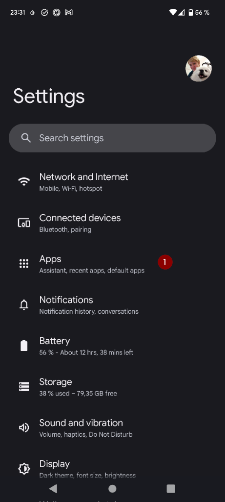
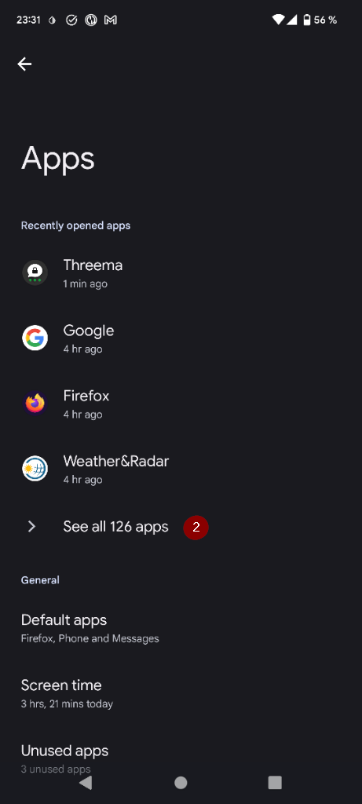
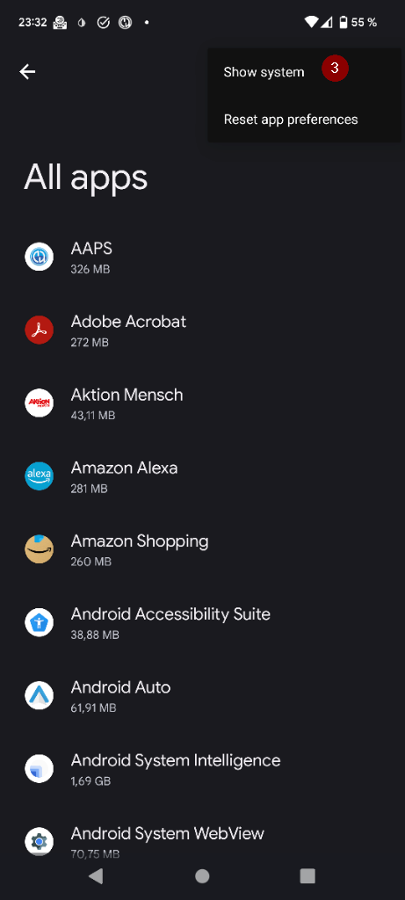
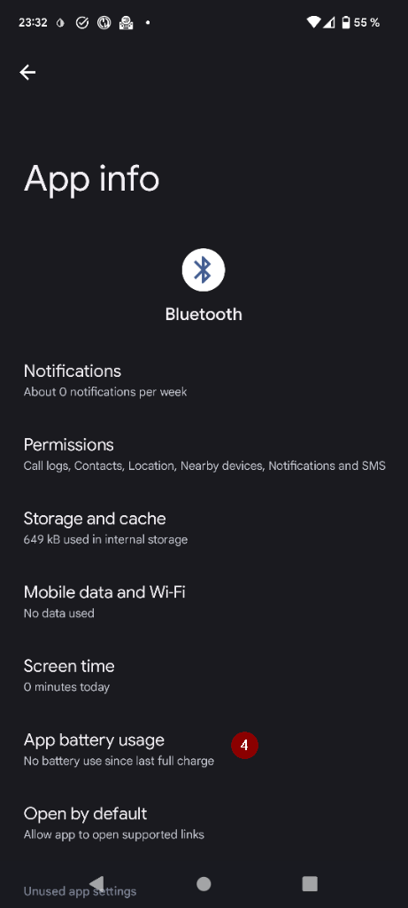
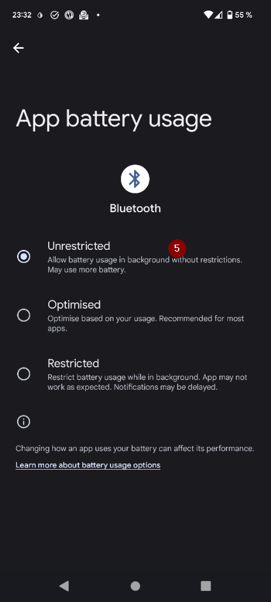
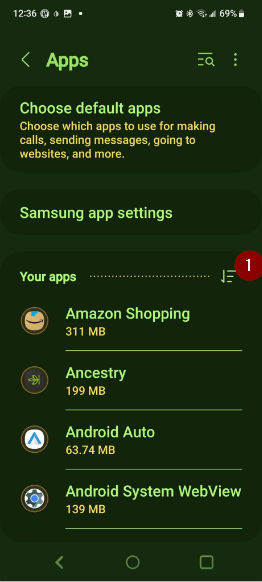
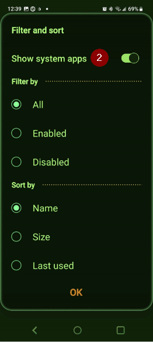
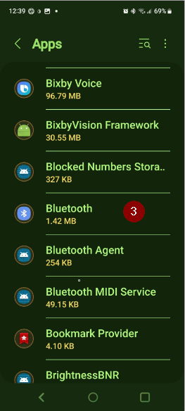
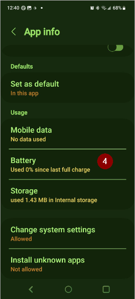
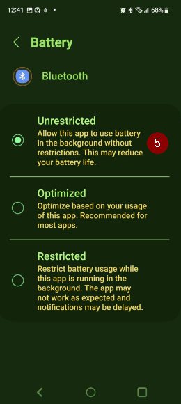

(generaltroubleshooting)=

# Fehlerbehebung

**Fang hier an, wenn etwas nicht funktioniert.** Informationen zur Fehlerbehebung stehen auf vielen Seiten der Dokumentation verteilt. Diese Seite führt sie zusammen: Sie ist eine Linksammlung, nach Themen sortiert, die Dir hilft, die häufigsten Probleme zu lösen.

Wenn Du unten keine Antwort findest, sieh auch hier nach:

* in den [FAQ](../UsefulLinks/FAQ.md) mit Antworten auf häufige Fragen und
* in der [Anleitung zum Abstimmen des Profils](ProfileTuning.md), wenn Dein Loop läuft, die Glukoseeinstellung aber besser werden soll.

```{admonition} Still stuck?
:class: tip
Wenn keiner der Links Dein Problem löst, findest Du unter [Wo bekomme ich Hilfe?](WhereCanIGetHelp.md), wie Du die Community fragst (Facebook, Discord), oder schicke Deine [Logdateien](AccessingLogFiles.md) an die Entwickler.
```

---

(generaltroubleshooting-aaps-app)=

## AAPS-App

### Erstellen & Update

* Wenn das Erstellen fehlschlägt, siehe [Wenn das Erstellen fehlschlägt](#building-aaps-troubleshooting): Dort ist für jede Erstellungsmethode der Abschnitt zur Fehlerbehebung aufgeführt:
  * [AAPS Builder](#aaps-builder-troubleshooting)
  * [Im Browser erstellen (Browser-Build)](#aaps-ci-troubleshooting)
  * [Android Studio](TroubleshootingAndroidStudio.md)
* Keystore verloren oder neuer Keystore: [AAPS neu installieren](#reinstall-aaps)
* **AAPS** aktualisieren: [mit dem AAPS Builder](#aaps-builder-updates), [mit einem Browser-Build (Fork)](#update-browser-build-troubleshooting), [mit Android Studio](#update-computer-build-troubleshooting)

### Installation

* [Warnung von Google Play Protect](#transferring-installing-play-protect-warning): Die App wird als unsicher gemeldet.
* Installation mit einer Meldung zu einem nicht verifizierten Entwickler **blockiert**: siehe [Android-Entwicklerverifizierung](#android-developer-verification) für die kostenlosen Installationsmethoden.

### Einstellungen

* [Profil: „Basal rate is not compatible with the current pump“](#your-aaps-profile-basal-not-compatible)
* [Pumpe: „Daten kommen von einer anderen Pumpe“](#config-builder-wrong-pump-data)
* [Nightscout-Client (NSClient)](TroubleshootingNsClient.md)
* **„AAPS-Einstellungen können nicht gelesen werden“** beim Start: Die Einstellungen sind mit einem Schlüssel verschlüsselt, den Android für **AAPS** aufbewahrt, und dieser Schlüssel öffnet sie nicht mehr, zum Beispiel nachdem der Schlüsselspeicher des Smartphones zurückgesetzt wurde. Solange dieser Bildschirm angezeigt wird, läuft **AAPS** nicht und steuert die Pumpe nicht. Tippe auf **Erneut versuchen**: Das beendet **AAPS** und startet es neu. Hilft das nicht, starte das Smartphone neu. Verwende **Frisch starten** nur, wenn nichts anderes hilft: Damit wird die unlesbare Einstellungsdatei beiseitegelegt (sie wird umbenannt und aufbewahrt) und **AAPS** mit leeren Einstellungen gestartet. Importiere dann Deinen letzten [Einstellungsexport](../Maintenance/ExportImportSettings.md).

### AndroidAPS nutzen

* [Falsche Kohlenhydrat-Werte (langsame Kohlenhydrat-Aufnahme)](#CobCalculation-detection-of-wrong-cob-values)
* [Automatisierungen](#automations-troubleshooting)
* [Full Closed Loop](#full-closed-loop-troubleshooting)

---

(generaltroubleshooting-bluetooth-related-issues)=


## Bluetooth-Probleme

Bei bekannten Problemen mit Bluetooth-Verbindungen, Pumpen/Pods oder Aktivierungs- und Verbindungsproblemen schau im Abschnitt [Bluetooth-Fehlerbehebung](../GettingHelp/BluetoothTroubleshooting.md) nach.

---

(generaltroubleshooting-android-related-issues)=

## Probleme rund um Android

### Akku-Optimierung

**AAPS** kann Dir helfen, die richtigen Einstellungen für Dein Smartphone zu finden: Öffne das **Menü** (☰) > **Über** und tippe auf **Meine App nicht beenden?**. Das öffnet die Anleitung für die Marke Deines Smartphones auf [Don't kill my app](https://dontkillmyapp.com/). Auch der [Einrichtungsassistent](#setup-wizard-bluetooth-battery-optimisation) fordert Dich auf, die Akku-Optimierung für **AAPS** und Bluetooth auszuschalten.

Mit Android wurden standardmäßig aktivierte Energiespareinstellungen eingeführt. Diese Einstellungen stoppen oder pausieren nicht zwingend benötigte Anwendungen, um so die Akkulaufzeit zu verlängern.

Ist sie aktiviert, verursacht das sehr wahrscheinlich Probleme mit **AAPS** und anderen unterstützenden Apps wie **xDrip**.

Damit **AAPS** und die anderen unterstützenden Apps permanent aktiv bleiben, ist es wichtig die Akkuoptimierung zu deaktivieren.

Abhängig vom Hersteller und dem Smartphone-Modell müssen Einstellungen möglicherweise an verschiedenen Stellen angepasst bzw. deaktiviert werden.

***HINWEIS:** Führe die folgenden Schritte durch, um die Akkuoptimierung (sofern vorhanden) für den Bluetooth-Dienst zu deaktivieren. Das gleiche Vorgehen kann auch für die Deaktivierung der Option für **AAPS** und andere Apps genutzt werden. Die Screenshots zeigen allderdings nur den Weg für den Bluetooth-Service.*

#### Pixel Smartphones (unverändertes Android)

* Gehe zu Einstellungen > Apps

  

* Wähle „alle Apps anzeigen“ aus.

  

* Im Menü auf der rechten Seite wähle 'Systemanwendungen anzeigen'.

  

* Such nun nach der 'Bluetooth'-App.

  

* Tippe auf „Akkunutzung durch App“ und wähle „Nicht eingeschränkt“ (bei manchen älteren Android-Versionen „Nicht optimiert“).

  


#### Samsung Smartphones

* Gehe zu Einstellungen > Apps

* Klicke auf das 'Filtern und Sortieren'-Icon (1) und aktiviere 'Systemanwendungen anzeigen' (2).

  

  

* Suche jetzt die Bluetooth-App und wähle sie aus, um ihre Einstellungen zu sehen.

  

* Tippe auf 'Akku'.

  

* Stelle sie auf „Nicht eingeschränkt“ (bei manchen älteren Android-Versionen „Nicht optimiert“).

  

#### Huawei Smartphones

Siehe diese Anleitung für [Huawei: Bluetooth & Akku-Optimierung](../CompatiblePhones/Huawei.md)

---

(generaltroubleshooting-cgm)=

## Kontinuierliche Glukosemessung (CGM)

Nützliche Links zu Lösungsschritten bekannter CGM-Probleme.

* [Allgemein](#general-cgm-troubleshooting)
* [Dexcom G6](#DexcomG6-troubleshooting-g6)
* [Libre 2 mit Minimal Looper](#minimallooper-troubleshooting)
* [Libre 3](#libre3-experiences-and-troubleshooting)
* [xDrip - fehlende CGM Daten](#xdrip-identify-receiver)
* [xDrip - Dexcom Fehlerbehebung](#xdrip-troubleshooting-dexcom-g5-g6-and-xdrip)

---

(generaltroubleshooting-pumps)=

## Pumpen

Nützliche Links zu Lösungsschritten bekannter Pumpen-Probleme.

* [Accu-Chek Combo](#combov2-tips-for-basic-usage)
* [Accu-Chek Insight](#Accu-Chek-Insight-Pump-insight-specific-errors)
* [CareLevo](#carelevo-alarms-and-notifications)
* [Dana RS](#DanaRS-Insulin-Pump-dana-rs-specific-errors)
* [Diaconn G8](#diaconn-g8-bluetooth-troubleshooting)
* [EOPatch2](#eopatch2-alarms-and-warnings)
* [Medtronic + RileyLink](#MedtronicPump-what-to-do-if-i-loose-connection-to-rileylink-and-or-pump)
* [Medtrum Nano](#medtrum-nano-troubleshooting)
* [Omnipod DASH](#omnipod-dash-troubleshooting)
* [Omnipod Eros](#OmnipodEros-troubleshooting)

---

(generaltroubleshooting-phones)=

## Smartphones

Nützliche Links zu Lösungsschritten bekannter Smartphone-Probleme.

* [Liste der getesteten Smartphone- und Geräte-Setups](https://docs.google.com/spreadsheets/u/1/d/e/2PACX-1vScCNaIguEZVTVFAgpv1kXHdsHl3fs6xT6RB2Z1CeVJ561AvvqGwxMhlmSHk4J056gMCAQE02sAWJvT/pubhtml?gid=683363241&single=true)
* [Unihertz Jelly](../CompatiblePhones/Jelly.md)
* [Huawei: Bluetooth & Akku-Optimierung](../CompatiblePhones/Huawei.md)

---

(generaltroubleshooting-remote-control)=

## Remote-Steuerung

* [AAPSClient und Remote-Steuerung (Kopplung, Befehle kommen nicht an)](#client-master-control-troubleshooting)
* [Probleme mit dem „Nightscout-Zugriffstoken“](#remotecontrol-nightscout-access-token)
* [SMS-Befehle](#SMSCommands-troubleshooting)
* [Android Auto](#android-auto-troubleshooting)

---

(generaltroubleshooting-smartwatches)=

## Smartwatches

Nützliche Links zu Lösungsschritten bekannter Smartwatch-Probleme.

* [Fehlerbehebung der Wear App](#Watchfaces-troubleshooting-the-wear-app)
* [Smartwatch und Smartphone kommunizieren nicht](#wear-os-watch-phone-communication)
* [Wear OS 5](#wear-os-5-troubleshooting)
* [Die Wear-App erstellen](#building-aaps-wear-os-troubleshooting)
