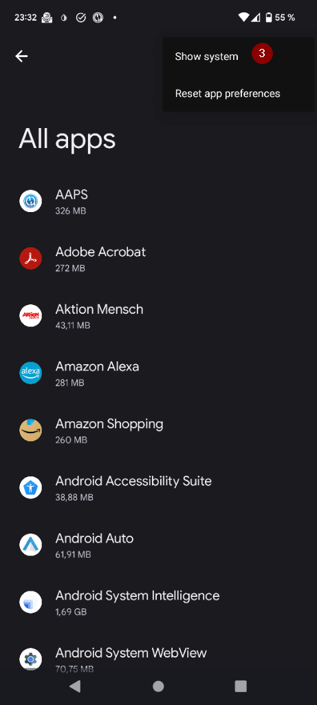
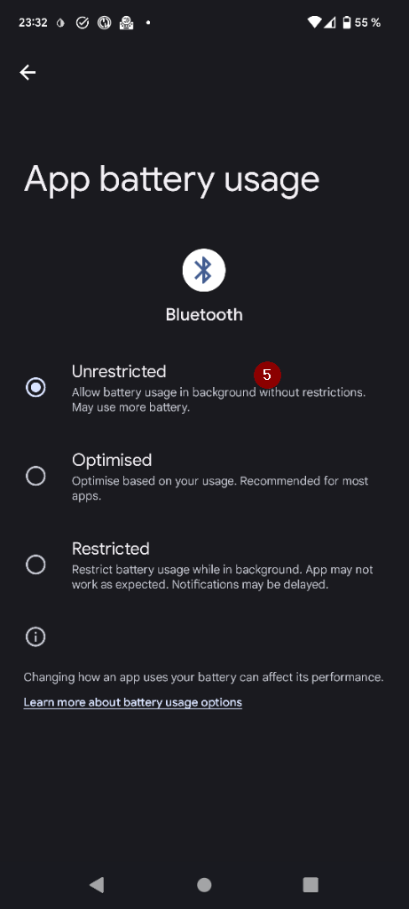
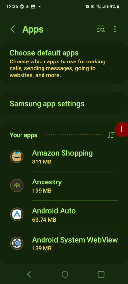

(generaltroubleshooting)=

# Problembehandlung

**Start here when something is not working.** Troubleshooting information lives on many pages across the documentation. This page brings it together: it is a single collection of links, sorted by topic, to help you solve the most common problems.

If you do not find your answer below, also check:

* the [FAQ](../UsefulLinks/FAQ.md) for answers to frequent questions, and
* the [Profile tuning guide](ProfileTuning.md) if your loop runs but your glucose control needs improving.

```{admonition} Still stuck?
:class: tip
If none of the links solve your problem, see [Where can I get help](WhereCanIGetHelp.md) to ask the community (Facebook, Discord), or send your [log files](AccessingLogFiles.md) to the developers.
```

---

(generaltroubleshooting-aaps-app)=

## AAPS-App

### Erstellen & Update

* If the build fails, see [If the build fails](#building-aaps-troubleshooting): it lists the troubleshooting section for each build method:
  * [AAPS Builder](#aaps-builder-troubleshooting)
  * [Im Browser erstellen (Browser Build)](#aaps-ci-troubleshooting)
  * [Android Studio](TroubleshootingAndroidStudio.md)
* Lost keystore, or new keystore: [Reinstalling AAPS](#reinstall-aaps)
* Updating **AAPS**: [with AAPS Builder](#aaps-builder-updates), [with a browser build (fork)](#update-browser-build-troubleshooting), [with Android Studio](#update-computer-build-troubleshooting)

### Installation

* [Google Play Protect warning](#transferring-installing-play-protect-warning): the app is reported as unsafe.
* Installation **blocked** with a message about an unverified developer: see [Android developer verification](#android-developer-verification) for the free installation methods.

### Einstellungen

* [Profile: "Basal rate is not compatible with the current pump"](#your-aaps-profile-basal-not-compatible)
* [Pump: "Data is coming from different pump"](#config-builder-wrong-pump-data)
* [Nightscout Client](TroubleshootingNsClient.md)

### Usage

* [Wrong carb values (slow carbs absorption)](#CobCalculation-detection-of-wrong-cob-values)
* [Automations](#automations-troubleshooting)
* [Full closed loop](#full-closed-loop-troubleshooting)

---

(generaltroubleshooting-bluetooth-related-issues)=


## Bluetooth-Probleme

Bei bekannten Problemen mit Bluetooth-Verbindungen, Pumpen/Pods oder Aktivierungs- und Verbindungsproblemen schau im Abschnitt [Bluetooth-Fehlerbehebung](../GettingHelp/BluetoothTroubleshooting.md) nach.

---

(generaltroubleshooting-android-related-issues)=

## Android Related Issues

### Battery optimization

**AAPS** can help you find the right settings for your phone: open the **menu** (☰) > **About** and tap **Don't kill my app?**. It opens the instructions for your phone brand on [Don't kill my app](https://dontkillmyapp.com/). The [setup wizard](#setup-wizard-bluetooth-battery-optimisation) also asks you to turn off battery optimization for **AAPS** and Bluetooth.

Mit Android wurden standardmäßig aktivierte Energiespareinstellungen eingeführt. Diese Einstellungen stoppen oder pausieren nicht zwingend benötigte Anwendungen, um so die Akkulaufzeit zu verlängern.

When this is enabled, it will very likely cause issue for **AAPS** and other supporting apps like **xDrip**.

Damit **AAPS** und die anderen unterstützenden Apps permanent aktiv bleiben, ist es wichtig die Akkuoptimierung zu deaktivieren.

Abhängig vom Hersteller und dem Smartphone-Modell müssen Einstellungen möglicherweise an verschiedenen Stellen angepasst bzw. deaktiviert werden.

***HINWEIS:** Führe die folgenden Schritte durch, um die Akkuoptimierung (sofern vorhanden) für den Bluetooth-Dienst zu deaktivieren. Das gleiche Vorgehen kann auch für die Deaktivierung der Option für **AAPS** und andere Apps genutzt werden. Die Screenshots zeigen allderdings nur den Weg für den Bluetooth-Service.*

#### Pixel Smartphones (unverändertes Android)

* Gehe zu Einstellungen > Apps

  

* Wähle „alle Apps anzeigen“ aus.

  

* Im Menü auf der rechten Seite wähle 'Systemanwendungen anzeigen'.

  

* Such nun nach der 'Bluetooth'-App.

  

* Click the "App battery usage" and select "Unrestricted" (called "Not optimized" on some older Android versions).

  


#### Samsung Smartphones

* Gehe zu Einstellungen > Apps

* Klicke auf das 'Filtern und Sortieren'-Icon (1) und aktiviere 'Systemanwendungen anzeigen' (2).

  

  

* Now search the Bluetooth app and select it to see its settings.

  

* Tippe auf 'Akku'.

  

* Set it to "Unrestricted" (called "Not optimized" on some older Android versions).

  

#### Huawei Smartphones

See this guide for [Huawei Bluetooth & battery optimization](../CompatiblePhones/Huawei.md)

---

(generaltroubleshooting-cgm)=

## Kontinuierliche Glukosemessung (CGM)

Nützliche Links zu Lösungsschritten bekannter CGM-Probleme.

* [Allgemein](#general-cgm-troubleshooting)
* [Dexcom G6](#DexcomG6-troubleshooting-g6)
* [Libre 2 with Minimal Looper](#minimallooper-troubleshooting)
* [Libre 3](#libre3-experiences-and-troubleshooting)
* [xDrip - fehlende CGM Daten](#xdrip-identify-receiver)
* [xDrip - Dexcom Problembehandlung](#xdrip-troubleshooting-dexcom-g5-g6-and-xdrip)

---

(generaltroubleshooting-pumps)=

## Pumpen

Nützliche Links zu Lösungsschritten bekannter Pumpen-Probleme.

* [Accu-Chek Combo](#combov2-tips-for-basic-usage)
* [Accu-Chek Insight](#Accu-Chek-Insight-Pump-insight-specific-errors)
* [CareLevo](#carelevo-alarms-and-notifications)
* [Dana RS](#DanaRS-Insulin-Pump-dana-rs-specific-errors)
* [Diaconn G8](#diaconn-g8-bluetooth-troubleshooting)
* [EOPatch2](#eopatch2-alarms-and-warnings)
* [Medtronic + RileyLink](#MedtronicPump-what-to-do-if-i-loose-connection-to-rileylink-and-or-pump)
* [Medtrum Nano](#medtrum-nano-troubleshooting)
* [Omnipod DASH](#omnipod-dash-troubleshooting)
* [Omnipod Eros](#OmnipodEros-troubleshooting)

---

(generaltroubleshooting-phones)=

## Smartphones

Nützliche Links zu Lösungsschritten bekannter Smartphone-Probleme.

* [Liste der getesteten Smartphone- und Geräte-Setups](https://docs.google.com/spreadsheets/u/1/d/e/2PACX-1vScCNaIguEZVTVFAgpv1kXHdsHl3fs6xT6RB2Z1CeVJ561AvvqGwxMhlmSHk4J056gMCAQE02sAWJvT/pubhtml?gid=683363241&single=true)
* [Unihertz Jelly](../CompatiblePhones/Jelly.md)
* [Huawei Bluetooth & battery optimization](../CompatiblePhones/Huawei.md)

---

(generaltroubleshooting-remote-control)=

## Remote-Steuerung

* [AAPSClient and remote control (pairing, commands not received)](#client-master-control-troubleshooting)
* ['Nightscout access token' issues](#remotecontrol-nightscout-access-token)
* [SMS-Befehle](#SMSCommands-troubleshooting)
* [Android Auto](#android-auto-troubleshooting)

---

(generaltroubleshooting-smartwatches)=

## Smartwatches

Nützliche Links zu Lösungsschritten bekannter Smartwatch-Probleme.

* [Fehlerbehebung der Wear App](#Watchfaces-troubleshooting-the-wear-app)
* [Watch and phone do not communicate](#wear-os-watch-phone-communication)
* [Wear OS 5](#wear-os-5-troubleshooting)
* [Building the Wear app](#building-aaps-wear-os-troubleshooting)
