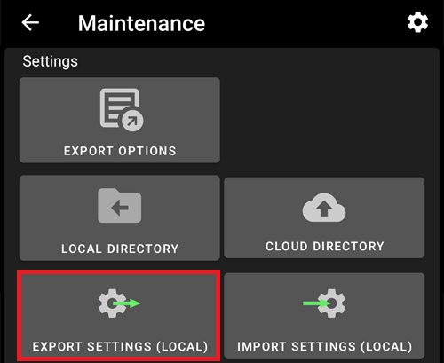
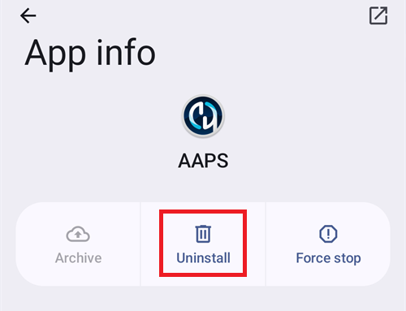

(reinstall-aaps)=
# AAPS mit einem neuen Keystore neu installieren

Jede **AAPS**-APK ist mit einem **Keystore** signiert. Ein Update installiert sich nur dann über Dein bestehendes **AAPS**, wenn es mit **demselben Keystore** signiert ist: Alle Einstellungen und Daten bleiben dann erhalten. Deshalb wird empfohlen, den Keystore und sein Passwort an einem sicheren Ort aufzubewahren.

Wenn Du versuchst, eine APK zu installieren, die mit einem anderen Keystore signiert ist als vorher, bekommst Du eine Fehlermeldung, dass die Installation fehlgeschlagen ist!

(reinstall-aaps-when)=
## Wann musst Du neu installieren?

Du musst **AAPS** deinstallieren und neu installieren, wenn Deine neue APK mit einem anderen Keystore signiert ist, zum Beispiel:

- Du findest Deinen alten Keystore oder sein Passwort nicht mehr.
- Du hast einen neuen Keystore erstellt, zum Beispiel mit [Option 1 des Browser-Builds](../SettingUpAaps/BrowserBuildKeystore.md) oder mit **Create a new key** im [AAPS Builder](../SettingUpAaps/BrowserBuildAapsBuilder.md).
- Du erstellst AAPS auf einem neuen Computer und hast Deinen Keystore nicht dorthin kopiert.

Wenn Du Deinen Keystore noch hast, brauchst Du diese Seite nicht: Verwende ihn wieder und [aktualisiere **AAPS**](../Maintenance/UpdateToNewVersion.md) einfach.

(reinstall-aaps-before)=
## Bevor Du anfängst

- Beim Deinstallieren von **AAPS** werden alle Einstellungen, Deine [Ziele](../SettingUpAaps/CompletingTheObjectives.md) und die aktuelle Pumpenverbindung gelöscht. Du bekommst sie zurück, indem Du Deine **Einstellungsdatei** importierst. Stelle also sicher, dass Du eine aktuelle hast.
- Die Einstellungsdatei enthält nicht den Verlauf Deiner Behandlungen und Glukosewerte. Wenn Du zu [Nightscout](../SettingUpAaps/SettingUpTheReportingServer.md) hochlädst, kannst Du ihn nach der Neuinstallation wieder laden (Schritt 8).
- Du brauchst Dein [**Master-Passwort**](#Preferences-master-password): Die Einstellungsdatei ist damit verschlüsselt.
- **Nutzer von Omnipod und Medtrum:** Lies zuerst [Schlauchlose Pumpen](#ExportImportSettings-tubeless-pumps). Deine Einstellungsdatei muss während des Pods bzw. Patches exportiert worden sein, den Du gerade trägst.
- [Richte bei Bedarf den Empfänger Deiner CGM- bzw. BZ-Quelle ein](../Getting-Started/CompatiblesCgms.md), bevor Du anfängst.

(reinstall-aaps-steps)=
## Schritte

Die Bilder zeigen einen Wechsel von **AAPS** 3.4 (Schritte 1 bis 3) zu **AAPS** 4 (Schritte 6 bis 8). Andere Versionen sehen etwas anders aus.

(reinstall-aaps-export)=
### 1. Exportiere Deine Einstellungen

Exportiere Deine Einstellungen mit dem **AAPS**, das gerade auf Deinem Smartphone installiert ist. Details findest Du unter [Einstellungen exportieren](#ExportImportSettings-Settings-Export).

In **AAPS** 3.4: open **Maintenance** and tap **Export options**. Under **User Settings**, tick **Local Storage** and tap **OK**.

*Hinweis: Du kannst auch den [Cloud-Speicher](#preferences-maintenance-cloud) nutzen, um eine zusätzliche Sicherungskopie zu haben. Das ist eine gute Idee, behalte aber die lokale Speicherung bei, um Einstellungen schnell wiederherstellen zu können.*

The button now reads **Export settings (local)**. Tippe darauf.

**AAPS** zeigt den Namen der Datei an, die es erstellen wird. Tippe auf **OK**, gib Dein Master-Passwort ein und tippe auf **OK**.

In **AAPS** 4: Öffne **Wartung**, wähle neben **Einstellungen exportieren** den Chip **Lokal** und tippe auf **Einstellungen exportieren**.

(reinstall-aaps-copy)=
### 2. Kopiere die Einstellungsdatei vom Smartphone

Die Datei liegt im Ordner **preferences** Deines [**AAPS**-Verzeichnisses](#SetupWizard-StoragePermission) und heißt z. B. `2026-10-13_222735_full.json`. Kopiere sie an einen externen Ort oder lade sie dorthin hoch (z. B. auf Deinen Computer oder in einen Cloud-Speicher). Normalerweise bleibt die Datei nach dem Deinstallieren auf Deinem Smartphone, bewahre aber sicherheitshalber eine Kopie woanders auf.

(reinstall-aaps-nightscout-before)=
### 3. Mit Nightscout synchronisieren

Dieser Schritt ist nicht zwingend, aber empfohlen, wenn Du [DynISF](#Open-APS-features-DynamicISF) nutzt: So kannst Du direkt mit den aktuellen Einstellungen weitermachen, statt 5 Tage zu warten, bis das Modul genug Daten gesammelt hat. NSClientV3 muss [aktiviert und eingerichtet](../SettingUpAaps/SettingUpTheReportingServer.md) sein.

Stelle sicher, dass Nightscout alle Deine Daten hat, bevor Du deinstallierst.

Öffne **Nightscout-Client**, tippe unten auf dem Bildschirm auf den Knopf **Vollständige Synchronisierung** und dann auf **OK**.

*Hinweis: Wie lange das dauert, hängt von Deinem Nightscout-Hoster ab.*

**AAPS** bietet anschließend an, seine Datenbank aufzuräumen. **OK** entfernt Daten, die älter als 3 Monate sind, vom Smartphone. Dadurch geht die Synchronisierung deutlich schneller. **Abbrechen** synchronisiert ohne Aufräumen. Die Datenbank auf dem Smartphone wird beim Deinstallieren ohnehin gelöscht, beides ist also in Ordnung.

Lass **AAPS** laufen, bis die Synchronisierung abgeschlossen ist.

(reinstall-aaps-build)=
### 4. Die neue APK erstellen

[Erstelle](../SettingUpAaps/BuildingAaps.md) mit Deinem neuen Keystore eine neue signierte APK und übertrage sie auf Dein Smartphone.

(reinstall-aaps-uninstall)=
### 5. AAPS deinstallieren

Tippe auf Deinem Smartphone unter **Einstellungen** > **Apps** > **AAPS** auf **Deinstallieren** und bestätige mit **OK**.

(reinstall-aaps-install)=
### 6. Das neue AAPS installieren und starten

[Installiere](../SettingUpAaps/TransferringAndInstallingAaps.md) die neue APK und starte **AAPS**. Der [Einrichtungsassistent](../SettingUpAaps/SetupWizard.md) fragt nach den Berechtigungen, die **AAPS** braucht: Tippe bei jeder auf **Berechtigung erteilen**. Damit wird auch die [Akku-Optimierung](#setup-wizard-bluetooth-battery-optimisation) wieder ausgeschaltet.

Wähle für **AAPS-Verzeichnis** denselben **AAPS**-Ordner wie vorher (den mit dem Ordner **preferences** darin) und tippe auf **Diesen Ordner verwenden** und **Zulassen**.

Wenn **AAPS** Deine exportierten Einstellungen findet, zeigt der Einrichtungsassistent den Bildschirm [Gespeicherte Einstellungen gefunden](#setup-wizard-import-settings), über den Du sie importieren kannst. Du kannst den Assistenten auch schließen und wie unten beschrieben über **Wartung** importieren.

(reinstall-aaps-import)=
### 7. Einstellungen importieren

Ist die Einstellungsdatei nicht mehr auf Deinem Smartphone, kopiere sie zurück in den Ordner **preferences** Deines **AAPS**-Verzeichnisses.

Öffne das Menü (☰) > **Wartung**, wähle neben **Einstellungen importieren** den Chip **Lokal** und tippe auf **Einstellungen importieren**.

Die Liste zeigt jede Datei mit ihrer **AAPS**-Version und ihrem Alter. Wähle die Datei, die Du in Schritt 1 exportiert hast.

Du musst im neuen **AAPS** nicht erst ein Master-Passwort festlegen. Gib das Master-Passwort, das Du beim Export verwendet hast, unter **Entschlüsselungs-Passwort** ein und tippe auf **Entschlüsseln**. Die Meldung **Datei wurde mit einem anderen Passwort verschlüsselt** ist normal: Das neue **AAPS** kennt Dein Passwort noch nicht. Der Import stellt es zusammen mit Deinen übrigen Einstellungen wieder her.

Hake **Pumpeneinstellungen auch ersetzen** an: Ohne diesen Haken werden Deine Pumpe und ihre Einstellungen nicht wiederhergestellt. Nutzer von Omnipod und Medtrum: Hake es nur an, wenn die Datei während Deines aktuellen Pods bzw. Patches exportiert wurde (siehe [Schlauchlose Pumpen](#ExportImportSettings-tubeless-pumps)).

Tippe auf **Importieren**, dann auf **OK**, um die Einstellungen zu übernehmen, und bei **Einstellungen übernommen** noch einmal auf **OK**.

(reinstall-aaps-nightscout-after)=
### 8. Den Verlauf aus Nightscout zurückholen

Öffne das Menü (☰) > [**Konfiguration**](../SettingUpAaps/ChangeAapsConfiguration.md) > **Kommunikation** und tippe unter **NSClientV3** auf **Plugin öffnen**. Prüfe, ob der Status **Verbunden** anzeigt. Falls nicht, siehe [Tipps zur Fehlerbehebung des Nightscout Client](TroubleshootingNsClient.md).

Tippe unten auf dem Bildschirm auf den Knopf **Vollständige Synchronisierung** und auf **OK**. Die Datenbank ist neu, Du kannst die Frage zum Aufräumen also beliebig beantworten.

**AAPS** lädt Deine Daten aus Nightscout. Wenn das abgeschlossen ist, zeigt das Protokoll **Full sync finished**.

(reinstall-aaps-check)=
### 9. Prüfen und weiter loopen

Prüfe, ob Deine Pumpe verbunden ist und Deine CGM-Werte ankommen, und loope dann weiter.

(reinstall-aaps-afterwards)=
## Danach

Verwende ab jetzt immer Deinen neuen Keystore und bewahre ihn mit seinem Passwort an einem sicheren Ort außerhalb Deines Smartphones auf. Siehe [Backups erstellen](../Maintenance/ExportImportSettings.md).
