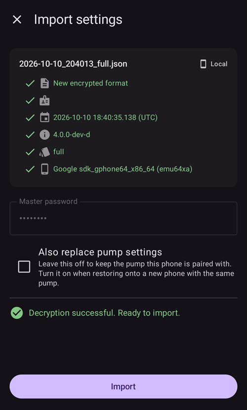

# Erstellen und Wiederherstellen von Backups

Sobald Du AAPS auf Deinem Smartphone installierst, wird es zu einem "medizinischen Gerät" auf das Du Dich jeden Tag verlässt. Es wird dringend empfohlen, für den Fall, dass Dein Smartphone defekt, gestohlen oder verloren geht, einen Notfall-Plan zu haben. Daher ist es wichtig, Dich darauf vorzubereiten, indem Du Dich fragst "Was passiert, wenn?"

Um Deine AAPS-Konfiguration auf einem bestehenden oder neuen Smartphone wiederherzustellen, ist es wichtig, die folgenden Elemente an einem sicheren Ort zu behalten (nicht auf Deinem Smartphone). Es hat sich bewährt, mindestens zwei separate Sicherungen zu haben: auf einer lokalen Festplatte, einem USB-Stick und (bevorzugt) im Cloud-Speicher (z. B.Google Drive oder Microsoft 365 OneDrive). Indem Du Deine Backups in der Cloud speicherst, hast Du von Deinem Smartphone aus alles, was zum Wiederherstellen Deiner Konfiguration benötigt wird, immer und überall verfügbar.

Überlege, ob Du Dir ein zweites Backup-Smartphone zulegen möchtest und das Wiederherstellen von AAPS übst, bis Dein Backup-Smartphone wie erwartet funktioniert. Dieser Schritt gibt Dir Gewissheit darüber, dass Dein Notfallplan funktioniert und Du beim Ausfall Deines primären Smartphones AAPS problemlos weiter nutzen kannst.

Um wiederherstellen zu können, ist es wichtig, die folgenden Dinge zur Hand zu haben:

- Deine **Android Studio Keystore-Datei** und das zugehörige **Passwort**: Wird zum (Neu-)Erstellen der AAPS.APK Installationsdatei benötigt.
- Eine aktuelle Kopie der **AAPS.APK Installationsdatei**
- Einen aktuellen **Export der Einstellungen**: Zum Wiederherstellen wichtiger Einstellungen (inklusive Deiner Ziele!).
- Dein **AAPS-Master-Passwort**
- Backups of additional utilities: Such as BYODA and/or xDrip.
- Persönliche Notizen zu Deinem Setup.

Unten sind die Elemente, die für die Sicherungen empfohlen werden, aufgeführt.

## Backups erstellen

### Keystore-Datei des Computers, auf dem Du die APK erstellt hast
Beim Erstellen Deiner .APK-Installationsdatei aus Android Studio heraus, wird die **Keystore-Datei und das Passwort genutzt, um die .APK-Installationsdatei zu signieren**. Um Deine aktuelle AAPS-Installation zu aktualisieren, muss die aktualisierte .APK-Installationsdatei mit dem gleichen Keystore, wie bei der ersten Installation, signiert werden. Beim Aktualisieren werden alle Einstellungen und die AAPS-Datenbank erhalten bleiben. Note that without this, you are required to first uninstall the current application and then [reinstall](#reinstall-aaps) and reconfigure AAPS.

Den Keystore und das zugehörige Passwort zu haben, reduziert die Komplexität bei einem zukünftigen APK-Update ganz erheblich. Das gilt insbesondere, wenn Du die App auf einem neuen Computer erzeugen musst. Wie Du den Keystore bei der Erstellung einer neuen APK nutzt, erfährst Du im Abschnitt „[AAPS aktualisieren](../Maintenance/UpdateToNewVersion.md)“.

**Wann soll gesichert werden:** Der Keystore sollte nach dem ersten Erstellen der **AAPS** .APK Installationsdatei gesichert werden.

**So sicherst Du:** Finde den Keystore-Pfad heraus. Wenn Du Dich nicht mehr an ihn erinnerst, kannst Du auch im Android Studio nachschauen: Wähle **Build > APK > Next**. Der Pfad wird Dir in “Key store path” angezeigt. Navigiere mit Deinem Datei-Explorer zum entsprechenden Verzeichnis und kopiere die Keystore-Datei (die Dateiendung ist `.jks`). Speichere sie an einem sicheren Ort in Deinem Cloud-Speicher, für den möglichen Fall, dass Du auf Deinem Computer nicht zugreifen kannst. Wichtig ist auch, dass Du Dein Keystore-Passwort, den Key-Alias und das Key-Passwort kennst (oder notierst).

### Kopien der neuesten APK-Datei
Für den Fall, dass Dein **AAPS** Haupt-Smartphone verloren geht oder beschädigt wird, kannst Du mit einer verfügbaren Kopie der APK mit **AAPS** auf einem neuen Smartphone sehr schnell wieder weitermachen. Hinweis: Du wirst auch Deine - vorher wie unten beschriebenen gesicherten - Einstellungen brauchen.

**Wann soll ich ein Backup machen:** Du solltest immer eine aktuelle Sicherung der neuesten APK, die Du auf Deinem **AAPS**-Smartphone nutzt, haben. Falls Du einen „Rollback“ machen musst, ist es ratsam auch die entsprechende Vorgänger-Version gesichert zu haben.

**So sicherst Du:** Halte eine Kopie auf dem Computer, mit dem Du die APK mit Android Studio erstellt hast, aktuell. Zusätzlich wird empfohlen, eine Kopie der APK-Installationsdatei in einer Cloud zu speichern. Stelle sicher, dass Du beide Backups bei Bedarf findest. Überlege, ob Du für die Speicherung der Backups eigene Ordner anlegen möchtest.

### AAPS-Einstellungsdatei („Einstellungen“)

```{admonition} Where are preferences stored on my phone?
:class: tip
You will find your settings in the **AAPS Directory** you have selected during [AAPS setup](#SetupWizard-StoragePermission).</br>
You can also change the **AAPS directory** on the **Maintenance** screen (**menu** (☰) > **Maintenance**), see [Setting the local AAPS directory](#preferences-maintenance-logdirectory).
```

Mit einer Kopie der APK-Installationsdatei (siehe oben) und Deiner **Einstellungs**-Datei, bist Du auf einem bestehenden oder neuen Smartphone schnell wieder einsatzbereit.

Die **Einstellungsdatei** wird verwendet, um die AAPS-Anwendung an Deine spezifischen Bedürfnisse anzupassen. They encompass details such as your **Configuration** settings, objective status, third-party communication settings (e.g., Nightscout, Tidepool), automations, and profiles.

Durch den Export der AAPS-Einstellungen in die Datei kannst Du die Konfiguration zu einem bestimmten Zeitpunkt wiederherstellen. Wie bereits erwähnt, enthält die Exportdatei zusätzlich zu allen Konfigurationseinstellungen auch den Status Deiner Ziele, den Du bei einer AAPS-**(Neu-)Installation** wiederherstellen musst. Ohne diese Wiederherstellung musst Du alle Ziele erneut von Anfang an durchlaufen, um einen Closed Loop aktivieren zu können. Einstellungsdateien ermöglichen es Dir auch, die „letzten funktionierenden“ Einstellungen wiederherzustellen. Damit machst Du alle Konfigurationsänderungen rückgängig.

**Wann die AAPS-Einstellungen gesichert werden sollten:**
* Jedes Mal, wenn Du ein Ziel erfüllst. Damit verhinderst Du den Fortschritt möglicherweise zu verlieren. _Ohne eine Kopie Deiner **Einstellungen** musst Du, wenn Du AAPS neu installierst oder Dein Smartphone tauschst, alle Ziele erneut abschließen._

* Immer dann, wenn Du größere Änderungen an der Konfiguration vornimmst (SMB-Einstellungen änderst, Insulintyp änderst, Pumpe änderst, Änderungen an Automatisierungen vornimmst), solltest Du sowohl vor als auch nach der Änderung die **Einstellungen** sichern. Auf diese Weise hast Du für den Fall eines "Rollback" sowohl die aktuellen Einstellungen als auch eine Kopie des Zustands vor den Änderungen.

* Nur für Nutzende schlauchloser Pumpen (Omnipod und Medtrum): Die Datei mit den **Einstellungen** enthält auch Verbindungsdetails zu Deinem aktuellen Pod und kann genutzt werden, um die Verbindung zu diesem Pod mit einem neuen Smartphone wiederherzustellen. Solltest Du Deine Einstellungen nicht nach dem Start des aktuellen Pods exportiert und gesichert haben, wirst Du im Fall eines Smartphone-Austauschs einen neuen Pod starten müssen.

**Wie Du manuell sicherst:**

1. If this your first time importing or exporting **Settings** you will need to set a master password in [Settings > Protection](#Preferences-master-password). Lege ein Passwort fest und notiere es an einem sicheren Ort. _Ohne dieses Passwort wirst Du nicht auf die Backups Deiner **Einstellungen** zugreifen können._

2. From the **AAPS** main screen, open the **menu** (☰) > **Maintenance**. Choose where to save the file with the **Local** and **Cloud** chips next to **Export settings** (see **Exporting or Importing Settings** below), then tap **Export settings**. **AAPS** shows where the file will go: the file name for **Local**, **Google Drive** for **Cloud**. Tap **OK**.

   

   

   Type the master password set above and tap **OK**.

   

   **Settings exported** (local) or **Cloud export successful** (cloud) confirms the export.

   

   

3. Navigiere mit dem Datei-Explorer auf Deinem Smartphone (meist als „Dateien“ oder „Meine Dateien“ bezeichnet) zu Interner Speicher > AAPS > Einstellungen. Hier findest Du Kopien aller exportierten Einstellungs-Dateien. Der Dateiname sollte `JJJJ-MM-TT_Zeit_Appname.json sein`. Lade diese Datei in den Cloud-Speicher Deiner Wahl hoch. Lade dann auch eine Kopie aus der Cloud auf Deinen lokalen Computer herunter.

(ExportImportSettings-Settings-Export)=

## Einstellungen exportieren

```{admonition} Where are preferences stored on my phone?
:class: tip
You will find your settings in the **AAPS Directory** you have selected during [AAPS setup](#SetupWizard-StoragePermission).</br>
You can also change the **AAPS directory** on the **Maintenance** screen (**menu** (☰) > **Maintenance**), see [Setting the local AAPS directory](#preferences-maintenance-logdirectory).
```

Insbesondere vor und nach den Konfigurationsänderungen, wird empfohlen, die Einstellungen regelmäßig zu exportieren. Du kannst wählen, ob Du die Exporte **manuell oder (vorzugsweise) durch eine Automatisierung** durchführen möchtest. Stelle sicher, dass Du Dir Dein AAPS Master-Passwort notierst und die Datei mit Deinen Einstellungen regelmäßig sicherst, indem Du sie von Deinem Smartphone zum Beispiel in einen Cloud-Speicher kopierst.

**Hinweis**: _Die exportierten Einstellungen werden mit Deinem AAPS Master-Passwort verschlüsselt: Ohne das Master-Passwort, das für den Export genutzt wurde, kannst Du die Datei mit Deinen Einstellungen nicht importieren!_

### Exportieren oder Importieren der Einstellungen
To export or import settings, open the **menu** (☰) and select **Maintenance**. Under **File management**, the **Local** and **Cloud** chips next to **Export settings** and **Import settings** choose where the settings file is saved to or read from: **Local** is the AAPS directory on your phone, **Cloud** is available once a [Cloud Directory](#preferences-maintenance-cloud) is set up. Tapping a chip turns it on or off; at least one always stays selected, and both rows share the same choice. Then tap **Export settings** or **Import settings** itself to start.


(ExportImportSettings-Automating-Settings-Export)=
### Automatisierter Export der Einstellungen

For doing automating settings exports [(**see Automation**)](../DailyLifeWithAaps/Automations.md#automating-preference-settings-export) open [**Settings** > **Maintenance**](#preferences-maintenance-settings), expand **Unattended Settings Export** and switch on **Enable automated settings export**.

Du kannst [Automatisierungen](../DailyLifeWithAaps/Automations.md#automating-preference-settings-export) so konfigurieren, dass die Einstellungen auitomatisch exportiert werden, entweder regelmäßig (_z. B._ wöchentlich) oder nach einem Pod-Wechsel.

_**Hinweis:** Beim Importieren der Einstellungen musst Du immer das AAPS-Passwort eingegeben!_


(ExportImportSettings-restoring-from-your-backups-on-a-new-phone-or-fresh-installation-of-aaps)=
## Wiederherstellen Deines Backups auf einem neuen Smartphone oder AAPS-Neuinstallation

```{admonition} Where are preferences stored on my phone?
:class: tip
You will find your settings in the **AAPS Directory** you have selected during [AAPS setup](#SetupWizard-StoragePermission).</br>
You can also change the **AAPS directory** on the **Maintenance** screen (**menu** (☰) > **Maintenance**), see [Setting the local AAPS directory](#preferences-maintenance-logdirectory).</br>
If **AAPS** loses access to that directory (this can happen after a reinstall or after clearing the app's storage), it shows an **Access to the AAPS directory was lost** notification and stops saving settings to the phone until you [select the directory again](#preferences-maintenance-logdirectory).
```

Use these instructions if you have a back-up of your APK and **Settings** that you want to load on to a new phone or if you needed to delete and reinstall the APK on your existing phone for any reason.

_Wenn Du **AAPS** mit einer APK aktualisieren möchtest, die mit demselben Keystore erstellt wurde, sollte der folgende Prozess nicht notwendig sein. Es wird trotzdem empfohlen, ein Backup vor dem Update zu erstellen._

Solltest Du **AAPS** aktualisieren nachdem Du Deinen ursprünglichen Keystore in der Zwischenzeit verloren oder ersetzt hast (z. B. einen neuen Computer für die Erstellung genutzt hast ohne den Keystore übertragen zu haben), ist es wichtig, dass Du die Einstellungen wie oben beschrieben sicherst und dann die bestehende **AAPS**-Version von Deinem Samartphone deinstallierst. See [Reinstalling AAPS with a new keystore](#reinstall-aaps) for the full procedure.

Wenn notwendig [konfiguriere Deinen CGM/BZ-Empfänger](../Getting-Started/CompatiblesCgms.md) bevor Du die nun folgenden Schritte ausführst

(ExportImportSettings-tubeless-pumps)=
```{admonition} Tubeless pumps (Omnipod and Medtrum) users
:class: warning
The **Preferences** file contains the session of the pod or patch that was active when you exported it.
- **Export right after every pod or patch activation** and copy the file off your phone.
- **Same phone, pod still running:** leave **Also replace pump settings** unticked. Your current pod is kept and only the other settings are imported.
- **New phone taking over the pod:** tick **Also replace pump settings**, and only use a file exported during the pod you are wearing now. A file from an earlier pod replaces your current pod session, and you will need to start a new pod.
- **An old pod session was imported by mistake:** **AAPS** keeps trying to reach that pod and you cannot activate a new one. Deactivate it; if that fails, discard it (see for example [Discarding a pod](#omnipod-dash-discard-pod) for Omnipod DASH).
```

```{admonition} Pump settings are kept unless you say otherwise
:class: note
By default, an import leaves your pump settings alone: the pump selected in **Configuration**, its pairing and all its other settings stay as they are on this phone. Tick **Also replace pump settings** on the import screen only when you restore onto a new phone that should take over the same pump. Settings that are not in the file are never deleted by an import.
```

1. Für eine [Neuinstallation](../SettingUpAaps/TransferringAndInstallingAaps.md) nutze die Anleitung und die Sicherungskopie Deiner APK von oben

2. Starte **AAPS** und lasse alle angeforderten Berechtigungen zu

3. Beende den Einrichtungs-Assistenten. We will be importing all the necessary settings from the back-up copy of **Settings**

4. From the **AAPS** main screen select Request and allow on all permissions listed in red on the top

5. From the **AAPS** main screen, set the master password in [Settings > Protection](#Preferences-master-password) to the same password as you used with your back-ups.

6. If you haven't done it yet, [set the **AAPS directory**](#preferences-maintenance-logdirectory): from the **AAPS** main screen, open the **menu** (☰) > **Maintenance** > **AAPS directory**.

7. From the **AAPS** main screen, open the **menu** (☰) > **Maintenance** > **Export settings** > type in the master password set above > **OK**. Damit wird der Ordner 'preferences' - sofern noch nicht vorhanden - auf Deinem Smartphone erstellt.

8. Lade die Datei mit der Sicherung Deiner **Einstellungen** aus Deiner Cloud-Plattform herunter.

9. Verwende Deinen Dateimanager (häufig „Dateien“ oder „Eigene Dateien“), um die Datei von Deinem Download-Verzeichnis auf `/Interner Speicher/AAPS/preferences` zu verschieben, sofern Dein **AAPS Verzeichnis** `/Interner Speicher/AAPS` ist.

10. From the **AAPS** main screen, open the **menu** (☰) > **Maintenance** and tap **Import settings**. Select the preferences file you want to restore from (the newest is at the top). Make sure you select the correct preferences file, all .json files from the preferences folder (or from the cloud directory, with **Cloud**) will be shown.

    

    **AAPS** shows the details of the file. Type the master password set above and tap **Decrypt & Review**.

11. Once the file is decrypted, decide what to do with the pump settings. On a new phone that takes over the same pump, tick **Also replace pump settings** so the pairing and the pump settings come from the file. Leave the box unticked to keep the pump this phone is already paired with. Then tap **Import**.

    

12. **AAPS** asks **Apply imported settings?** and tells you how many settings will change and, if you left the box unticked, how many pump settings are kept. Nothing has been written yet, so **Cancel** leaves your phone exactly as it was. Tap **OK** to apply.

    

13. **AAPS** applies the imported settings straight away, without restarting. Only the plugins whose settings changed are restarted. While this runs, **AAPS** shows **Applying settings…**; if the pump is busy, it shows **Waiting for pump…** and applies the settings once the pump is idle. If the pump is still busy after one minute, **AAPS** offers to try again. A **Settings applied** message confirms that the imported settings are in use. Any treatment you had queued while the import ran is dropped and **AAPS** tells you that it was cancelled, so nothing is sent to the pump twice.

    

If the file selected a pump that this version of **AAPS** does not have, **AAPS** falls back to the **Virtual Pump** and tells you so. Select your pump again in **Configuration** and check its settings.

14. Tubeless pumps (Omnipod and Medtrum) users only - if you ticked **Also replace pump settings** and your **Preferences** were not backed up from the same pod you are currently using, you will need to start a new pod to begin insulin delivery.

**Troubleshooting:** if you are unable to get an active profile set from the **AAPS** main screen, open the **menu** (☰) in the top left > **Configuration** > **Pump** > switch to **Virtual Pump** > then switch back to your pump type

### Hinweis für Dana RS Nutzer

- If you ticked **Also replace pump settings**, the pump connection settings are imported too: **AAPS** on your new phone will already "know" the pump and therefore not start a Bluetooth scan.
- Bitte stelle die Bluetooth-Verbindung zwischen Smartphone und Pumpe manuell her.