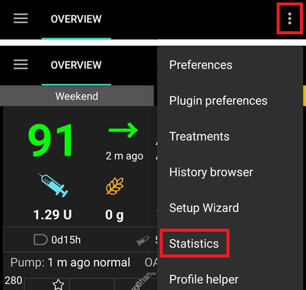
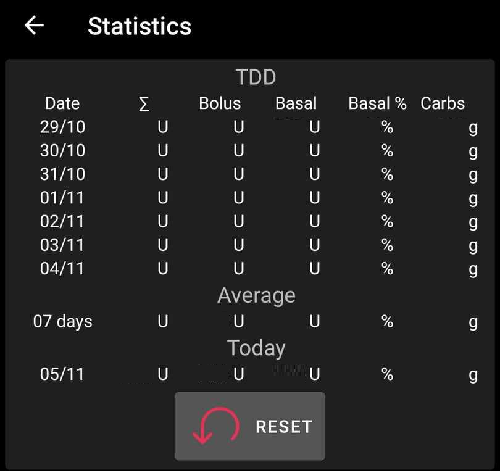
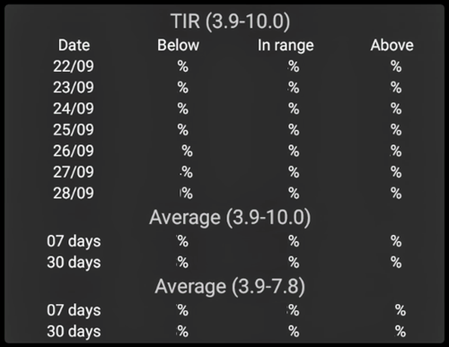
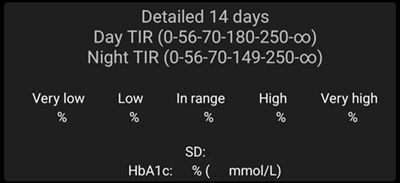
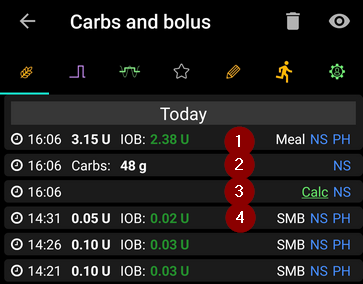
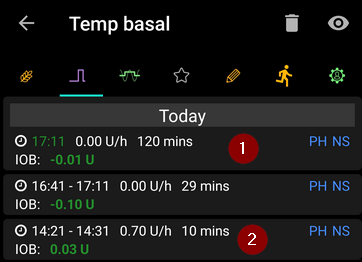
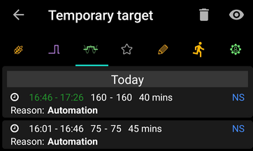
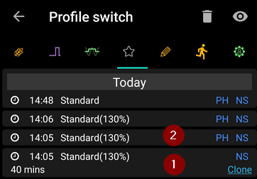
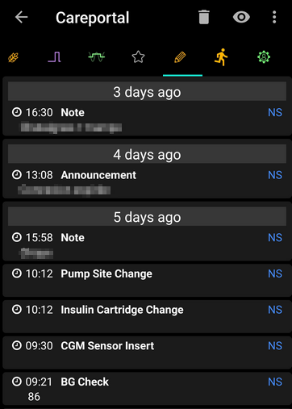
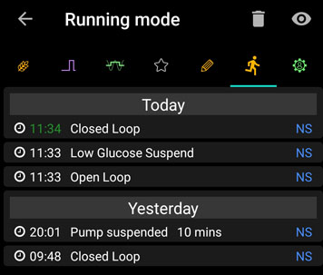

# Deine Daten reviewen

## AAPS-Historie

**AAPS** speichert Deinen gesamten Verlauf (**Glukosewerte**, Behandlungen, Basalraten, Zielwerte, **Profilwechsel** …) in einer lokalen Datenbank auf dem Smartphone. Diese Datenbank ist nicht Teil des [Einstellungsexports](../Maintenance/ExportImportSettings.md). Du kannst sie in **AAPS** selbst mit der **Historie** und dem unten beschriebenen Bildschirm **Statistiken** auswerten. Für langfristige Auswertungen und Berichte lade Deine Daten zu [Nightscout](../SettingUpAaps/Nightscout.md) oder [Tidepool](../SettingUpAaps/Tidepool.md) hoch.

Den **AAPS**-Verlauf kannst Du in der **Historie** ansehen: Öffne das **Menü** (☰) und wähle **Historie**.

- Tippe auf die **Datumskarte**, um den Tag auszuwählen, den Du ansehen möchtest.
- Die Diagramme öffnen sich herausgezoomt und zeigen den **ganzen ausgewählten Tag**. Zieh zwei Finger auseinander, um einen Teil davon zu vergrößern.
- Mit den Pfeilen **<** und **>** gehst Du einen Tag zurück oder vor, mit **Jetzt** kehrst Du zum aktuellen Tag zurück.
- Die Diagramme zeigen dieselben Daten wie die Diagramme auf dem Startbildschirm (Glukosewerte, Behandlungen, Basalrate, IOB, COB, Aktivität, Abweichungen …).

(reviewing-statistics)=
## AAPS-Statistiken

**AAPS** stellt einige rudimentäre Statistiken zur Verfügung.

Die meisten Werte und Kennzahlen basieren auf den [Empfehlungen](https://diabetesjournals.org/care/article/46/Supplement_1/S97/148053/6-Glycemic-Targets-Standards-of-Care-in-Diabetes) der ADA (American Diabetes Association) aus 2023.

Um sie zu öffnen, öffne das **Menü** (☰) und wähle **Statistiken**.

Der Bildschirm **Statistiken** hat vier Reiter: **Insulin**, **TIR**, **Glukose** und **Zyklus**. Tippe auf einen Reiter oder wische nach links oder rechts, um zwischen ihnen zu wechseln.

(reviewing-tdd)=
### Reiter Insulin: Gesamttagesdosis

Die Karte **Gesamttagesdosis** zeigt für die vergangenen Tage (bis zu einer Woche), für die **AAPS** Insulindaten hat, je eine Zeile pro Tag, dann deren **Durchschnitt** und dann **Heute** bis jetzt. Direkt nach der Installation von **AAPS** wird nur **Heute** angezeigt. Die Spalten sind:

- **Basal**: nur Basal.
- **Bolus**: die Summe aller Bolusgaben und SMBs.
- **TDD Gesamt**: die tägliche Gesamtinsulinmenge (**TDD**), also die Summe aus Bolus- und Basalinsulin, das am Tag abgegeben wurde.
- **Kohlenhydrate**: eingegebene Kohlenhydrate und verzögerte Kohlenhydrate (eCarbs).

Der Abschnitt **TDD** wird berechnet, wenn Du die Seite öffnest, und die Berechnung dauert ein paar Sekunden. Tippe auf **Neu berechnen**, um sie erneut durchzuführen.

Die **TDD** ist Dein Bolus- plus Basalinsulin pro Tag. Manche Ärzte verwenden – besonders bei neuen Pumpenträgern – ein Basal-Bolus-Verhältnis von 50:50: Die gesamte Basalrate (**TBB**, die Summe Deiner Basalraten über 24 Stunden) sollte dann etwa die Hälfte der TDD betragen. Andere bevorzugen eine TBB von 32 % bis 37 % der TDD.

Wie die meisten Faustregeln hat das nur begrenzte Aussagekraft. Dein Diabetes kann anders aussehen!

### Reiter TIR

Time In Range (**TIR**): 70-180 mg/dl oder 3,9-10 mmol/l.

**TIR**-Informationen stehen, in Abhängigkeit von der Datenmenge in der **AAPS**-Datenbank, für 7 und 30 Tage zur Verfügung.

Darunter findest Du die Statistik Time In Tight Range (TITR) 70-140 mg/dl oder 3,9-7,8 mmol/l (der Bildschirm zeigt diesen Bereich als 70-141).

**Besprich den Zielbereich mit Deinem Diabetes-Team.**

Dein Diabetes kann anders aussehen. Du solltest alle vorgeschlagenen Zielbereiche mit Deinem Endokrinologen oder Deinem Diabetes-Team besprechen. Richtig eingesetzt, können die Statistiken von AAPS ein wirksames Werkzeug sein, um __Glukose__-Trends zu verfolgen und Fortschritte im Blick zu behalten.

Darunter zeigt die Karte **Dexcom TIR** eine ausführliche **TIR**-Statistik über 14 Tage.

**SD**: Standard Deviation (dt. Standardabweichung), ein [Indikator](https://www.ncbi.nlm.nih.gov/pmc/articles/PMC3125941/) für Glukosewert-Schwankungenof (je höher umso schlechter).

HbA1c: die Schätzung des sich ergebenden glykierten Hämoglobins („Langzeit-Blutzucker“), basierend auf dem Durchschnitt der CGM-Messungen. Dies ist ein indikativer Wert, der möglicherweise nicht mit dem im Blut gemessenen HbA1c übereinstimmt.

(reviewing-statistics-agp)=
### Reiter Glukose: Ambulantes Glukoseprofil (AGP)

Das **Ambulante Glukoseprofil** (**AGP**) zeigt, wie sich Dein Glukosewert normalerweise über den Tag bewegt. Wähle den Zeitraum mit den Knöpfen oben: **Heute**, **24h**, **7d**, **30d** oder **90d**.

- **Das Diagramm**: ein Tag von Mitternacht bis Mitternacht. Die Linie ist der **Median** (die Hälfte Deiner Werte zu dieser Uhrzeit lag darunter, die Hälfte darüber). Darum liegt ein Band mit der mittleren Hälfte Deiner Werte (**25–75%**) und ein breiteres Band mit den meisten Werten (**10–90%**). Ein schmales Band bedeutet, dass Dein Glukosewert zu dieser Uhrzeit von Tag zu Tag ähnlich ist. Gestrichelte Linien markieren Deine **Niedrig-Markierung**, 140 mg/dl (7,8 mmol/l) und Deine **Hoch-Markierung**.
- **Glukoseübersicht**: die Zeit in Deinem Bereich, im engen Bereich (70–140 mg/dl oder 3,9–7,8 mmol/l), über und unter Deinem Bereich, dann Dein **Durchschnitt** und Dein **Median** der Glukosewerte. Dein Bereich ergibt sich aus der **Niedrig-Markierung** und der **Hoch-Markierung**, die unter [Zielbereich für die Grafikanzeige](#Preferences-range-for-visualization) eingestellt sind.
- **eA1c** und **GMI**: zwei Schätzungen des HbA1c, berechnet aus Deinen CGM-Werten. Wie der HbA1c oben stimmen sie möglicherweise nicht mit Deinen HbA1c-Laborwerten überein.
- **SD** (Standardabweichung) und **CV** (Variationskoeffizient): wie stark Dein Glukosewert schwankt. Ein niedrigerer Wert bedeutet einen gleichmäßigeren Glukoseverlauf.
- **Tage**: wie viele Tage mit CGM-Daten verwendet wurden.

 

Unter dem AGP zeichnet die Karte **Glukose Pentagon (CGP)** fünf Kennzahlen Deiner Glukosewerte der letzten 14 Tage als Fünfeck. Ein kleineres Fünfeck bedeutet eine bessere Glukoseeinstellung.

### Reiter Zyklus: TDD-Zyklus-Muster

**TDD-Zyklus-Muster** legt Deine täglichen Insulinmengen in 28-Tage-Zyklen übereinander, damit Du wiederkehrende Muster erkennst. Jeder Zyklus wird als Linie gezeichnet (**Individuelle Zyklen**), zusammen mit ihrem Durchschnitt.

- **Roh-TDD** / **TDD bereinigt**: Wähle die Gesamttagesdosis, wie sie abgegeben wurde, oder die TDD abzüglich des Insulins für Kohlenhydrate.
- **Zyklusverschiebung**: verschiebt den Beginn des Zyklus (0 bis 27 Tage).

Es werden Daten von mindestens 56 Tagen (2 Zyklen) benötigt. Mit weniger Daten zeigt die Karte **Nicht genügend Daten (benötigt mindestens 56 Tage für 2 Zyklen)**. Das Muster wird erst berechnet, wenn Du den Reiter **Zyklus** öffnest, weil dafür Daten von 168 Tagen gelesen werden.

(aaps-screens-treatments)=
## Behandlungsverlauf

Öffne oben links auf dem Startbildschirm das **Menü** (☰) und wähle **Behandlungsverlauf**. In dieser Ansicht kannst Du den Verlauf der folgenden Behandlungen ansehen und ändern, jede auf einem eigenen Reiter (wische die Reiterleiste, um alle zu sehen):

* Kohlenhydrate & Bolus
* [Verzögerter Bolus](#Extended-Carbs-extended-bolus-and-switch-to-open-loop-dana-and-insight-pump-only)
* Temporäre Basalrate
* [Temporäres Ziel](../DailyLifeWithAaps/TempTargets.md)
* [Profilwechsel](../DailyLifeWithAaps/ProfileSwitch-ProfilePercentage.md)
* Careportal: Notizen und Careportal-Einträge
* AAPS-Modus: Die Historie des Loop-Status
* Benutzereintrag: Andere Notizen, die nicht an Nightscout gesendet werden

Am Ende jeder Zeile zeigen kleine Symbole, woher die Daten stammen oder wohin sie gesendet wurden:
* Symbol **Nightscout** (das Nightscout-Logo): Die Daten stammen aus Nightscout oder wurden dort gespeichert
* Symbol **Pumpe**: Die Daten stammen aus dem Pumpenverlauf (sie wurden von der Pumpe verarbeitet)
* Symbol **Mülleimer**: Der Eintrag wurde gelöscht (er wird nur angezeigt, wenn Du gelöschte Einträge mit dem **Augen**-Symbol oben rechts einblendest)

(screens-bolus-carbs)=
### Kohlenhydrate & Bolus

Auf diesem Reiter kannst Du die Bolus- und Kohlenhydrateingaben einsehen. Jeder Bolus (Zeile **1**) zeigt neben der Insulinmenge das verbleibende zugehörige IOB an. Der Ursprung des Bolus kann entweder sein:
* Mahlzeit (manuell eingegeben über die Knöpfe Insulin, QuickWizard oder Bolus-Rechner)
* SMB, wenn die SMB-Funktionalität verwendet wird

Die Kohlenhydrat-Einträge (Zeile **2**) werden mit ihrer Menge in Gramm angezeigt.

If you have used the [Bolus Wizard](#aaps-screens-bolus-wizard) to calculate insulin dosage, you can press the “Calc” text on the bolus line to show the details of how the bolus was calculated.

Abhängig von der gewählten Pumpe werden Insulin und Kohlenhydrate in einer oder mehreren Zeilen angezeigt: eine Zeile für die Berechnungsdetails, eine für die Kohlenhydrate und eine für den eigentlichen Bolus.

Mit dem Behandlungsverlauf kannst Du fehlerhafte Kohlenhydrat-Einträge korrigieren (_z. B._ wenn Du die KH-Menge über- oder unterschätzt hast). Einen existierenden Eintrag kannst Du darüber nicht bearbeiten. Dazu musst Du wie folgt vorgehen:

1. Prüfe die aktuellen Werte für COB und IOB auf dem Startbildschirm und merke sie Dir.
2. Je nach Pumpe werden die Kohlenhydrate zusammen mit dem Insulin in einer Zeile oder als eigener Eintrag (z. B. bei der Dana RS) angezeigt.
3. Entferne den Eintrag mit der falschen KH-Menge: Tippe auf das Mülleimer-Symbol, wähle die zu entfernenden Zeilen aus und tippe dann erneut auf das Mülleimer-Symbol, um es abzuschließen.
4. Stelle sicher, dass die KH erfolgreich gelöscht wurden, indem Du COB auf dem Startbildschirm erneut überprüfst.
5. Mach das Gleiche für IOB, wenn es nur eine Zeile mit KH und Insulin gibt.

   → Falls die KH nicht wie vorgesehen gelöscht werden und Du dennoch zusätzliche Kohlenhydrate eingibst, wird mit einem zu hohen COB gerechnet und dies kann zu überhöhter Insulinabgabe führen.

6. Gib die richtige KH-Menge erneut ein (**Behandlungen → Kohlenhydrate** in der unteren Navigationsleiste oder ein [Schnellstart](#quicklaunch)-Knopf **Kohlenhydrate**) und achte darauf, den richtigen Zeitpunkt einzustellen.
7. Gibt es nur eine Zeile mit KH und Insulin, musst Du zusätzlich die Insulinmenge eingeben. Achte darauf, den richtigen Zeitpunkt einzustellen, und prüfe nach dem Bestätigen des neuen Eintrags IOB auf dem Startbildschirm.

### Temporäre Basalrate

Die durch den Loop gesetzten **temporäre Basalraten** werden hier angezeigt. Wirkt ein Eintrag noch auf das IOB, wird diese Information neben der Rate angezeigt (Zeile **1**). Das können sein:
* Positives IOB, wenn die temporäre Basalrate höher war als die im Profil festgelegte
* Negatives IOB bei einem Null-Temp (wie in Zeile **1**) oder wenn die temporäre Basalrate niedriger war als die im Profil festgelegte

Das Löschen der Einträge wirkt sich nur auf Deine Berichte in Nightscout aus und verfälscht wahrscheinlich Dein tatsächliches IOB – es wird nicht empfohlen.

Links an einer Zeile bedeutet ein rotes S „Suspend“: Das passiert, wenn gerade kein Basal abgegeben wird. Dies ist eine ganz normale Situation, wenn beispielsweise ein Pod gewechselt wird.

### Temporäres Ziel

Hier kann die Historie der temporären Ziele eingesehen werden.

### Profilwechsel

Die Historie der Profilwechsel ist hier zu sehen. Bei jedem Profilwechsel siehst Du möglicherweise mehrere Einträge: Zeile **1**, gespeichert sowohl in NS als auch im Pumpenverlauf, entspricht dem tatsächlichen Wechsel. Zeile **2**, gespeichert in Nightscout, aber nicht im Pumpenverlauf, entspricht der Anforderung eines Profilwechsels durch den Anwender.

Das Löschen der Einträge wirkt sich nur auf die Nightscout-Berichte aus und niemals das aktuelle Profil verändern.

Mit dem Knopf **Klonen** in Zeile **2** kannst Du eine Kopie eines **Profilwechsels** erstellen. Mehr dazu erfährst Du unter [Dein AAPS-Profil > Deine Profile verwalten](#your-aaps-profile-clone-profile-switch).

### Careportal

Dieser Reiter zeigt alle Notizen und Careportal-Einträge, die in Nightscout erfasst wurden.

(AapsScreens-running-mode)= (aaps-screens-running-mode)=
### Betriebsmodus

Dieser Reiter zeigt den Verlauf der Änderungen des [Loop-Status](#AapsScreens-loop-status): Open, Closed, LGS, Unterbrechung, Getrennt.

### Benutzereingabe

Dieser Reiter listet die Aktionen auf, die in **AAPS** vom Anwender oder von einer **Automatisierung** ausgeführt wurden (Änderungen des Loop-Modus, Profilwechsel, Behandlungen, Exporte der Einstellungen …). Diese Einträge werden nicht an Nightscout gesendet.

------

## Wie unterscheiden sich Nightscout und Tidepool?

Nightscout ermöglicht die Speicherung von **AAPS**-Daten und bietet eine breite Palette an [Auswertungsmöglichkeiten](https://nightscout.github.io/nightscout/reports/).

Tidepool dahingegen erlaubt den Review der [Daten](https://www.tidepool.org/viewing-your-data) und macht das [Teilen der Informationen mit dem Diabetes-Team sehr einfach](https://www.tidepool.org/providers/how-it-works#tidepool-data-platform).