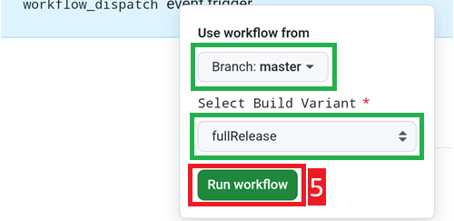

# Browser-Update (Fork)

```{tip}
Du hast AAPS mit dem **AAPS Builder** erstellt? Dann brauchst Du diese Seite nicht. Siehe [Aktualisieren mit dem AAPS Builder](#aaps-builder-updates).
```

## Kein Download möglich - APK muss selbst erstellt werden

Aufgrund der gesetzlichen Regelungen für Medizinprodukte ist **AAPS** nicht als Download verfügbar. Es ist zulässig, die App für den eigenen Gebrauch zu erstellen, aber du darfst keine Kopie an andere weitergeben! Zu den Details schaue bitte auf die [FAQ-Seite](../UsefulLinks/FAQ.md).

```{note}
In case you want to upgrade **AAPS** with a browser for the first time: copy your back-up keystore file to your Google Drive. Folge dann dem [Prozess für den **AAPS**-Browser Build](../SettingUpAaps/BrowserBuild.md) und nicht dieser Anleitung. Anstatt einen neuen Keystore zu erstellen, wählst Du den Keystore aus, den Du von Deinem Computer kopiert hast.
Das musst Du nur beim ersten Mal machen. Für die danach folgenden Updates, kannst Du dann dieser Anleitung folgen.
```

```{tip}
**Umstieg auf den AAPS Builder?** Der [AAPS Builder](../SettingUpAaps/BrowserBuildAapsBuilder.md) ist der einfachere Browser-Build: Es gibt keinen Fork, der synchronisiert werden muss, und Du lädst die App direkt von GitHub herunter. Umsteigen musst Du nicht, diese Anleitung funktioniert weiterhin. Wenn Du umsteigst, besorge Dir zuerst eine Kopie Deines Keystores aus Deinem Fork, wie unter [Umstieg vom bisherigen Browser-Build](#aaps-builder-from-fork) beschrieben. Sonst kann der neue Build das AAPS auf Deinem Smartphone nicht aktualisieren.
```

## Übersicht zum Aktualisieren auf eine neue AAPS-Version mit einem Browser

```{contents} Steps for updating to a new version of AAPS
:depth: 1
:local: true
```

Wenn Probleme auftreten, findest Du Hilfe auf der eigenen Seite zur [Fehlerbehebung beim Browser-Build](../GettingHelp/BrowserBuildTroubleshooting.md).

### Exportiere Deine Einstellungen

Exportiere die Einstellungen Deiner aktuellen **AAPS**-Version Deines Smartphones. Vielleicht brauchst Du sie nicht, aber sicher ist sicher.

Wenn Du nicht mehr genau weißt, wie man das macht, schaue auf der Seite [Export & Import der Einstellungen](ExportImportSettings.md) nach.

(Update-to-new-version-update-your-repo)=
### Aktualisiere Dein GitHub Repository

[Logge Dich bei GitHub ein](https://github.com/login).

1. Wähle Repositories aus.
2. Scrolle herunter und wähle Dein eigenes AndroidAPS Repository aus.


3. Stelle sicher, dass Du Deine eigene Kopie von AndroidAPS verwendest (Fork von nightscout/AndroidAPS)
4. Tippe auf „Sync Fork“, um es zu aktualisieren (die Anzahl der Commits kann sich vom Bild unterscheiden)


5. Tippe auf „Update Branch“


Hinweis: Falls Du aus Versehen Deine AndroidAPS-Kopie geändert hast, siehst Du den folgenden Bildschirm. Verwirf alle Änderungen (Commits), um zur offiziell freigegebenen Version zurückzukehren.


You have now synchronized (updated) your own copy with the latest release of **AAPS**. Gut gemacht.


### Führ die folgenden Schritte durch, um eine signierte APK zu erstellen

1. Wähle in Deiner AAPS-GitHub-Kopie „Actions“ aus.
2. Klappe alle „Workflows“ auf.
3. Wähle AAPS-CI aus


4. Scroll herunter und tippe auf „Run Workflow“.


5. Lass den Branch auf master. Prüfe unter **Select AAPS Version**, dass **4.0.0** ausgewählt ist, die neueste Version oben in der Liste. Ist Dein Fork nicht aktuell, ist eine ältere Version vorausgewählt: Startest Du den Workflow mit dem Formular so, wie es sich öffnet, erstellst Du diese ältere Version erneut, und Deine App wird nicht aktualisiert. Wähle die [Variante](#browserbuild-variant) (fullRelease) und tippe dann auf Run workflow.

   ```{note}
   Die Liste der Versionen ist Teil des Workflows in Deinem Fork. Fehlt **4.0.0**, ist Dein Fork noch nicht synchronisiert: Geh zurück zu [Dein GitHub-Repository aktualisieren](#Update-to-new-version-update-your-repo).
   ```




6. Es erscheint die Nachricht „Workflow run was successfully requested“. Mit dem Aktualisieren der Browser-Seite kannst Du den Build-Fortschritt mitverfolgen. Eine grünes Häkchen zeigt an, dass die Aktion „AAPS CI“ abgeschlossen ist. You have successfully built the updated version of **AAPS**. Das bedeutet, dass Master und Wear apk nun direkt in Deinem Google Drive (wie unten beschrieben) gespeichert wurden. Die AAPSClient Apk kann in Github > nightscout > AndroidAPS [hier](https://github.com/nightscout/AndroidAPS/releases) heruntergeladen werden


### Installiere die AAPS APK

1. Öffne Dein Google Drive
2. Gehe in den AAPS-Ordner und öffne den Ordner mit der neuen Version. Dort findest Du sowohl die Smartphone-Version, als auch die Android-Wear-Version.


```{note}
Seit September 2026 kann Googles [Android-Entwicklerverifizierung](#android-developer-verification) je nach Land verhindern, dass sich die APK durch Antippen der Datei installieren lässt. Kostenlose Möglichkeiten das zu umgehen, werden auf dieser Seite erklärt.
```

[Hier](#Update-to-new-version-check-aaps-version-on-phone) geht's weiter

(update-browser-build-troubleshooting)=

## Problembehandlung

Keine Panik, wenn irgendetwas schiefläuft.

Tief durchatmen!

Prüfe dann, ob Dein Problem schon beschrieben ist: siehe [Fehlerbehebung beim AAPS Builder](#aaps-builder-troubleshooting), wenn Du mit dem **AAPS Builder** erstellst, sonst [Fehlerbehebung beim Browser-Build](#aaps-ci-troubleshooting).

Wenn Du weitere Hilfe brauchst, kontaktiere bitte andere **AAPS**-Nutzende auf [Facebook](https://www.facebook.com/groups/AndroidAPSUsers) oder [Discord](https://discord.gg/4fQUWHZ4Mw).
