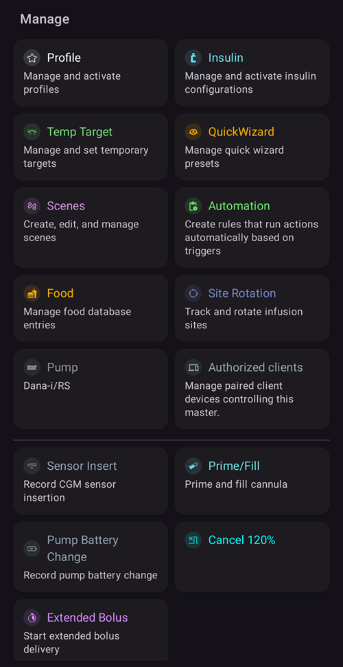

(v4-changes)=
# Änderungen mit AAPS Version 4

Diese Seite gibt einen Überblick über die wichtigsten **Verhaltensänderungen** zwischen **AAPS** v3 und v4 – Dinge, die anders funktionieren, verschoben oder entfernt wurden – damit Du weißt, was auf Dich zukommt. Siehe auch die [Release Notes](ReleaseNotes.md) und die [Update-Anleitung](UpdateToNewVersion.md).

```{contents} Table of contents
:depth: 2
:local: true
```

---

## NSClient v1 wurde entfernt

**AAPS** v3 enthielt **zwei** Module zur Synchronisation mit Nightscout:

- **NSClient** – der bisherige Client (die alte REST- bzw. socket.io-API von Nightscout, auch *„v1“* genannt) und
- **NSClientV3** – der Client für die neuere **API v3** von Nightscout.

In **AAPS** v4 wurde das alte Modul **NSClient (v1)** **entfernt**. Für die Synchronisation mit Nightscout gibt es jetzt nur noch **NSClientV3**.

```{admonition} What you need to do
:class: important
Falls bei Dir (oder Deinem **AAPSClient**-Follower) noch das alte Modul **NSClient (v1)** für die Synchronisation lief, wechsle vor oder nach dem Update zu **NSClientV3**:

- Öffne **[Konfiguration](../SettingUpAaps/ConfigBuilder.md) → Kommunikation → NSClientV3**.
- Gib Deine **Nightscout-URL** und ein **Zugriffstoken** ein (NSClientV3 verwendet ein Zugriffstoken, *nicht* das alte API Secret – siehe [Token erstellen](https://nightscout.github.io/nightscout/security/#create-a-token)).
- Deine Nightscout-Seite muss die **API v3** unterstützen (Nightscout 15 oder neuer).
- Wenn Du **Websockets** nutzt, schalte sie auf **beiden** Geräten ein oder aus, also auf Master und Follower – nie nur auf einem.
```

Das betrifft nur die Verbindung zwischen App und Nightscout. Deine Daten in Nightscout bleiben unverändert.

---

## Die untere Navigationsleiste: Behandlungen, Szenen und Bearbeiten

In **AAPS** v3 hast Du Dich über eine Reihe von **Reitern** (Übersicht, Aktionen, Behandlungen, …) durch die App bewegt. Mehrere Funktionen waren **Module**, die Du in der Konfiguration aktiviert hast (**Aktionen**, **Automatisierung**, **Essen**, …).

In **AAPS** v4 gibt es keine Reiter mehr und damit auch nicht mehr das Augen-Kästchen in der Konfiguration, mit dem ein Modul als Reiter angezeigt wurde. Der Hauptbildschirm ist die **Übersicht**. Über die **untere Navigationsleiste** öffnest Du drei Fenster, die von unten hochklappen. **Aktionen, Automatisierung und Essen sind keine Module mehr** – in der [Konfiguration](../SettingUpAaps/ConfigBuilder.md) musst Du dazu nichts aktivieren. Ihre Funktionen findest Du jetzt in diesen Fenstern.

(v4changes-treatments)=
### Behandlungen – eingeben und abgeben

Im Fenster **Behandlungen** erfasst Du eine Behandlung oder gibst sie ab: **Bolus-Rechner**, **Insulin** (manueller Bolus), **Kohlenhydrate**, **Behandlung** (Insulin und Kohlenhydrate zusammen), **Kalibrierung**, **CGM** (öffnet Deine CGM-App, wenn eine eingerichtet ist) und Deine **[QuickWizards](../DailyLifeWithAaps/QuickWizards.md)**.


Auf einer **Wear OS-Smartwatch** gibst Du dieselben Behandlungen über das **AAPS-Menü** der Smartwatch ein (Bolus-Rechner / Rechner, eCarbs, Behandlung, …):


### Szenen

Deine Voreinstellungen für bestimmte Situationen – siehe [Szenen](../DailyLifeWithAaps/Scenes.md).

(v4changes-manage)=
### Bearbeiten – verwalten und aktivieren

Im Fenster **Bearbeiten** verwaltest und aktivierst Du alles andere: **[Profil](../DailyLifeWithAaps/ProfileSwitch-ProfilePercentage.md)**, **Insulineinstellungen** (Deine Insulin-Konfigurationen), **[Temporäres Ziel](../DailyLifeWithAaps/TempTargets.md)**, Vorlagen für **[QuickWizard](../DailyLifeWithAaps/QuickWizards.md)**, **[Szenen](../DailyLifeWithAaps/Scenes.md)**, **Automatisierung**, **Essen**, **Wechsel der Setzstellen**, **Pumpe**, **[Autorisierte Clients](../RemoteFeatures/ClientMasterControl.md)** – dazu die Pumpenaktionen, die früher im Reiter *Aktionen* waren (**Verzögerter Bolus**, **Temporäre Basalrate abbrechen**, **Nadelwechsel/Füllen**, **CGM-Sensor gesetzt**, **Pumpenbatterie-Wechsel**).



Deine bestehenden Automatisierungsregeln und Essenseinträge bleiben alle erhalten. Geändert hat sich nur der Weg zu diesen Funktionen.

(screens-action-tab)=
#### Wo ist der Reiter Aktionen geblieben?

**AAPS** 3.x hatte einen Reiter „Aktionen“. In **AAPS** 4 findest Du seine Funktionen an anderen Stellen:

* **Profilwechsel** und **Prozentsatz des Profils**: Tippe auf dem Hauptbildschirm auf den [Profilnamen](#aaps-screens-profile--target) oder wähle **Bearbeiten → Profil**. See [Change the Profile Percentage](#ProfileSwitch-change-percentage).
* **Temporäres Ziel**: Tippe auf dem Hauptbildschirm auf das [Ziel](#aaps-screens-profile--target) oder wähle **Bearbeiten → Temporäres Ziel**.
* **Nadelwechsel/Füllen**, **CGM-Sensor gesetzt**, **BZ-Test** und die anderen Careportal-Einträge: im aufgeklappten [Statusbereich](#aaps-screens-careportal), unter **Bearbeiten** oder als [Schnellstart](../DailyLifeWithAaps/QuickLaunch.md)-Knöpfe.
* **Historie**, **Statistiken** (TDD): im **Menü** (☰).

```{admonition} Profile switch and profile percentage
:class: note
In **AAPS** v3 hat ein langer Druck auf den Profilnamen den Dialog für den Profilwechsel geöffnet (Prozentsatz, Dauer, temporäres Ziel für Aktivität). In **AAPS** v4 **tippst** Du auf den Profilnamen (oder wählst **Bearbeiten → Profil**) und dann unten rechts auf den runden Knopf **▶**. Dort findest Du dieselben Einstellungen. Siehe [Prozentsatz des Profils ändern](#ProfileSwitch-change-percentage).
```

---

(v4changes-read-only-management)=
## Schutz der Einstellungen sperrt jetzt auch die Verwaltungsbildschirme

In **AAPS** v3 hat der [Schutz der Einstellungen](#Preferences-settings-protection) nur dann nach Deinem Passwort gefragt, wenn Du die Einstellungen geöffnet hast. Im Reiter **Lokales Profil** konntest Du Profile trotzdem ohne Passwort anlegen oder ändern.

In **AAPS** v4 gilt der Schutz der Einstellungen auch für das Bearbeiten auf den Verwaltungsbildschirmen: **Profil**, **Insulineinstellungen**, **Temporäres Ziel** und **QuickWizard**. Sind Deine Einstellungen gesperrt, öffnen sich diese Bildschirme **schreibgeschützt**:

- Du kannst die Einträge durchsehen, mit **▶ Aktivieren** aktivieren oder verwenden.
- Die Knöpfe **Hinzufügen / Bearbeiten / Klonen / Löschen** sind **ausgeblendet**. Nur der **✏️ Stift** in der oberen Leiste zeigt, dass Du das Bearbeiten freischalten kannst.


```{admonition} What you need to do
:class: important
Um einen Eintrag hinzuzufügen, zu bearbeiten, zu klonen oder zu löschen, tippe auf den **✏️ Stift** in der oberen Leiste und gib Dein Passwort für die Einstellungen ein (oder nutze die Biometrie). Dann erscheinen die Knöpfe.

Wenn Du Deine Einstellungen nicht schützen musst, kannst Du den Schutz der Einstellungen unter **Einstellungen → Schutz** ausschalten.
```

---

(v4changes-active-insulin)=
## Das verwendete Insulin kann nicht bearbeitet werden

In **AAPS** v3 konntest Du die DIA des verwendeten Insulins jederzeit ändern.

In **AAPS** v4 ist das Insulin, das unter **Bearbeiten → Insulineinstellungen** als **AKTIV** markiert ist, ausgegraut. Du kannst es weder bearbeiten noch löschen.

Beim Update übernimmt **AAPS** das Insulin und die DIA, die in Deinen Profilwechseln aus v3 schon gespeichert sind. Findet es ältere Einträge, bei denen zwar das Insulin bekannt ist, die DIA aber nicht, verwendet es dafür eine Standard-DIA und zeigt einmalig eine Meldung an, zum Beispiel *Für ältere Einträge war keine Insulinwirkdauer gespeichert, daher wurden 9,0 Stunden für Lyumjev verwendet. Prüfe Deine Insulineinstellungen – bereits migrierte Einträge werden danach nicht mehr geändert.* Wenn Du diese Meldung siehst, prüfe Deine Insulineinstellungen.

```{admonition} What you need to do
:class: important
Um den DIA oder das Wirkmaximum zu ändern, lege mit **+** ein neues Insulin an, passe es an, speichere es und aktiviere es mit **▶ Aktivieren**. Siehe [Das verwendete Insulin wechseln](#Config-Builder-insulin-change-active).
```

---

(v4changes-remote-control)=
## AAPSClient remote zu steuern erfordert eine Kopplung

In **AAPS** v3 hat der **AAPSClient** **AAPS** gesteuert, indem es Careportal-Behandlungen in Nightscout geschrieben hat. Einen Bolus abgeben konnte es nicht.

In **AAPS** v4 werden Client und Haupt-Smartphone (Master) einmal miteinander **gekoppelt**, und jeder Befehl wird signiert. Das Haupt-Smartphone prüft und bestätigt jeden Befehl, und ein Client kann jetzt auch einen Bolus abgeben.

- Jeder Client hat eine **[Rolle](#client-master-control-roles)**, die festlegt, was er darf.
- Solange die Client-Steuerung eingeschaltet ist, läuft das Haupt-Smartphone im **[geschützten Modus](#client-master-control-hardened-mode)**: Behandlungen und Änderungen, die direkt in Nightscout eingegeben werden (auf der Website oder in anderen Apps), werden nicht mehr übernommen.
- Jeder Client bekommt ein **[eigenes Nightscout-Token](#client-master-control-own-token)** mit genau den Rechten, die er braucht.

```{admonition} What you need to do
:class: important
Koppele jeden **AAPSClient** mit dem Haupt-Smartphone: siehe [Master ↔ Client-Steuerung](#client-master-control). Ist auf dem Haupt-Smartphone ein Admin-Token hinterlegt, zeigt es einen QR-Code an. Damit richtest Du den Client mit einem einzigen Scan ein und koppelst ihn. Wenn Du Behandlungen bisher auf der Nightscout-Website eingegeben hast, gib sie stattdessen auf einem gekoppelten Client ein.
```

---

## Doppelte BZ-Werte schalten den Loop jetzt auf Unterbrechung bei niedrigem BZ (LGS)

Wenn **AAPS** denselben Glukosewert zweimal erhält (zu erkennen an einem roten Warnzeichen auf der Verknüpfung zur BZ-Quelle in der unteren Leiste), kann es Deinen Trend nicht mehr zuverlässig berechnen und gibt deshalb kein Korrekturinsulin mehr ab.

In **AAPS** v3 geschah das unbemerkt im Hintergrund: Dein Loop wurde weiter als **Closed Loop** angezeigt, obwohl er nicht mehr korrigieren konnte.

In **AAPS** v4 siehst Du diesen Wechsel. Ein Closed Loop wird auf **Unterbrechung bei niedrigem BZ (LGS)** umgeschaltet, und der Loop-Dialog nennt Dir den Grund: *„LGS-Modus wegen doppelter Werte in der BZ-Quelle“*. **AAPS** kann Deine Basalrate aber weiterhin senken oder aussetzen, um Dich vor Unterzuckerungen zu schützen.

```{admonition} What you need to do
:class: important
Suche die doppelten Werte und entferne sie – siehe [BZ-Warnzeichen](#aaps-screens-bg-warning-sign).

Auch wenn sie entfernt sind, bleibt **AAPS** in **Unterbrechung bei niedrigem BZ (LGS)**. Es kehrt nicht von selbst zu **Closed Loop** zurück: Drücke lange auf das Loop-Symbol und wähle wieder **Closed Loop**.
```

---

(v4changes-tidepool)=
## Tidepool: Daten erscheinen jetzt unter dem Gerätenamen AAPS

In **AAPS** v3 wurden die zu [Tidepool](../SettingUpAaps/Tidepool.md) hochgeladenen Daten dort unter einem anderen Gerätenamen angezeigt.

In **AAPS** v4 erscheinen die Daten unter dem Gerätenamen **AAPS**. Nach dem Update legt **AAPS** in Tidepool einen neuen Datensatz an. Deine älteren Daten bleiben in Tidepool unter dem alten Gerätenamen.

```{admonition} What you need to do
:class: important
Meist nichts: Neue Daten erscheinen einfach unter **AAPS**.

Starte **keine** „**Vollständige Synchronisierung**“, solange die alten Daten noch in Tidepool liegen. Sonst wären dieselben Daten dort doppelt. Wenn Du alle Daten unter dem neuen Namen haben möchtest, nutze zuerst den Knopf „**Alle Daten löschen**“ auf dem [Tidepool-Bildschirm](#tidepool-menu) (er löscht auch die alten, von **AAPS** hochgeladenen Daten) und starte dann „**Vollständige Synchronisierung**“. Hochladen lassen sich nur die Daten, die noch in **AAPS** auf Deinem Smartphone gespeichert sind.
```

---


<!-- =====================================================================
     This page is a growing list of v4 behavioral changes.
     Add new changes as their own "## " section, newest grouping as agreed.
     Maintainers: relocate page + images and fix cross-links as needed.
     ===================================================================== -->
