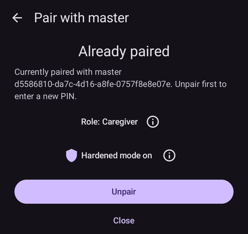

(aapsclient-app)=
# Die AAPSClient-App

**AAPSClient** ist die Begleit-App zu **AAPS**: eine App für ein zweites Smartphone – meist das eines Betreuers –, das der Person, die **AAPS** nutzt, **folgt**. From **AAPS** version 4, the caregiver can also **control** the loop remotely through signed commands. Beide Smartphones kommunizieren über Deine **Nightscout**-Seite. Eine direkte Verbindung zwischen den Smartphones ist nicht nötig.

```{admonition} Wording used on this page
:class: note
- **Client** = ein Smartphone mit **AAPSClient**.
- **Master** = das Haupt-Smartphone mit **AAPS**, das mit der Pumpe verbunden ist und den Loop ausführt.
```

```{admonition} iPhone version in development
:class: note
**AAPSClient** läuft derzeit auf Android-Smartphones. Eine iPhone-Version von **AAPSClient** wird entwickelt und befindet sich in einer frühen Testphase. Sie ist noch nicht veröffentlicht: Es gibt keinen Eintrag im App Store und nichts zum Herunterladen. Diese Seite wird aktualisiert, sobald sie verfügbar ist.
```

```{contents} Table of contents
:depth: 2
:local: true
```

## Was AAPSClient ist (und was nicht)

**AAPSClient** sieht aus wie **AAPS** und bedient sich auch so, hat aber **keinen eigenen Loop**:

- Die App enthält **keinen APS-Algorithmus**, keine **Ziele** und **keine Pumpentreiber** – sie gibt nie selbst Insulin ab.
- Die Module, die nur die Haupt-App verwendet (**SMS-Kommunikator**, **Tidepool**, **Open Humans**), sind ebenfalls nicht enthalten.
- Was sie *enthält*: die Synchronisation über **NSClientV3**, die BZ-Quellen-Module, das Senden an **xDrip+** und die Anbindung von **Wear OS** / **Garmin** – also alles, was nötig ist, um zu folgen und Befehle weiterzuleiten. Eine **Garmin**-Smartwatch an einem Client kann die Daten anzeigen. Von ihr gesendete Kohlenhydrate werden aber nicht eingetragen, und sie kann die Pumpe nicht verbinden oder trennen: Der Client zeigt eine Meldung an, und Du gibst sie stattdessen in **AAPS** ein.

Alles, was Du in **AAPSClient** auslöst, wird vom Master (dem Smartphone mit der Pumpe) geprüft, begrenzt, bestätigt und **ausgeführt**. Wie das funktioniert, erklärt die eigene Seite [Master ↔ Client-Steuerung](ClientMasterControl.md): wie Du die beiden Smartphones koppelst, wie der Master den Bestätigungstext schreibt, den Du siehst, wie ein auf dem Client gestarteter Bolus abgegeben wird und was passiert, wenn der Master offline ist.

## Versionen: AAPSClient, AAPSClient2 und AAPSClient3

Auf demselben Follower-Smartphone können bis zu drei Client-Apps nebeneinander installiert werden, die jeweils einer **anderen** Person folgen: **AAPSClient** (gelbe Eule), **AAPSClient2** (blaue Eule) und – neu in **AAPS** Version 4 – **AAPSClient3** (grüne Eule). Sie können alle dasselbe. Nur Name und Farbe unterscheiden sich (App-Symbol, Hintergrund des Widgets und Statusbereich auf dem Startbildschirm), damit Du sie auseinanderhalten kannst. Jede App wird mit ihrem eigenen Master gekoppelt. Details findest Du unter [Über AAPSClient, AAPSClient2 und AAPSClient3](#remotecontrol-aapsclient-versions).

## Die App bekommen

**AAPSClient** bekommst Du auf dieselbe Weise wie **AAPS** – siehe [Herunterladen und Installieren](#RemoteControl_aapsclient) – und installierst sie wie die Haupt-App ([AAPS auf Dein Smartphone übertragen und installieren](../SettingUpAaps/TransferringAndInstallingAaps.md)).

## Erster Start: ein kürzerer Einrichtungsassistent

Beim ersten Start führt **AAPSClient** denselben **Einrichtungsassistenten** aus, den Du von **AAPS** kennst, aber mit viel weniger Schritten. Auf einem Follower werden kein Profil, kein Insulin, keine Pumpe, kein APS und keine Ziele eingerichtet:

1. **Willkommen**, **Lizenzvereinbarung**, **Berechtigungen** und **Master-Passwort** – genau wie in der Haupt-App, siehe [AAPS Einrichtungsassistent](../SettingUpAaps/SetupWizard.md).
2. Der Client fragt **nicht** nach den **Einheiten** oder den **unteren/oberen Grenzen**: Er übernimmt sie vom Haupt-Smartphone, sobald er mit Nightscout verbunden ist. Du siehst sie später in den **Einstellungen**. Dort zeigt ein kleines **Smartphone-Symbol**, dass sie [mit dem Haupt-Smartphone abgeglichen](#client-master-config-prefs) werden. Ändern kannst Du sie nur, wenn der Master erreichbar ist.
3. **Vom Master aus einrichten** – öffne auf dem Master **Bearbeiten → Autorisierte Clients**, füge dieses Smartphone mit einem **QR-Code** hinzu und tippe hier auf **QR-Code scannen**. Ein einziger Scan richtet Nightscout mit einem eigenen Token für dieses Smartphone ein und koppelt es auch gleich, wenn es ein Code zum Koppeln ist. Das Smartphone übernimmt außerdem den Namen, mit dem es auf dem Master hinzugefügt wurde, als Namen dieser Instanz (Buchstaben mit Akzent werden zu einfachen Buchstaben, aus „Miloš“ wird „Milos“). **Nach dem Scan ist die Einrichtung abgeschlossen**: Der Assistent schließt sich, weil die nächsten Schritte nur noch zeigen würden, was der Code schon erledigt hat. Ohne QR-Code überspringst Du diesen Schritt. (Nur Android: Unter iOS gibt es den Scanner noch nicht.)

   

4. **Kommunikation** – die Liste bietet nur die Module an, die ein Follower braucht (NSClientV3, xDrip+, Wear, External Companion Apps, Garmin). Wenn Du keinen QR-Code gescannt hast, aktiviere **NSClientV3** und trage **dieselbe Nightscout-URL** wie auf dem Haupt-Smartphone sowie ein Zugriffstoken ein, mit eingeschalteten **Websockets** – genau wie unter [Synchronisation](#RemoteControl_aapsclient) beschrieben.

   

5. **Mit Master koppeln** – diesen Schritt gibt es **nur** auf dem Client. Er verbindet dieses Gerät mit der PIN über den sicheren Befehlskanal mit dem Master und übernimmt, wie der QR-Code, den Namen, mit dem das Smartphone auf dem Master hinzugefügt wurde. **Nach der Kopplung ist die Einrichtung abgeschlossen.** Du kannst den Schritt auch überspringen und jederzeit später über **Bearbeiten → Mit Master koppeln** koppeln.

   

6. **Wer nutzt dieses Smartphone?** – nur, wenn Du im Assistenten nicht gekoppelt hast: der Name der Person, die dieses Smartphone nutzt. Daran wird diese Instanz in Berichten und bei der Synchronisation erkannt.

(aapsclient-pairing-with-the-master)=

## Pairing with the master

On the **master**, open **Manage → Authorized clients** and add a client. There are two ways to pair:

- **Mit einem QR-Code** (am schnellsten, wenn das Smartphone eine Kamera hat): Scanne den Code im Schritt „**Vom Master aus einrichten**“ des Assistenten oder über **Bearbeiten → Mit Master koppeln → QR-Code scannen** und bestätige mit „**Verwenden**“. It sets up Nightscout too.
- **With the PIN**: on the **client**, open the wizard step above (or **Manage → Pair with master**), type the one-time PIN shown on the master and press "**Pair**". The client then shows who it is about to trust — confirm with "**Pair**":


From the wizard, a successful pairing finishes the setup and opens the home screen. On the master the client appears as **Active** in the [Authorized clients](#client_master_master_setup) list. Afterwards, **Manage → Pair with master** shows "*Already paired*", the phone's role and whether hardened mode is on:

 The full pairing procedure, security details and troubleshooting are on [Master ↔ Client control](#client_master_client_setup).

After pairing, the client gets a Nightscout token of its own from the master (if the master has an admin token), with only the rights a client needs, and stops using the token you may have entered. **AAPSClient** never writes treatments or BG to Nightscout itself: everything it does is sent to the master, which writes it. See [The client's own Nightscout token](#client-master-control-own-token).

The master decides what this phone may do with its **[role](#client-master-control-roles)** (Read-only, Meals, Caregiver or Admin). **Manage → Pair with master** shows the phone's role.

## The home screen

The client's home screen mirrors the followed loop:


- **BG, graphs, IOB/COB and profile** come from Nightscout, just as the master uploaded them.
- The **loop status** shown is the **master's** (a client has no loop of its own). Until the client has received the master's running mode from Nightscout, the running mode chip shows a **question mark** (unknown).
- The **status card** shows the **followed pump's** reservoir and battery and the uploader battery, taken from the Nightscout device status — a client has no pump, so there is no local pump status and no pump management anywhere in the app.
- The bottom bar offers **Treatments**, **Scenes** and **Manage** once the client is paired (only **Manage** before pairing) — there are no pump or objectives tabs.

## Treatments and actions

Everything under **Manage** works like on the main app, with one important difference: on a client, actions that would change therapy (bolus, carbs, temp targets, scenes…) are **hidden until the device is paired**, and once paired they are **relayed to the master** for confirmation and execution — see [Using remote control](#client-master-control).

The **Profile** entry is the exception: it is shown even on an **unpaired** client, but opens **view-only** — the client shows the profiles it receives through Nightscout (it needs them for its own calculations), without edit or activate buttons. Once the client is **paired**, the profile list is synchronized with the master and you can edit and activate profiles from the client like any other remote action.

On an **unpaired** client, **Manage** only offers **Profile** and **Pair with master**:


The red banner "*Master device unreachable. Editing is disabled until the connection is restored.*" also appears on an unpaired client. This is expected: there is no master to reach yet. The banner disappears once the client is paired and the master is online.

Once the client is paired, the therapy actions appear:


There is **no Pump entry** — a client has no pump.

If the master is not reachable, the same banner appears on a paired client: the therapy actions are greyed out, and anything you try is blocked before it is sent. The client notices that the master is offline when you try an action, and re-enables the actions once the master is back online.


## Settings synchronized with the master

The active plugin **configuration** and many **preferences** are kept in sync between the master and its paired clients; synced items are marked with a small **phone icon** and are disabled (with a "*Master device unreachable*" banner) while the master cannot be reached. This is described in [Changing configuration and preferences](#client-master-config-prefs).

## AAPSClient on a smartwatch

A Wear OS watch can be paired with the **client** phone; its actions are relayed through the client to the master. See [Wear OS](../WearOS/WearOsSmartwatch.md) and the [smartwatch options in Remote control](#RemoteControl_smartwatches).
