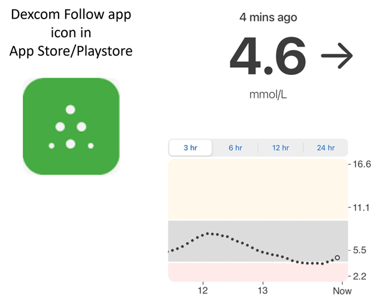
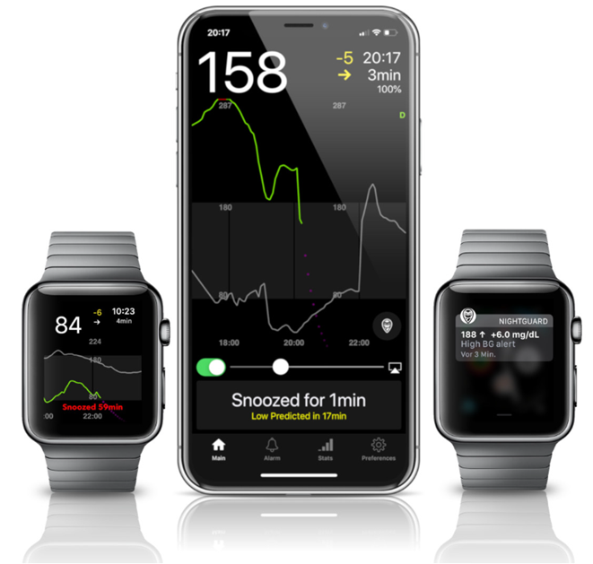
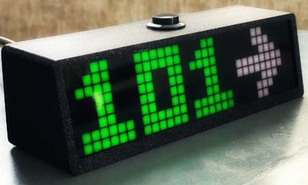

# AAPS folgen (keine Interaktion mit dem AAPS-System)

Zusätzlich zu den Möglichkeiten zum Folgen _und_ der Remote-Steuerung von **AAPS**, die unter [Remote-Steuerung](../RemoteFeatures/RemoteControl.md)beschrieben werden, gibt es mehrere zusätzliche Apps und Geräte, die die Community entwickelt hat, um leicht den Werten (Glukosewerte und anderen Informationen) folgen zu können, ohne mit **AAPS** zu interagieren.

Einen guten Überblick über die vielen Möglichkeiten **AAPS** folgen zu können, findest Du auf der [Nightscout-Follower](https://nightscout.github.io/nightscout/downloaders/#)-Webseite.

```{contents} Table of contents
:depth: 1
:local: true
```

Die häufigsten Strategien im Zusammenhang mit **AAPS** werden weiter unten erläutert.

## Smartphone Apps

```{contents} These are some of the main “follower” apps used by **AAPS** users. All of these apps are “free”: 
:depth: 1
:local: true
```

### Dexcom Follow ([Android](https://play.google.com/store/apps/details?id=com.dexcom.follow.region2.mgdl) und [iOS](https://apps.apple.com/fr/app/dexcom-follow-mg-dl-dxcm2/id1032203080))



* Dexcom Follow ist mit vielen Smartphones kompatibel (sowohl Android als auch iPhone). Dexcom Follow kann, auch wenn Du nicht die offiziellen Dexcom App nutzt, dazu genutzt werden, Sensordaten zu empfangen.

* Viele Betreuende kennen Dexcom Follow und finden die klare Benutzeroberfläche besser als etwas Kompliziertes.

* Dexcom Follow eignet sich besonders gut für Menschen (z. B. Lehrer/Großeltern), die sehr wenig über Diabetes und Glukosewerte wissen. It has customizable alerts (BG level, what sound to play etc.). Alarme können bei Bedarf komplett abgeschaltet werden. Das kann z.B. in Situationen, in denen der Sensor noch nicht zuverlässig läuft und falsche tiefe Werte anzeigt, hilfreich sein.

#### Dexcom Follow konfigurieren: Schritt-für-Schritt-Anleitung

Wenn Du die inoffizielle Dexcom App BYODA für das Auslesen der Sensorwerte nutzt, kannst Du weitere Follower aus der BYODA App heraus einladen.

Mittlerweile können aus Drittanbieter-Apps keine Einladungs-Emails mehr an Dexcom-Follower verschickt werden. In xDrip the invite request will just result in the message “invite not sent”.

Du musst die offizielle Dexcom-App installieren, die Einladung senden und dann die offizielle App wieder deinstallieren.

Die Schritte dazu sind folgende:

1)  Installiere die offizielle “Dexcom-App" auf einem _beliebigen_ Smartphone (Android/iPhone). Das kann auch ein Follower-Smartphone sein, wenn es für Dich besser passt. 2)  Logge Dich mit Deinen Dexcom Nutzernamen und  Passwort ein. Nutze dazu die normalen Login-Daten, die Du auch für Dexcom Clarity nutzt (wenn Du ein Dexcom/Clarity Kunde sein solltest). Hast Du noch keinen Dexcom Login, gibt es an dieser Stelle die Möglichkeit einen neuen Login zu erstellen.   
3)  Wische durch die einleitenden Menüs. 4)  Wähle “Kein Code” als Sensorcode aus. 5)  Unter Transmitter-SN wähle "Manuell eingeben" und gib einen gültigen Transmitter-Code ein (z. B. den eines bereits abgelaufenen Transmitters, damit dieser sich nicht mit einen laufenden Transmitter in die Quere kommt). Das Format ist ein Abfolge von Zahlen und Buchstaben: “ZBZZZB” einer bestimmten Kombination. Daher ist es am einfachsten einen Code eines alten Transmitters zu verwenden. 6) Sobald die App versucht, den Transmitter und den Sensor zu finden, kannst Du Follower einladen: Wähle die kleinen drei Punkte oben links in der App aus und füge einen neuen Follower hinzu. Wenn einer Deiner Follower ein neues Samrtphone hat, kannst Du diesen Weg auch nutzen,  um ihm/ihr - sofern nötig - eine neue Einladung zu schicken. An der Stelle löscht Du die Person zunächst aus der Follower-Liste und verschickst dann eine neue Einladungs-E-Mail, die dann auf dem neunen Smartphone ankommt. 7)  Lade die Dexcom Follow App auf das Follower-Smartphone herunter (iPhone: App Store oder Android: Play) und installiere sie. Richte die Dexcom Follow App ein. Während der Einrichtung wirst Du dazu aufgefordert, die E-Mail mit der Follower-Einladung zu öffnen.    
8)  Jetzt kannst Du die offizielle Dexcom G6 App deinstallieren.

For Dexcom Follow, the sensor data is then exported from the **AAPS** phone either directly from BYODA, or from xDrip, depending on which app you are using.


### [Nightguard](https://apps.apple.com/fr/app/nightguard/id1116430352) (iOS)



Vorteile (von Nutzenden gemeldet):

* Im [App Store](https://apps.apple.com/us/app/nightguard/id1116430352) verfügbar, nutzerfreundliches Interface, einfach.

* Wischen einer Schaltfläche oder schütteln des iPones zum Schlummern der Alarme für verschiedene Dauern (5 Minuten bis zu 24 Stunden)

* Anpassbare Alarme (Hoch-/Niedrig-Alarm, keine Sensordaten seit 15-45 Minuten).

* Schneller Anstieg/Fall für 2-5 aufeinanderfolgende Sensordaten (Du entscheidest). Du bestimmst auch das Delta zwischen zwei Sensorwerten

* Intelligentes Schlummern, sodass es keinen Alarm gibt, wenn der Glukosewert sich in die richtige Richtung bewegt

* Es gibt einen Reiter "Care" (Behandlungen) auf dem neue temporäre Ziele für einen bestimmten Zeitraum gesetzt, temporäre Ziele gestoppt und Kohlenhydrate eingegeben werden können.

Nachteile (von Nutzenden gemeldet)

* Nur für iOS verfügbar

* Das temporäre Ziel wird immer als 5 mmol angezeigt, unabhängig davon welche Höhe eingestellt wurde

* Die konkrete temporäre Basalrate wird nicht angezeigt, auch wenn ein laufendes temporäres Basal angezeigt wird

### [Nightwatch](https://play.google.com/store/apps/details?id=se.cornixit.nightwatch) (Android)


* Nightwatch bezeichnet sich selbst als ein Nightscout-Client und es überwacht die Nightscout-Glukosewerte des Nutzenden auf einem Android Smartphone oder Tablet.

* Die App kann aus [Google Play](https://play.google.com/store/apps/details?id=se.cornixit.nightwatch) heruntergeladen werden und zeigt die Glukosewerte in Echtzeit an.

* The user can be alerted with customized noisy low and high alarms set.

* Glukosewerte können sowohl in mmol/L als auch in mg/dl angezeigt werden.

* Android 5.0 oder höher sind vorausgesetzt.

* Es hat eine dunkle Benutzeroberfläche, große Anzeigen und Schaltflächen für die Benutzung in der Nacht.

### xDrip (Android)

You can use xDrip as a follower.

#### Wenn Du Nightscout nutzt ...

Set xDrip as a Nightscout Follower. Du kannst damit Glukosewerte und Behandlungsdaten empfangen, nicht jedoch das Basal.


#### Without Nightscout - xDrip BG data source

If your **AAPS** data source is xDrip (or if xDrip can also receive BG from another app like BYODA, Juggluco, ...) you can use it from the master phone to share data with xDrip followers, displaying BG, treatments and basal rates.


#### Without Nightscout - xDrip BG companion app

If your **AAPS** data source is not xDrip but you can display BG data from the Companion App data source, you can use it from the master phone to share data with xDrip followers, displaying BG, treatments and basal rates.


### xDrip4iOS (iOS)


xDripSwift stammt von der ursprünglichen xDrip-App ab, wurde auf iOS portiert und entwickelte sich dann weiter zu "xDrip for iOS" (**xDrip4iOS** ).

```{admonition} Further detail about how to attempt to obtain the original **xDrip4iOS** app
:class: dropdown
Die [xDrip4iOS Facebook-Gruppe](https://www.facebook.com/groups/853994615056838/announcements) ist die wichtigste Community-Unterstützung für xDrip4iOS und Shuggah. **xDrip4iOS** kann sich mit vielen verschiedenen CGM-Systemen und -Transmittern verbinden und Glukosewerte, Diagramme und Statistiken anzeigen und Alarme auslösen. Es kann auch zu Nightscout hochladen oder als [Follower-App für Nightscout](https://xdrip4ios.readthedocs.io/de/latest/connect/follower/) fungieren. 

"Wie bekomme ich **xDrip4iOS** für mein iPhone?"
Es gibt zwei Möglichkeiten:

1. Wenn Du einen Mac und einen Apple Developer Account (99 EUR/USD pro Jahr) hast, kannst Du Dein eigenes xDrip4iOS erstellen, indem Du [den folgenden Anweisungen folgst:](https://xdrip4ios.readthedocs.io/en/latest/install/build/).

Wenn Du möchtest, kannst Du dann zu einem Herausgeber („Releaser“) werden, [einen persönlichen Testflight xDrip4iOS](https://xdrip4ios.readthedocs.io/en/latest/install/personal_testflight/) mit bis zu 100 anderen Personen teilen, um ihnen auf diese Weise zu helfen.

2. Du trittst der [xDrip4iOS Facebook-Gruppe](https://www.facebook.com/groups/853994615056838/announcements) bei und verfolgst die „pinned posts“, die die derzeit verfügbaren Möglichkeiten die App zu bekommen, beschreiben. **Du solltest nicht um eine Einladung zur App** bitten (lies die Gruppenregeln).
```


„Was ist **Shuggah**?“ Eine Gruppe ukrainischer Entwickelnder nahm den xDrip4iOS Projektcode (der öffentlich auf Github verfügbar ist) und veröffentlichte ihn unter einem Firmenkonto im App Store. Das Shuggah-Release wird nicht von den xDrip4iOS Entwickelnden gemanagt.

Die [xDrip4iOS Facebook-Gruppe](https://www.facebook.com/groups/853994615056838/announcements) unterstützt xDrip4iOS und die zugehörigen Apple Watch Apps.

### [Sugarmate](https://apps.apple.com/fr/app/sugarmate/id1111093108) (iOS)


[Sugarmate](https://sugarmate.io/) kann auf iPhones aus dem App Store heruntergeladen werden. Sugarmate ist kompatibel mit:
* Apple iPhone (benötigt Software ab Version 13.0 oder höher)
* Apple iPhone (benötigt Software ab Version 13.0 oder höher)
* Google Android (speichere die Web-App auf Deinem Startbildschirm)

Es wurde von Sugarmate-Nutzenden berichtet, dass es in den USA mit Apple CarPlay genutzt werden kann, um Glukosewerte während des Fahrens anzuzeigen. Ob das in Ländern außerhalb der USA auch möglich ist, ist noch nicht geklärt. Wenn Du mehr dazu wissen solltest, ergänze Deine Informationen hier in der Dokumentation, indem Du einen Pull-Request (link), der schnell gemacht ist, machst.


### [Spike](https://spike-app.com/) (iOS)


Spike kann sowohl aus Hauptempfänger (Receiver) als auch als Follower-App verwendet werden. Es hat eine Glukosewert-Anzeige, Alarme und aktives Insulin im Funktionsumfang.

Die Website und die App werden nicht mehr weiterentwickelt. Support bekommst Du auf [Facebook](https://www.facebook.com/groups/1973791946274873) oder [Gitter](https://gitter.im/SpikeiOS/Lobby).

## Smartwatches zur **AAPS-Überwachung** (vollständige Profilinformationen oder nur Glukosewerte), wobei **AAPS** auf einem Smartphone läuft.

Schaue [hier](../Getting-Started/Watches.md) nach.


## Geräte, um AAPS zu folgen

```{contents} Devices include:
:depth: 1
:local: true
```

### M5 Stack


Der [M5Stack](https://github.com/mlukasek/M5_NightscoutMon/wiki) ist eine kleine Box, die für verschiedene Anwendungen programmiert werden kann. Eine dieser Anwendungen ist die Anzeige von Glukosewerten, den entsprechenden Verläufen, den wirkenden Kohlenhydraten und des aktiven Insulins. Es ist in einem Plastikgehäuse untergebracht und hat neben einem Farb-Display auch einen Micro-SD-Karten-Steckplatz, 3 Tasten, einen Lautsprecher und einen internen Akku. Es ist ein großartiger Glukose-Monitor und ist, wenn Du eine Nightscout-Seite hast, recht einfach einzurichten. Normalerweise wird er im WLAN zu Hause genutzt, aber es gibt auch einige Menschen, die ihn unterwegs auf dem Motorrad mit dem Smartphone-Hotspot verwenden.

### Sugarpixel

SugarPixel ist ein Gerät, dass als Zweitanzeige für Glukosewerte und Alarme genutzt wird. Es wird mit der Dexcom App oder der Nightscout App auf dem Smartphone verbunden und man kann dann damit die Glukosewerte permanent verfolgen. Das Gerät zeigt die Glukosewerte in Echtzeit an. This CGM hardware monitor benefits from random tone generation audio alerts (which are incredibly loud), vibration alerts for hearing impaired, customizable display options and native multi-user following.




* SugarPixel has multiple display options in mg/dL and mmol/L to suit the user’s needs with color-coded glucose values.
* In der Standardanzeige wird der Glukosewert, ein Trendpfeil und die Veränderung (Delta) angezeigt. Delta ist die Veränderung + oder - seit dem letzten Messwert.
* SugarPixel can be customized for use in low brightness with the BG and Time face to see the user’s BG reading and current time on the user’s nightstand.
* SugarPixel’s color face uses the entire display to show a single color representing the BG value. Damit kann man die Glukosewerte auch auf große Entfernungen durch das Fenster erkennen, während im Hof, qauf der Terrasse oder im Planschbecken oder Pool gespielt wird.
* Die "Big BG"-Anzeige ist Brillen- und Kontaktlinsen-Tragenden zu empfehlen.

### Nightscout Clock auf einem Ulanzi TC001

**Nightscout Clock** ist eine Open-Source-Software, die auf einem **Ulanzi TC001** läuft. Es verbindet sich mit den Dexcom-Servern oder Nightscout und zeigt Glukosewerte in Echtzeit an.


* Sie kann sowohl mmol/l als auch mg/dl-Einheiten anzeigen und hat hörbare Alarme.
* Es gibt verschiedene Anzeigemöglichkeiten. Die [Github nightscout-clock](https://github.com/ktomy/nightscout-clock?tab=readme-ov-file#more-information-for-people-who-needs-it)-Seite gibt Dir einen Überblick.
* Das Einrichten und Konfigurieren des Geräts erfordert nur ein paar einfache Schritte. Nach der Einrichtung benötigt es nur Strom und WLAN.
* Das Ulanzi TC001 ist preislich deutlich günstiger als das SugarPixel.
* Die Software zusammen mit den Installationsanweisungen findest Du auf [Github nightscout-clock](https://github.com/ktomy/nightscout-clock?tab=readme-ov-file).
* Es wird von Artiom Kenibasov entwickelt und gepflegt. Hilfestellung bekommst Du über die [AAPS-Facebook-Gruppe](https://www.facebook.com/groups/cgminthecloud/posts/8776932509094594/).

### PC (TeamViewer)
Zur Remote-Fehlerbehebung hat sich für einige Konstellationen ein Fernüberwachungs-Tool wie z. B. [TeamViewer](https://www.teamviewer.com/) bewährt.
