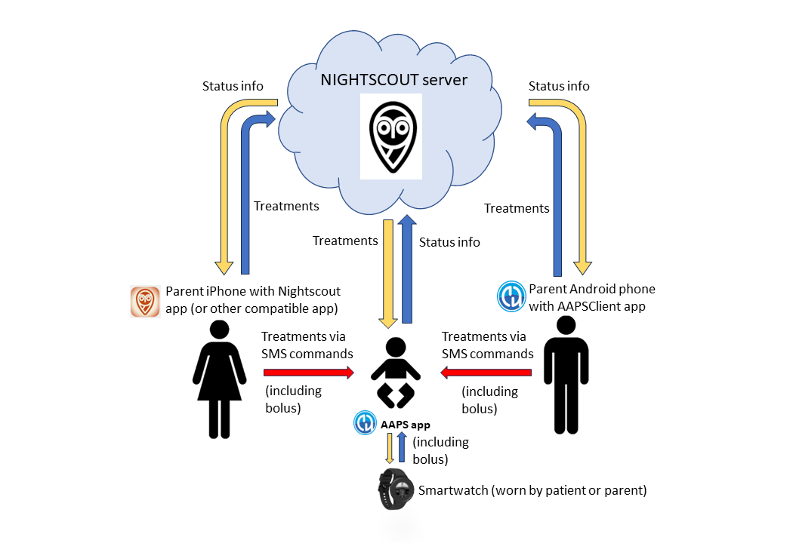
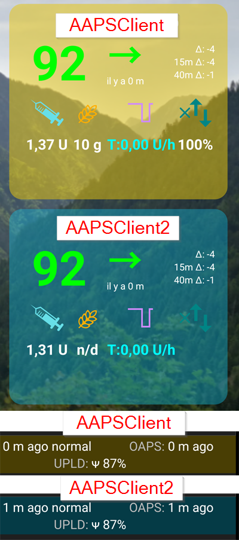
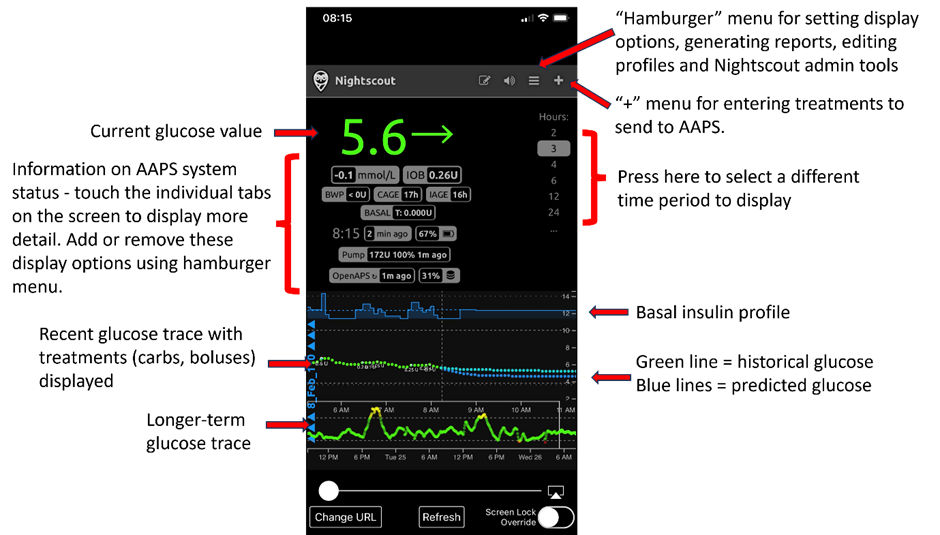
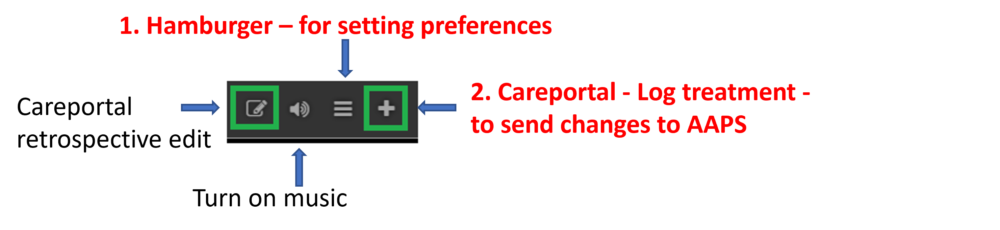
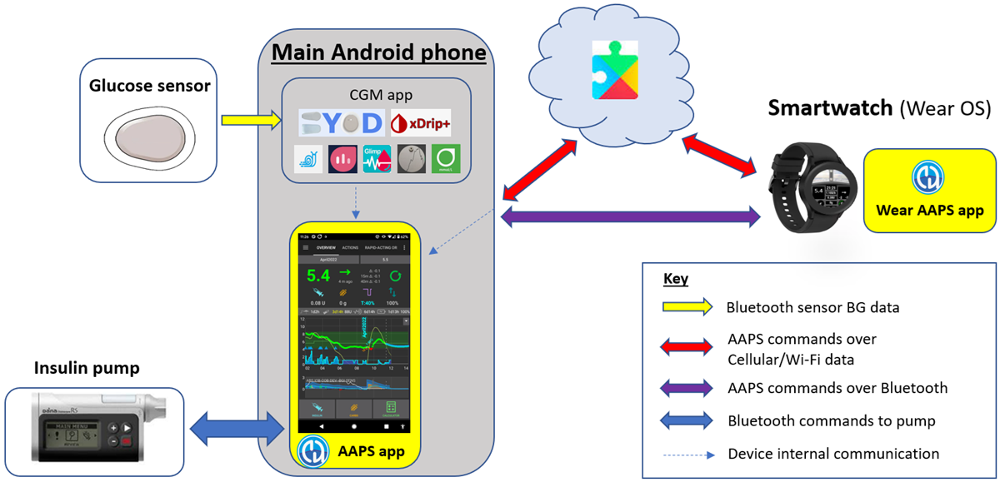
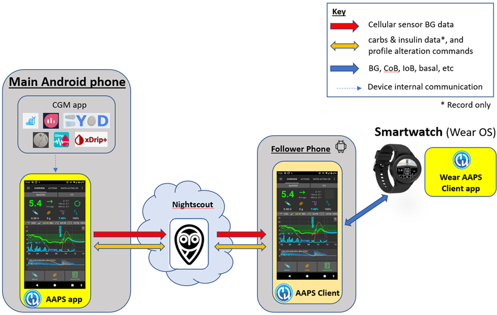
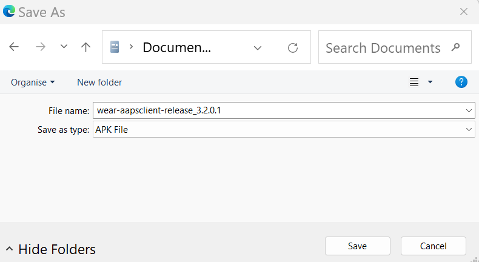

# AAPS remote steuern

```{contents} In this page
:backlinks: entry
:depth: 2
```

Es gibt vier sehr wirkungsvolle Wege, **AAPS** remote zu steuern:

1) [SMS-Befehle](#RemoteControl_SMS-Commands) (das Follower-Smartphone kann Android oder iOS nutzen), 2) [AAPSClient](#RemoteControl_aapsclient) (das Follower-Gerät ist ein Android-Smartphone oder -Tablet oder ein Windows-, Mac- oder Linux-Computer; auf einem iPhone [erstellst Du die App selbst](#aapsclient-iphone)) 3) [Nightscout](#RemoteControl_nightscout) (Android, iOS oder anderer Computer bzw. anderes Gerät), vor allem zum Folgen: siehe den Hinweis zur [Client-Steuerung](#client-master-control) in diesem Abschnitt.  
4) [Smartwatches](#RemoteControl_smartwatches) (Android)

Die ersten drei sind meist für Pflegende/Eltern geeignet und Smartwatches sind **zusätzlich** für Erwachsene mit Diabetes sehr hilfreich.



(RemoteControl_SMS-Commands)=

## 1) SMS-Befehle

Hierzu gibt es die gesonderte Seite [SMS-Befehle](../RemoteFeatures/SMSCommands.md).

(RemoteControl_aapsclient)=
## 2) AAPSClient

**AAPSClient** sieht **AAPS** selbst sehr ähnlich und bietet den Betreuenden dieselben Bildschirme und Schaltflächen, um Remote-Befehle an **AAPS** zu senden:


(remotecontrol-aapsclient-versions)=
### Über AAPSClient, AAPSClient2 und AAPSClient3

Es gibt 3 Versionen der Client-App: **AAPSClient**, **AAPSClient2** und **AAPSClient3**. Sie funktionieren gleich. Der einzige Unterschied: Sie lassen sich nebeneinander auf demselben Follower-Smartphone installieren.

Wer einer Person folgt, braucht nur **AAPSClient**. Um einer zweiten Person (mit eigener **Nightscout**-Seite und eigenem **AAPS**-Smartphone) zu folgen und ihr AAPS fernzusteuern, installiere zusätzlich **AAPSClient2**, und für eine dritte Person **AAPSClient3**. Jede App wird einzeln eingerichtet und mit der **Nightscout**-Seite und dem **AAPS**-Smartphone der Person [gekoppelt](#aapsclient-pairing-with-the-master), der sie folgt.

Damit Du die Apps auseinanderhalten kannst, haben einige Elemente eine andere Farbe: gelb für **AAPSClient**, blau für **AAPSClient2** und grün für **AAPSClient3**. Diese Elemente sind das App-Symbol, der Widget-Hintergrund und der **AAPS**-Statusbereich auf dem Startbildschirm der App. <br/> Hinweis: Die Deckkraft des Widget-Hintergrunds kann in der Widget-Konfiguration eingestellt werden. Bei geringer Deckkraft ist die Farbe schwer zu erkennen.



### Herunterladen und Installieren

**AAPSClient** kann auf einem einzigen Smartphone oder mehreren Follower-Smartphones installiert werden (z.B. auf das Follower-Smartphone des ersten Elternteils und des zweiten Elternteils), um so beiden die Möglichkeit zu geben das zugehörige **AAPS**-Master-Smartphone remote zu steuern.

Um **AAPSClient** herunterzuladen, gehe zum [GitHub-Repository](https://github.com/nightscout/AndroidAPS/releases/) und klicke auf das Asset **„app-AAPSClient-release_x.x.x.x“** (es kann eine neuere Version sein als im Screenshot unten):


Gehe dann in Deinen _Downloads_-Ordner auf Deinem Computer. Unter Windows werden die _Downloads_ im Menüband rechts angezeigt:


Nach dem Herunterladen klicke auf _im Ordner anzeigen_, um die Datei dort zu finden.

Die **AAPSClient** apk kann nun entweder:

Mit einem USB-Kabel auf das Follower-Smartphone übertragen werden, oder in einen Google-Drive Ordner gezogen werden und dann auf das Follower-Smartphone durch klicken auf app-"AAPSClient-release-"-Datei gebracht werden.

Brauchst Du **AAPS** für Dich selbst und **AAPSClient**, um jemand anderem zu folgen, musst Du **AAPSClient** selbst erstellen, statt es wie oben beschrieben aus dem GitHub-Repository herunterzuladen. Der Grund dafür ist, dass mit unterschiedlichen Schlüsseln signierte Apps (**AAPS** und **AAPSClient**) nicht auf dem gleichen Smartphone installiert werden können. <br/> Um den **AAPSClient** selbst zu erstellen, folge dem Prozess eines [herkömmlichen AAPS Builds](../SettingUpAaps/BuildingAaps.md). An der Stelle **Generate signed App Bundle or APK**, wählst Du anstelle von **fullRelease** in diesem Fall **aapsclientRelease** aus.

Dieselbe Regel gilt, wenn Du mehrere Client-Apps (**AAPSClient**, **AAPSClient2**, **AAPSClient3**) auf einem Follower-Smartphone installierst: Sie müssen alle mit **demselben Schlüssel** signiert sein. Andernfalls verweigert Android die Installation der zweiten App (Fehler `INSTALL_FAILED_DUPLICATE_PERMISSION`).

### Synchronisierung: AAPSClient und AAPS einrichten

Ist die __AAPSClient__-APK auf dem Follower-Smartphone installiert, stelle sicher, dass **NSClientV3** auf beiden Smartphones für Nightscout 15 gleich eingerichtet ist (siehe [Update-Anleitung](../Maintenance/UpdateToNewVersion.md)). Das folgende Beispiel zeigt die Einrichtung der Synchronisierung mit NSClientV3 und Nightscout 15; in __AAPS__ gibt es auch andere Datenquellen (z. B. xDrip).

Unter **Konfiguration** > **Kommunikation** synchronisierst Du Deine Daten über __NSClientV3__ (mit der v3-API) mit Nightscout, und zwar auf dem __AAPS__- und dem Follower-Smartphone auf dieselbe Weise.


Stelle sicher, dass __beide__ Smartphones, das AAPS- und das AAPSClient-Smartphone, miteinander synchronisiert sind, indem Du auf jedem NSClientV3 einrichtest. Auf dem Follower-Smartphone geht das stattdessen auch durch Scannen eines QR-Codes, den **AAPS** anzeigt, siehe unten [AAPSClient mit AAPS koppeln](#remotecontrol-pairing):

- Gib in den **Einstellungen** von NSClientV3 Deine **Nightscout-URL** ein

- Gib in denselben Einstellungen Dein **Nightscout Zugriffstoken** ein. Bitte folge den Hinweisen [hier](https://nightscout.github.io/nightscout/security/#create-a-token). Nutze auf dem **AAPS**-Smartphone ein **Admin-Token**: Damit erstellt **AAPS** für jedes Follower-Smartphone ein eigenes Token.

- Aktiviere auf **beiden** Smartphones **Websockets verwenden**. Auf dem **AAPS**-Smartphone sind Websockets für die Remote-Steuerung **erforderlich**: Ohne sie kann **AAPS** keine Befehle von **AAPSClient** empfangen. Auf beiden Smartphones beschleunigen sie außerdem die Synchronisierung, bei etwas höherem Akkuverbrauch.


Stelle sicher, dass sowohl __AAPSClient__ als auch __AAPS__ auf dem Bildschirm **NSClientV3** des jeweiligen Smartphones „verbunden“ anzeigen. Jetzt folgt **AAPSClient** zwar **AAPS** (Glukosewerte, Behandlungen, Profil), kann es aber noch nicht steuern: Kopple die beiden Smartphones wie unten beschrieben.

(remotecontrol-pairing)=
### AAPSClient mit AAPS koppeln (Remote-Steuerung)

Ab **AAPS**-Version 4 steuert **AAPSClient** **AAPS** über eine sichere, **gekoppelte** Verbindung. Synchronisierung allein reicht nicht: Solange die Smartphones nicht gekoppelt sind, zeigt **AAPSClient** nur **Verwalten** mit einem schreibgeschützten **Profil** und **Mit Master koppeln**.

1. Öffne auf dem **AAPS**-Smartphone **Verwalten → Autorisierte Clients** und schalte **Client-Steuerung erlauben** ein (standardmäßig aus, im Einfachen Modus immer an).
2. Tippe auf **+**, gib einen Namen für das Follower-Smartphone ein, wähle, wie es eingerichtet wird, und wähle seine **Rolle**:
   - **QR-Code: Nightscout und Kopplung** – **AAPS** zeigt einen QR-Code, der auf dem Follower-Smartphone Nightscout einrichtet und es mit einem Scan koppelt. Dafür braucht es ein Admin-Token in den NSClientV3-Einstellungen des **AAPS**-Smartphones.
   - **PIN** – für ein Follower-Smartphone ohne Kamera, das bereits mit Nightscout verbunden ist: Notiere die einmalige **PIN** (etwa zwei Minuten gültig).
3. Scanne auf dem **AAPSClient**-Smartphone den Code (im Einrichtungsassistenten oder über **Verwalten → Mit Master koppeln → QR-Code scannen**) oder öffne **Verwalten → Mit Master koppeln** und gib die PIN ein. Bestätigen.

Das Follower-Smartphone erscheint dann in der Liste **Autorisierte Clients** als **Aktiv**, und **AAPSClient** zeigt **Behandlungen**, **Szenen** und **Verwalten**. Das Follower-Smartphone bekommt ein eigenes Nightscout-Token mit genau den Rechten, die es braucht. Die vollständige Anleitung mit Screenshots und Fehlerbehebung findest Du unter [Master ↔ Client-Steuerung](#client_master_master_setup).

Prüfe, ob die Einrichtung funktioniert: Gib in **AAPSClient** Kohlenhydrate ein, bestätige die angezeigte Menge und prüfe, ob der Eintrag auf beiden Smartphones unter **Behandlungen** erscheint.

(remotecontrol-nightscout-access-token)=

### Probleme mit der Konfiguration des „Nightscout Zugriffstoken“ beheben

Die genaue Konfiguration des „Nightscout Zugriffstoken“ kann davon abhängen, ob Deine Nightscout-Seite bei einem kostenpflichtigen Anbieter gehostet wird oder nicht.

Hast Du Probleme, dass **AAPS** das „Nightscout Zugriffstoken“ annimmt, und nutzt Du eine kostenpflichtig gehostete Nightscout-Seite, wende Dich am besten zuerst an Deinen Nightscout-Anbieter, um die Probleme mit dem Token zu lösen. In allen anderen Fällen wende Dich an die **AAPS**-Gruppe. Bitte prüfe im Vorfeld, ob Du die [hier](https://nightscout.github.io/nightscout/security/#create-a-token) beschriebene Anleitung genau durchgegangen bist.

### Was AAPSClient bietet

Ist **AAPSClient** gekoppelt, bietet es den Betreuenden fast dieselben Bildschirme wie **AAPS** selbst:

- **Behandlungen**: Insulinbolus, Kohlenhydrate und Bolus-Rechner.
- **Szenen**: [Szenen](../DailyLifeWithAaps/Scenes.md) starten und beenden.
- **Verwalten**: Profile, Insulineinstellungen, temporäre Ziele, QuickWizard, Automatisierung, Lebensmittel, Wechsel der Setzstellen, Kopplung und die laufende temporäre Basalrate.
- **Hauptmenü**: Behandlungen, Historie, Statistiken, Wartung, Konfiguration.

Auf **AAPSClient** gibt es keine Pumpe und keine Ziele. Eine ausführliche Beschreibung findest Du unter [Die AAPSClient-App](AapsClient.md).

Mit **AAPSClient** können Betreuende die meisten Anpassungen, die direkt in **AAPS** möglich sind, **einschließlich Insulinboli**, als Remote-Anpassungen über das Mobilfunk- oder Internetnetz vornehmen. Jeder Befehl wird signiert und über Nightscout an das **AAPS**-Smartphone gesendet, das ihn mit seinen eigenen Daten prüft, begrenzt, Dir seine eigene Bestätigung zeigt und ihn erst dann ausführt. **AAPSClient** _kann_ deutlich schneller sein als [SMS-Befehle](../RemoteFeatures/SMSCommands.md), besonders bei Befehlen, die eine Authentifizierung bräuchten.

Auf anderem Weg in Nightscout eingegebene Behandlungen (zum Beispiel über die Nightscout-Website) werden nicht übernommen, solange die Client-Steuerung eingeschaltet ist: **AAPS** ist dann im [Geschützten Modus](#client-master-control-hardened-mode) und nimmt Änderungen nur von gekoppelten Clients an. Ist die Client-Steuerung aus, werden sie nur übernommen, wenn die passenden **Empfangen**-Optionen im [Bereich Synchronisierung der NSClient-Einstellungen](#Preferences-nsclient-synchronization) aktiviert sind.

Die Remote-Steuerung über **AAPSClient** wird nur empfohlen, wenn Deine Synchronisierung gut funktioniert (_d. h._ Du siehst keine ungewollten Datenänderungen wie selbstständige Änderungen von TT, TBR usw.).

### AAPSClient mit Smartwatch-Optionen

Eine Smartwatch kann sehr nützlich sein, um bei Kindern **AAPS** zu managen. Es sind einige verschiedene Konfigurationen möglich. Auf einer kompatiblen Smartwatch kann die [**AAPSClient WearOS**- App](https://github.com/nightscout/AndroidAPS/releases/) installiert werden, die mit der **AAPSClient**-App auf dem Smartphone des Betreuenden (z. B. Elternteil) verbunden wird. Sie zeigt den aktuellen Glukosewert und den Loop-Status. Ist **AAPSClient** mit **AAPS** gekoppelt, werden die Aktionen der Smartwatch (einschließlich Boli, Kohlenhydraten, temporären Zielen und Profilwechseln) über **AAPSClient** an **AAPS** weitergeleitet, das sie bestätigt und ausführt: siehe [Wear OS auf einem Client](#clientmastercontrol-wear-os-on-a-client). [Hier](#remotecontrol-smartwatches) kannst Du mehr über Smartwatches erfahren.

(RemoteControl_nightscout)=
## 3) Nightscout

Genauso wie es Nightscout als einen Server "in der Cloud" gibt, gibt es auch eine dedizierte **Nightscout**-App, die über den App Store direkt auf Dein iPhone heruntergeladen werden kann. Für ein Android-Follower-Smartphone gibt es keine eigene Nightscout-App. Nutze in diesem Fall am besten [**AAPSClient**](#RemoteControl_aapsclient). Wenn Du nur folgen und keine Behandlungen senden möchtest, kannst Du auch die [Nightwatch](https://play.google.com/store/apps/details?id=se.cornixit.nightwatch)-App aus dem Play Store herunterladen und installieren.

Sobald Du die **Nightscout**-App auf Deinem iPhone installiert hast, öffne die App, folge den Anweisungen für die Einrichtung und gib Deine Nightscout-Adresse (siehe links unten) ein. Je nach Anbieter bei dem Deine Nightscout-Seite läuft, kann es etwas anders aussehen. (_z. B._ http://deineadresse.herokuapp.com). Gib dann Dein Nightscout API secret (Passwort) ein (siehe rechts unten). Wenn Du nicht nach Deinem API-Passwort gefragt wirst, klickst Du oben in der App auf das Schloss-Symbol und gibst es dann ein:


Weitere Informationen zur Einrichtung findest Du direkt bei [Nightscout](https://nightscout.github.io/nightscout/discover/)

Wenn Du Dich das erste Mal einloggst, wirst Du noch eine sehr einfach gestaltete Ansicht sehen. Passe die Anzeige an, indem Du das „Hamburger“-Menü oben rechts auswählst und nach unten scrollst:


Scrolle bis zu den „Einstellungen“ herunter. Die Darstellung der Glukosewerte erfolgt standardmäßig "logaritmisch". Das kannst Du unter "Skalierung" auf "Linear" ändern. Um das Basal der Pumpe einzublenden, ändere unter dem Abschnitt "Basalraten-Darstellung" den Wert auf "Standard“.


Wähle Deine gewünschten Optionen aus. Deaktiviere die Alarme, wenn Du für die Alarmierung andere Apps nutzt.


Scrolle weiter herunter bis zum Abschnitt "Zeige Plugins".

Wichtig ist, dass dort “Behandlungs-Portal” ausgewählt ist. In diesem Abschnitt kannst Du einige andere Metriken zusätzlich auswählen, von denen Aktives Insulin, Behandlungs-Portal, Pumpe, Kanülenalter, Insulin-Alter, Basalraten-Profil, und OpenAPS am nützlichsten sind.

Wichtig ist, dass Du nach Deinen Änderungen unten auf "Speichern“ klickst, damit diese Änderungen wirksam werden.


Nach dem Drücken von „Speichern“ wird die App zum Hauptbildschirm der Nightscout-App zurückkehren. Es sollte ungefähr so aussehen:

1. Aktueller Glukosewert
2. Informationen zum AAPS-Systemstatus - Tippe auf die einzelnen Registerkarten des Bildschirms, um mehr Details anzuzeigen. Lösche bzw. füge mit dem Hamburger-Menü die anzuzeigenden Informationen hinzu.
3. Glukoseverlauf mit den entsprechenden Behandlungen (Kohlenhydrate, Boli) wird angezeigt
4. Längerfristiger Glukoseverlauf
5. „Hamburger“-Menü zum Einstellen der Anzeigeoptionen, Erstellung von Berichten, Bearbeitung von Profilen und den Nightscout Admin-Tools
6. Menü „**+**“ zur Eingabe von Behandlungen (wann **AAPS** sie übernimmt, steht [unten](#RemoteControl_nightscout-treatments)).
7. Ändern des Anzeige-Zeitraums
8. Basalrate (basales Insulinprofil)
9. Grüne Linie = historische Glukosewerte Blaue Linien = prognostizierte Glukosewerte



Schauen wir uns das obere linke Menü der Nightscout-App etwas genauer an:

1. Behandlungen rückwirkend ändern
2. Alarme ein-/ausschalten
3. Hamburger - für Einstellungen
4. Careportal – Behandlung erfassen (wann **AAPS** diese übernimmt, steht [unten](#RemoteControl_nightscout-treatments))



Es gibt auf diesem Bildschirm eine Vielzahl an Statusinformationen des **AAPS**-Systems in den grauen Tabs (und noch mehr Informationen werden angezeigt, wenn Du auf die Tabs tippst):

1. 5 Minuten Glukosetrend
2. Bolus-Assistenten-Vorschau (BWP)
3. Tippe auf „Basal“, um Dein aktuelles Profil und Deine Basal-Informationen zu sehen
4. Zeit seit dem letzten CGM-Messwert in AAPS
5. **Pumpe**: Insulin, Batterie % und wann sie sich das letzte Mal mit AAPS verbunden hat
6. Zeit seit der letzten Aktualisierung von AAPS - wenn es länger als 5 Minuten her ist, kann es auf ein Verbindungsproblem zwischen dem AAPS-Smartphone und der Pumpe/CGM hindeuten
7. Drücke auf IOB, um die Verteilung zwischen von Basal- und Bolusinsulin zu sehen
8. Alter des Insulins im Reservoir
9. Kanülenalter
10. Akkustand des AAPS-Smartphones
11. Größe Deiner Datenbank. Wenn diese zu voll wird (nur DIY Nightscout - bei gehosteten Diensten einfach ignorieren), können Verbindungsprobleme auftreten. Du kannst die Größe durch Datenlöschungen im Admin-Tool-Menü reduzieren (über das Hamburger-Menü).


Tippe auf „Aktualisieren“ am unteren Ende der Seite, um das Popup zu schließen.

(RemoteControl_nightscout-treatments)=
### Behandlungen über die Nightscout-App an AAPS senden

In **AAPS** 4 ist der unterstützte Weg, **AAPS** fernzusteuern, ein **gekoppelter AAPSClient**, siehe [Master ↔ Client-Steuerung](#client-master-control): Jeder Client hat eine [Rolle](#client-master-control-roles), die begrenzt, was er darf, und jeder Befehl wird vom Client signiert und dann vom **AAPS**-Smartphone geprüft und bestätigt. Solange die Client-Steuerung eingeschaltet ist, ist das **AAPS**-Smartphone im [Geschützten Modus](#client-master-control-hardened-mode): Behandlungen, temporäre Ziele und Profilwechsel, die auf der Nightscout-Website oder in der Nightscout-App eingegeben werden, werden **nicht** übernommen. Die Nightscout-App ist dann nur noch ein Werkzeug zum Folgen.

```{admonition} Only when client control is off
:class: warning
Ist **Client-Steuerung erlauben** unter **Verwalten → Autorisierte Clients** ausgeschaltet (und der Einfache Modus aus), übernimmt **AAPS** Careportal-Einträge aus Nightscout nur für die Datenarten, die Du unter **Empfangen** im [Bereich Synchronisierung der NSClientV3-Einstellungen](#Preferences-nsclient-synchronization) eingeschaltet hast: Kohlenhydrate, temporäre Ziele, Profilwechsel und die übrigen Careportal-Einträge. Insulin wird auf diesem Weg nie abgegeben: Ein in Nightscout eingegebener „Korrekturbolus“ wird nur *angekündigt*, und **AAPS** zählt ihn als aktives Insulin, ohne ihn abzugeben. Diese Einrichtung wird für die Remote-Steuerung nicht empfohlen; nutze stattdessen einen gekoppelten **AAPSClient**.
```

Mehr zu den **Nightscout**-Optionen kannst Du [hier](https://nightscout.github.io/) nachlesen

### Tipps, um das Beste aus der Nightscout-App herauszuholen

1). Wenn Du auf einer Seite "hängenbleibst" und zum Hauptbildschirm zurückkehren möchtest, klicke einfach auf „Aktualisieren“ (unten in der Mitte). Das bringt Dich zurück auf den **Nightscout**-Startbildschirm mit der Anzeige der Glukosewerte.

Wenn Du das aktuell auf dem Smartphone laufende Profil sehen möchtest, drücke auf die verschiedenen Symbole oberhalb des Diagramms. Zusatzinformationen (Mahlzeitenfaktoren, Insulin-Empfindlichkeit und Zeitzone etc.) erhältst Du, indem Du auf "Basal“ drückst und hinter "OpenAPS“ sind Informationen zum Profil und das aktuelle Ziel etc. anzeigbar. Der Ladezustand sowohl des Smartphone-Akkus, als auch der Pumpen-Batterie können ebenfalls angezeigt werden. BWP zeigt die Vorhersage des Algorithmus zur voraussichtlichen Entwicklung des aktiven Insulins (IOB) und der aktiven Kohlenhydrate (COB).

#### Andere Menü-Symbole: Was bedeutet der Stift (bearbeiten)?

Du kannst Bleistift (technisch) verwenden, um Bolus- oder Korrekturbehandlungen der letzten 48 Stunden zu verschieben oder zu löschen.

Mehr Details dazu findest Du [hier](https://nightscout.github.io/nightscout/discover/#edit-mode-edit)

Obwohl dies potenziell nützlich sein könnte, um angekündigte (aber nicht gebolte) Kohlenhydrate zu löschen, funktioniert es in der Praxis derzeit nicht gut mit **AAPS** und wir empfehlen diese Änderungen direkt über die **AAPS**-App vorzunehmen.

(RemoteControl_smartwatches)= (remotecontrol-smartwatches)=

## 4) Smartwatches

### Option 1) AAPS von einer Wear-OS-Smartwatch aus steuern



Sobald Du [**AAPS** auf Deiner Smartwatch fertig eingerichtet hast](../WearOS/BuildingAapsWearOS.md), findest Du ausführliche Informationen zu den Smartwatch-Watchfaces und den jeweiligen Funktionen in [Wear AAPS auf einer Smartwatch nutzen](../WearOS/WearOsSmartwatch.md).

Als kurze Übersicht: Die folgenden Funktionen können von der Smartwatch aus gestartet werden:

* temporäres Ziel setzen

* Bolusrechner verwenden (Welche Variablen bei der Berechnung berücksichtigt werden, lässt sich in den Einstellungen auf dem Smartphone festlegen.)

* eCarbs eintragen

* Bolus (Insulin + Kohlenhydrate) abgeben

* Uhreinstellungen

* Status

* Pumpenstatus überprüfen

* Loop-Status überprüfen

* Profil prüfen und ändern, CPP (Circadian Percentage Profile = Zeitverschiebung + Prozentsatz)

* TDD (Total daily dose = Bolus + Basal pro Tag) anzeigen

* Remote-Bolus, wenn das Kind und die betreuende Person an verschiedenen Orten sind (dies ist möglich, wenn die **AAPS**-Smartwatch und das **AAPS**-Smartphone mit dem WLAN verbunden sind)

#### Kommunikation eines Betreuenden zur Smartwatch über andere Apps (wie WhatsApp)

Es können zusätzliche Apps (z. B. WhatsApp) für den Nachrichtenaustausch zwischen Eltern und Kindern auf der Smartwatch installiert werden. Es ist wichtig, dass dem Smartphone nur EIN Google-Konto zugeordnet ist, da die Smartwatch sonst die Daten nicht rüberbringen kann. Du musst 13 oder älter sein, um ein Samsung-Konto zu haben. Das Geburtsdatum muss in der eMail-Adresse hinterlegt sein, die auf dem Android-Smartphone verwendet wird.

Ein Video, das das WhatsApp-Setup für das Senden von Nachrichten auf der Galaxy 4 Smartwatch zeigt, findest Du [hier](https://gorilla-fitnesswatches.com/how-to-get-whatsapp-on-galaxy-watch-4/). Über WhatsApp kannst Du nicht den vollen Funktionsumfang nutzen.

Durch Anpassungen sowohl in der **Galaxy Wearable**-App auf dem **AAPS**-Smartphone als auch auf der Smartwatch, können WhatsApp-Nachrichten mit einem leichten Vibrieren signalisiert und auf dem bestehenden Watchface gezeigt werden.

### Option 2) **AAPS** auf der Smartwatch steuert **AAPS** auf dem Smartphone

Ähnlich wie ein Follower-Smartphone mit **AAPSClient** oder SMS-Befehlen (siehe die Abschnitte oben) kann auch eine Smartwatch genutzt werden, um **AAPS** fernzusteuern und vollständige Profildaten anzuzeigen. Ein wesentlicher Unterschied zum Follower-Smartphone: Die Verbindung zwischen Smartwatch und **AAPS**-Smartphone läuft über Bluetooth und braucht weder Nightscout noch einen Authentifizierungscode. Nebenbei bemerkt: Sind Smartwatch und **AAPS**-Smartphone per Bluetooth verbunden und zusätzlich in einem WLAN bzw. Mobilfunknetz, kommuniziert die Smartwatch auch darüber mit dem **AAPS**-Smartphone, was die Reichweite vergrößert. Dazu gehört auch ein Remote-Bolus, wenn sich die betreuende Person mit der **AAPS**-Smartwatch und das Kind mit Typ-1-Diabetes (mit dem **AAPS**-Smartphone) an verschiedenen Orten befinden, was zum Beispiel nützlich sein kann, wenn das Kind in der Schule ist.

Eine Smartwatch zur Remote-Steuerung ist verschiedensten Situationen komfortabel:

a)  **AAPSClient**- oder **SMS**-Befehle nicht funktionieren können; oder

b)  Du keinen Authentifizierungscode eingeben möchtest (wie bei SMS-Befehlen nötig).

Eine Smartwatch braucht **Wear OS 3 oder neuer**, um **AAPS** steuern zu können. Bitte prüfe die technischen Daten der Smartwatch und sieh Dir die Seite [Smartwatches](../Getting-Started/Watches.md) an. Wenn Du unsicher bist, such oder frag in den **AAPS**-Gruppen auf Facebook oder Discord nach.

Unten findest Du konkrete Anleitungen zur Einrichtung von **AAPS** auf der beliebten Samsung Galaxy Watch 4 (40 mm). Die [Garmin](https://apps.garmin.com/en-US/apps/a2eebcac-d18a-4227-a143-cd333cf89b55?fbclid=IwAR0k3w3oes-OHgFdPO-cGCuTSIpqFJejHG-klBTm_rmyEJo6gdArw8Nl4Zc#0)-Smartwatch ist ebenfalls gerne gewählt. Füge gerne andere Smartwatches und Deine damit gemachten Kompatibilitäts-Erfahrungen in der Dokumentation und [verbessere die Dokumentation](../SupportingAaps/HowToEditTheDocs.md), damit die gesamte **AAPS**-Community davon profitieren kann.

### Option 3) **AAPS** auf dem Smartphone wird über AAPS auf der Smartwatch gesteuert



Die Software für die Smartwatch, die **AAPSClient** Wear-APK, kann direkt von [GitHub](https://github.com/nightscout/AndroidAPS/releases/) heruntergeladen werden.

Um die Software herunterzuladen, klicke auf die Smartwatch-App, die zur Client-App auf dem Smartphone passt: **wear-aapsclient-release_**_Version_ gehört zu **AAPSClient**, **wear-aapsclient2-release_**_Version_ zu **AAPSClient2** (siehe [Über AAPSClient, AAPSClient2 und AAPSClient3](#remotecontrol-aapsclient-versions)):


Dann "Speichern unter" und speichere die Datei an einem Ort Deiner Wahl auf Deinem Computer:





Die **AAPSClient** Wear APK wird genauso auf die Smartwatch gebracht (übertragen und sideloading), wie es im Abschnitt [Übertragen der Wear-App auf Dein AAPS Smartphone](#remote-control-transferring-the-aaps-wear-app-onto-your-aaps-phone) für die die **AAPS** Wear App beschrieben ist.  


