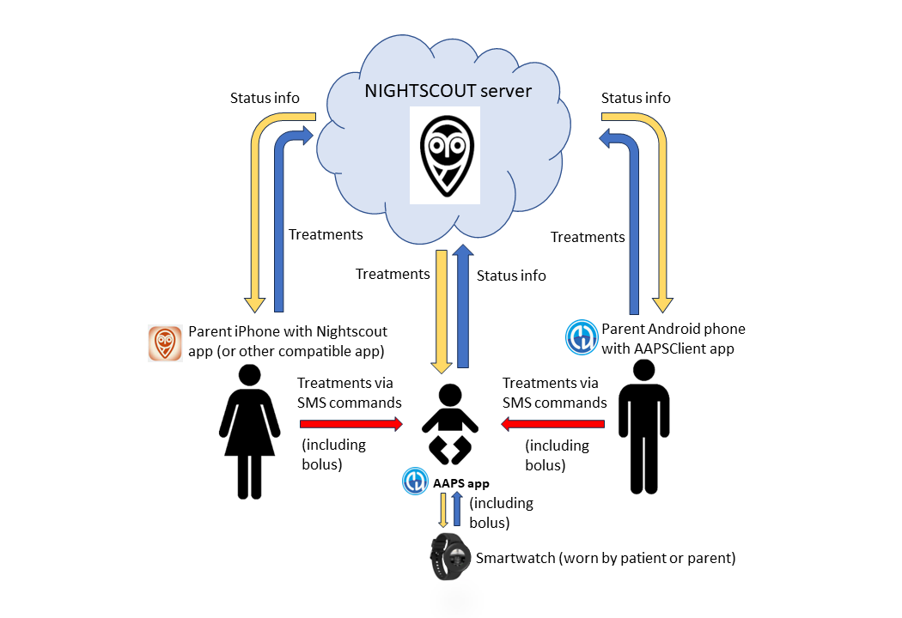
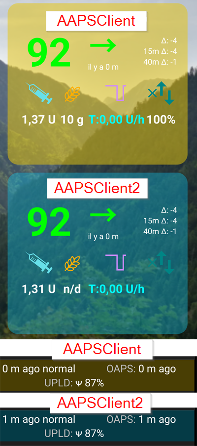
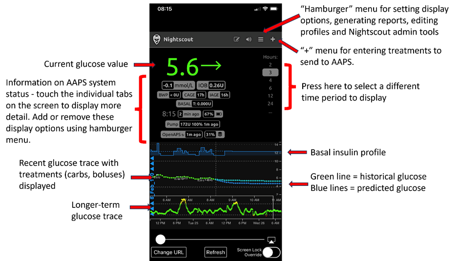
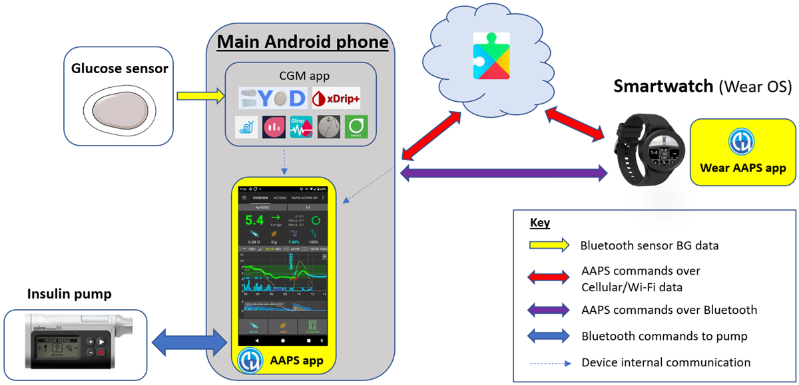
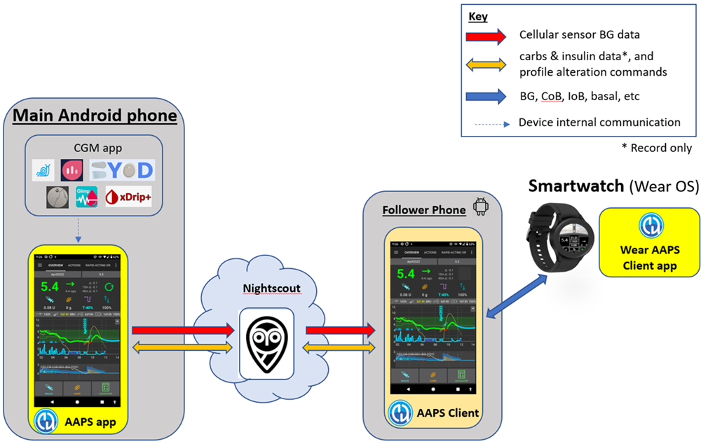

# AAPS remote steuern

```{contents} In this page
:backlinks: entry
:depth: 2
```

Es gibt vier sehr wirkungsvolle Wege, **AAPS** remote zu steuern:

1) [SMS commands](#RemoteControl_SMS-Commands) (follower phone can be either Android or iOS), 2) [AAPSClient](#RemoteControl_aapsclient) (follower phone is Android; an iPhone version is in development) 3) [Nightscout](#RemoteControl_nightscout) (Android, iOS or other computer/device), mainly for following: see the note on [client control](#client-master-control) in that section.  
4) [Smartwatches](#RemoteControl_smartwatches) (Android)

Die ersten drei sind meist für Pflegende/Eltern geeignet und Smartwatches sind **zusätzlich** für Erwachsene mit Diabetes sehr hilfreich.



(RemoteControl_SMS-Commands)=

## 1) SMS-Befehle

Hierzu gibt es die gesonderte Seite [SMS-Befehle](../RemoteFeatures/SMSCommands.md).

(RemoteControl_aapsclient)=
## 2) AAPSClient

**AAPSClient** looks very similar in appearance to **AAPS** itself, offering the caregiver the same screens and buttons to send commands remotely to **AAPS**:


(remotecontrol-aapsclient-versions)=
### About AAPSClient, AAPSClient2 and AAPSClient3

There are 3 versions of the client app: **AAPSClient**, **AAPSClient2** and **AAPSClient3**. They work the same way. The only difference is that they can be installed side by side on the same follower phone.

A caregiver who follows one person needs only **AAPSClient**. To follow and remote control a second person (with their own **Nightscout** site and their own **AAPS** phone), install **AAPSClient2** as well, and **AAPSClient3** for a third person. Each app is set up and [paired](#aapsclient-pairing-with-the-master) on its own, with the **Nightscout** site and the **AAPS** phone of the person it follows.

To tell the apps apart, some elements have a different color: yellow for **AAPSClient**, blue for **AAPSClient2** and green for **AAPSClient3**. Those elements are the app icon, the widget background, and the **AAPS** status section on the home screen of the app. <br/> Note: the opacity of the widget background can be set in the widget configuration. At a low opacity the color is hard to see.



### Herunterladen und Installieren

**AAPSClient** kann auf einem einzigen Smartphone oder mehreren Follower-Smartphones installiert werden (z.B. auf das Follower-Smartphone des ersten Elternteils und des zweiten Elternteils), um so beiden die Möglichkeit zu geben das zugehörige **AAPS**-Master-Smartphone remote zu steuern.

Um den **AAPSClient** herunterzuladen, navigiere zum [Github-Repository](https://github.com/nightscout/AndroidAPS/releases/) und klicke auf das Element **„app-AAPSClient-release_x.x.x.x“** (die im Screenshot unten gezeigte Version kann eventuell älter sein):


Gehe dann in Deinen _Downloads_-Ordner auf Deinem Computer. Unter Windows zeigt -downloads- das rechte Menüband an:


Nach dem Herunterladen klicke auf _im Ordner anzeigen_, um die Datei dort zu finden.

Die **AAPSClient** apk kann nun entweder:

Mit einem USB-Kabel auf das Follower-Smartphone übertragen werden, oder in einen Google-Drive Ordner gezogen werden und dann auf das Follower-Smartphone durch klicken auf app-"AAPSClient-release-"-Datei gebracht werden.

Sollten Du **AAPS** für Dich selbst und den **AAPSClient** zum Folgen anderer Personen benötigen, musst Du den **AAPSClient** selbst erstellen und kannst ihn nicht, wie oben beschrieben, aus dem Github-Repository herunterzuladen. Der Grund dafür ist, dass mit unterschiedlichen Schlüsseln signierte Apps (**AAPS** und **AAPSClient**) nicht auf dem gleichen Smartphone installiert werden können. <br/> Um den **AAPSClient** selbst zu erstellen, folge dem Prozess eines [herkömmlichen AAPS Builds](../SettingUpAaps/BuildingAaps.md). An der Stelle **Generate signed App Bundle or APK**, wählst Du anstelle von **fullRelease** in diesem Fall **aapsclientRelease** aus.

The same rule applies when you install several client apps (**AAPSClient**, **AAPSClient2**, **AAPSClient3**) on one follower phone: they must all be signed with the **same key**. Otherwise Android refuses to install the second one (error `INSTALL_FAILED_DUPLICATE_PERMISSION`).

### Synchronization: AAPSClient and AAPS set up

Once the __AAPSClient__ apk is installed on the follower phone, make sure **NSClientV3** is set up the same way on both phones for Nightscout 15 (see the [update notes](../Maintenance/UpdateToNewVersion)). The example below shows the synchronization set-up with NSClientV3 and Nightscout 15; other data sources are available in __AAPS__ (e.g. xDrip).

In **Configuration** > **Communication**, the user synchronizes their data with Nightscout through __NSClientV3__ (using the v3 API), set up the same way for both __AAPS__ and the follower phone.


The user must ensure that __both__ the AAPS and AAPS Client phones are synched together by setting up NSClientV3 on each. On the follower phone this can be done by scanning a QR code shown by **AAPS** instead, see [Pairing AAPSClient with AAPS](#remotecontrol-pairing) below:

- Enter your **Nightscout URL** in the NSClientV3 **Settings**

- Enter your **Nightscout access token** in the same settings. Please follow the notes [here](https://nightscout.github.io/nightscout/security/#create-a-token). On the **AAPS** phone use an **admin token**: with it **AAPS** makes a token of its own for each follower phone.

- Enable **Use websockets** on **both** phones. On the **AAPS** phone websockets are **required** for remote control: without them, **AAPS** cannot receive commands from **AAPSClient**. On both phones they also make synchronization faster, at the cost of slightly higher battery use.


The user should ensure that both __AAPSClient__ and __AAPS__ are showing  ‘connected’ in the **NSClientV3** screen of each phone. At this point **AAPSClient** follows **AAPS** (BG, treatments, profile), but it cannot control it yet: pair the two phones as described below.

(remotecontrol-pairing)=
### Pairing AAPSClient with AAPS (remote control)

From **AAPS** version 4, **AAPSClient** controls **AAPS** through a secure, **paired** connection. Synchronization alone is not enough: until the phones are paired, **AAPSClient** only shows **Manage** with a view-only **Profile** and **Pair with master**.

1. On the **AAPS** phone, open **Manage → Authorized clients** and turn on **Allow client control** (it is off by default, and always on in Simple Mode).
2. Tap **+**, enter a name for the follower phone, choose how it is set up and choose its **role**:
   - **QR code: Nightscout and pairing** — **AAPS** shows a QR code that sets up Nightscout on the follower phone and pairs it, in one scan. This needs an admin token in the **AAPS** phone's NSClientV3 settings.
   - **PIN** — for a follower phone without a camera, already connected to Nightscout: note the one-time **PIN** (valid for about two minutes).
3. On the **AAPSClient** phone, scan the code (in the Setup Wizard, or **Manage → Pair with master → Scan QR code**), or open **Manage → Pair with master** and enter the PIN. Confirm.

The follower phone then appears as **Active** in the **Authorized clients** list, and **AAPSClient** shows **Treatments**, **Scenes** and **Manage**. The follower phone gets a Nightscout token of its own, with only the rights it needs. The full procedure, with screenshots and troubleshooting, is on [Master ↔ Client control](#client_master_master_setup).

Check that the set-up works: enter carbs on **AAPSClient**, confirm the amount shown, and check that the entry appears in **Treatments** on both phones.

(remotecontrol-nightscout-access-token)=

### Troubleshooting 'Nightscout access token' configuration issues

The precise 'Nightscout access token' configuration may differ depending upon whether your Nightscout provider is a paid for hosted site or not.

If you are struggling with **AAPS** to accept the 'Nightscout access token' and using a paid for hosted Nightscout site, you may wish to first liaise with your Nightscout provider on how to resolve the 'Nightscout access token' difficulties. In allen anderen Fällen wende Dich an die **AAPS**-Gruppe. Bitte prüfe im Vorfeld, ob Du die [hier](https://nightscout.github.io/nightscout/security/#create-a-token) beschriebene Anleitung genau durchgegangen bist.

### What AAPSClient offers

Once paired, **AAPSClient** offers the caregiver almost the same screens as **AAPS** itself:

- **Treatments**: insulin bolus, carbs and the bolus wizard.
- **Scenes**: start and stop [scenes](../DailyLifeWithAaps/Scenes.md).
- **Manage**: profiles, insulin settings, temporary targets, QuickWizard, automation, food, site rotation, pairing and the running temp basal.
- **Main menu**: treatments history, history browser, statistics, maintenance, configuration.

There is no pump and no objectives on **AAPSClient**. See [The AAPSClient app](AapsClient.md) for a detailed description.

**AAPSClient** lets the caregiver make most of the adjustments allowed directly in **AAPS**, **including insulin boluses**, remotely over the mobile or internet network. Every command is signed and sent through Nightscout to the **AAPS** phone, which checks it against its own data, caps it, shows you its own confirmation, and only then executes it. **AAPSClient** _can_ be much faster than [SMS Commands](../RemoteFeatures/SMSCommands.md), especially for commands that would need authentication.

Treatments entered in Nightscout by other means (for example the Nightscout website) are not applied while client control is on: **AAPS** is then in [hardened mode](#client-master-control-hardened-mode) and takes changes only from paired clients. With client control off, they are applied only if the matching **Receive** options are enabled in the [Synchronization section of NSClient preferences](#Preferences-nsclient-synchronization).

Remote control through **AAPSClient** is only recommended if your synchronization is working well (_i.e._ you don’t see unwanted data changes like self-modification of TT, TBR etc).

### AAPSClient mit Smartwatch-Optionen

Eine Smartwatch kann sehr nützlich sein, um bei Kindern **AAPS** zu managen. Es sind einige verschiedene Konfigurationen möglich. Auf einer kompatiblen Smartwatch kann die [**AAPSClient WearOS**- App](https://github.com/nightscout/AndroidAPS/releases/) installiert werden, die mit der **AAPSClient**-App auf dem Smartphone des Betreuenden (z. B. Elternteil) verbunden wird. This will show current BG and loop status. Once **AAPSClient** is paired with **AAPS**, the watch actions (including boluses, carbs, temp targets and profile changes) are relayed through **AAPSClient** to **AAPS**, which confirms and executes them: see [Wear OS on a client](#clientmastercontrol-wear-os-on-a-client). You can read more about Smartwatches [here](#remotecontrol-smartwatches).

(RemoteControl_nightscout)=
## 3) Nightscout

Genauso wie es Nightscout als einen Server "in der Cloud" gibt, gibt es auch eine dedizierte **Nightscout**-App, die über den App Store direkt auf Dein iPhone heruntergeladen werden kann. Wenn Du ein Android-Follower-Smartphone hast es gibt keine spezielle Nightscout-App. Du nutzt in diesem Fall am Besten den [**AAPSClient**](#2-aapsclient). Wenn Du nur folgen möchtest und keine Behandlungen eingeben musst, kannst Du auch die [Nightwatch](https://play.google.com/store/apps/details?id=se.cornixit.nightwatch)-App aus dem Play Store herunterladen und installieren.

Sobald Du die **Nightscout**-App auf Deinem iPhone installiert hast, öffne die App, folge den Anweisungen für die Einrichtung und gib Deine Nightscout-Adresse (siehe links unten) ein. Je nach Anbieter bei dem Deine Nightscout-Seite läuft, kann es etwas anders aussehen. (_z. B._ http://deineadresse.herokuapp.com). Gib dann Dein Nightscout API secret (Passwort) ein (siehe rechts unten). Wenn Du nicht nach Deinem API-Passwort gefragt wirst, klickst Du oben in der App auf das Schloss-Symbol und gibst es dann ein:


Weitere Informationen zur Einrichtung findest Du direkt bei [Nightscout](https://nightscout.github.io/nightscout/discover/)

Wenn Du Dich das erste Mal einloggst, wirst Du noch eine sehr einfach gestaltete Ansicht sehen. Passe die Anzeige an, indem Du das „Hamburger“-Menü oben rechts auswählst und nach unten scrollst:


Scrolle bis zu den „Einstellungen“ herunter. Die Darstellung der Glukosewerte erfolgt standardmäßig "logaritmisch". Das kannst Du unter "Skalierung" auf "Linear" ändern. Um das Basal der Pumpe einzublenden, ändere unter dem Abschnitt "Basalraten-Darstellung" den Wert auf "Standard“.


Wähle Deine gewünschten Optionen aus. Deaktiviere die Alarme, wenn Du für die Alarmierung andere Apps nutzt.


Scrolle weiter herunter bis zum Abschnitt "Zeige Plugins".

Wichtig ist, dass dort “Behandlungs-Portal” ausgewählt ist. In diesem Abschnitt kannst Du einige andere Metriken zusätzlich auswählen, von denen Aktives Insulin, Behandlungs-Portal, Pumpe, Kanülenalter, Insulin-Alter, Basalraten-Profil, und OpenAPS am nützlichsten sind.

Wichtig ist, dass Du nach Deinen Änderungen unten auf "Speichern“ klickst, damit diese Änderungen wirksam werden.


Nach dem Drücken von „Speichern“ wird die App zum Hauptbildschirm der Nightscout-App zurückkehren. Es sollte ungefähr so aussehen:

1. Aktueller Glukosewert
2. Informationen zum AAPS-Systemstatus - Tippe auf die einzelnen Registerkarten des Bildschirms, um mehr Details anzuzeigen. Lösche bzw. füge mit dem Hamburger-Menü die anzuzeigenden Informationen hinzu.
3. Glukoseverlauf mit den entsprechenden Behandlungen (Kohlenhydrate, Boli) wird angezeigt
4. Längerfristiger Glukoseverlauf
5. „Hamburger“-Menü zum Einstellen der Anzeigeoptionen, Erstellung von Berichten, Bearbeitung von Profilen und den Nightscout Admin-Tools
6. "**+**" menu for entering treatments (see [below](#RemoteControl_nightscout-treatments) for when **AAPS** applies them).
7. Ändern des Anzeige-Zeitraums
8. Basalrate (basales Insulinprofil)
9. Grüne Linie = historische Glukosewerte Blaue Linien = prognostizierte Glukosewerte



Schauen wir uns das obere linke Menü der Nightscout-App etwas genauer an:

1. Behandlungen rückwirkend ändern
2. Alarme ein-/ausschalten
3. Hamburger - für Einstellungen
4. Careportal - Log treatment (see [below](#RemoteControl_nightscout-treatments) for when **AAPS** applies these)


Es gibt auf diesem Bildschirm eine Vielzahl an Statusinformationen des **AAPS**-Systems in den grauen Tabs (und noch mehr Informationen werden angezeigt, wenn Du auf die Tabs tippst):

1. 5 Minuten Glukosetrend
2. Bolus-Assistenten-Vorschau (BWP)
3. Tippe auf „Basal“, um Dein aktuelles Profil und Deine Basal-Informationen zu sehen
4. Zeit seit dem letzten CGM-Messwert in AAPS
5. **Pumpe**: Insulin, Batterie % und wann sie sich das letzte Mal mit AAPS verbunden hat
6. Zeit seit der letzten Aktualisierung von AAPS - wenn es länger als 5 Minuten her ist, kann es auf ein Verbindungsproblem zwischen dem AAPS-Smartphone und der Pumpe/CGM hindeuten
7. Drücke auf IOB, um die Verteilung zwischen von Basal- und Bolusinsulin zu sehen
8. Alter des Insulins im Reservoir
9. Kanülenalter
10. Akkustand des AAPS-Smartphones
11. Größe Deiner Datenbank. Wenn diese zu voll wird (nur DIY Nightscout - bei gehosteten Diensten einfach ignorieren), können Verbindungsprobleme auftreten. Du kannst die Größe durch Datenlöschungen im Admin-Tool-Menü reduzieren (über das Hamburger-Menü).


Tippe auf „Aktualisieren“ am unteren Ende der Seite, um das Popup zu schließen.

(RemoteControl_nightscout-treatments)=
### Behandlungen über die Nightscout-App an AAPS senden

In **AAPS** 4 the supported way to control **AAPS** remotely is a **paired AAPSClient**, see [Master ↔ Client control](#client-master-control): each client has a [role](#client-master-control-roles) that limits what it may do, and every command is signed, checked and confirmed by the **AAPS** phone. While client control is on, the **AAPS** phone is in [hardened mode](#client-master-control-hardened-mode): treatments, temporary targets and profile switches entered on the Nightscout website or in the Nightscout app are **not** applied. The Nightscout app is then a tool for following only.

```{admonition} Only when client control is off
:class: warning
If **Allow client control** is off in **Manage → Authorized clients** (and Simple Mode is off), **AAPS** applies careportal entries from Nightscout only for the data types you turned on under **Receive** in the [Synchronization section of the NSClientV3 settings](#Preferences-nsclient-synchronization): carbs, temporary targets, profile switches and the other careportal entries. Insulin is never delivered this way: a "Correction bolus" entered in Nightscout is only *announced*, and **AAPS** counts it as insulin on board without delivering it. This set-up is not recommended for remote control; use a paired **AAPSClient** instead.
```

Mehr zu den **Nightscout**-Optionen kannst Du [hier](https://nightscout.github.io/) nachlesen

### Tipps, um das Beste aus der Nightscout-App herauszuholen

1). Wenn Du auf einer Seite "hängenbleibst" und zum Hauptbildschirm zurückkehren möchtest, klicke einfach auf „Aktualisieren“ (unten in der Mitte). Das bringt Dich zurück auf den **Nightscout**-Startbildschirm mit der Anzeige der Glukosewerte.

Wenn Du das aktuell auf dem Smartphone laufende Profil sehen möchtest, drücke auf die verschiedenen Symbole oberhalb des Diagramms. Zusatzinformationen (Mahlzeitenfaktoren, Insulin-Empfindlichkeit und Zeitzone etc.) erhältst Du, indem Du auf "Basal“ drückst und hinter "OpenAPS“ sind Informationen zum Profil und das aktuelle Ziel etc. anzeigbar. Der Ladezustand sowohl des Smartphone-Akkus, als auch der Pumpen-Batterie können ebenfalls angezeigt werden. BWP zeigt die Vorhersage des Algorithmus zur voraussichtlichen Entwicklung des aktiven Insulins (IOB) und der aktiven Kohlenhydrate (COB).

#### Andere Menü-Symbole: Was bedeutet der Stift (bearbeiten)?

Du kannst Bleistift (technisch) verwenden, um Bolus- oder Korrekturbehandlungen der letzten 48 Stunden zu verschieben oder zu löschen.

Mehr Details dazu findest Du [hier](https://nightscout.github.io/nightscout/discover/#edit-mode-edit)

Obwohl dies potenziell nützlich sein könnte, um angekündigte (aber nicht gebolte) Kohlenhydrate zu löschen, funktioniert es in der Praxis derzeit nicht gut mit **AAPS** und wir empfehlen diese Änderungen direkt über die **AAPS**-App vorzunehmen.

(RemoteControl_smartwatches)= (remotecontrol-smartwatches)=

## 4) Smartwatches

### Option 1) AAPS von einer Wear-OS-Smartwatch aus steuern



Sobald Du [**AAPS** auf Deiner Smartwatch fertig eingerichtet hast](../WearOS/BuildingAapsWearOS.md), findest Du ausführliche Informationen zu den Smartwatch-Zifferblättern und den jeweiligen Funktionen in [Wear AAPS auf einer Smartwatch nutzen](../WearOS/WearOsSmartwatch.md).

Als kurze Übersicht: Die folgenden Funktionen können von der Smartwatch aus gestartet werden:

* temporäres Ziel setzen

* Bolusrechner verwenden (Welche Variablen bei der Berechnung berücksichtigt werden, lässt sich in den Einstellungen auf dem Smartphone festlegen.)

* eCarbs eintragen

* Bolus (Insulin + Kohlenhydrate) abgeben

* Uhreinstellungen

* Status

* Pumpenstatus überprüfen

* Loop-Status überprüfen

* Profil prüfen und ändern, CPP (Circadian Percentage Profile = Zeitverschiebung + Prozentsatz)

* TDD (Total daily dose = Bolus + Basal pro Tag) anzeigen

* Remote-Bolus, wenn das Kind und die betreuende Person an verschiedenen Orten sind (dies ist möglich, wenn die **AAPS**-Smartwatch und das **AAPS**-Smartphone mit dem WLAN verbunden sind)

#### Kommunikation eines Betreuenden zur Smartwatch über andere Apps (wie WhatsApp)

Es können zusätzliche Apps (z. B. WhatsApp) für den Nachrichtenaustausch zwischen Eltern und Kindern auf der Smartwatch installiert werden. Es ist wichtig, dass dem Smartphone nur EIN Google-Konto zugeordnet ist, da die Smartwatch sonst die Daten nicht rüberbringen kann. Du musst 13 oder älter sein, um ein Samsung-Konto zu haben. Das Geburtsdatum muss in der eMail-Adresse hinterlegt sein, die auf dem Android-Smartphone verwendet wird.

Ein Video, das das WhatsApp-Setup für das Senden von Nachrichten auf der Galaxy 4 Smartwatch zeigt, findest Du [hier](https://gorilla-fitnesswatches.com/how-to-get-whatsapp-on-galaxy-watch-4/). Über WhatsApp kannst Du nicht den vollen Funktionsumfang nutzen.

Durch Anpassungen sowohl in der **Galaxy Wearable**-App auf dem **AAPS**-Smartphone als auch auf der Smartwatch, können WhatsApp-Nachrichten mit einem leichten Vibrieren signalisiert und auf dem bestehenden Zifferblatt gezeigt werden.

### Option 2) **AAPS** auf der Smartwatch steuert **AAPS** auf dem Smartphone

Similarly to using a follower phone with **AAPSClient** or SMS commands (see the sections above), a smartwatch can be used to remotely control **AAPS** and provide full profile data. A key difference to using a follower phone is that the smartwatch to **AAPS** phone link is via Bluetooth and needs neither Nightscout nor an authentication code. As a side-note, if both smartwatch and **AAPS** phone linked by Bluetooth are also on a Wi-Fi/Cellular data network, the watch will also interact with the **AAPS** phone, giving a longer range of communication. This includes remote delivery of a bolus where the caregiver with the **AAPS** watch and T1D child (with **AAPS** phone) are in different locations, which can be useful in circumstances where the T1D child is in school.

Eine Smartwatch zur Remote-Steuerung ist verschiedensten Situationen komfortabel:

a)  **AAPSClient** or **SMS** commands cannot work; or

b)  The user wishes to avoid typing an authentication code (as required for SMS commands).

A smartwatch needs **Wear OS 3 or newer** to be able to control **AAPS**. Please check the technical specifications of the watch, and see the [Smartwatches page](../Getting-Started/Watches.md). Wenn Du Dir nicht sicher sein solltest, frage einfach in den **AAPS**  Facobook/Discord Gruppen nach.

Eine detaillierte Schritt-für-Schritt Anleitung für die **AAPS**-Einrichtung auf der Samsung Galaxy Watch 4 (40mm) findest Du weiter unten. Die [Garmin](https://apps.garmin.com/en-US/apps/a2eebcac-d18a-4227-a143-cd333cf89b55?fbclid=IwAR0k3w3oes-OHgFdPO-cGCuTSIpqFJejHG-klBTm_rmyEJo6gdArw8Nl4Zc#0)-Smartwatch ist ebenfalls gerne gewählt. Füge gerne andere Smartwatches und Deine damit gemachten Kompatibilitäts-Erfahrungen in der Dokumentation und [verbessere die Dokumentation](../SupportingAaps/HowToEditTheDocs.md), damit die gesamte **AAPS**-Community davon profitieren kann.

### Option 3) **AAPS** auf dem Smartphone wird über AAPS auf der Smartwatch gesteuert



Die notwendige Smartwatch-Software (**AAPSClient** Wear APK) kann direkt von [Github](https://github.com/nightscout/AndroidAPS/releases/) heruntergeladen werden.

To download the software, click on the watch app that matches the client app on the phone: **wear-aapsclient-release_**_version_ goes with **AAPSClient**, **wear-aapsclient2-release_**_version_ goes with **AAPSClient2** (see [About AAPSClient, AAPSClient2 and AAPSClient3](#remotecontrol-aapsclient-versions)):


Dann "Speichern unter" und speichere die Datei an einem Ort Deiner Wahl auf Deinem Computer:


Die **AAPSClient** Wear APK wird genauso auf die Smartwatch gebracht (übertragen und sideloading), wie es im Abschnitt [Übertragen der Wear-App auf Dein AAPS Smartphone](#remote-control-transferring-the-aaps-wear-app-onto-your-aaps-phone) für die die **AAPS** Wear App beschrieben ist.  


