# AAPS über eine Wear OS Smartwatch steuern

(Watchfaces-aaps-watchfaces)=

## AAPS Watchfaces

```{warning}
Die klassischen **AAPS**-Watchfaces laufen nur unter Wear OS 5 und älter, und schon Wear OS 5 schränkt sie ein. Unter **Wear OS 6 und neuer** installiert die Smartwatch-App stattdessen ein Watchface im Watch Face Format von Google: Dein benutzerdefiniertes Watchface als Bild oder das **Watchface mit Komplikationen**. Was unter welcher Wear OS-Version nicht mehr funktioniert, steht unter [Änderungen bei Wear OS-Watchfaces](#wearos-watchface-changes), und für Wear OS 6 siehe [das Watchface, das AAPS installiert](#wearos-aaps-v4-watchface).
```

Unter Wear OS 5 und älter sind mehrere klassische Watchfaces in die **AAPS**-Smartwatch-App eingebaut. Sie zeigen den Glukosewert mit Delta, IOB, die aktive Basalrate und ein Diagramm der Werte. Zwei Tipp-Gesten funktionieren darauf:

* Doppeltippen auf den Glukosewert öffnet das **AAPS**-Hauptmenü
* Doppeltippen auf das Diagramm ändert seinen Zeitraum

Unter jeder Wear OS-Version funktionieren die auf dieser Seite beschriebenen [Komplikationen](#Watchfaces-complications) und [Kacheln](#WearOsSmartwatch-wear-os-tiles) mit jedem Watchface, das Platz dafür hat.

## Konfiguration

Aktiviere **Wear** unter [**Konfiguration** > **Kommunikation**](#Config-Builder-wear).

Um von der Smartwatch aus einen Bolus abzugeben oder andere Aktionen auszuführen, schalte **Steuerung über Wear OS** ein. Die Optionen des Bolus-Rechners für die Smartwatch werden an derselben Stelle eingestellt: siehe [Einstellungen > Wear](#preferences-wear). Solange **Steuerung über Wear OS** ausgeschaltet ist, lehnt das Smartphone jede von der Smartwatch gesendete Behandlung oder Modusänderung ab, und die Smartwatch zeigt *„Wear control is turned off in the Wear settings on the phone.“*

Mit **Plugin öffnen** auf der Karte **Wear** öffnest Du den Wear-Bildschirm:

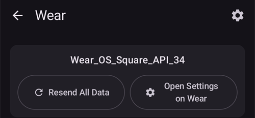

Die oberste Zeile zeigt den Namen der verbundenen Smartwatch oder **(keine Uhr verbunden)**. Auf diesem Bildschirm kannst Du

* Alle Daten erneut senden. Diese Funktion kann helfen, wenn die Smartwatch längere Zeit außer Reichweite war und Du die Informationen an die Smartwatch pushen willst.
* Über das Smartphone die Einstellungen auf der Uhr öffnen.
* Auswählen, welches Watchface **AAPS** auf der Smartwatch installiert (**Watchface auf Smartwatch installiert**: Dein benutzerdefiniertes Watchface oder das Watchface mit Komplikationen). Diese Karte wird nur angezeigt, solange eine Smartwatch mit **Wear OS 6** oder neuer verbunden ist. Siehe [das Watchface, das AAPS installiert](#wearos-aaps-v4-watchface).
* Das **Benutzerdefinierte Watchface** verwalten (die Karte wird angezeigt, solange eine Smartwatch verbunden ist): **Watchface laden** sendet ein benutzerdefiniertes Watchface an die Smartwatch, **Infos Watchface** listet die Details des geladenen Watchfaces und seine Felder auf, **Weitere AAPS Watchfaces** öffnet die [Tauschbörse](../ExchangeSiteCustomWatchfaces/index.md) im Browser, und **Export template** speichert eine Vorlage, die Du bearbeiten kannst. Unter den Schaltflächen wird eine Vorschau des geladenen Watchfaces angezeigt. Siehe [Zu einem AAPS-Watchface wechseln](#WearOS_changing-to-AAPS-watchface).

Stelle sicher, dass Benachrichtigungen von AAPS nicht auf der Uhr blockiert sind. Die Eingaben werden aktiviert, indem Du über die Benachrichtigung wischst und sie bestätigst.

## Zugriff auf das Hauptmenü von AAPS


Das Hauptmenü von **AAPS** öffnest Du auf einem dieser Wege:

* Öffne **AAPS** aus der App-Liste der Smartwatch
* Tippe auf eine **AAPS**-Komplikation, die das Menü öffnet, siehe [Einstellungen für Komplikationen](#WearOsSmartwatch-complication-settings)
* Tippe auf die Kachel **BZ-Verlauf**, deren **Tippen-Aktion** auf **Hauptmenü** gesetzt ist, siehe [Kacheleinstellungen](#WearOsSmartwatch-wear-os-tiles)
* Doppeltippe auf einem klassischen **AAPS**-Watchface auf den Glukosewert

(WearOsSmartwatch-loop-status)=

## Bildschirm Loop-Status

Der Bildschirm **Loop-Status** fasst zusammen, was der Loop gerade tut, ohne dass Du das Smartphone herausholen musst. Öffne ihn im AAPS-Hauptmenü (**Loop Status** oder **Status → Loop**) oder durch Tippen auf die Komplikation **Blutzucker**. Das Menü **Status** hat außerdem eine Seite **Pumpe** und eine Seite **TDD** mit den Tagesgesamtdosen.


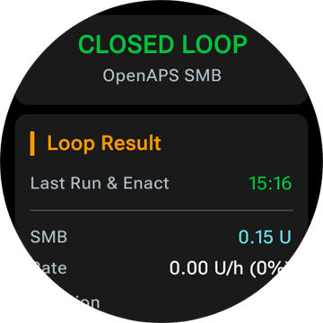

Der Bildschirm ist eine Liste von Karten. Scrolle nach unten, um alle zu sehen:

* **AAPS-Modus** – der aktuelle Modus (Closed Loop, Open Loop, LGS, pausiert, getrennt …) und bei einem zeitlich begrenzten Modus, wie lange er noch läuft.
* **Ergebnis des Loop** – wann der Loop zuletzt gelaufen ist und welche temporäre Basalrate oder welchen SMB er angefordert hat.
* **Szene** – nur solange eine [Szene](#scenes-from-watch) aktiv ist: ihr Name, die verbleibende Zeit (bzw. **Szene läuft bis sie manuell gestoppt wird** bei einer Szene ohne Endzeit) und die **Nächste Szene**, die beginnt, wenn sie endet.
* **Ziele** – Dein Zielwert und das temporäre Ziel, falls eines läuft.
* **Profil** – der Name des aktiven Profils, mit **Prozentsatz** und **Zeitverschiebung**, wenn diese nicht den Standardwerten entsprechen. Ein zeitlich begrenzter Profilwechsel wird hervorgehoben und zeigt, wie lange er noch läuft und zu welchem Profil er am Ende zurückkehrt (**Zurück zu**).
* **Sensitivität** – dieselben Zeilen wie der Sensitivitäts-Chip auf dem Startbildschirm des Smartphones: der Autosens-Wert sowie der ISF aus dem Profil, der variable und der effektive ISF.

Ein kleines Szenen-Symbol neben einem AAPS-Modus, einem temporären Ziel oder einem Profilwechsel bedeutet, dass er **von der aktiven Szene gesetzt** wurde. Dasselbe Symbol wird in der Auswahl **AAPS-Modus** angezeigt.

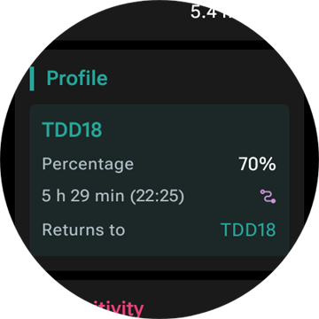

(WearOsSmartwatch-bolus-calculator)=

## Der Bolus-Rechner auf der Smartwatch

Öffne **Rechner** im **AAPS**-Hauptmenü, über die [Kachel Aktionen](#WearOsSmartwatch-wear-os-tiles) oder über eine Komplikation, die den Rechner öffnet. Er führt durch ein paar Seiten; wische von rechts nach links, um weiterzugehen:

| Kohlenhydrate                                                   | Anfrage                                                             | Ergebnis                                                          | Berechnung                                                                        | Bestätigen                                                          |
| --------------------------------------------------------------- | ------------------------------------------------------------------- | ----------------------------------------------------------------- | --------------------------------------------------------------------------------- | ------------------------------------------------------------------- |
|  |  |  |  |  |

1. **Kohlenhydrate**: Gib die Kohlenhydrate mit den Schaltflächen **+10**, **+5**, **−** und **+** ein.
2. **Anfordern**: die letzte Seite, bevor das Smartphone übernimmt. Sie zeigt Deine Eingaben: die Kohlenhydrate und, falls Du sie nutzt, Mahlzeitentyp, KH-Zeit und Prozentsatz, siehe [Optionale Seiten](#WearOsSmartwatch-calculator-optional-pages). Tippe auf das Häkchen, um sie an das Smartphone zu senden, das die Berechnung ausführt.
3. **Ergebnis**: der von **AAPS** vorgeschlagene Bolus, darunter die Kohlenhydrate: die Kohlenhydrate jetzt und die eCarbs später, die KH-Zeit und die Glocke der Essenserinnerung. Passe die Dosis mit **−** und **+** an, siehe unten. Scrolle nach unten zur Karte **Berechnung**: Tippe darauf, um jede Zeile der Berechnung zu sehen, genau wie auf dem Smartphone.
4. **Bestätigen**: Wische zur zweiten Seite und tippe auf das Häkchen. Das Smartphone gibt den Bolus ab und erfasst die Kohlenhydrate.

(WearOsSmartwatch-calculator-optional-pages)=

### Optionale Seiten

Drei Smartwatch-Einstellungen fügen jeweils eine Seite nach **Kohlenhydrate** hinzu. Sie sind standardmäßig ausgeschaltet. Öffne das **AAPS**-Hauptmenü, dann **Einstellung** > **Aussehen**, und schalte die gewünschten ein; sind mehrere eingeschaltet, kommen die Seiten in der Reihenfolge **Mahlzeitentyp**, **KH-Zeit**, **Prozentsatz**. Die Punkte unten im Rechner zeigen, wie viele Seiten er hat.

| Einstellungen                                                                            | Mahlzeitentyp                                                           | KH-Zeit                                                                 | Prozent                                                                   |
| ---------------------------------------------------------------------------------------- | ----------------------------------------------------------------------- | ----------------------------------------------------------------------- | ------------------------------------------------------------------------- |
|  |  | 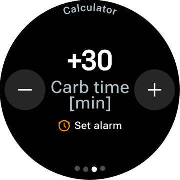 |  |

* **Rechner Mahlzeitentyp**: **Brot**, **Kuchen** oder **Pizza**, das teilt die Kohlenhydrate einer langsamen Mahlzeit in Kohlenhydrate jetzt und eCarbs später auf, siehe [Den Mahlzeitentyp wählen](#WearOsSmartwatch-wizard-meal-type).
* **KH-Zeit-Rechner**: die Minuten bis zum Essen, mit einer Glocke **Alarm einstellen** für die Essenserinnerung, siehe [KH-Zeit und Essenserinnerung](#WearOsSmartwatch-wizard-carb-time).
* **Rechner Prozentsatz**: ein Prozentsatz des berechneten Bolus, zum Beispiel 70 %, wenn Du eine kleinere Dosis möchtest. Er startet beim **Bolus-Prozentsatz** aus den [Einstellungen des Bolus-Rechners](#Preferences-deliver-this-part-of-bolus-wizard-result) auf dem Smartphone, 100 %, sofern Du ihn nicht geändert hast. Siehe auch den Hinweis unter [Den Bolus auf der Ergebnisseite anpassen](#WearOsSmartwatch-wizard-result).

(WearOsSmartwatch-wizard-result)=

### Den Bolus auf der Ergebnisseite anpassen

Die Ergebnisseite zeigt den von **AAPS** vorgeschlagenen Bolus zusammen mit einer Schaltfläche **−** und einer Schaltfläche **+**. Damit passt Du die Dosis vor dem Bestätigen an, ohne zum Smartphone zurückzugehen.

| Vorgeschlagen                                                                     | Mehr                                                                                | Weniger                                                                                |
| --------------------------------------------------------------------------------- | ----------------------------------------------------------------------------------- | -------------------------------------------------------------------------------------- |
|  |  |  |

* Jedes Tippen ändert den Bolus um **einen Schritt Deiner Pumpe**, sodass die angebotenen Mengen immer zu dem passen, was Deine Pumpe tatsächlich abgeben kann.
* **Halte eine Schaltfläche gedrückt**, um den Wert fortlaufend zu ändern. Je länger Du hältst, desto schneller geht es.
* Du kannst nicht unter **0 IE** und nicht über Deine Einstellung **max. Bolus** gehen.

Die laufende Summe wird auf der Ergebnisseite angezeigt, sodass Du immer die Menge siehst, die Du gleich bestätigst. Die Änderung wird nach den Kohlenhydraten angezeigt, zum Beispiel *(+0,20 IE)*, und die benutzte Schaltfläche wird grün für mehr oder rot für weniger.

Musste **AAPS** die Dosis begrenzen, zum Beispiel weil der berechnete Bolus über Deiner Einstellung **max. Bolus** liegt, weist eine bernsteinfarbene Warnzeile unter der Summe darauf hin (zum Beispiel *„Bolus constraint applied“*). Dasselbe gilt für eine begrenzte Kohlenhydratmenge.

```{admonition} Das ist nicht dasselbe wie Rechner Prozentsatz :class: note Mit der Einstellung **Rechner Prozentsatz** gibst Du einen *Prozentsatz* des berechneten Bolus ein, **bevor** die Ergebnisseite erscheint. Die Schaltflächen **−** und **+** passen die *endgültige Menge* **auf** der Ergebnisseite an. Du kannst beides nutzen.

    <br />(WearOsSmartwatch-wizard-meal-type)=
    
    ### Den Mahlzeitentyp wählen
    
    Der Rechner auf der Smartwatch kann die Kohlenhydrate einer langsamen Mahlzeit in Kohlenhydrate jetzt und eCarbs später aufteilen, wie die [Kohlenhydratart](#AapsScreens-carbs-type) im Bolus-Rechner des Smartphones. Schalte in den **Einstellung** > **Aussehen** der Smartwatch **Rechner Mahlzeitentyp** ein. Die Einstellung ist standardmäßig aus, und dann wird die Seite **Mahlzeitentyp** übersprungen.
    
    * Nach der Eingabe der Kohlenhydrate zeigt eine Seite **Mahlzeitentyp** drei Symbole: **Brot**, **Kuchen** und **Pizza**. Tippe auf ein Symbol: Sein Name und die daraus folgenden Kohlenhydrate erscheinen unter den Symbolen, zum Beispiel *65 g* bei Brot oder *52+22 g* bei Pizza (52 g jetzt und 22 g eCarbs später). **Brot** ist der Standard und behält alle Kohlenhydrate für jetzt.
    * Die Seiten Anfordern und Bestätigen zeigen die Kohlenhydrate auf dieselbe Weise (*52+22 g*). Die Ergebnisseite zeigt außerdem, wann die eCarbs beginnen und wie lange sie dauern.
    * Der Bolus wird nur für die jetzt gegessenen Kohlenhydrate berechnet. Die Aufteilung nutzt dieselben Werte wie der Bolus-Rechner des Smartphones.
    
    (WearOsSmartwatch-wizard-carb-time)=
    
    ### KH-Zeit und Essenserinnerung
    
    Ist **KH-Zeit-Rechner** in den **Einstellung** > **Aussehen** der Smartwatch eingeschaltet, folgt nach den Kohlenhydraten eine Seite **KH-Zeit**: die Minuten bis zum Essen, wie die [KH-Zeit](#aaps-screens-bolus-wizard) im Bolus-Rechner des Smartphones. **Jetzt** ist der Standard. **−** und **+** verschieben sie in Schritten von 5 Minuten, bis zu einer Stunde vor oder nach jetzt. Eine Zeit in der Vergangenheit gilt für bereits gegessene Kohlenhydrate.
    
    Bei einer Zeit in der Zukunft erscheint unter dem Wert eine Glocke **Alarm einstellen**. Sie ist standardmäßig eingeschaltet, tippe darauf, um sie auszuschalten. Die Seiten Anfordern und Ergebnis zeigen die KH-Zeit, zum Beispiel *+30 min*, und die Glocke. Das Smartphone erfasst die Kohlenhydrate zu dieser Zeit, verschiebt die eCarbs des Mahlzeitentyps entsprechend und startet seine Erinnerung **Zeit zum Essen**.
    
    | Ergebnis | BZ-Diagramm | Läuft | Zeit zum Essen |
    | --- | --- | --- | --- |
    |  |  |  |  |
    
    Die Erinnerung ist auch auf der Smartwatch gespeichert, sodass sie auch dann ertönt, wenn das Smartphone außer Reichweite ist:
    
    * Der Bildschirm **Blutzucker-Verlauf**, die Kachel **BZ-Verlauf** und das Diagramm des **Watchfaces mit Komplikationen** zeichnen eine gestrichelte orange Linie dort, wo die Erinnerung ertönt, mit den verbleibenden Minuten daneben.
    * Während sie läuft, steht eine stille Benachrichtigung **Zeit zum Essen** mit **Stopp** und **+5 min** in der Benachrichtigungsliste. Sie kommt zurück, wenn Du sie wegwischst, bis die Erinnerung vorbei ist.
    * Ist die Zeit gekommen, vibriert die Smartwatch, und dann alle halbe Minute fünf Minuten lang, bis Du reagierst. Die Benachrichtigung bietet **Stille** und **+5 min**, und Wegwischen schaltet sie ebenfalls stumm.
    
    **Stopp**, **Stille** und **+5 min** wirken gleich auf der Smartwatch, dem Smartphone und einem **AAPSClient**, und alle zeigen dieselbe Erinnerung.
    
    (Watchfaces-complications)=
    
    ## Komplikationen
    
    _Komplikation_ ist ein Begriff aus der traditionellen Uhrmacherei und beschreibt eine Ergänzung zum Haupt-Watchface, etwa ein weiteres kleines Fenster oder Hilfszifferblatt (mit Datum, Wochentag, Mondphase usw.). Mit Wear OS 2.0 können solche Zusatzinformationen (Wetter, Benachrichtigungen, Fitness Tracker etc.) zu jedem Watchface hinzugefügt werden, das Komplikationen unterstützt.
    
    Die AAPS Wear OS-App unterstützt Komplikationen seit Build `2.6` und erlaubt es jedem Watchface eines Drittanbieters, das Komplikationen unterstützt, AAPS-Daten anzuzeigen (Glukosewert mit Trend, IOB, COB usw.).
    
    Komplikationen dienen außerdem als **Verknüpfung** zu AAPS-Funktionen. Durch antippen der AAPS-Komplikation kannst Du - abhängig vom Komplikations-Typ und den Einstellungen - AAPS-spezifische Menüs und Dialoge aufrufen.
    
    
    
    ### Arten von Komplikationen
    
    Die AAPS Wear OS-App liefert nur Rohdaten in vordefinierten Formaten. Die Drittanbietern der Watchfaces legen fest, wo und wie Komplikationen - einschließlich des Layouts, Rahmen, Farben und Schriftarten - wiedergegeben werden sollen. Von den vielen verfügbaren Wear OS-Komplikationsarten nutzt AAPS:
    
    * `SHORT TEXT` – enthält zwei Textzeilen mit je 7 Zeichen, manchmal Wert und Beschriftung genannt. Diese werden in der Regel in einem Kreis oder einer "Pill" unter- oder nebeneinander angezeigt. Es handelt sich um eine Komplikation mit sehr begrenztem Platz. AAPS versucht, unnötige Zeichen zu entfernen und rundet Werte, entfernt führende oder abschließende Nullen etc.
    * `LONG TEXT` – enthält zwei Textzeilen mit je etwa 20 Zeichen. Normalerweise werden diese in einem Rechteck oder einer "long pill" untereinander dargestellt. Er wird für weitere Details und den Statusangaben in Textform verwendet.
    * `RANGED VALUE` – für Werte aus einem vordefinierten Bereich, etwa einen Prozentwert. Beinhaltet ein Icon, eine Beschriftung und wird meist als Kreis-Fortschritts-Diagramm angezeigt.
    * `LARGE IMAGE` – ein eigenes Hintergrundbild, das (wenn das Watchface es unterstützt) als Hintergrund genutzt werden kann.
    * `SMALL IMAGE` / `MONOCHROMATIC IMAGE` – ein kleines Symbol. In einem Platz vom Typ `SMALL IMAGE` zeichnet AAPS es in seiner eigenen Farbe; in einem Platz vom Typ `MONOCHROMATIC IMAGE` färbt das Watchface es ein.
    
    ### Komplikationen einrichten
    
    Um eine Komplikation zum Watchface hinzuzufügen, konfiguriere es durch langes Drücken und Tippen auf das Zahnrad-Symbol darunter. Je nach dem wie das einzelne Watchface die Komplikationen behandelt musst Du entweder auf die Platzhalter klicken oder das Setup für Komplikationen des Watchfaces aufrufen. AAPS-Komplikationen werden unter dem AAPS-Menü-Eintrag gruppiert.
    
    Bei der Konfiguration von Komplikationen passt Wear OS die Auswahl an und führt nur die Komplikationen auf, die an der gewünschten Stelle angezeigt werden können. Wenn Du also eine bestimmte Komplikation nicht in der Liste findest, passt sie wahrscheinlich nicht an den gewünschten Platz innerhalb des Watchfaces.
    
    ### Komplikationen von AAPS
    
    AAPS stellt die folgenden Komplikationen bereit. „Öffnet“ beschreibt, was ein Tippen bewirkt, wenn **Tipp Komplikation** auf **Standard** steht, siehe [Einstellungen für Komplikationen](#WearOsSmartwatch-complication-settings).
    
    **Glukose**
    
    * **Blutzucker** (`SHORT TEXT`, öffnet _Loop-Status_): der Glukosewert mit Trendpfeil in der ersten Zeile, Alter des Werts und Delta in der zweiten.
    * **Blutzucker (ausführlich)** (`SHORT TEXT`, öffnet _BZ-Verlauf_): nur der Glukosewert in der ersten Zeile, damit das Watchface ihn groß darstellen kann. Alter und Trendpfeil stehen in der zweiten Zeile.
    * **BZ-Kurve** (`SMALL IMAGE` / `LARGE IMAGE`, öffnet _BZ-Verlauf_): das Glukosediagramm als Bild, für Watchfaces mit einem Bildplatz. Das ist das Diagramm auf dem **Watchface mit Komplikationen**.
    * **Vollständiger Status** (`LONG TEXT`, öffnet _Menü_): die meisten Daten in einer Zeile: der Glukosewert mit Trendpfeil, Delta und Alter des Werts, dann aktive Kohlenhydrate, aktives Insulin und die Basalrate.
    * **Vollständiger Status (umgekehrt)** (`LONG TEXT`, öffnet _Menü_): dasselbe mit vertauschten Zeilen, für Watchfaces, die nur eine der beiden Zeilen eines `LONG TEXT`-Platzes zeigen.
    
    **Insulin und Kohlenhydrate**
    
    * **IoB-Icon** (`SHORT TEXT`, öffnet _Bolus_): aktives Insulin mit einem Spritzen-Symbol.
    * **IoB detailliert** (`SHORT TEXT`, öffnet _Bolus_): gesamtes aktives Insulin in der ersten Zeile, Bolus- und Basalanteil in der zweiten.
    * **CoB-Icon** (`SHORT TEXT`, öffnet _Rechner_): aktive Kohlenhydrate mit einem Kohlenhydrat-Symbol.
    * **CoB detailliert** (`SHORT TEXT`, öffnet _Rechner_): die jetzt aktiven Kohlenhydrate in der ersten Zeile, die noch kommenden Kohlenhydrate (eCarbs) in der zweiten.
    * **CoB & IoB** (`SHORT TEXT`, öffnet _Rechner_): aktives Insulin in der ersten Zeile, aktive Kohlenhydrate in der zweiten.
    
    **Basal und Ziel**
    
    * **Basalrate** (`SHORT TEXT`, öffnet _Menü_): die aktuelle Basalrate.
    * **BR & IoB** (`SHORT TEXT`, öffnet _Menü_): aktives Insulin in der ersten Zeile, die Basalrate in der zweiten.
    * **BR & Zielwert** (`SHORT TEXT`, öffnet _Temporäres Ziel_): der Zielwert in der ersten Zeile, bei laufendem temporärem Ziel mit der verbleibenden Zeit, und die Basalrate in der zweiten.
    * **Ziel** (`SHORT TEXT`, öffnet _Temporäres Ziel_): der Zielwert in der ersten Zeile und, solange ein temporäres Ziel läuft, dessen verbleibende Zeit in der zweiten.
    * **BR, COB & IOB** (`SHORT TEXT`, öffnet _Menü_): die Basalrate in der ersten Zeile, aktive Kohlenhydrate und aktives Insulin in der zweiten.
    
    **Loop und Smartphone**
    
    * **AAPS-Modus** (`SMALL IMAGE` / `ICON`, öffnet die _Auswahl AAPS-Modus_): der aktuelle Loop-Modus als Symbol: Closed Loop, Open Loop, Unterbrechung bei niedrigem BZ, pausiert, getrennt oder deaktiviert. Ein Tippen öffnet eine Auswahl mit den gerade erlaubten Moduswechseln, zum Beispiel **Loop pausieren**, **Pumpe trennen**, **Loop fortsetzen** oder **Pumpe erneut verbinden**. Dieselbe Auswahl findest Du im **AAPS**-Hauptmenü unter **AAPS-Modus**.
    * **Uploader/Smartphone-Akkustand** (`RANGED VALUE` / `SHORT TEXT` / `ICON`, öffnet _Status_): der Akku des **AAPS**-Smartphones, als Anzeige mit Akku-Symbol, als Zahl oder nur als Symbol. Er wird zusammen mit den anderen **AAPS**-Daten aktualisiert, meist alle 5 Minuten mit einem neuen Wert.
    
    Die Auswahl **AAPS-Modus**, wie sie über die Komplikation, das Hauptmenü oder die Kachel AAPS-Modus geöffnet wird:
    
    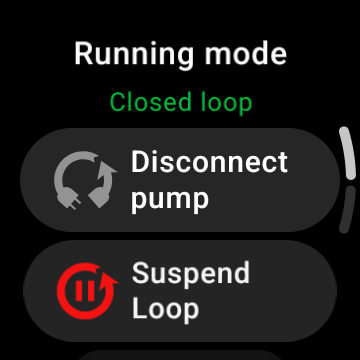
    
    (WearOsSmartwatch-complication-settings)=
    
    ### Einstellungen für Komplikationen
    
    Öffne im **AAPS**-Hauptmenü auf der Smartwatch **Einstellung** > **Komplikation**:
    
    
    
    * **Tipp Komplikation** (Standard `Default`): was ein Tippen auf eine **AAPS**-Komplikation öffnet, für alle Komplikationen gemeinsam:
      * _Standard_: was die Komplikation selbst öffnet, siehe Liste oben
      * _Menü_: das **AAPS**-Hauptmenü
      * _Rechner_: den Bolus-Rechner
      * _Bolus_: den Behandlungsdialog, Insulin und Kohlenhydrate
      * _eCarbs_: den eCarbs-Dialog
      * _Status_: das Statusmenü
      * _AAPS-Modus_: die Auswahl AAPS-Modus. Dafür muss **Steuerung über Wear OS** in den Wear-Einstellungen des Smartphones eingeschaltet sein, sonst öffnet sich stattdessen das Hauptmenü.
      * _Kein(e)_: Ein Tippen bewirkt nichts
    * **Zeitbereich des BZ-Diagramms** (Standard `3 hours`): wie viele Stunden die Komplikation **BZ-Kurve** zeigt, 1, 3 oder 6. Die Kachel BZ-Verlauf hat eine eigene Einstellung.
    * **Unicode in Komplikationen** (Standard `On`): Die Komplikationen nutzen Unicode-Symbole wie `Δ` für das Delta, `⁞` als Trennzeichen und `⎍` für die Basalrate. Wie sie aussehen, hängt von der Schrift des Watchfaces ab. Schalte das auf `Off`, wenn ein Watchface sie als Kästchen oder Leerstellen darstellt.
    
    (WearOsSmartwatch-wear-os-tiles)=
    
    ## Wear OS-Kacheln
    
    Kacheln sind die Seiten, die Du durch Wischen vom Watchface aus erreichst. **AAPS** bringt sieben davon mit, jede mit bis zu vier Schaltflächen. Ein Tippen auf eine Schaltfläche öffnet den passenden Dialog auf der Smartwatch oder bittet Dich um Bestätigung, und dann erledigt das Smartphone die Arbeit. Eine Kachel ist eine Verknüpfung, keine Statusanzeige: Sie zeigt nicht den Zustand der Smartphone-App.
    
    Bevor Du die Kacheln nutzt, schalte **Steuerung über Wear OS** unter [Einstellungen > Wear](#preferences-wear) ein.
    
    ### Eine Kachel hinzufügen
    
    Je nach Smartwatch und Smartphone gibt es zwei Wege:
    
    1. Auf der Smartwatch: Wische vom Watchface aus über die letzte Kachel hinaus zu **Kachel hinzufügen** und wähle eine **AAPS**-Kachel. Auf den meisten Smartwatches öffnet auch langes Drücken auf eine Kachel die Ansicht zum Hinzufügen und Entfernen.
    2. Auf dem Smartphone in der Begleit-App Deiner Smartwatch (**Galaxy Wearable** bei Samsung, **Wear OS** bei anderen Marken): Öffne **Kacheln**, tippe auf **Hinzufügen** und wähle die gewünschten **AAPS**-Kacheln. Die Reihenfolge der Kacheln lässt sich durch Ziehen ändern.
    
    
    
    ### Kacheleinstellungen
    
    Die Kacheln **Aktionen**, **Temporäres Ziel**, **BZ-Verlauf** und **Szene** haben Einstellungen auf der Smartwatch. Öffne das **AAPS**-Hauptmenü, dann **Einstellung** > **Kachel**, und wähle die Kachel. Langes Drücken auf die Kachel öffnet ebenfalls ihre Einstellungen, außer auf Pixel-Smartwatches. Die anderen drei Kacheln werden vom Smartphone befüllt und haben auf der Smartwatch nichts einzustellen.
    
    | Hauptmenü | Einstellung | Kachel |
    | --- | --- | --- |
    |  |  |  |
    
    Die Einstellungen einer Kachel sind eine Liste ihrer vier Plätze. Tippe auf einen Platz, um auszuwählen, was er zeigt, oder auf **Kein(e)**, um ihn leer zu lassen.
    
    | Langes Drücken auf die Kachel | Einstellungen der Kachel Temporäres Ziel |
    | --- | --- |
    |  |  |
    
    Jede Kachel hat vier Plätze. Hat eine Kachel mehr Einträge, zeigt sie die ersten vier.
    
    ### Kachel Aktionen
    
    
    
    Verknüpfungen zu den Dialogen der **AAPS**-Smartwatch-App. Wähle in den Kacheleinstellungen bis zu vier davon aus:
    
    * **Rechner**: der Bolus-Rechner, mit Kohlenhydrateingabe, optionalem Prozentsatz [1] und optionalem Mahlzeitentyp [2]
    * **Behandl**: Insulin und Kohlenhydrate in einem Schritt
    * **Insulin**: ein Bolus, in Einheiten eingegeben
    * **Kohlenhydrate**: Kohlenhydrate, auch verzögerte Kohlenhydrate. Ein **negativer** Wert wird bis zu Deinem aktuellen COB angenommen, um früher eingegebene Kohlenhydrate zu korrigieren. Entfernte Kohlenhydrate werden im BZ-Diagramm der Smartwatch angezeigt.
    * **eCarbs**: verzögerte Kohlenhydrate
    * **Temp. Ziel**: ein temporäres Ziel mit eigenem Zielwert und eigener Dauer
    * **Profilwechsel**: ein Profilwechsel mit Prozentsatz, Zeitverschiebung und Dauer
    
    
    
    Die Dialoge, die die Schaltflächen öffnen. Wische von rechts nach links, um zur nächsten Seite eines Dialogs zu gelangen, und tippe auf der letzten Seite auf das Häkchen, um die Anforderung an das Smartphone zu senden:
    
    | Behandl | Insulin | Kohlenhydrate | eCarbs | Temp. Ziel | Profilwechsel |
    | --- | --- | --- | --- | --- | --- |
    |  |  |  |  | 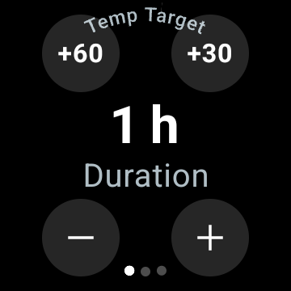 |  |
    
    [1] Schalte in den **Einstellung** > **Aussehen** der Smartwatch **Rechner Prozentsatz** ein, um die Prozenteingabe im Bolus-Rechner anzuzeigen. Der Standard-Prozentsatz kommt aus dem [„Bolus-Prozentsatz“](#Preferences-deliver-this-part-of-bolus-wizard-result) des Smartphones. Die übrigen Rechner-Einstellungen sind die des Smartphones unter **Einstellungen** > **Einstellungen des Bolus-Rechners**.
    
    [2] Schalte in den **Einstellung** > **Aussehen** der Smartwatch **Rechner Mahlzeitentyp** ein, um die Seite **Mahlzeitentyp** anzuzeigen, auf der Du **Brot**, **Kuchen** oder **Pizza** wählst, um die Kohlenhydrate einer langsamen Mahlzeit in Kohlenhydrate jetzt und eCarbs später aufzuteilen. Siehe [Den Mahlzeitentyp wählen](#WearOsSmartwatch-wizard-meal-type).
    
    ### Kachel Temporäres Ziel
    
    
    
    Temporäre Ziele aus den Vorlagen des Smartphones. Dauer und Zielwert jeder Vorlage legst Du auf dem Smartphone unter **Einstellungen** > [Standard-Temp-Ziele](#Preferences-default-temp-targets) fest. Wähle in den Kacheleinstellungen bis zu vier davon aus:
    
    * **Aktivität**: für Sport
    * **Essen**: Bald essen, ein niedrigeres Ziel, damit zur Mahlzeit mehr aktives Insulin vorhanden ist
    * **Hypo**: ein höheres Ziel während der Behandlung einer Unterzuckerung
    * **Manuell**: ein eigener Zielwert und eine eigene Dauer
    * **Abbrechen**: beendet das laufende temporäre Ziel. Die Schaltfläche wird nur angezeigt, solange ein temporäres Ziel läuft.
    
    ### Kachel Schnellassistent
    
    
    
    Die [QuickWizard](#quickwizards)-Einträge des Smartphones, bei denen **Show on Watch** eingeschaltet ist, innerhalb ihrer gültigen Uhrzeiten. Ein Kohlenhydrat-Eintrag zeigt seine Kohlenhydrate in g, ein Insulin-Eintrag seine feste Dosis in IE. Ein Tippen führt den Eintrag nach einer Bestätigung auf der Smartwatch aus. Auf der Smartwatch gibt es nichts einzustellen: Bearbeite die Einträge auf dem Smartphone und schalte für jeden Eintrag, den Du auf der Kachel haben möchtest, unter **Device Selection** **Show on Watch** ein. Außerhalb der gültigen Uhrzeiten aller Deiner Einträge zeigt die Kachel **Keine Konfiguration verfügbar**.
    
    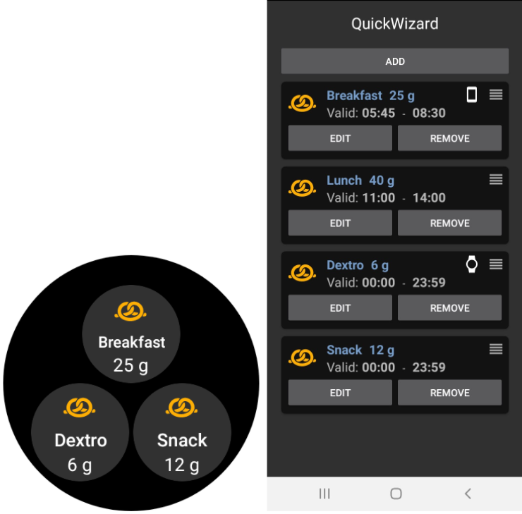
    
    ### Kachel Szene
    
    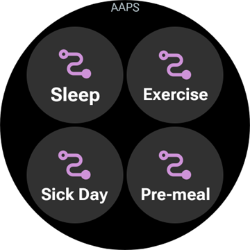
    
    Die [Szenen](#scenes-from-watch) des Smartphones. Jeder der vier Plätze wird in den Kacheleinstellungen auf **Automatisch**, **Kein(e)** oder eine Szene gesetzt. Ein Platz auf **Automatisch** übernimmt die nächste Szene aus der Liste des Smartphones, die kein anderer Platz belegt. Ein Platz, der auf eine Szene gesetzt ist, die es auf dem Smartphone nicht mehr gibt, zeigt **Nicht verfügbar**.
    
    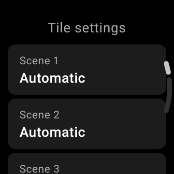
    
    ### Kachel AAPS-Modus
    
    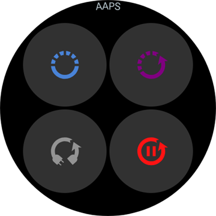
    
    Die [AAPS-Modi](#aaps-screens-running-mode), zu denen Du vom aktuellen aus wechseln kannst, mit denselben Symbolen wie auf dem Smartphone: Closed Loop, Unterbrechung bei niedrigem BZ, Open Loop, Loop deaktivieren, Loop pausieren und Pumpe trennen bzw. fortsetzen und erneut verbinden, während einer davon läuft. **Loop pausieren** und **Pumpe trennen** fragen zuerst nach einer Dauer. Das Smartphone entscheidet, welche Modi angeboten werden; die Smartwatch zeigt die ersten vier und lässt **Loop deaktivieren** weg, wenn **Loop pausieren** in der Liste ist.
    
    ### Kachel Benutzer Aktion
    
    
    
    Eine Schaltfläche für jede [Automatisierung](#automations-automation-triggers) auf dem Smartphone, deren Auslöser **Benutzeraktion** ist. Ein Tippen bittet Dich um Bestätigung, dann führt das Smartphone die Aktionen der Automatisierung aus. Die Schaltflächen heißen wie die Automatisierungen, gib ihnen also kurze Namen. Auf der Smartwatch gibt es nichts einzustellen.
    
    ### Kachel BZ-Verlauf
    
    
    
    Der Glukosewert mit Pfeil, Delta und Alter, darunter IOB, COB, Basalrate und Zielwert, und das BZ-Diagramm mit Vorhersagen, Boli, Kohlenhydraten und SMBs. Zwei Einstellungen auf der Smartwatch: **Zeitraum** (1, 3 oder 6 Stunden) und **Tippen-Aktion**, die den vollständigen **Blutzucker-Verlauf**, das **Hauptmenü** oder den Bildschirm **Loop-Status** öffnet.
    
    
    
    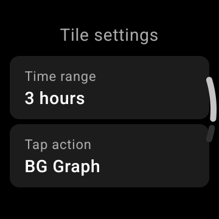
    
    ## Always on (immer an)
    
    Dieser und der nächste Abschnitt gelten für die klassischen **AAPS**-Watchfaces unter Wear OS 5 und älter. Unter Wear OS 6 hat das **Watchface mit Komplikationen** eine eigene Always-on-Anzeige, siehe [das Watchface, das AAPS installiert](#wearos-aaps-v4-watchface).
    
    Lange Akkulaufzeit für Android Wear OS Smartwatches ist eine Herausforderung. Einige Smartwatches halten bis zu 30 Stunden vor dem erneuten Aufladen. Das Display sollte ausgeschaltet werden, um bei Nichtverwendung optimal Energie zu sparen. Die meisten Uhren unterstützen das „Always On“-Display.
    
    Seit AAPS Version 3 können wir „Simplify UI“ während des "Always-On-Modus" verwenden. Dieses UI enthält nur den Blutzucker, den Trend und die Zeit. Dieses UI ist leistungsoptimiert mit weniger häufigen Updates, die weniger Informationen zeigen und weniger Pixel nutzen, um Strom auf OLED-Bildschirmen zu sparen.
    
    Die vereinfachte Oberfläche gibt es für die Watchfaces Digital Style und Custom. Die vereinfachte Oberfläche ist optional und wird in den Watchface-Einstellungen konfiguriert (lange auf das Watchface drücken und auf „Bearbeiten“ oder das Zahnrad tippen). Wähle die Einstellung „Benutzeroberfläche vereinfachen“ und setze sie auf „Immer im Modus“ oder „Immer ein und Aufladen“.
    
    ### Nachtmodus
    
    Beim Laden wäre es praktisch, wenn das Display „immer an“ bleiben und nachts Deinen Glukosewert zeigen könnte. Die Standard-Watchfaces sind jedoch zu hell und haben zu viele Informationen, und die Details sind mit verschlafenen Augen schwer zu lesen. Daher haben wir eine Option für das Watchface hinzugefügt, um das Interface nur während des Ladevorgangs zu vereinfachen, wenn es in der Konfiguration eingestellt ist.
    
    Die vereinfachte Oberfläche gibt es für die Watchfaces Digital Style und Custom. Die vereinfachte Oberfläche ist optional und wird in den Watchface-Einstellungen konfiguriert (lange auf das Watchface drücken und auf „Bearbeiten“ oder das Zahnrad tippen). Wähle die Einstellung „Benutzeroberfläche vereinfachen“ und setze sie auf „Während des Ladevorgangs“ oder „Immer ein und Aufladen“.
    
    Die Android-Entwickleroptionen ermöglichen es Deiner Uhr wach zu bleiben, während sie aufgeladen wird. Wie Du die Entwickleroptionen freischaltest, steht in der [offiziellen Dokumentation](https://developer.android.com/training/wearables/get-started/debugging). Setze in den Entwickleroptionen „Beim Laden aktiv lassen“ auf „an“.
    
    Hinweis: Nicht alle Displays können always-on gut handhaben. Es kann dazu führen, dass sich der Bildschirm einbrennt, insbesondere auf den älteren OLED-Displays. Die Uhren verdunkeln das Display im Allgemeinen, um das Einbrennen zu verhindern; bitte informiere Dich über das Handbuch , Angaben des Herstellers oder das Internet für Ratschläge.
    
    
    
    
    
    (WearOsSmartwatch-phone-alarms)=
    
    ## Alarme des Smartphones auf der Smartwatch
    
    
    
    Die Smartwatch zeigt die Alarme des Smartphones an, sodass Du siehst, warum das Smartphone einen Ton macht, und vom Handgelenk aus reagieren kannst. Die Smartwatch vibriert, und dann alle halbe Minute fünf Minuten lang, bis Du reagierst. Eine Benachrichtigung zeigt Titel und Text des Alarms, mit denselben Antworten wie bei der Erinnerung [Zeit zum Essen](#WearOsSmartwatch-wizard-carb-time):
    
    * **Stille** oder Wegwischen: Der Alarm stoppt, und der Alarmbildschirm auf dem Smartphone schließt sich.
    * **5 min. stummschalten**: Der Alarm stoppt und ertönt nach fünf Minuten erneut, auf dem Smartphone und auf der Smartwatch.
    
    Zwei Arten von Alarmen erreichen die Smartwatch:
    
    * Der Alarmbildschirm des Smartphones (Pumpenfehler, Alarme von Automatisierungen, Glukosealarme): **Stille** und **5 min. stummschalten**.
    * Dringende Benachrichtigungen mit Ton, wie *Pumpe nicht erreichbar* oder ein Nightscout-Alarm: nur **Stille**. Das Smartphone hat für diese nur **Schließen**, und sie kommen von selbst wieder, solange ihre Ursache besteht.
    
    Die Erinnerung *Zeit zum Essen* wird nicht auf diesem Weg gesendet: Die Smartwatch lässt sie selbst ertönen.
    
    ## Verknüpfung Schlummeralarm
    
    Die Smartwatch [zeigt den Alarm](#WearOsSmartwatch-phone-alarms) selbst an; die Verknüpfung ist ein zweiter Weg, ihn mit einem Druck stummzuschalten. Es kann eine Verknüpfung, um AAPS Alarme/Benachrichtigungen schlummernd zu stellen, erstellt werden. Einen Alarm oder eine Benachrichtigung über die Smartwatch zu bestätigen bzw. stumm zuschalten ohne das Smartphone dazu in die Hand nehmen zu müssen, vereinfacht den Alltag. Hinweis: Du musst die Alarmmeldung trotzdem auf Deinem Smartphone prüfen und entsprechend reagieren, aber das kannst Du später tun. Hat Deine Smartwatch zwei Tasten, kannst Du eine Taste dem Programm `AAPS Snooze Alert` zuweisen.
    
    Um die Taste auf der Samsung Watch 4 zuzuweisen, gehe zu `Settings > Advanced Features > Customize Buttons > Double press > AAPS Snooze Alert`
    
    Auf einem Watchface mit Komplikationen erledigt eine Komplikation **App-Verknüpfung**, die auf **AAPS Snooze Alert** gesetzt ist, dasselbe mit einem Tippen. Die [alternative Einrichtung des Watchfaces mit Komplikationen](#wearos-complications-watchface-setup) nutzt dafür den Platz oben rechts.
    
    ### xDrip schlummern
    
    Wenn Du xDrip nutzt und xDrip auf der Smartwatch installiert ist, schaltet die Verknüpfung „AAPS Snooze Alert“ auch jeden xDrip-Alarm in den Schlummermodus. 
    
    
    ## Tipps zu Leistung und Akkulaufzeit
    
    Wear OS-Smartwatches sind Geräte mit sehr begrenzter Energie. Durch die Größe des Uhrengehäuses wird die Kapazität des enthaltenen Akkus begrenzt. Trotz der neuesten Entwicklungen sowohl auf der Hardware- als auch auf der Software-Seite, müssen Wear OS Uhren immer noch tägliche geladen werden.
    
    Hält der Akku weniger als einen Tag (von morgens bis abends), helfen Dir diese Tipps bei der Fehlersuche.
    
    Die wichtigsten Stromverbraucher sind:
    
    * Aktives Display mit eingeschalteter Hintergrundbeleuchtung (bei LED) oder voller Helligkeit (bei OLED)
    * Darstellung auf dem Bildschirm
    * Funkkommunikation über Bluetooth
    
    Da wir bei der Kommunikation keine Abstriche machen können (wir brauchen aktuelle Daten) und die neuesten Daten anzeigen wollen, lassen sich die meisten Optimierungen bei der _Anzeigezeit_ vornehmen:
    
    * Vorinstallierte Watchfaces sind meist besser optimiert als selbst aus dem Store geladene.
    * Besser sind Watchfaces, die im inaktiven bzw. gedimmten Modus weniger Daten darstellen.
    * Sei vorsichtig beim Kombinieren mit anderen Komplikationen, etwa Wetter-Widgets von Drittanbietern oder anderen, die Daten aus externen Quellen nutzen.
    * Fang mit einfacheren Watchfaces an. Füge immer nur eine Komplikation hinzu und beobachte, wie sich diese auf die Akku-Laufzeit auswirkt.
    * Nutze ein dunkles Design für das Watchface. Auf OLED-Displays bedeuten weniger leuchtende Pixel weniger Stromverbrauch und weniger Einbrennen.
    * Prüfe, was auf Deiner Smartwatch besser läuft: die AAPS-Standard-Watchfaces oder andere Watchfaces mit AAPS-Komplikationen.
    * Beobachte das über einige Tage mit unterschiedlichen Aktivitäten. Die meisten Uhren aktivieren die Anzeige beim Draufschauen, bei Bewegung und anderen nutzungsbezogenen Auslösern.
    * Prüfe Deine allgemeinen Systemeinstellungen, die die Leistung beeinflussen: Benachrichtigungen, Zeitlimit für Hintergrundbeleuchtung bzw. aktives Display, wann GPS aktiviert ist.
    * Sieh Dir die [Liste getesteter Smartphones und Smartwatches](#Phones-list-of-tested-phones) an und [frag die Community](../GettingHelp/WhereCanIGetHelp.md) nach den Erfahrungen anderer und der berichteten Akkulaufzeit.
    * **Wir können nicht garantieren, dass die auf dem Watchface oder in einer Komplikation angezeigten Daten aktuell sind**. Am Ende entscheidet Wear OS, wann ein Watchface oder eine Komplikation neue Daten erhält. Selbst wenn die AAPS-App die Aktualisierung anstößt, kann das System die Aktualisierung verschieben oder ignorieren, um die Akku-Laufzeit zu erhöhen. Im Zweifel und vor allem bei niedrigem Akku-Ladestand der Uhr solltest Du die Werte immer mit einem Blick auf AAPS auf Deinem Smartphone gegenprüfen.
    
    (Watchfaces-troubleshooting-the-wear-app)=
    
    ## Fehlerbehebung bei der Wear-App
    
    Zeigt die Smartwatch keine oder alte Daten, prüfe zuerst die Verbindung zwischen Smartwatch und Smartphone, siehe [Fehlerbehebung bei der Kommunikation zwischen AAPS-Smartwatch und AAPS-Smartphone](#wear-os-watch-phone-communication). Für eine Smartwatch mit Wear OS 5 siehe auch die [allgemeinen Empfehlungen zur Fehlerbehebung für Wear OS 5](#wear-os-5-troubleshooting). Eine Komplikation, die sich nicht aktualisiert, hat dieselben Ursachen wie eine Kachel oder ein Watchface, das sich nicht aktualisiert, prüfe also zuerst diese.
    
    ## Weitere benutzerdefinierte AAPS-Watchfaces
    
    [Hier](../ExchangeSiteCustomWatchfaces/index.md) kannst Du Zip-Dateien mit benutzerdefinierten Watchfaces anderer Nutzerinnen und Nutzer herunterladen.
    
    ## Eigenes Watchface erstellen
    
    Wenn Du ein eigenes Watchface erstellen möchtest, folge der [Anleitung hier](../ExchangeSiteCustomWatchfaces/CustomWatchfaceReference.md).
    
    Hast Du ein benutzerdefiniertes Watchface erstellt, kannst Du Dein eigenes **AAPS**-Watchface mit anderen teilen: Die Zip-Datei kann per Pull Request auf GitHub in den Ordner „ExchangeSiteCustomWatchfaces“ hochgeladen werden. Beim Zusammenführen (Merge) des Pull Requests wird das Dokumentationsteam die Datei CustomWatchface.png extrahieren und dann den Dateinamen der ZIP-Datei voranstellen.
    
    (WearOsSmartwatch-complications-watchface-download)=
    
    ## Eine eigene Version des Watchfaces mit Komplikationen erstellen
    
    Das **Watchface mit Komplikationen**, das **AAPS** unter Wear OS 6 installiert (siehe [das Watchface, das AAPS installiert](#wearos-aaps-v4-watchface)), wurde mit Samsungs **Watch Face Studio** erstellt. Seine Projektdatei kannst Du kostenlos herunterladen, um sie nach Deinem Geschmack zu ändern oder auf einer Smartwatch mit Wear OS 5 oder älter zu nutzen, auf der **AAPS** sie nicht installiert:
    
    [Complications watchface (AAPS V4), zip](https://github.com/openaps/AndroidAPSdocs/raw/refs/heads/master/docs/_static/wearos/Complications_watchface_AAPS_V4.zip)
    
    Die Zip-Datei enthält vier Dateien:
    
    * `AAPS V4_0_2.wfs`: das Projekt. Öffne es in [Watch Face Studio](https://developer.samsung.com/watch-face-studio/download.html), ändere, was Du möchtest, und installiere es von dort auf der Smartwatch.
    * `com.watchfacestudio.aapsv4.apk`: das Watchface wie es ist, bereit zur Installation mit [adb](https://developer.android.com/tools/releases/platform-tools): `adb install com.watchfacestudio.aapsv4.apk` bei per ADB-Debugging verbundener Smartwatch.
    * `README.txt`: die beiden empfohlenen Komplikations-Einrichtungen, genau wie auf der [Wear OS-Seite](#wearos-complications-watchface-setup).
    * `AAPS V4.png`: eine Vorschau.
    
    ```{admonition} Das ist kein benutzerdefiniertes Watchface
    :class: note
    Die Zip-Datei ist kein benutzerdefiniertes Watchface für **Watchface laden** im **Wear**-Modul, und das Smartphone kann sie nicht installieren. Sie muss entpackt und wie oben beschrieben mit Watch Face Studio oder adb auf der Smartwatch installiert werden.