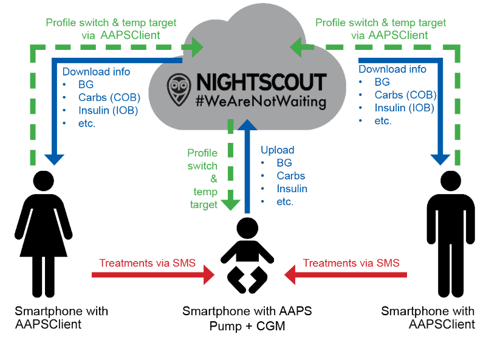

# Fernüberwachung

__AAPS__ bietet verschiedene Funktionen zur Fernüberwachung von Kindern mit Typ-1-Diabetes und ermöglicht außerdem Remote-Befehle, mit denen Anweisungen an __AAPS__ gesendet werden. Der __AAPSClient__ kann auch zur Remote-Überwachung genutzt werden. Du kannst damit __AAPS__-Follower Deines Freundes oder Partners sein.

## Funktionen

- Die Pumpe des Kindes wird vom Smartphone des Kindes durch __AAPS__ gesteuert.
- Betreuende können mit der **AAPSClient-APK** auf ihrem Android-Smartphone alle wichtigen Daten per Fernüberwachung verfolgen, etwa Glukosewerte, aktive Kohlenhydrate und aktives Insulin (eine iPhone-Version von **AAPSClient** ist in Entwicklung, siehe [AAPSClient](AapsClient.md)). In __AAPS__ geänderte Einstellungen werden mit __AAPSClient__ synchronisiert und umgekehrt.
- Betreuende können sich über die **xDrip-App im Follower-Modus** auf ihrem Android-Smartphone alarmieren lassen, wenn der xDrip-Companion-Modus eingerichtet ist.
- Die Remote-Steuerung von __AAPS__ durch [SMS-Befehle](../RemoteFeatures/SMSCommands.md) ist durch eine Zwei-Faktor-Authentifizierung abgesichert.
- Die Remote-Steuerung über __AAPSClient__ nutzt den signierten Befehlskanal, der mit **AAPS** 4 eingeführt wurde: Der Client muss zuerst mit dem Master **gekoppelt** werden (per QR-Code oder PIN), und jeder Befehl wird vom Master bestätigt und ausgeführt. Das Smartphone jeder betreuenden Person kann eine eigene [Rolle](#client-master-control-roles) bekommen, von nur lesen bis volle Steuerung – siehe [Master ↔ Client-Steuerung](#client-master-control).

## Tools und Apps für die Fernüberwachung

- [Nightscout](https://nightscout.github.io/) im Webbrowser (vor allem Datenanzeige).
- [__AAPSClient__](AapsClient.md) ist eine abgespeckte Version von __AAPS__, die dem Master-__AAPS__ folgen und, sobald sie **gekoppelt** ist, Remote-Befehle senden kann: Kohlenhydrate, __Temporäre Ziele__, __Profilwechsel__ und sogar Boli (siehe [Master ↔ Client-Steuerung](#client-master-control)). Es gibt 3 Apps: [AAPSClient, AAPSClient2 & AAPSClient3 zum Herunterladen](https://github.com/nightscout/AndroidAPS/releases/), sodass eine betreuende Person bis zu drei verschiedenen Personen vom selben Smartphone aus folgen kann (z. B. zwei Kindern mit Typ-1-Diabetes, jedes mit eigenem Nightscout-Konto und eigenem Master-__AAPS__).
- Dexcom Follow, wenn Du die originale Dexcom-App nutzt (nur Glukosewerte).
- [xDrip](../CompatibleCgms/xDrip.md) im Follower-Modus (vor allem Glukosewerte und **Alarme**).
- [Sugarmate](https://sugarmate.io/) oder [Spike](https://spike-app.com/) unter iOS (vor allem Glukosewerte und **Alarme**).
- Zur Remote-Fehlerbehebung hat sich für einige Konstellationen ein Fernüberwachungs-Tool wie z. B. [TeamViewer](https://www.teamviewer.com/) bewährt.

## Smartwatch-Optionen

Eine Smartwatch kann speziell das Managen des __AAPS__ eines Kindes mit Typ-1 Diabetes unterstützen. Es gibt einige Möglichkeiten:

- Option 1 - Wenn der __AAPSClient__ auf dem Smartphone der betreuenden Person installiert ist, kann die [AAPSClient WearOS App](https://github.com/nightscout/AndroidAPS/releases/) auf einer kompatiblen Smartwatch installiert werden, die sich dann mit dem Smartphone der betreuenden Person verbindet. Sie zeigt den aktuellen __Glukosewert__, den Loop-Status und die Bolushistorie und erlaubt die Eingabe von Kohlenhydraten, __Temporären Zielen__ und __Profil__wechseln. Ist der Client mit dem Master **gekoppelt**, kann die Smartwatch auch einen **Bolus** starten: Der Befehl wird über den Client an den Master weitergeleitet, der ihn bestätigt und abgibt (siehe [Master ↔ Client-Steuerung](#client-master-control)).
- Option 2 – Die [AAPS Wear OS-App](../WearOS/WearOsSmartwatch.md) kann auch erstellt und auf einer kompatiblen Smartwatch installiert werden, die mit dem Smartphone des Kindes verbunden ist, aber von der betreuenden Person getragen wird. Dazu gehören alle oben genannten Funktionen sowie die Möglichkeit, direkt einen Insulinbolus abzugeben, ohne dem Kind das Smartphone abnehmen zu müssen.
- Option 3 – Nur Anzeige: Eine Smartwatch, die **AAPS** nicht direkt unterstützt (Xiaomi, Amazfit oder eine Wear OS-Smartwatch mit einer Komplikation), kann Glukose, IOB, COB und Loop-Status über eine Companion-App wie WatchDrip+ oder GlucoDataHandler anzeigen, die vom Modul **External Companion Apps** des verbundenen **AAPS**- oder **AAPSClient**-Smartphones versorgt wird. Siehe [External Companion Apps](#watches-external-companion-apps).

## Dinge, die zu beachten sind

- Bedenke die Zeitverzögerung zwischen Master und Follower durch die Zeit für Up- und Download sowie die Tatsache, dass das __AAPS__-Master-Smartphone erst nach einem Loop-Durchlauf hochlädt.
- Wie sieht Dein Notfallplan aus, wenn die Remote-Steuerung nicht funktioniert (_z. B._ bei Netzwerkproblemen oder verlorener Bluetooth-Verbindung)? Denke immer daran, was mit **AAPS** passieren wird, wenn Du plötzlich keine neuen Befehle senden kannst. **AAPS** überschreibt die Basalrate, den ISF und das ICR mit den aktuellen Profilwerten. Falls Deine Remote-Verbindung unterbrochen wird, ist es ist besser temporäre Profilwechsel (_d.h._ mit einer beschränkten Dauer) genutzt zu haben, als auf ein dauerhaftes stärkeres Insulinprofil geschwechselt zu sein. Wenn Die eingegebene Zeitspanne abgelaufen ist, wird die Pumpe auf das Original-Profil zurückfallen.
