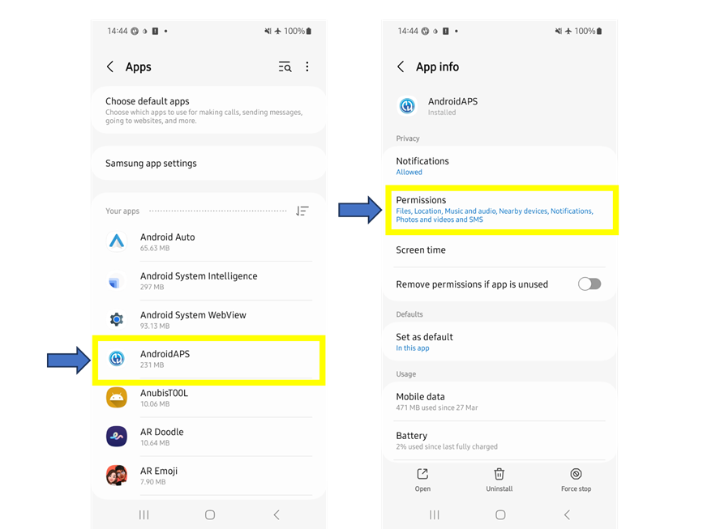

# SMS-Befehle

```{contents} Table of contents
:depth: 2
```

Most remote adjustments (temp targets, carbs, profile switches and, once the client is paired, boluses) can be made with the [**AAPSClient** app](../RemoteFeatures/RemoteMonitoring.md) on an Android phone with an internet connection, see [Master ↔ Client control](#client-master-control) (an iPhone version of **AAPSClient** is in development, see [AAPSClient](AapsClient.md)). SMS commands remain an alternative that works without internet, and the only remote option if you use an iPhone as a follower and do not have **AAPSClient** yet.

**SMS-Befehle sind wirklich hilfreich:**
1. Für die tägliche Remote-Steuerung

2. If you want to remotely bolus insulin without a paired **AAPSClient**

3. In einer Gegend mit schwachem Internet-Empfang, in der Textnachrichten durchkommen, aber der übrige Empfang eingeschränkt ist. Dies hilft besonders in entlegenen Gebieten (z.B. beim Camping oder dem Skifahren.

4. If your other method of remote control (**AAPSClient**) is temporarily not working

## Sicherheitshinweise

Wenn Du **SMS-Befehle** in **AAPS** freischaltest, behalte im Kopf, dass das Smartphone, dass SMS-Befehle versenden soll auch gestohlen werden kann und/oder von jemand anderem verwendet werden kann. Sichere Dein Smartphone mindestens mit einer PIN. Ein starkes Passwort und/oder eine biometrische Sicherung werden dringend empfohlen. Wichtig ist, dass das Smartphone-Passwort sich vom APK-Master-Passwort (das Passwort, das benötigt wird, um die **AAPS** Einstellungen zu ändern) unterscheidet.

Außerdem ist es empfehlenswert, eine [zweite Telefonnummer](#SMSCommands-authorized-phone-numbers) für SMS-Kommandos einzurichten. Mit der zweiten Rufnummer hast Du, für den Fall, dass Dein eigentliches Remote-Smartphone manipuliert wurde, dann die Möglichkeit die SMS-Kommunikation zu [deaktivieren](#SMSCommands-other).

Der voreingestellte Mindestabstand zwischen zwei Bolus-Befehlen beträgt 15 Minuten. Aus Sicherheitsgründen musst Du mindestens zwei berechtigte Rufnummern hinterlegt haben, um diesen Wert verändern zu können. Wenn Du versuchst innerhalb von 15 Minuten einen weiteren Bolus remote abzugeben, erhältst Du die Fehlermeldung "Bolusabgabe aus der Ferne nicht möglich. Versuch es später erneut.”

Wenn das Remote-Kommando (z.B. Bolusabgabe oder Profilwechsel) abgeschlossen ist, wird dies mit einer entsprechenden SMS von AAPS bestätigt. Es ist ratsam, dies so einzustellen, dass Bestätigungstexte an mindestens zwei verschiedene Telefonnummern gesendet werden, falls eines der Empfangstelefone gestohlen wird.

**If you bolus through SMS Commands, you must enter carbs separately (second SMS, AAPSClient...)!** If you fail to do so, the IOB would be correct with too low COB, potentially leading to not performed correction bolus as **AAPS** assumes that you have too much active insulin.

Um die Sicherheit für die sensiblen Befehle zu erhöhen, muss eine Authentifizierungs-App mit einem zeitbasierten Einmalpasswort verwendet werden.

Wenn Du die Möglichkeit SMS-Befehle vom Smartphone der betreuenden Person aus schicken zu können, löschen willst, nutze den Notfall-Knopf „[Authentifikatoren zurücksetzen](#sms-commands-authenticator-setup)” in **AAPS** oder schicke den SMS-Befehl „[SMS STOP](#SMSCommands-other)“. Durch das Zurücksetzen der Authentifikatoren werden ALLE Eltern-/Betreuenden-Smartphones ungültig. Diese müssen anschließend neu eingerichtet werden.

## SMS-Kommandos einrichten

```{contents} The overall process is as follows
:depth: 1
:local: true
```

(sms-commands-authenticator-setup)=
### Konfiguration der Authenticator App

Zwei-Faktor-Authentifizierung wird zur Verbesserung der Sicherheit verwendet.

Lade (aus dem App Store oder von Google Play) eine Authenticator-App herunter und installiere sie auf dem Smartphone der betreuenden Person. Beliebte kostenlose Apps sind:
  - [Authy](https://authy.com/download/)
  - Google Authenticator - [Android](https://play.google.com/store/apps/details?id=com.google.android.apps.authenticator2) / [iOS](https://apps.apple.com/de/app/google-authenticator/id388497605)
  - [LastPass Authenticator](https://lastpass.com/auth/)
  - [FreeOTP Authenticator](https://freeotp.github.io/)

Diese Authenticator-Apps erzeugen einen zeitlich begrenzten, 6-stelligen Code als Einmalkennwort, ähnlich dem des mobilen Bankings oder Online-Shoppings. Du kannst jede Authentifizierungs-App, die RFC 6238 TOTP-Token unterstützt, verwenden. Der Microsoft Authenticator funktioniert nicht.

### Überprüfen der Smartphone-Einstellungen

Gehe auf Deinem Smartphone zu **Apps > AAPS > Berechtigungen**. Stelle sicher, dass **SMS** und **Telefon** zugelassen sind.



```{admonition} "App was denied access to SMS"
:class: tip
Android can block the **SMS** permission for apps that were not installed from an app store, like **AAPS**. If you see this message when you grant the **SMS** permission, open the phone's **Settings > Apps > AAPS**, tap the **⋮** menu (top right) and select **Allow restricted settings**. Then grant the **SMS** permission again.
```


### Datum und Uhrzeit synchronisieren

Die Zeit auf beiden Telefonen muss synchron sein. Am einfachsten erfolgt dies direkt über das Mobilfunknetz. Zeitunterschiede können zu Authentifizierungsproblemen führen.

Prüfe sowohl das **AAPS**-Smartphone, als auch das Smartphone der betreuenden Person darauf, dass Datum und die Uhrzeit synchron sind. Wie Du das genau machen kannst, hängt vom jeweiligen Smartphone ab. Du musst möglicherweise verschiedene Einstellungen ausprobieren.

Beispiel (für Samsung S23): **Einstellungen > Allgemeine Verwaltung > Datum und Zeit**: Stelle sicher, dass **Datum und Uhrzeit automatisch stellen** ausgewählt ist.

Einige Optionen können ausgegraut sein, wenn das Smartphone als Kinder-Smartphone aufgesetzt ist und daher einen Administrator des Familienkontos benötigt. Diese Datums- und Zeiteinstellung wird auf einem (Eltern-) iPhone „automatisch“ gesetzt. Wenn Du Dir nicht sicher bist, ob beide Smartphones synchronisiert sind, ist das nicht schlimm. Wenn es deswegen zu Problemen kommen sollte, kannst Du das auch nach dem Einrichten der SMS-Befehle lösen (bitte um Hilfe, wenn Du sie benötigen solltest).

### AAPS-Einstellungen

Now that the phone settings have been checked, in the **AAPS** app itself, go to [**Configuration** → **Communication**](../SettingUpAaps/ConfigBuilder.md) and enable the **SMS Communicator** plugin.

Open the **SMS Communicator** settings.

Enable **Allow remote commands via SMS**. The **Additional mandatory PIN at token end** and **Authenticator setup** options only appear once this is enabled:


(SMSCommands-authorized-phone-numbers)=
#### Erlaubte Telefonnummern

Gebe die Rufnummer des/der Eltern-Smartphone(s) bzw. die der betreuenden Person ein. Stelle die Landesvorwahl wie im Beispiel unten gezeigt und entferne die erste „0“ der Vorwahl (internationales Format):
* UK Telefonnummer: +447976304596
* US-Telefonnummer: +11234567890
* DE Telefonnummer: +491721234567
* _etc._

Bitte beachte, dass je nach Deinem Standort ein vorangestelltes "+" erforderlich sein kann. To determine this, send a sample text which will show the received format on the **SMS Communicator** plugin screen (**Configuration** → **Communication** → **SMS Communicator** → **Open plugin**).

Möchtest Du mehr als eine Rufnummer hinterlegen, müssen diese durch ein Semikolon und **OHNE Leerzeichen** (das ist wichtig!) getrennt werden. Select **OK**:


#### Remote bolus min distance

- You can define the minimum delay (in minutes) between two boluses issued via SMS.
- Aus Sicherheitsgründen musst Du mindestens zwei erlaubte Telefonnummern hinzufügen, um diesen Wert zu bearbeiten.

#### Zusätzliche obligatorische PIN am Token-Ende

Aus Sicherheitsgründen muss dem Antwortcode eine PIN folgen. Wähle eine PIN aus, die Du (und alle Betreuenden) beim Senden eines SMS-Befehls am Ende des Authentifizierungscodes anhängst.

Anforderungen an die PIN sind:

* at least 6 digits
* digits only

For a safer PIN, do not use the same digit many times (_e.g._ 111111) or a sequence (_e.g._ 123456).


#### Konfiguration der Authenticator App

* Tap **Authenticator setup** and follow the step-by-step instructions on the screen.
* Öffne die auf dem _Eltern-/Betreuenden-Smartphone_ installierte Authenticator-App und füge ein neues Konto bzw. eine neue Verbindung hinzu und
* Use the caregiver phone to scan the QR code shown under **Scan code to setup AAPS OTP codes**.


* Under **Test One-Time-Password**, enter the one-time passcode from the authenticator app on the caregiver phone followed by your PIN in **Code to check**:

Example:
* Der von der Authenticator angezeigte Einmal-Passcode ist 457051
* Deine zwingend erforderliche PIN ist 2401
* Der zu testende Code ist damit: 4570512401

If the entry is correct, the red text “WRONG PIN” will change automatically to a green “OK”. **There is no button you can press!** The process is now complete, there is no “OK” button you need to press after entering the code:


You should now be set up with SMS commands.

Use the **Reset Authenticators** button at the bottom of the **Authenticator setup** screen if you want to remove provisioned authenticators. (By resetting authenticator you make ALL already provisioned authenticators invalid. You will need to set them up again.)

## SMS-Befehle verwenden

### Erste Schritte bei der Nutzung der SMS-Befehle

1)  To check you have set everything up correctly, test the connection by typing “bg” as an SMS message from the caregiver phone to the **AAPS** phone. You should get a response similar to that shown here:


If you don't receive any response, check the [Troubleshooting](#SMSCommands-troubleshooting) section below.

2)  Now try an SMS command that requires the authenticator, _e.g._ “target hypo”. The caregiver’s phone will receive a text back, prompting you to enter the **six-digit authenticator password** from the authenticator app, followed by the additional secret **PIN** known only by caregivers/followers (a string of twelve digits in total, assuming your PIN has 6 digits).

When you try sending an SMS command for the first time, try it in the presence of the **AAPS** phone, to see how it works:


The caregiver’s phone will receive an SMS in reply from **AAPS** to confirm if the remote SMS command has been carried out successfully.

If your command is successful, you will receive a reply to confirm this. If there is a problem you will receive an error message. See [Troubleshooting](#SMSCommands-troubleshooting) below for common errors.

**Hint**: It can be useful to have unlimited SMS on your phone plan (for each phone used) if a lot of SMS will be sent.

### Mahlzeitenbolus über SMS-Befehle abgegeben

Remote bolusing of insulin can be done via **SMS Commands** or through a paired **AAPSClient** (see [Master ↔ Client control](#client-master-control)); it cannot be done through the Nightscout website. Carbs can be announced through SMS or **AAPSClient** as well. With SMS, it is not possible to send both carbs and insulin commands in one single SMS message. These commands must be sent separately as follows:

1)  Send the insulin bolus (_e.g._“bolus 2” will command a bolus of 2 units) through SMS commands is equivalent to **Treatments** → **Insulin** in **AAPS**. 2)  Send the carbs (_e.g._ “carbs 20” will announce 20g of carbs). This is equivalent to **Treatments** → **Carbs** in **AAPS**.

To avoid hypos, it is a good idea to start conservatively, by bolusing **less insulin** than would be needed according to your carb ratio, because you are not taking into account the current glucose level or glucose trend.

**The order in which you send these commands is important**. If you announce a large amount of carbs by any route, and have SMBs enabled, **AAPS** may immediately respond by giving a partial bolus of insulin. So, if you then try to send an insulin bolus _after_ announcing the carbs, you may have a frustrating delay and a “bolus in progress” message, and you then need to check what has been given as an SMB. Or, if you do not realise an SMB is being delivered, and your own subsequent bolus is also successful, too much insulin may be delivered for the meal overall. Therefore, if bolusing for meals remotely, always send the insulin bolus _before_ the carb announcement. If you prefer, you can combine **AAPSClient** with SMS commands: carbs entered on a paired **AAPSClient** need no authentication code and are therefore quicker than SMS commands. Carbs or other treatments entered on the Nightscout website are **not** applied while client control is on; **AAPS** is then in [hardened mode](#client-master-control-hardened-mode).

(SMSCommands-commands)=
## Kommandos

```{contents} List of command groups
:depth: 1
:local: true
```

Commands must be sent in English, the response will be in your local language if the response string is already [translated](#translations-translate-strings-for-AAPS-app). The commands are not case-sensitive, you can use lower or upper case.


The **SMS Commands Tables** below show all the possible SMS commands. _Example values_ are given, to aid understanding. The commands have the same range of possible values (targets, percent profile etc.) which are allowable in the **AAPS** app itself.

(authentication-or-not)=
### Authentifizieren oder nicht?

Some SMS commands give an immediate response, and some SMS commands require strong **authentication** through the Authenticator app. A simple enquiry like “**BG**” (which requests an update on current glucose) is quick to type, doesn't need authenticating, and returns the **AAPS** status information shown below:


Commands which need more security require a code to be entered, for example:


The *Auth* column in the tables below, indicates whether such a strong authentication is required for each command.

### CGM-Daten

| Befehl     | Auth | Funktion & *Antwort*                                                                                                                                                                                              |
| ---------- | ---- | ----------------------------------------------------------------------------------------------------------------------------------------------------------------------------------------------------------------- |
| BG         | Nein | Antwortet mit: Letzter Glukosewert, Delta, IOB (Bolus und Basal), COB<br/>*BZ: 5.6, Delta: -0.2 mmol, IOB: 0.20U (Bolus: 0.10U Basal: 0.10U), COB: 0g*                                                      |
| CAL 5.6/90 | Ja   | Kalibriert das CGM mit dem Wert von 5.6/90<br/>(nutze den für die Maßeinheiten richtigen Wert)<br/>Funktioniert nur, wenn sie korrekt in **AAPS**eingerichtet sind.<br/>*Kalibrierung gesendet* |

### Pumpe

| Befehl               | Auth | Funktion & *Antwort*                                                                                |
| -------------------- | ---- | --------------------------------------------------------------------------------------------------- |
| PUMPE                | Nein | LastConn: 1 minAgo<br/>Temp: 0.00U/h @11:38 5/30min<br/>IOB: 0.5U Reserv: 34U Batt: 100 |
| PUMP DISCONNECT *30* | Ja   | Um die Pumpe für *30* Minuten zu trennen                                                            |
| PUMP CONNECT         | Ja   | Verbindung zur Pumpe wiederhergestellt                                                              |

### Basal

| Befehl            | Auth | Funktion & *Antwort*                          |
| ----------------- | ---- | --------------------------------------------- |
| BASAL 0.3         | Ja   | Startet ein Basal mit 0.3 IE/h für 30 Minuten |
| BASAL 0.3 20      | Ja   | Startet ein Basal mit 0.3 IE/h für 20 Minuten |
| BASAL 30%         | Ja   | Startet ein Basal mit 30% für 30 Minuten      |
| BASAL 30% 50      | Ja   | Startet ein Basal mit 30% für 50 Minuten      |
| BASAL STOP/CANCEL | Ja   | Stoppt das temporäre Basal                    |

Some pumps take a temp basal only in percent, others only in U/h. If you use the other form, **AAPS** answers *"This pump takes a temp basal only in percent, not in U/h."* (or the reverse) and sets nothing. The duration must be a multiple of your pump's temp basal duration step.


### Loop

| Befehl            | Auth | Funktion & *Antwort*                                                                                                                                                                                                                                                              |
| ----------------- | ---- | --------------------------------------------------------------------------------------------------------------------------------------------------------------------------------------------------------------------------------------------------------------------------------- |
| LOOP STATUS       | Nein | Die Antwort hängt vom aktuellen Status ab:<br/> - *Loop ist deaktiviert*, wenn der Loop deaktiviert ist oder LGS<br/> - *Loop ist aktiviert*, wenn der Loop geschlossen oder geöffnet ist<br/> - *Suspended (10 Min)*, wenn der Loop getrennt oder pausiert ist |
| LOOP STOP/DISABLE | Ja   | Die Pumpe schaltet auf die vorprogrammierten Basalrate zurück.<br/>*Loop wurde deaktiviert*                                                                                                                                                                                 |
| LOOP SUSPEND 20   | Ja   | *Das Loopen wird für 20 Minuten unterbrochen*                                                                                                                                                                                                                                     |
| LOOP RESUME       | Ja   | *Loop wurde fortgesetzt*                                                                                                                                                                                                                                                          |
| LOOP CLOSED       | Ja   | *Current loop mode: Closed Loop*                                                                                                                                                                                                                                                  |
| LOOP LGS          | Ja   | *Current loop mode: Low Glucose Suspend*                                                                                                                                                                                                                                          |

### Bolus

Remote bolus is not allowed within 15 min (this value is editable only if 2 phone numbers added) after last bolus command or remote commands! In this case, the response would be *Remote bolus not available. Try again later.* This response is also sent when the pump is currently delivering a bolus.

| Befehl               | Auth | Funktion & *Antwort*                                                                                                                                              |
| -------------------- | ---- | ----------------------------------------------------------------------------------------------------------------------------------------------------------------- |
| BOLUS 1.2            | Ja   |                                                                                                                                                                   |
| BOLUS 0.60 MEAL      | Ja   | Gibt den 0.60 IE Bolus ab <br/>**und** setzt das [temporäre Ziel „Bald essen“](#TempTargets-eating-soon-temp-target)                                        |
| CARBS 5              | Ja   | Trägt 5 Gramm ein, ohne einen Bolus abzugeben                                                                                                                     |
| CARBS 5 17:35/5:35PM | Ja   | Gibt 5 Gramm um 17:35h ein.<br/>Das akzeptiert Format hängt vom <br/> eingestellten Zeitformat (12h/24h) auf dem Smartphone ab.                       |
| EXTENDED 2 120       | Ja   | To start extended bolus 2U for 120 min.<br/>Only for [compatible pumps](#Extended-Carbs-extended-bolus-and-switch-to-open-loop-dana-and-insight-pump-only). |
| EXTENDED STOP/CANCEL | Ja   | Stoppt den erweiterten Bolus                                                                                                                                      |

### Profil

| Befehl         | Auth | Funktion & *Antwort*                                                                                                                                                                                           |
| -------------- | ---- | -------------------------------------------------------------------------------------------------------------------------------------------------------------------------------------------------------------- |
| PROFILE STATUS | Nein | Aktuelles Profil und Prozentsatz                                                                                                                                                                               |
| PROFILE LIST   | Nein | Die aktuelle Liste der Profile in **AAPS**, z.B.:<br/>1. Profil1<br/> 2. Profil2                                                                                                                   |
| PROFILE 1      | Ja   | Um das aktuelle Profil auf Profil 1 aus der Liste zu ändern.<br/>Verwende die Nummern, die vom Befehl **PROFILE LIST**zurückgegeben werden,<br/>nicht die Profilnamen, wie Du sie gespeichert hast |
| PROFILE 2 30   | Ja   | Wechselt vom aktuellen Profil auf Profil2 mit 30%                                                                                                                                                              |

The percentage must be between 30 and 250 %, as in the app. A value outside this range is refused before you are asked for the authentication code.

### Temporäre Ziele

| Befehl                    | Auth | Funktion & *Antwort*                                 |
| ------------------------- | ---- | ---------------------------------------------------- |
| TARGET MEAL/ACTIVITY/HYPO | Ja   | Setzt die temporären Ziele BALD ESSEN/AKTIVITÄT/HYPO |
| TARGET STOP/CANCEL        | Ja   | Bricht das aktuelle temporäre Ziel ab                |


(SMSCommands-other)=
### Andere

| Befehl           | Auth | Funktion & *Antwort*                                                                                                                                                                                                                                                   |
| ---------------- | ---- | ---------------------------------------------------------------------------------------------------------------------------------------------------------------------------------------------------------------------------------------------------------------------- |
| RESTART          | Ja   | Startet AAPS neu. Das hilft bei Problemen, die normalerweise durch einen Neustart behoben werden können.                                                                                                                                                               |
| SMS DISABLE/STOP | Ja   | To disable the SMS Remote Service, reply with the code.<br/>Keep in mind that you'll be able to reactivate it directly<br/>from the **AAPS** master smartphone only.                                                                                       |
| HELP             | Nein | Returns all functions available for interrogation:<br/>BG, LOOP, PUMP, BASAL, BOLUS, EXTENDED, CAL, PROFILE, TARGET, SMS, CARBS, HELP, RESTART<br/>Send further ***HELP ***FUNCTION****** command to list<br/>all options available in this section. |
| HELP BOLUS       |      | *BOLUS 1.2<br/>BOLUS 1.2 MEAL*                                                                                                                                                                                                                                   |

(SMSCommands-troubleshooting)=
## Problembehebung und FAQ

```{contents} List of questions and issues
:depth: 1
:local: true
```

### Was kann mit SMS-Befehlen _nicht_ gemacht werden?

1)  **You cannot set a _temporary_ profile switch** (so for example, setting "profile exercise" for 60 minutes), although you can permanently switch to “profile exercise”. Temporary profile switches can instead be set through **AAPSClient**.

2)  **You cannot cancel automations** or **set user-defined targets** but there are approximate solutions: As an example, imagine the normal profile target is 5.5. You have set an automation in AAPS, to always set a high target of 7.0 between 2.30pm and 3.30pm because of a sports class in school, and a condition of the automation is that “no temp target exists”. This week, you have been told at short notice that the sports class is cancelled, and is being replaced by a pizza-eating session, but your kid is already at school with the **AAPS** phone. If the high temporary target of 7.0 is started by the automation, and you cancel it (on the **AAPS** phone, or remotely) the conditions for the automation are still met and **AAPS** will simply set the high target again, a minute later.

**If you did have access to the AAPS phone**, you could uncheck/modify the automation, or, if you don’t want to do that, you could simply set a new temp target of 5.6 for 60 min by pressing on the target on the main screen, or via **Manage** → **Temp Target**. This would prevent the automation from setting the high target of 7.0.

**If you don’t have access to the AAPS phone** SMS commands can be used for an approximate fix: for example, by using the command “target meal” to set a target of 5.0 for 45 mins (other default targets are 8.0 for activity or hypo, see Table). However, with SMS commands you cannot specify a _specific_ value target value (of 5.6 for 60 minutes, for example), you would need to use **AAPSClient** to do this.

### Was passiert, wenn ich es mir nach dem Senden eines Befehls anders überlege?

**AAPS** will only deliver on the most recent command. So, if you type “bolus 1.5”, and then, without authenticating, you send a new command “bolus 1”, it will ignore the earlier 1.5 command. **AAPS** will always send the caregiver's phone a response to confirm what the SMS command is before you are prompted to enter the authentication code, as well as a response following the action.

### Warum habe ich keine Antwort auf einen SMS-Befehl erhalten?

It could be for one of these reasons:

1)  The message has not got through to the phone (network issues). 2)  **AAPS** is still in the process of processing the request (_e.g._ a bolus, which can take some time to deliver depending on your bolus rate). 3)  The **AAPS** phone does not have a good Bluetooth connection to the pump when the command is received, and the command has failed (this usually creates an alarm on the **AAPS** phone).

### Keinerlei Reaktion auf SMS-Befehle

On the caregiver phone and/or **AAPS** phone, try disabling the following options :
* **Als Chat-Nachricht senden** 
* Wenn Du die Android Messages-App oder die Google Messages-App nutzt, deaktiviere RCS-Nachrichten:
  - Öffne den entsprechenden SMS-Nachrichtenverlauf
  - Klicke auf die drei Punkte in der oberen rechten Ecke
  - Wähle DETAILS aus
  - Aktiviere „Nur SMS und MMS senden“ 

### Fehler beim Ausführen der Befehle

There are several possible reasons the command may not be successful:

* Die Einrichtung der SMS-Befehle ist nicht vollständig/korrekt
* Der Befehl wurde im falschen Format geschickt (z.B. „disconnect pump 45" anstelle von „pump disconnect 45“)
* Du hast eine falschen oder abgelaufenen Authenticator Code genutzt (es hat sich bewährt einige Sekunden auf einen neuen Code zu warten, wenn der andere nur noch kurz gültig sein sollte)
* Der Code + PIN waren richtig, aber die SMS-Kommunikation ist verzögert, sodass **AAPS** angenommen hat, dass der Code abgelaufen ist
* Das **AAPS**-Smartphone ist nicht in Reichweite der Pumpe bzw. hat keinen Kontakt
* Es läuft zeitgleich eine Bolusabgabe

Common errors are shown in the examples below:


### Wie kann ich einen Befehl stoppen, nachdem er bereits authentifiziert wurde?

You can't. However, you can cancel a bolus sent by SMS on the **AAPS** phone itself, by simply cancelling it on the bolusing popup, if you are quick. Many SMS commands (apart from bolusing and carb announcements) can be easily reversed, or actions taken to mitigate unintended effects if a mistake is made.

For errors in bolusing and carb announcements, you can still take action. For example, if you have announced 20g carbs but your child only eats 10g and you (or an onhand caregiver) is unable to delete the treatment in the **AAPS** phone directly, you could set a high temporary target, or set a reduced profile, to encourage **AAPS** to be less aggressive.

### Mehrfach-SMS

If you receive the same message repeatedly (_e.g._ a profile switch) you may have accidentally set up a looping condition with other apps. This could be xDrip, for example. If so, please ensure that xDrip (or any other app) does not upload treatments to NightScout.

If the other app is installed on multiple phones make sure to deactivate upload on all of them.

(sms-commands-too-many-messages)=
### Ich bekomme von SMS-Befehlen zu viele SMS-Nachrichten. Kann ich die Häufigkeit reduzieren oder stoppen?

Using SMS commands may generate a lot of automated messages from the **AAPS** phone to the caregiver’s phone. You will also receive messages, for example “basal profile in pump updated” if you have automations set up in **AAPS**. It can be useful to have unlimited SMS allowance on your **AAPS** phone plan (and for each caregiver phone used) if a lot of SMS will be sent, and to deactivate SMS notifications, alarms or vibrations on all phones. It is not possible to use SMS commands and not receive these updates. Because of this, you may want an alternative way to communicate directly with your child (if they are old enough), instead of SMS. Common alternative communication apps used by **AAPS** caregivers include Whatsapp, Lime, Telegram, and Facebook Messenger.

It is possible to disable the "Profile changed" SMS, when the Profile change originated from Nightscout. To do this, create a file named **exactly**  `do_not_send_sms_on_profile_change` in the `extra` dir of your AAPS directory.
