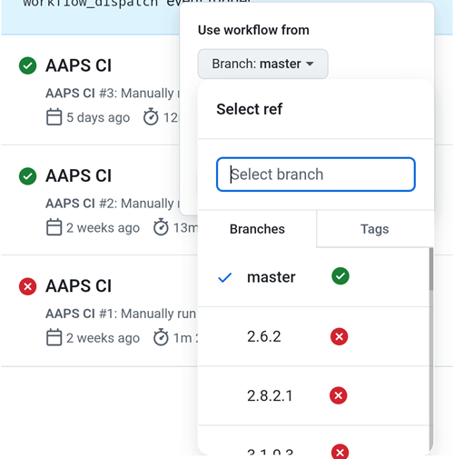

(github-build-apk)=

# Browser build – Step 4: Build the APK

```{note}
This is **Step 4** of the [Browser build](BrowserBuild.md). First complete [Step 3 – Authorize Google Drive](BrowserBuildGoogleDrive.md).
```

## AAPS-CI GitHub Actions to Build the AAPS APK
 - Suitable for general users.

```{tab-set}

:::{tab-item} Wiki
### Run the Workflow to Build the Signed APK

1. Wähle in Deiner AAPS-GitHub-Kopie „Actions“ aus.
2. Klappe alle „Workflows“ auf.
3. Select AAPS-CI


4. Scroll herunter und tippe auf „Run Workflow“.


5. Leave **Use workflow from** on the master branch. In **Select AAPS Version**, select the **AAPS** version you want to build (normally the newest one). Select the [variant](#browserbuild-variant) (fullRelease) and tap Run workflow.


6. Es erscheint die Nachricht „Workflow run was successfully requested“. Mit dem Aktualisieren der Browser-Seite kannst Du den Build-Fortschritt mitverfolgen. Eine grünes Häkchen zeigt an, dass die Aktion „AAPS CI“ abgeschlossen ist. Du hast damit die aktualisierte AAPS-Version erfolgreich erstellt.


### Install the AAPS APK

1. Open your Google Drive
2. Gehe in den AAPS-Ordner und öffne den Ordner mit der neuen Version. Dort findest Du sowohl die Smartphone-Version, als auch die Android-Wear-Version.


:::  

:::{tab-item} Video
<div align="center" style="max-width: 360px; margin: auto; margin-bottom: 2em;">
  <div style="position: relative; width: 100%; aspect-ratio: 9/16;">
    <iframe
      src="https://geo.dailymotion.com/player/x9rdwms.html?video=x9rdwms&loop=true&mute=true"
      loading="lazy"
      style="position: absolute; top: 0; left: 0; width: 100%; height: 100%;"
      frameborder="0"
      allowfullscreen>
    </iframe>
  </div>
</div>
:::  

```

## Build Version selection

**Only AAPS versions from 3.3.2.1 and above will build with the Browser method.**

Tap **Select AAPS Version** and pick the version to build. The newest version is at the top of the list.



(browserbuild-variant)=

## Build Variants selection

*Note: both Android and Android Wear apps will be built automatically.*

  - Select the variant you need:
    - fullRelease: For regular pump usage with full functionality.
    - [aapsclientRelease, aapsclient2Release, aapsclient3Release](#RemoteControl_aapsclient): For caregivers (requires [Nightscout](../SettingUpAaps/Nightscout.md)). `aapsclient3Release` builds **AAPSClient3**, available from **AAPS** version 4.0 (see [About AAPSClient, AAPSClient2 and AAPSClient3](#remotecontrol-aapsclient-versions)).
    - pumpcontrolRelease: To replace your pump app/controller


Variants ending with “Debug” indicate that the APK will be built in debug mode, which is useful for developers for troubleshooting.

<!-- If you want to test the items in a pull request has been moved to dev page /AdvancedOptions/DevBranch.md -->

----

Once the build succeeds, the apk is saved to your Google Drive. Continue with [Transferring and Installing AAPS](TransferringAndInstallingAaps.md).

```{note}
Seit September 2026 kann Googles [Android-Entwicklerverifizierung](#android-developer-verification) je nach Land verhindern, dass sich die APK durch Antippen der Datei installieren lässt. Kostenlose Möglichkeiten das zu umgehen, werden auf dieser Seite erklärt.
```

If the build fails, first [find out what went wrong in the build log](#aaps-ci-read-the-logs), then see [Browser build troubleshooting](../GettingHelp/BrowserBuildTroubleshooting.md). To include a specific commit in your build, see [cherry-pick a commit](#github-cherry-pick).
