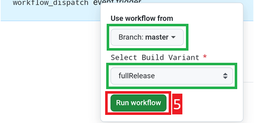
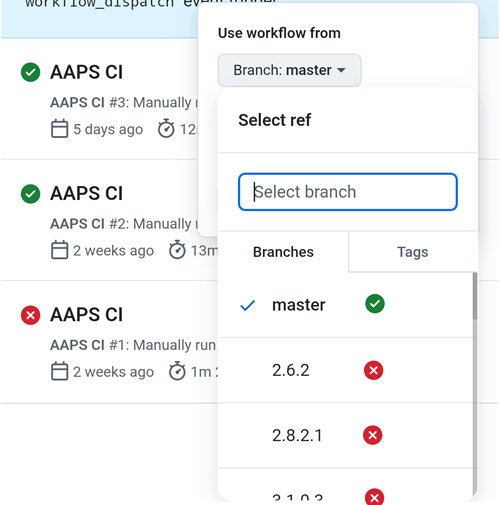

(github-build-apk)=

# Browser-Build – Schritt 4: Die APK erstellen

```{note}
Das ist **Schritt 4** des [Browser-Builds](BrowserBuild.md). Schließe zuerst [Schritt 3 – Google Drive autorisieren](BrowserBuildGoogleDrive.md) ab.
```

## AAPS-CI GitHub Aktionen, um die AAPS APK zu erstellen
 - Passend für die Standard-Benutzer.

```{tab-set}

:::{tab-item} Wiki
### Den Workflow ausführen, um die signierte APK zu erstellen

1. Wähle in Deiner AAPS-GitHub-Kopie „Actions“ aus.
2. Klappe alle „Workflows“ auf.
3. Wähle AAPS-CI


4. Scroll herunter und tippe auf „Run Workflow“.


5. Lass **Use workflow from** auf dem Master-Branch. Wähle unter **Select AAPS Version** die **AAPS**-Version aus, die Du erstellen möchtest (normalerweise die neueste). Wähle die [Variante](#browserbuild-variant) (fullRelease) und tippe auf Run workflow.




6. Es erscheint die Nachricht „Workflow run was successfully requested“. Mit dem Aktualisieren der Browser-Seite kannst Du den Build-Fortschritt mitverfolgen. Eine grünes Häkchen zeigt an, dass die Aktion „AAPS CI“ abgeschlossen ist. Du hast damit die aktualisierte AAPS-Version erfolgreich erstellt.


### Die AAPS-APK installieren

1. Öffne Dein Google Drive
2. Gehe in den AAPS-Ordner und öffne den Ordner mit der neuen Version. Dort findest Du sowohl die Smartphone-Version, als auch die Android-Wear-Version.


:::  

:::{tab-item} Video
<div align="center" style="max-width: 360px; margin: auto; margin-bottom: 2em;">
  <div style="position: relative; width: 100%; aspect-ratio: 9/16;">
    <iframe
      src="https://geo.dailymotion.com/player/x9rdwms.html?video=x9rdwms&loop=true&mute=true"
      loading="lazy"
      style="position: absolute; top: 0; left: 0; width: 100%; height: 100%;"
      frameborder="0"
      allowfullscreen>
    </iframe>
  </div>
</div>
:::  

```

## Auswahl der zu erstellenden Version („Build-Version“)

**Das Erstellen der Version in einem Browser („Browser-Build“) ist erst ab AAPS-Version 3.3.2.1 (oder höher) möglich.**

Tippe auf **Select AAPS Version** und wähle die Version aus, die erstellt werden soll. Die neueste Version steht oben in der Liste.



(browserbuild-variant)=

## Auswahl der zu erstellenden Variante („Build Variants“)

*Hinweis: Sowohl die Android- als auch Android Wear-App werden automatisch erstellt.*

  - Wähle die gewünschte Variante aus:
    - fullRelease: Volle Funktionalität mit normaler Pumpennutzung.
    - [aapsclientRelease, aapsclient2Release, aapsclient3Release](#RemoteControl_aapsclient): für Betreuende (erfordert [Nightscout](../SettingUpAaps/Nightscout.md)). `aapsclient3Release` erstellt **AAPSClient3**, verfügbar ab **AAPS** Version 4.0 (siehe [Über AAPSClient, AAPSClient2 und AAPSClient3](#remotecontrol-aapsclient-versions)).
    - pumpcontrolRelease: Ersetzt die Pumpenbedienung über App oder das separate Bediengerät („controller“)


Varianten mit der Endung „Debug“ bedeuten, dass die APK im Debug-Modus erstellt wird. Das hilft Entwicklern bei der Fehleranalyse.

<!-- If you want to test the items in a pull request has been moved to dev page /AdvancedOptions/DevBranch.md -->

----

Sobald der Build erfolgreich ist, wird die APK in Deinem Google Drive gespeichert. Weiter mit [AAPS auf Dein Smartphone übertragen und installieren](TransferringAndInstallingAaps.md).

```{note}
Seit September 2026 kann Googles [Android-Entwicklerverifizierung](#android-developer-verification) je nach Land verhindern, dass sich die APK durch Antippen der Datei installieren lässt. Kostenlose Möglichkeiten das zu umgehen, werden auf dieser Seite erklärt.
```

Schlägt der Build fehl, [finde zuerst im Build-Log heraus, was schiefgegangen ist](#aaps-ci-read-the-logs), und sieh Dir dann [Fehlerbehebung beim Browser Build](../GettingHelp/BrowserBuildTroubleshooting.md) an. Um einen bestimmten Commit in Deinen Build aufzunehmen, siehe [Commit per Cherry-Pick übernehmen](#github-cherry-pick).
