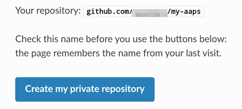

(aaps-builder)=

# Browser-Build mit dem AAPS Builder

```{note}
Das ist der empfohlene Weg, AAPS auf einem **Android-Smartphone** zu erstellen. Er funktioniert auch im Browser jedes Computers. Die anderen Wege für einen Computer oder ein iPhone findest Du in der Übersicht zum [Browser-Build](BrowserBuild.md).
```

```{contents} In this page
:backlinks: entry
:depth: 2
```

Der **AAPS Builder** erstellt die AAPS-App für Dich in GitHub, der kostenlosen Website zum Hosten von Code. Du musst nichts auf Deinem Smartphone installieren und keine Vorbereitungsdatei öffnen.

A setup page walks you through it. Beim ersten Mal dauert es etwa 10 Minuten:

1. Create your own **private copy** of AAPS Builder in your GitHub account: the setup page opens GitHub with everything filled in, you only confirm. The build workflow, the file that tells GitHub how to build AAPS, is already in it.
2. Create or upload your **signing key** (the keystore).
3. Give the key to your repository as a GitHub **secret**.
4. **Build** the app. One build takes 15 to 30 minutes.
5. **Download and install** the app on your phone.

Du musst AndroidAPS **nicht** „forken“: Der AAPS-Quellcode wird bei jedem Build aus dem offiziellen AndroidAPS-Repository heruntergeladen. Google Drive brauchst Du **auch nicht**: Du lädst die App direkt von GitHub herunter.

```{admonition} Where the code comes from
:class: note

The build workflow is maintained by the AAPS developers in the [nightscout/aaps-builder](https://github.com/nightscout/aaps-builder) repository, and your repository is a copy of it. The [workflow](https://github.com/nightscout/aaps-builder/blob/main/.github/workflows/build.yml) in your copy is short: it runs the [build steps](https://github.com/nightscout/aaps-builder/blob/main/.github/workflows/aaps-builder.yml) kept in that repository, so improvements reach you without any change to your repository. You can read both files. Beim Erstellen lädt der Workflow nur den offiziellen AAPS-Quellcode und GitHubs eigene Build-Werkzeuge herunter. Dein Keystore verlässt nie Deinen Browser und Dein privates Repository.
```

(aaps-builder-before-you-start)=

## Bevor Du anfängst

Du brauchst:

- Ein **GitHub-Konto** (kostenlos). Falls Du noch keins hast, leg es zuerst auf [github.com](https://github.com/signup) an.
- Einen **Webbrowser**: Chrome auf Deinem Smartphone oder einen beliebigen Browser auf einem Computer. Melde Dich vor dem Start in diesem Browser bei github.com an.
- **Die GitHub-App auf Deinem Smartphone?** Die kannst Du behalten. Einige Schaltflächen der Einrichtungsseite öffnen dann die App statt Chrome. Building works in the app, but the app **cannot download** the finished AAPS: [step 5](#aaps-builder-step5) shows how to switch to Chrome for the download.
- Deinen **bestehenden Keystore** `(.jks`-Datei), sein Passwort und seinen Alias, falls Du AAPS schon einmal erstellt hast und es ohne Neuinstallation aktualisieren willst.

```{warning}
**Dein Build-Repository muss privat bleiben.** Alles, was ein Build erzeugt, ist für jeden sichtbar, der das Repository sehen kann. Die Einrichtungsseite legt für Dich ein privates Repository an. Never change it to public, and don't **fork** AAPS Builder instead: a fork is always public.

Ein privates Repository bekommt 2000 kostenlose GitHub-Actions-Minuten pro Monat. Das reicht für mehrere Builds.
```

```{warning}
**Neuer oder vorhandener Schlüssel: Davon hängt ab, ob Du AAPS aktualisieren kannst.**

- **Du hast AAPS schon auf Deinem Smartphone, erstellt mit einem Keystore, den Du noch hast**: Wähle auf der Einrichtungsseite **I already have a keystore** und lade ihn hoch. Dein nächster Build aktualisiert AAPS dann direkt. Du hast AAPS mit dem bisherigen Browser-Build erstellt (Dein eigener Fork)? Dann liegt Dein Keystore in Deinem Fork: [Besorge Dir zuerst eine Kopie](#aaps-builder-from-fork) davon.
- **Du erstellst AAPS zum ersten Mal, oder Du hast Deinen Keystore oder sein Passwort verloren**: Wähle **Create a new key**. Eine App, die mit einem neuen Schlüssel signiert ist, kann kein AAPS aktualisieren, das mit einem anderen Schlüssel signiert wurde. You must export your settings, copy the file off your phone, uninstall the old AAPS, install the new one, then import your settings: see [Reinstalling AAPS with a new keystore](#reinstall-aaps).

Nutze danach immer denselben Schlüssel. Wenn Du einen neuen Schlüssel erstellst, lade die Sicherung herunter, die die Seite anbietet, und bewahre sie zusammen mit Passwort und Alias (`key0`) an einem sicheren Ort außerhalb Deines Smartphones auf.
```

(aaps-builder-from-fork)=

## Umstieg vom bisherigen Browser-Build (Fork)

Überspringe diesen Abschnitt, wenn Du AAPS nie mit dem bisherigen Browser-Build erstellt hast (Deine eigene Kopie bzw. Dein Fork von AndroidAPS in GitHub, mit Vorbereitungsdatei und Google Drive).

Dein Keystore ist als Secrets in Deinem Fork gespeichert. GitHub zeigt ein Secret nie wieder an, deshalb kannst Du es nicht in Dein neues Repository kopieren. Get a copy of your keystore first, then use it in [step 2](#aaps-builder-step2) with **I already have a keystore**.

```{warning}
Wähle nicht **Create a new key**. Ein AAPS, das mit einem neuen Schlüssel erstellt wurde, kann das AAPS auf Deinem Smartphone nicht aktualisieren.
```

Welcher Fall trifft auf Dich zu?

- **Du hast Option 2 genutzt** (Du hast Deinen eigenen Keystore aus Android Studio hochgeladen), und Du hast die `.jks`-Datei, ihre Passwörter und ihren Alias noch: Dann musst Du hier nichts tun. Use that file in step 2.
- **Du hast Option 1 genutzt** (die Vorbereitungsdatei hat Deinen Schlüssel erzeugt), oder Du hast Deine Keystore-Datei nicht mehr: Exportiere sie wie unten beschrieben aus Deinem Fork.

So exportierst Du Deinen Keystore aus Deinem Fork:

1. Öffne in Deinem Fork **Settings** → **Secrets and variables** → **Actions** und lege ein Secret mit dem Namen `ZIP_PASSWORD` an. Wähle ein Passwort nur aus englischen Buchstaben und Ziffern. Es schützt die Datei, die Du gleich erzeugst.
2. Öffne den Tab **„Actions“** Deines Forks, tippe auf **„CI Keystore Export“** und dann auf **„Run workflow“**. Mehr dazu: [Keystore exportieren](#ci-keystore-export).
3. Sobald der Durchlauf ein grünes Häkchen hat, öffne Dein Google Drive: Die Datei `keystore.zip` liegt im Ordner **AAPS** → **KeyStore**. Schlägt der Durchlauf beim Google-Drive-Schritt fehl, ist der Google-Drive-Zugriff Deines Forks abgelaufen: siehe [Google refresh token expired](#aaps-ci-google-token-expired).
4. Lade `keystore.zip` herunter und öffne sie mit Deinem `ZIP_PASSWORD`: am Computer oder auf dem Smartphone mit einer Dateimanager-App, die passwortgeschützte ZIP-Dateien öffnen kann. Sie enthält:
   - `keystore.jks`: Deinen Keystore,
   - `keyStoreInfo.txt`: Dein `KEYSTORE_PASSWORD`, `KEY_PASSWORD` und `ALIAS` (meist `key0`).
5. Kopiere `keystore.jks` auf Dein Smartphone (oder in Dein Google Drive, damit Du sie dort auswählen kannst).

In [step 2](#aaps-builder-step2) of the setup page:

1. Tippe auf **I already have a keystore**.
2. Wähle unter **Keystore-Datei**, die Datei `keystore.jks`.
3. Gib unter **Keystore-Password** das `KEYSTORE_PASSWORD` aus `keyStoreInfo.txt` ein.
4. Wähle unter **Key Alias** den `ALIAS` aus `keyStoreInfo.txt` aus.
5. Unterscheiden sich `KEY_PASSWORD` und `KEYSTORE_PASSWORD`, entferne das Häkchen bei **Key password is the same as the keystore password** und gib das `KEY_PASSWORD` ein.

Bewahre `keystore.zip` und das `ZIP_PASSWORD` an einem sicheren Ort außerhalb Deines Smartphones auf: Das ist die Sicherung Deines Schlüssels.

To also save the builds of AAPS Builder in Google Drive, do [step 6](#aaps-builder-google-drive): the setup page gets a new `GDRIVE_OAUTH2` for you. Deinen Fork kannst Du behalten, bis das mit dem AAPS Builder erstellte AAPS auf Deinem Smartphone installiert ist.

## Einrichtungsseite öffnen

**→ [AAPS-Builder-Einrichtungsseite öffnen](#aaps-builder-setup)**

The setup page is part of this documentation, in your language. Keep this page open in another tab as well: the sections below explain each step of the setup page in more detail, with screenshots.

Die Einrichtungsseite öffnet jede GitHub-Seite in einem neuen Chrome-Tab. Um zur Einrichtungsseite zurückzukehren, tippe auf die Tab-Schaltfläche neben der Adressleiste von Chrome (das Quadrat mit einer Zahl) und wähle die AAPS-Builder-Einrichtungsseite.

Die Einrichtungsseite läuft komplett in Deinem Browser: Dein Schlüssel und Deine Passwörter werden nirgendwohin gesendet, außer in das GitHub-Secret, in das Du sie selbst einfügst. Nur Dein GitHub-Benutzername geht an GitHub, um zu prüfen, ob es ihn gibt. Sie merkt sich Deinen GitHub-Benutzernamen und den Namen Deines Repositorys, sodass Du jederzeit zurückkommen kannst, um Deine Secrets-Seite oder Deine Builds wieder zu öffnen.


(aaps-builder-step1)=

## Schritt 1 – Dein privates Build-Repository anlegen

This step creates your own private copy of AAPS Builder in your GitHub account, with the build workflow already in it. Nur Du kannst es und die damit erstellten Apps sehen.

1. Stelle sicher, dass Du in diesem Browser bei github.com angemeldet bist.

2. Gib unter **Dein GitHub-Benutzername** Deinen GitHub-Benutzernamen ein, nicht Deine E-Mail-Adresse. Die Seite prüft ihn bei GitHub: **✓ GitHub user found** bedeutet, dass er stimmt.

3. Übernimm unter **Name Deines Repositorys** den Vorschlag `my-aaps`. Hast Du Dein Repository schon unter einem anderen Namen angelegt, gib genau diesen Namen ein.

   ```{note}
   **Already have an AAPS Builder repository** (made with an earlier version of the setup page)? Don't create a new one: type its exact name, skip **Create my private repository**, and update its workflow once as explained in [Updating AAPS](#aaps-builder-updates). Your secrets stay as they are. If you want a new repository anyway, choose a name you don't have yet, for example `my-aaps-2`, and use the same keystore in step 2.

   Don't type the name of your fork of AndroidAPS: a fork is public, and it already builds with its own **AAPS CI** workflow.
   ```

   

4. Prüfe die Zeile **Your repository:**. Dort steht `github.com/<your username>/my-aaps`. The setup page remembers the name from your last visit: check it every time before you use its buttons.

5. Tippe auf **Create my private repository**.

   

6. GitHub opens **Create a new repository** in a new tab. Everything is already filled in: under **Start with a template**, the template `nightscout/aaps-builder` with **Include all branches** off, and under **General**, your account as **Owner** and the name you chose.

   

   Don't change anything.

7. Scroll down: under **Configuration**, **Choose visibility** is already **Private**. Tap the green **Create repository** button.

   

   GitHub shows your new repository: it contains a folder `.github` (with the build workflow) and a file `README.md`. Wechsle für Schritt 2 **zurück in den Tab der Einrichtungsseite**: Tippe auf die Tab-Schaltfläche neben der Adressleiste von Chrome und wähle die Einrichtungsseite.

```{warning}
**Your new repository is empty**, with no files? It was not created from the template, and it cannot build. Delete it (**Settings** → bottom of the page → **Delete this repository**), then tap **Create my private repository** on the setup page again.
```

(aaps-builder-step2)=

## Step 2 – Your signing key

Die App muss mit Deinem eigenen Schlüssel signiert werden. Wähle einen der beiden Tabs. Lies vorher den [Hinweis zu neuem oder vorhandenem Schlüssel](#aaps-builder-before-you-start).


### Ich habe schon einen Keystore

1. Tippe auf **I already have a keystore**.
2. Wähle unter **Keystore-Datei** Deine `.jks`-Datei (oder `.keystore`, `.p12`, `.pfx`). Auf dem Smartphone kopiere die Datei vorher auf das Smartphone oder in Dein Google Drive.
3. Gib unter **Keystore password** das Keystore-Passwort ein.
4. Wähle unter **Key Alias** Deinen Alias aus der Liste, oder tippe ihn ein, falls es keine Liste gibt. Bei Keystores aus Android Studio ist das meist `key0`.
5. Unterscheiden sich Dein Key-Passwort und Dein Keystore-Passwort, entferne das Häkchen bei **Key password is the same as the keystore password** und gib das Key-Passwort ein.
6. Tippe auf **Check and continue**.

Die Seite prüft Passwort und Alias auf Deinem Gerät. **Keystore OK! Continue with step 3.** means everything is right. Steht dort, dass das Passwort erst beim Build geprüft wird, mach trotzdem weiter: Der Build meldet sich, falls etwas nicht stimmt.

### Neuen Schlüssel erstellen

1. Tippe auf **Create a new key**.

2. Wähle ein Passwort und gib es zweimal ein. Regeln: mindestens 8 Zeichen, nur die Buchstaben a–z und A–Z, die Ziffern 0–9 und Zeichen wie `! ? #`. Keine Leerzeichen, keine Umlaute oder Buchstaben mit Akzent und kein `|`.

3. Tippe auf **Create key**. Es dauert ein paar Sekunden, bis **Key created** erscheint.

   

4. Tippe auf **Download backup (aaps-keystore.jks)**. Fragt Chrome **Datei noch einmal herunterladen?**, liegt schon eine ältere Sicherung mit demselben Namen auf Deinem Smartphone: Tippe auf **Herunterladen**. Chrome speichert den neuen Schlüssel dann als `aaps-keystore (1).jks`. Das ist die Datei, die zu diesem Schlüssel gehört. Bewahre sie auf und verwechsle sie nicht mit der älteren.

   Bewahre diese drei Dinge zusammen an einem sicheren Ort außerhalb Deines Smartphones auf (zum Beispiel in Deinem eigenen Cloud-Speicher):

   - die Datei `aaps-keystore.jks`,
   - Dein Passwort
   - den Alias des Schlüssels: **`key0`**.

   Du brauchst alle drei, falls Du AAPS jemals auf anderem Weg erstellst, zum Beispiel mit Android Studio. Schlüssel, die mit einer früheren Version der Einrichtungsseite erstellt wurden, haben den Alias `aaps`.

   

(aaps-builder-step3)=

## Step 3 – Give the key to your repository

Step 3 unlocks when step 2 is done. Dein Schlüssel, seine Passwörter und sein Alias werden in einen einzigen Wert gepackt, das Secret `KEYSTORE_SET`.

1. Tippe auf **Open the secrets page**.


2. GitHub öffnet die Seite **New secret** Deines Repositorys. Auf dem Smartphone liegt sie unterhalb des Einstellungsmenüs: Scrolle nach unten.


3. Wechsle in den Tab der Einrichtungsseite und tippe auf **Copy name**. Wechsle zurück in den GitHub-Tab und füge den Namen in das kleine Feld **Name** ein. Der Name lautet `KEYSTORE_SET`.

4. Wechsle in den Tab der Einrichtungsseite und tippe auf **Copy secret**. Wechsle zurück in den GitHub-Tab und füge es in das große Feld **Secret** ein (auf dem Smartphone lange drücken). Das Secret ist ein sehr langer Code mit Tausenden Zeichen: Die Einrichtungsseite zeigt seine ersten Zeichen neben der Schaltfläche an. Füge dort nicht das Wort `KEYSTORE_SET` ein.

5. Tippe auf **Add secret**. `KEYSTORE_SET` erscheint jetzt unter **Repository secrets**.


Das musst Du nur einmal machen.

```{tip}
GitHub zeigt **Page not found** (404)? Prüfe zuerst, ob Du in diesem Browser bei github.com angemeldet bist: Bei privaten Repositorys zeigt GitHub 404 an, wenn Du nicht angemeldet bist. Andernfalls passt der Benutzername oder der Repository-Name aus Schritt 1 nicht zu Deinem Repository. Prüfe den Namen auf github.com, korrigiere ihn in Schritt 1 und tippe noch einmal auf die Schaltfläche.
```

(aaps-builder-step4)=

## Step 4 – Build the app

1. Tippe auf der Einrichtungsseite auf **Open the build page**. GitHub öffnet die Seite **Build AAPS** Deines Repositorys.

   

   Öffnet sich stattdessen die **GitHub-App**: Tippe auf **RUN WORKFLOW**, prüfe Version und Variante und tippe noch einmal auf **RUN WORKFLOW**. Die App zeigt eventuell weiterhin **Nothing to see here**: Zieh die Liste nach unten, um sie zu aktualisieren und Deinen Build zu sehen. Mach dann mit Punkt 4 unten weiter.

2. If GitHub asks, tap the green button to enable workflows.

   The list of workflows shows two entries: use **Build AAPS**. Ignore **AAPS Builder**: it holds the build steps and has no **Run workflow** button.

3. Tippe auf **Run workflow**. Ein kleines Formular öffnet sich:
   - **Version**: keep `latest` to build the newest AAPS release, or type a release number such as `4.0.0`.
   - **Variant**: Behalte `fullRelease` für die normale Nutzung mit einer Pumpe. Die anderen Varianten werden unter [Build-Varianten](#browserbuild-variant) erklärt. `aapsclient3Release` builds **AAPSClient3**, available from **AAPS** version 4.0 (see [About AAPSClient, AAPSClient2 and AAPSClient3](#remotecontrol-aapsclient-versions)).
   - Tippe auf die grüne Schaltfläche **Run workflow**.

   

4. Der Build startet und zeigt **In progress**, mit zwei Teilen: **AAPS / Check**, dann **AAPS / Build AAPS**.

   

5. Warte 15 bis 30 Minuten. Ein grünes Häkchen bedeutet, dass der Build fertig ist. Ein rotes Kreuz bedeutet, dass er fehlgeschlagen ist: Öffne den Build, um die Meldung zu lesen, und schau dann unter [Problembehandlung](#aaps-builder-troubleshooting) nach.

   

   ```{tip}
   **E-Mail, wenn ein Build fertig ist:** GitHub schickt Dir nur dann eine E-Mail, wenn ein Build fehlschlägt. Damit Du auch bei Erfolg eine bekommst: Öffne auf github.com Dein Profilbild → **Settings** → **Notifications** → **System** → **Actions** und entferne das Häkchen bei **Only notify for failed workflows**.
   ```

Wenn es keine Schaltfläche **Build AAPS** oder **Run workflow** gibt:

- Open your repository and check that it has a folder `.github` with the file `workflows/build.yml`. If the repository is empty, it was not created from the template: delete it (**Settings** → bottom of the page → **Delete this repository**) and do [step 1](#aaps-builder-step1) again with the button.
- Öffne den Tab **Actions**. Steht dort, dass Workflows deaktiviert sind, tippe auf die grüne Schaltfläche, um sie zu aktivieren, und dann in der Liste auf **Build AAPS**.

(aaps-builder-step5)=

## Step 5 – Install the app on your phone

```{warning}
**Vor jedem Update** [exportiere Deine Einstellungen](#ExportImportSettings-Automating-Settings-Export) in AAPS und kopiere die Datei **weg vom Smartphone** (Google Drive, Dropbox …). Öffne auf Deinem Smartphone die Einrichtungsseite in Chrome.
```

1. Öffne auf Deinem Smartphone die Einrichtungsseite in **Chrome**. Melde Dich bei github.com an, falls Du gefragt wirst.
2. Tippe auf **Open my builds** und dann auf den neuesten Build mit grünem Häkchen.

   ```{admonition} The GitHub app opened instead of Chrome?
   :class: note

   Die GitHub-App kann keine Builds herunterladen. Öffne in der App den neuesten Build und tippe auf **Artifacts ↗**, oder tippe oben auf das Teilen-Symbol und wähle **Chrome** (bzw. **Link kopieren** und füge den Link in die Adressleiste von Chrome ein). Der Build öffnet sich in Chrome: Mach dort mit dem nächsten Schritt weiter.

   Damit GitHub-Links nicht mehr in der App geöffnet werden: Android-**Einstellungen** → **Apps** → **GitHub** → **Standardmäßig öffnen** → **Unterstützte Links öffnen** ausschalten.
   ```

   

3. Scrolle nach unten zur Build-Zusammenfassung und tippe auf den Link **Download AAPS**.

   

   ```{tip}
   Scrolle mit dem Finger auf dem Text, nicht auf dem Diagramm der Build-Schritte: Sonst verschiebt sich das Diagramm statt der Seite.
   ```

   Du kannst auch weiter nach unten zu **Artifacts** scrollen und auf das Download-Symbol neben `aaps-….apk` tippen.

   

4. Wenn der Download fertig ist, öffne das Chrome-Menü **⋮** → **Downloads**, tippe auf `aaps-….apk` und wähle **Installieren**. Falls Du gefragt wirst, erlaube die Installation von Apps aus dieser Quelle.

   

`aaps-wear-….apk` ist die Smartwatch-App. Nutzt Du keine Smartwatch, überspringe sie.

Die App bleibt **14 Tage** auf der Build-Seite. Sie erscheint nicht in Deinem Repository unter **Code**. Kopiere sie zusammen mit Deinen Einstellungsexporten an einen sicheren Ort außerhalb Deines Smartphones.

Weitere Wege, die App zu installieren, findest Du unter [AAPS übertragen und installieren](TransferringAndInstallingAaps.md).

```{note}
Seit September 2026 kann Googles [Android-Entwicklerverifizierung](#android-developer-verification) je nach Land verhindern, dass sich die APK durch Antippen der Datei installieren lässt. Kostenlose Möglichkeiten das zu umgehen, werden auf dieser Seite erklärt.
```

(aaps-builder-google-drive)=

## Step 6 (optional) – Also save the app in Google Drive

Du kannst jeden Build auch in Deinem Google Drive speichern im Ordner `AAPS/<version>` speichern lassen. Das ist optional: Die App ist immer auf der Build-Seite verfügbar.

Dafür brauchst Du ein weiteres Secret, `GDRIVE_OAUTH2`. Step 6 of the setup page gets it from Google for you, on a phone or a computer. **AAPS** can then only see and change the files it creates in your Google Drive, nothing else.

1. On the setup page, tap **Connect Google Drive**. Google opens in a new tab.
2. Choose your Google account and allow access. If Google says the app is not verified, tap **Advanced**, then **Go to …**.
3. The new tab then shows an error such as **This site can't be reached** or **127.0.0.1 refused to connect**. **This is expected:** Google's answer is in the address of that tab. Tap the address bar, select the whole address (it starts with `http://127.0.0.1:47913/`) and copy it.
4. Go back to the setup page tab within a few minutes: Google's answer is only valid for a short time, and only once. Paste the address into **Paste the copied address here** and tap **Get GDRIVE_OAUTH2**. The page shows **GDRIVE_OAUTH2 is ready**.
5. Tippe auf **Open the secrets page**. Tippe auf **Copy name**, und füge ihn in das kleine Feld **Name** ein (der Name ist `GDRIVE_OAUTH2`). Tap **Copy secret**, paste it into the big **Secret** box and tap **Add secret**.

Ab dem nächsten Build werden die APKs zusätzlich in Google Drive gespeichert.

Already have a `GDRIVE_OAUTH2` value from the preparation file of the other browser build methods? It works too: add it as the `GDRIVE_OAUTH2` secret.

Wenn Du 6 Monate lang nichts erstellst oder Dein Google-Passwort änderst, entzieht Google den Zugriff. Der Build meldet das dann: Wiederhole diese Schritte. Siehe [Google Refresh Token Expired](#aaps-ci-google-token-expired).

(aaps-builder-updates)=

## Aktualisiere AAPS

Dein Repository erstellt nie etwas von selbst: Du entscheidest, wann welche Version und welche Variante erstellt wird. Wenn eine neue AAPS-Version erscheint:

1. [Back up your settings](#aaps-builder-step5) as explained in step 5.
2. Build the new version as in [step 4](#aaps-builder-step4). Behalte `latest` oder gib die Versionsnummer ein.
3. Download and install it as in [step 5](#aaps-builder-step5).

**Updates of the build steps** reach you by themselves: at every build, your repository runs the build steps released by the AAPS developers in nightscout/aaps-builder. Nothing changes in your repository, and there is no automatic build.

**Updates of your workflow file** are rare: only when the **Run workflow** form changes, for example for a new build variant, or once if your repository was made with an earlier version of the setup page (an empty repository with a short workflow file) or from the old template. The [Docs updates & changes](../Maintenance/DocumentationUpdate.md) page says so. Your `KEYSTORE_SET` secret stays as it is. On the setup page, open **Updating your copy** at the end of step 1:

1. Tap **Open the newest workflow**. On a computer, click the **copy icon** ("Copy raw file") at the top right of the file. On a phone, open the **plain-text version** instead, press and hold the text, then **Select all** and **Copy**.
2. Tap **Open my workflow file**.
3. Replace the whole text with the copied workflow (long press on a phone: **Select all**, then **Paste**).
4. Tap **Commit changes…**, then **Commit changes**.

The first line of the file shows its version.

(aaps-builder-troubleshooting)=

## Problembehandlung

To see why a build failed, [read the build log](#aaps-ci-read-the-logs): the step names are different, but you find the error the same way. You can also [update a secret](#aaps-ci-update-secret) and [run the build again](#aaps-ci-rerun) the same way.

- **No "Build AAPS" or "Run workflow" button, or the repository is empty**: the repository was not created from the template. Delete it (**Settings** → bottom of the page → **Delete this repository**) and do [step 1](#aaps-builder-step1) again with the **Create my private repository** button.
- **Der Build bricht mit „This repository is PUBLIC“ ab**: Öffne in Deinem Repository **Settings** → **General** → **Danger Zone** → **Change visibility** → **Private** und erstelle dann erneut.
- **"Secret KEYSTORE_SET is missing"**: do step 3 of the setup page.
- **"The secret is too short"**, **"The secret is not a valid code"** oder **"The secret does not contain a keystore"**: Im Secret steht der falsche Text, oft das Wort `KEYSTORE_SET` selbst oder nur ein Teil des Codes. In your repository, open **Settings** → **Secrets and variables** → **Actions**, edit `KEYSTORE_SET` and paste the long code from **Copy secret** again (redo step 2 of the setup page first if you closed it).
- **"Keystore, password or alias is wrong"**: check your keystore's password and alias, then redo steps 2 and 3 of the setup page.
- **"Version … does not exist"**: Die eingegebene Version ist keine AAPS-Version. Verwende `latest` oder prüfe die Versionsnummer.
- **"Variant … is not supported"**: your workflow file is an older version. Replace it as explained in [Updating AAPS](#aaps-builder-updates).
- **"Page not found" (404), wenn die Einrichtungsseite GitHub öffnet**: Melde Dich im selben Browser bei github.com an (bei privaten Repositorys zeigt GitHub 404 an, wenn Du nicht angemeldet bist). Bist Du angemeldet, passt der Benutzername oder Repository-Name aus Schritt 1 der Einrichtungsseite nicht zu Deinem Repository. Gib die exakten Namen ein.
- **"No GitHub user with this name"** in Schritt 1: Gib Deinen GitHub-Benutzernamen so ein, wie er in Deinem GitHub-Profil steht, nicht Deine E-Mail-Adresse.
- **Kein Download-Link, oder die GitHub-App hat sich geöffnet**: Die GitHub-App kann keine Builds herunterladen. Open the build in Chrome as explained in [step 5](#aaps-builder-step5). Damit GitHub-Links nicht mehr in der App geöffnet werden: Android **Einstellungen** → **Apps** → **GitHub** → **Standardmäßig öffnen** → deaktiviere **Unterstützte Links öffnen**.
- **"Google Drive access has expired or was revoked"**: redo [step 6](#aaps-builder-google-drive) and update the `GDRIVE_OAUTH2` secret.

For other GitHub and Google Drive issues, see [Browser build troubleshooting](../GettingHelp/BrowserBuildTroubleshooting.md).

```{toctree}
:hidden:

AAPS Builder setup page <BrowserBuildAapsBuilderSetup.md>
```
