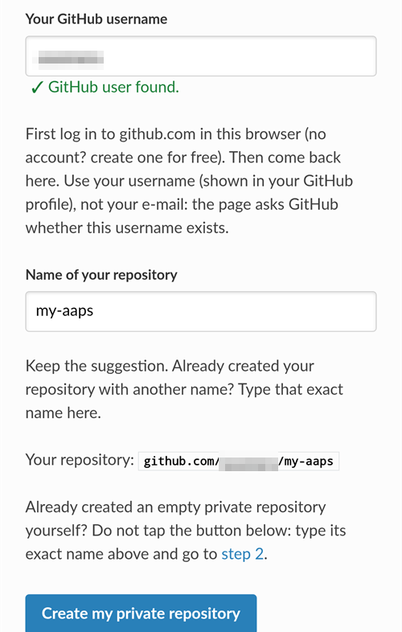
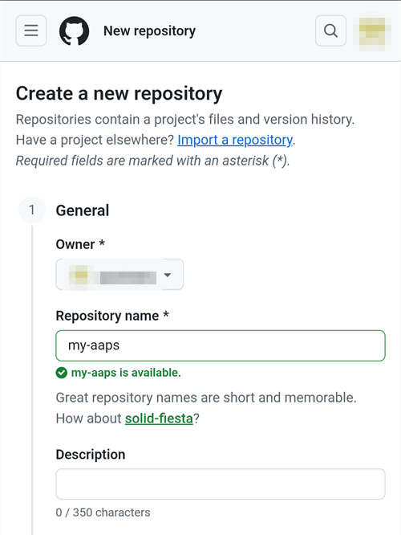
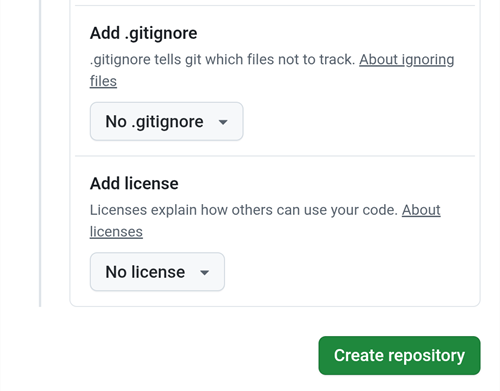
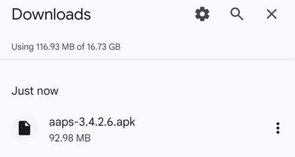

(aaps-builder)=

# Browser-Build mit dem AAPS Builder

```{note}
Das ist der empfohlene Weg, AAPS auf einem **Android-Smartphone** zu erstellen. Er funktioniert auch im Browser jedes Computers. Die anderen Wege für einen Computer oder ein iPhone findest Du in der Übersicht zum [Browser-Build](BrowserBuild.md).
```

```{contents} In this page
:backlinks: entry
:depth: 2
```

Der **AAPS Builder** erstellt die AAPS-App für Dich in GitHub, der kostenlosen Website zum Hosten von Code. Du musst nichts auf Deinem Smartphone installieren und keine Vorbereitungsdatei öffnen.

Eine Einrichtungsseite führt Dich durch die Schritte. Beim ersten Mal dauert es etwa 10 Minuten:

1. Lege in Deinem GitHub-Konto Deine eigene **private Kopie** von AAPS Builder an: Die Einrichtungsseite öffnet GitHub mit allen Angaben bereits ausgefüllt, Du bestätigst nur noch. Der Build-Workflow, also die Datei, die GitHub sagt, wie AAPS erstellt wird, ist darin schon enthalten.
2. Erstelle Deinen **Signaturschlüssel** (den Keystore) oder lade ihn hoch.
3. Übergib den Schlüssel als GitHub-**Secret** an Dein Repository.
4. **Erstelle** die App. Ein Build (Erstellprozess) dauert 15 bis 30 Minuten.
5. **Lade die App herunter und installiere** sie auf Deinem Smartphone.

Du musst AndroidAPS **nicht** „forken“: Der AAPS-Quellcode wird bei jedem Build aus dem offiziellen AndroidAPS-Repository heruntergeladen. Google Drive brauchst Du **auch nicht**: Du lädst die App direkt von GitHub herunter.

```{admonition} Where the code comes from
:class: note

Der Build-Workflow wird von den AAPS-Entwicklern im Repository [nightscout/aaps-builder](https://github.com/nightscout/aaps-builder) gepflegt, und Dein Repository ist eine Kopie davon. Der [Workflow](https://github.com/nightscout/aaps-builder/blob/main/.github/workflows/build.yml) in Deiner Kopie ist kurz: Er führt die [Build-Schritte](https://github.com/nightscout/aaps-builder/blob/main/.github/workflows/aaps-builder.yml) aus, die in jenem Repository liegen, sodass Verbesserungen bei Dir ankommen, ohne dass Du Dein Repository ändern musst. Du kannst beide Dateien lesen. Beim Erstellen lädt der Workflow nur den offiziellen AAPS-Quellcode und GitHubs eigene Build-Werkzeuge herunter. Dein Keystore verlässt nie Deinen Browser und Dein privates Repository.
```

(aaps-builder-before-you-start)=

## Bevor Du anfängst

Du brauchst:

- Ein **GitHub-Konto** (kostenlos). Falls Du noch keins hast, leg es zuerst auf [github.com](https://github.com/signup) an.
- Einen **Webbrowser**: Chrome auf Deinem Smartphone oder einen beliebigen Browser auf einem Computer. Melde Dich vor dem Start in diesem Browser bei github.com an.
- **Die GitHub-App auf Deinem Smartphone?** Die kannst Du behalten. Einige Schaltflächen der Einrichtungsseite öffnen dann die App statt Chrome. Das Erstellen funktioniert in der App, aber die App **kann das fertige AAPS nicht herunterladen**: [Schritt 5](#aaps-builder-step5) zeigt, wie Du für den Download zu Chrome wechselst.
- Deinen **bestehenden Keystore** `(.jks`-Datei), sein Passwort und seinen Alias, falls Du AAPS schon einmal erstellt hast und es ohne Neuinstallation aktualisieren willst.

```{warning}
**Dein Build-Repository muss privat bleiben.** Alles, was ein Build erzeugt, ist für jeden sichtbar, der das Repository sehen kann. Die Einrichtungsseite legt für Dich ein privates Repository an. Stelle es niemals auf öffentlich um, und erstelle stattdessen auch keinen **Fork** von AAPS Builder: Ein Fork ist immer öffentlich.

Ein privates Repository bekommt 2000 kostenlose GitHub-Actions-Minuten pro Monat. Das reicht für mehrere Builds.
```

```{warning}
**Neuer oder vorhandener Schlüssel: Davon hängt ab, ob Du AAPS aktualisieren kannst.**

- **Du hast AAPS schon auf Deinem Smartphone, erstellt mit einem Keystore, den Du noch hast**: Wähle auf der Einrichtungsseite **I already have a keystore** und lade ihn hoch. Dein nächster Build aktualisiert AAPS dann direkt. Du hast AAPS mit dem bisherigen Browser-Build erstellt (Dein eigener Fork)? Dann liegt Dein Keystore in Deinem Fork: [Besorge Dir zuerst eine Kopie](#aaps-builder-from-fork) davon.
- **Du erstellst AAPS zum ersten Mal, oder Du hast Deinen Keystore oder sein Passwort verloren**: Wähle **Create a new key**. Eine App, die mit einem neuen Schlüssel signiert ist, kann kein AAPS aktualisieren, das mit einem anderen Schlüssel signiert wurde. Du musst Deine Einstellungen exportieren, die Datei vom Smartphone herunterkopieren, das alte AAPS deinstallieren, das neue installieren und dann Deine Einstellungen importieren: siehe [AAPS mit einem neuen Keystore neu installieren](#reinstall-aaps).

Nutze danach immer denselben Schlüssel. Wenn Du einen neuen Schlüssel erstellst, lade die Sicherung herunter, die die Seite anbietet, und bewahre sie zusammen mit Passwort und Alias (`key0`) an einem sicheren Ort außerhalb Deines Smartphones auf.
```

(aaps-builder-from-fork)=

## Umstieg vom bisherigen Browser-Build (Fork)

Überspringe diesen Abschnitt, wenn Du AAPS nie mit dem bisherigen Browser-Build erstellt hast (Deine eigene Kopie bzw. Dein Fork von AndroidAPS in GitHub, mit Vorbereitungsdatei und Google Drive).

Dein Keystore ist als Secrets in Deinem Fork gespeichert. GitHub zeigt ein Secret nie wieder an, deshalb kannst Du es nicht in Dein neues Repository kopieren. Besorge Dir zuerst eine Kopie Deines Keystores und verwende ihn dann in [Schritt 2](#aaps-builder-step2) mit **I already have a keystore**.

```{warning}
Wähle nicht **Create a new key**. Ein AAPS, das mit einem neuen Schlüssel erstellt wurde, kann das AAPS auf Deinem Smartphone nicht aktualisieren.
```

Welcher Fall trifft auf Dich zu?

- **Du hast Option 2 genutzt** (Du hast Deinen eigenen Keystore aus Android Studio hochgeladen), und Du hast die `.jks`-Datei, ihre Passwörter und ihren Alias noch: Dann musst Du hier nichts tun. Nutze diese Datei in Schritt 2.
- **Du hast Option 1 genutzt** (die Vorbereitungsdatei hat Deinen Schlüssel erzeugt), oder Du hast Deine Keystore-Datei nicht mehr: Exportiere sie wie unten beschrieben aus Deinem Fork.

So exportierst Du Deinen Keystore aus Deinem Fork:

1. Öffne in Deinem Fork **Settings** → **Secrets and variables** → **Actions** und lege ein Secret mit dem Namen `ZIP_PASSWORD` an. Wähle ein Passwort nur aus englischen Buchstaben und Ziffern. Es schützt die Datei, die Du gleich erzeugst.
2. Öffne den Tab **„Actions“** Deines Forks, tippe auf **„CI Keystore Export“** und dann auf **„Run workflow“**. Mehr dazu: [Keystore exportieren](#ci-keystore-export).
3. Sobald der Durchlauf ein grünes Häkchen hat, öffne Dein Google Drive: Die Datei `keystore.zip` liegt im Ordner **AAPS** → **KeyStore**. Schlägt der Durchlauf beim Google-Drive-Schritt fehl, ist der Google-Drive-Zugriff Deines Forks abgelaufen: siehe [Google refresh token expired](#aaps-ci-google-token-expired).
4. Lade `keystore.zip` herunter und öffne sie mit Deinem `ZIP_PASSWORD`: am Computer oder auf dem Smartphone mit einer Dateimanager-App, die passwortgeschützte ZIP-Dateien öffnen kann. Sie enthält:
   - `keystore.jks`: Deinen Keystore,
   - `keyStoreInfo.txt`: Dein `KEYSTORE_PASSWORD`, `KEY_PASSWORD` und `ALIAS` (meist `key0`).
5. Kopiere `keystore.jks` auf Dein Smartphone (oder in Dein Google Drive, damit Du sie dort auswählen kannst).

In [Schritt 2](#aaps-builder-step2) der Einrichtungsseite:

1. Tippe auf **I already have a keystore**.
2. Wähle unter **Keystore-Datei**, die Datei `keystore.jks`.
3. Gib unter **Keystore-Password** das `KEYSTORE_PASSWORD` aus `keyStoreInfo.txt` ein.
4. Wähle unter **Key Alias** den `ALIAS` aus `keyStoreInfo.txt` aus.
5. Unterscheiden sich `KEY_PASSWORD` und `KEYSTORE_PASSWORD`, entferne das Häkchen bei **Key password is the same as the keystore password** und gib das `KEY_PASSWORD` ein.

Bewahre `keystore.zip` und das `ZIP_PASSWORD` an einem sicheren Ort außerhalb Deines Smartphones auf: Das ist die Sicherung Deines Schlüssels.

Um die Builds von AAPS Builder auch in Google Drive zu speichern, führe [Schritt 6](#aaps-builder-google-drive) aus: Die Einrichtungsseite holt dafür ein neues `GDRIVE_OAUTH2` für Dich. Deinen Fork kannst Du behalten, bis das mit dem AAPS Builder erstellte AAPS auf Deinem Smartphone installiert ist.

## Einrichtungsseite öffnen

**→ [AAPS-Builder-Einrichtungsseite öffnen](#aaps-builder-setup)**

Die Einrichtungsseite ist Teil dieser Dokumentation und in Deiner Sprache. Lass diese Seite zusätzlich in einem anderen Tab geöffnet: Die Abschnitte unten erklären jeden Schritt der Einrichtungsseite ausführlicher, mit Screenshots.

Die Einrichtungsseite öffnet jede GitHub-Seite in einem neuen Chrome-Tab. Um zur Einrichtungsseite zurückzukehren, tippe auf die Tab-Schaltfläche neben der Adressleiste von Chrome (das Quadrat mit einer Zahl) und wähle die AAPS-Builder-Einrichtungsseite.

Die Einrichtungsseite läuft komplett in Deinem Browser: Dein Schlüssel und Deine Passwörter werden nirgendwohin gesendet, außer in das GitHub-Secret, in das Du sie selbst einfügst. Nur Dein GitHub-Benutzername geht an GitHub, um zu prüfen, ob es ihn gibt. Sie merkt sich Deinen GitHub-Benutzernamen und den Namen Deines Repositorys, sodass Du jederzeit zurückkommen kannst, um Deine Secrets-Seite oder Deine Builds wieder zu öffnen.


(aaps-builder-step1)=

## Schritt 1 – Dein privates Build-Repository anlegen

In diesem Schritt legst Du in Deinem GitHub-Konto Deine eigene private Kopie von AAPS Builder an, mit dem Build-Workflow bereits darin. Nur Du kannst es und die damit erstellten Apps sehen.

1. Stelle sicher, dass Du in diesem Browser bei github.com angemeldet bist.

2. Gib unter **Dein GitHub-Benutzername** Deinen GitHub-Benutzernamen ein, nicht Deine E-Mail-Adresse. Die Seite prüft ihn bei GitHub: **✓ GitHub user found** bedeutet, dass er stimmt.

3. Übernimm unter **Name Deines Repositorys** den Vorschlag `my-aaps`. Hast Du Dein Repository schon unter einem anderen Namen angelegt, gib genau diesen Namen ein.

   ```{note}
   **Hast Du schon ein AAPS-Builder-Repository** (angelegt mit einer früheren Version der Einrichtungsseite)? Lege kein neues an: Gib seinen genauen Namen ein, überspringe **Create my private repository** und aktualisiere seinen Workflow einmalig wie unter [AAPS aktualisieren](#aaps-builder-updates) beschrieben. Deine Secrets bleiben, wie sie sind. Möchtest Du trotzdem ein neues Repository, wähle einen Namen, den Du noch nicht hast, zum Beispiel `my-aaps-2`, und verwende in Schritt 2 denselben Keystore.

   Gib nicht den Namen Deines Forks von AndroidAPS ein: Ein Fork ist öffentlich, und er erstellt AAPS bereits mit seinem eigenen Workflow **AAPS CI**.
   ```

   

4. Prüfe die Zeile **Your repository:**. Dort steht `github.com/<your username>/my-aaps`. Die Einrichtungsseite merkt sich den Namen von Deinem letzten Besuch: Prüfe ihn jedes Mal, bevor Du ihre Knöpfe verwendest.

5. Tippe auf **Create my private repository**.

   

6. GitHub öffnet **Create a new repository** in einem neuen Tab. Alles ist bereits ausgefüllt: unter **Start with a template** die Vorlage `nightscout/aaps-builder` mit ausgeschaltetem **Include all branches**, und unter **General** Dein Konto als **Owner** und der Name, den Du gewählt hast.

   

   Ändere nichts.

7. Scrolle nach unten: Unter **Configuration** steht **Choose visibility** bereits auf **Private**. Tippe auf den grünen Knopf **Create repository**.

   

   GitHub zeigt Dein neues Repository: Es enthält einen Ordner `.github` (mit dem Build-Workflow) und eine Datei `README.md`. Wechsle für Schritt 2 **zurück in den Tab der Einrichtungsseite**: Tippe auf die Tab-Schaltfläche neben der Adressleiste von Chrome und wähle die Einrichtungsseite.

```{warning}
**Ist Dein neues Repository leer**, ohne Dateien? Dann wurde es nicht aus der Vorlage angelegt und kann nichts erstellen. Lösche es (**Settings** → unten auf der Seite → **Delete this repository**) und tippe dann auf der Einrichtungsseite erneut auf **Create my private repository**.
```

(aaps-builder-step2)=

## Schritt 2 – Dein Signaturschlüssel

Die App muss mit Deinem eigenen Schlüssel signiert werden. Wähle einen der beiden Tabs. Lies vorher den [Hinweis zu neuem oder vorhandenem Schlüssel](#aaps-builder-before-you-start).


### Ich habe schon einen Keystore

1. Tippe auf **I already have a keystore**.
2. Wähle unter **Keystore-Datei** Deine `.jks`-Datei (oder `.keystore`, `.p12`, `.pfx`). Auf dem Smartphone kopiere die Datei vorher auf das Smartphone oder in Dein Google Drive.
3. Gib unter **Keystore password** das Keystore-Passwort ein.
4. Wähle unter **Key Alias** Deinen Alias aus der Liste, oder tippe ihn ein, falls es keine Liste gibt. Bei Keystores aus Android Studio ist das meist `key0`.
5. Unterscheiden sich Dein Key-Passwort und Dein Keystore-Passwort, entferne das Häkchen bei **Key password is the same as the keystore password** und gib das Key-Passwort ein.
6. Tippe auf **Check and continue**.

Die Seite prüft Passwort und Alias auf Deinem Gerät. **Keystore OK! Continue with step 3.** bedeutet, dass alles stimmt. Steht dort, dass das Passwort erst beim Build geprüft wird, mach trotzdem weiter: Der Build meldet sich, falls etwas nicht stimmt.

### Neuen Schlüssel erstellen

1. Tippe auf **Create a new key**.

2. Wähle ein Passwort und gib es zweimal ein. Regeln: mindestens 8 Zeichen, nur die Buchstaben a–z und A–Z, die Ziffern 0–9 und Zeichen wie `! ? #`. Keine Leerzeichen, keine Umlaute oder Buchstaben mit Akzent und kein `|`.

3. Tippe auf **Create key**. Es dauert ein paar Sekunden, bis **Key created** erscheint.

   

4. Tippe auf **Download backup (aaps-keystore.jks)**. Fragt Chrome **Datei noch einmal herunterladen?**, liegt schon eine ältere Sicherung mit demselben Namen auf Deinem Smartphone: Tippe auf **Herunterladen**. Chrome speichert den neuen Schlüssel dann als `aaps-keystore (1).jks`. Das ist die Datei, die zu diesem Schlüssel gehört. Bewahre sie auf und verwechsle sie nicht mit der älteren.

   Bewahre diese drei Dinge zusammen an einem sicheren Ort außerhalb Deines Smartphones auf (zum Beispiel in Deinem eigenen Cloud-Speicher):

   - die Datei `aaps-keystore.jks`,
   - Dein Passwort
   - den Alias des Schlüssels: **`key0`**.

   Du brauchst alle drei, falls Du AAPS jemals auf anderem Weg erstellst, zum Beispiel mit Android Studio. Schlüssel, die mit einer früheren Version der Einrichtungsseite erstellt wurden, haben den Alias `aaps`.

   

(aaps-builder-step3)=

## Schritt 3 – Den Schlüssel an Dein Repository übergeben

Schritt 3 wird freigeschaltet, sobald Schritt 2 erledigt ist. Dein Schlüssel, seine Passwörter und sein Alias werden in einen einzigen Wert gepackt, das Secret `KEYSTORE_SET`.

1. Tippe auf **Open the secrets page**.


2. GitHub öffnet die Seite **New secret** Deines Repositorys. Auf dem Smartphone liegt sie unterhalb des Einstellungsmenüs: Scrolle nach unten.


3. Wechsle in den Tab der Einrichtungsseite und tippe auf **Copy name**. Wechsle zurück in den GitHub-Tab und füge den Namen in das kleine Feld **Name** ein. Der Name lautet `KEYSTORE_SET`.

4. Wechsle in den Tab der Einrichtungsseite und tippe auf **Copy secret**. Wechsle zurück in den GitHub-Tab und füge es in das große Feld **Secret** ein (auf dem Smartphone lange drücken). Das Secret ist ein sehr langer Code mit Tausenden Zeichen: Die Einrichtungsseite zeigt seine ersten Zeichen neben der Schaltfläche an. Füge dort nicht das Wort `KEYSTORE_SET` ein.

5. Tippe auf **Add secret**. `KEYSTORE_SET` erscheint jetzt unter **Repository secrets**.


Das musst Du nur einmal machen.

```{tip}
GitHub zeigt **Page not found** (404)? Prüfe zuerst, ob Du in diesem Browser bei github.com angemeldet bist: Bei privaten Repositorys zeigt GitHub 404 an, wenn Du nicht angemeldet bist. Andernfalls passt der Benutzername oder der Repository-Name aus Schritt 1 nicht zu Deinem Repository. Prüfe den Namen auf github.com, korrigiere ihn in Schritt 1 und tippe noch einmal auf die Schaltfläche.
```

(aaps-builder-step4)=

## Schritt 4 – App erstellen

1. Tippe auf der Einrichtungsseite auf **Open the build page**. GitHub öffnet die Seite **Build AAPS** Deines Repositorys.

   

   Öffnet sich stattdessen die **GitHub-App**: Tippe auf **RUN WORKFLOW**, prüfe Version und Variante und tippe noch einmal auf **RUN WORKFLOW**. Die App zeigt eventuell weiterhin **Nothing to see here**: Zieh die Liste nach unten, um sie zu aktualisieren und Deinen Build zu sehen. Mach dann mit Punkt 4 unten weiter.

2. Wenn GitHub fragt, tippe auf den grünen Knopf, um Workflows zu aktivieren.

   Die Liste der Workflows zeigt zwei Einträge: Verwende **Build AAPS**. Ignoriere **AAPS Builder**: Er enthält die Build-Schritte und hat keinen Knopf **Run workflow**.

3. Tippe auf **Run workflow**. Ein kleines Formular öffnet sich:
   - **Version**: Behalte `latest`, um die neueste AAPS-Version zu erstellen, oder gib eine Versionsnummer wie `4.0.0` ein.
   - **Variant**: Behalte `fullRelease` für die normale Nutzung mit einer Pumpe. Die anderen Varianten werden unter [Build-Varianten](#browserbuild-variant) erklärt. `aapsclient3Release` erstellt **AAPSClient3**, verfügbar ab **AAPS** Version 4.0 (siehe [Über AAPSClient, AAPSClient2 und AAPSClient3](#remotecontrol-aapsclient-versions)).
   - Tippe auf die grüne Schaltfläche **Run workflow**.

   

4. Der Build startet und zeigt **In progress**, mit zwei Teilen: **AAPS / Check**, dann **AAPS / Build AAPS**.

   

5. Warte 15 bis 30 Minuten. Ein grünes Häkchen bedeutet, dass der Build fertig ist. Ein rotes Kreuz bedeutet, dass er fehlgeschlagen ist: Öffne den Build, um die Meldung zu lesen, und schau dann unter [Fehlerbehebung](#aaps-builder-troubleshooting) nach.

   

   ```{tip}
   **E-Mail, wenn ein Build fertig ist:** GitHub schickt Dir nur dann eine E-Mail, wenn ein Build fehlschlägt. Damit Du auch bei Erfolg eine bekommst: Öffne auf github.com Dein Profilbild → **Settings** → **Notifications** → **System** → **Actions** und entferne das Häkchen bei **Only notify for failed workflows**.
   ```

Wenn es keine Schaltfläche **Build AAPS** oder **Run workflow** gibt:

- Öffne Dein Repository und prüfe, ob es einen Ordner `.github` mit der Datei `workflows/build.yml` enthält. Ist das Repository leer, wurde es nicht aus der Vorlage angelegt: Lösche es (**Settings** → unten auf der Seite → **Delete this repository**) und führe [Schritt 1](#aaps-builder-step1) erneut mit dem Knopf aus.
- Öffne den Tab **Actions**. Steht dort, dass Workflows deaktiviert sind, tippe auf die grüne Schaltfläche, um sie zu aktivieren, und dann in der Liste auf **Build AAPS**.

(aaps-builder-step5)=

## Schritt 5 – App auf dem Smartphone installieren

```{warning}
**Vor jedem Update** [exportiere Deine Einstellungen](#ExportImportSettings-Automating-Settings-Export) in AAPS und kopiere die Datei **weg vom Smartphone** (Google Drive, Dropbox …). Öffne auf Deinem Smartphone die Einrichtungsseite in Chrome.
```

1. Öffne auf Deinem Smartphone die Einrichtungsseite in **Chrome**. Melde Dich bei github.com an, falls Du gefragt wirst.
2. Tippe auf **Open my builds** und dann auf den neuesten Build mit grünem Häkchen.

   ```{admonition} The GitHub app opened instead of Chrome?
   :class: note

   Die GitHub-App kann keine Builds herunterladen. Öffne in der App den neuesten Build und tippe auf **Artifacts ↗**, oder tippe oben auf das Teilen-Symbol und wähle **Chrome** (bzw. **Link kopieren** und füge den Link in die Adressleiste von Chrome ein). Der Build öffnet sich in Chrome: Mach dort mit dem nächsten Schritt weiter.

   Damit GitHub-Links nicht mehr in der App geöffnet werden: Android-**Einstellungen** → **Apps** → **GitHub** → **Standardmäßig öffnen** → **Unterstützte Links öffnen** ausschalten.
   ```

   

3. Scrolle nach unten zur Build-Zusammenfassung und tippe auf den Link **Download AAPS**.

   

   ```{tip}
   Scrolle mit dem Finger auf dem Text, nicht auf dem Diagramm der Build-Schritte: Sonst verschiebt sich das Diagramm statt der Seite.
   ```

   Du kannst auch weiter nach unten zu **Artifacts** scrollen und auf das Download-Symbol neben `aaps-….apk` tippen.

   

4. Wenn der Download fertig ist, öffne das Chrome-Menü **⋮** → **Downloads**, tippe auf `aaps-….apk` und wähle **Installieren**. Falls Du gefragt wirst, erlaube die Installation von Apps aus dieser Quelle.

   

`aaps-wear-….apk` ist die Smartwatch-App. Nutzt Du keine Smartwatch, überspringe sie.

Die App bleibt **14 Tage** auf der Build-Seite. Sie erscheint nicht in Deinem Repository unter **Code**. Kopiere sie zusammen mit Deinen Einstellungsexporten an einen sicheren Ort außerhalb Deines Smartphones.

Weitere Wege, die App zu installieren, findest Du unter [AAPS übertragen und installieren](TransferringAndInstallingAaps.md).

```{note}
Seit September 2026 kann Googles [Android-Entwicklerverifizierung](#android-developer-verification) je nach Land verhindern, dass sich die APK durch Antippen der Datei installieren lässt. Kostenlose Möglichkeiten das zu umgehen, werden auf dieser Seite erklärt.
```

(aaps-builder-google-drive)=

## Schritt 6 (optional) – App zusätzlich in Google Drive speichern

Du kannst jeden Build auch in Deinem Google Drive speichern im Ordner `AAPS/<version>` speichern lassen. Das ist optional: Die App ist immer auf der Build-Seite verfügbar.

Dafür brauchst Du ein weiteres Secret, `GDRIVE_OAUTH2`. Schritt 6 der Einrichtungsseite holt ihn für Dich bei Google, auf einem Smartphone oder einem Computer. **AAPS** kann dann in Deinem Google Drive nur die Dateien sehen und ändern, die es selbst anlegt, sonst nichts.

1. Tippe auf der Einrichtungsseite auf **Connect Google Drive**. Google öffnet sich in einem neuen Tab.
2. Wähle Dein Google-Konto und erlaube den Zugriff. Meldet Google, dass die App nicht überprüft ist, tippe auf **Erweitert** und dann auf **Weiter zu …**.
3. Der neue Tab zeigt dann einen Fehler wie **Die Website ist nicht erreichbar** oder **127.0.0.1 hat die Verbindung abgelehnt**. **Das ist so gewollt:** Die Antwort von Google steht in der Adresse dieses Tabs. Tippe auf die Adressleiste, markiere die ganze Adresse (sie beginnt mit `http://127.0.0.1:47913/`) und kopiere sie.
4. Gehe innerhalb weniger Minuten zum Tab der Einrichtungsseite zurück: Die Antwort von Google ist nur kurze Zeit und nur einmal gültig. Füge die Adresse in **Paste the copied address here** ein und tippe auf **Get GDRIVE_OAUTH2**. Die Seite zeigt **GDRIVE_OAUTH2 is ready**.
5. Tippe auf **Open the secrets page**. Tippe auf **Copy name**, und füge ihn in das kleine Feld **Name** ein (der Name ist `GDRIVE_OAUTH2`). Tippe auf **Copy secret**, füge es in das große Feld **Secret** ein und tippe auf **Add secret**.

Ab dem nächsten Build werden die APKs zusätzlich in Google Drive gespeichert.

Hast Du schon einen Wert `GDRIVE_OAUTH2` aus der Vorbereitungsdatei der anderen Browser-Build-Methoden? Der funktioniert auch: Füge ihn als Secret `GDRIVE_OAUTH2` hinzu.

Wenn Du 6 Monate lang nichts erstellst oder Dein Google-Passwort änderst, entzieht Google den Zugriff. Der Build meldet das dann: Wiederhole diese Schritte. Siehe [Google Refresh Token Expired](#aaps-ci-google-token-expired).

(aaps-builder-updates)=

## Aktualisiere AAPS

Dein Repository erstellt nie etwas von selbst: Du entscheidest, wann welche Version und welche Variante erstellt wird. Wenn eine neue AAPS-Version erscheint:

1. [Sichere Deine Einstellungen](#aaps-builder-step5), wie in Schritt 5 erklärt.
2. Erstelle die neue Version wie in [Schritt 4](#aaps-builder-step4). Behalte `latest` oder gib die Versionsnummer ein.
3. Lade sie herunter und installiere sie wie in [Schritt 5](#aaps-builder-step5).

**Aktualisierungen der Build-Schritte** kommen von selbst bei Dir an: Bei jedem Build führt Dein Repository die Build-Schritte aus, die die AAPS-Entwickler in nightscout/aaps-builder veröffentlicht haben. In Deinem Repository ändert sich nichts, und es gibt keinen automatischen Build.

**Aktualisierungen Deiner Workflow-Datei** sind selten: nur wenn sich das Formular **Run workflow** ändert, zum Beispiel für eine neue Build-Variante, oder einmalig, wenn Dein Repository mit einer früheren Version der Einrichtungsseite (ein leeres Repository mit einer kurzen Workflow-Datei) oder aus der alten Vorlage angelegt wurde. Die Seite [Aktualisierungen & Änderungen der Dokumentation](../Maintenance/DocumentationUpdate.md) weist darauf hin. Dein Secret `KEYSTORE_SET` bleibt, wie es ist. Öffne auf der Einrichtungsseite am Ende von Schritt 1 **Updating your copy**:

1. Tippe auf **Open the newest workflow**. Klicke auf einem Computer oben rechts in der Datei auf das **Kopier-Symbol** („Copy raw file“). Öffne auf einem Smartphone stattdessen die **Nur-Text-Version**, halte den Text gedrückt und wähle dann **Alles auswählen** und **Kopieren**.
2. Tippe auf **Open my workflow file**.
3. Ersetze den gesamten Text durch den kopierten Workflow (auf einem Smartphone lange drücken: **Alles auswählen**, dann **Einfügen**).
4. Tippe auf **Commit changes…** und dann auf **Commit changes**.

Die erste Zeile der Datei zeigt ihre Version.

(aaps-builder-troubleshooting)=

## Fehlerbehebung

Um zu sehen, warum ein Build fehlgeschlagen ist, [lies das Build-Log](#aaps-ci-read-the-logs): Die Namen der Schritte sind anders, aber den Fehler findest Du auf die gleiche Weise. Auf die gleiche Weise kannst Du auch [ein Secret aktualisieren](#aaps-ci-update-secret) und [den Build erneut ausführen](#aaps-ci-rerun).

- **Kein Knopf „Build AAPS“ oder „Run workflow“, oder das Repository ist leer**: Das Repository wurde nicht aus der Vorlage angelegt. Lösche es (**Settings** → unten auf der Seite → **Delete this repository**) und führe [Schritt 1](#aaps-builder-step1) mit dem Knopf **Create my private repository** erneut aus.
- **Der Build bricht mit „This repository is PUBLIC“ ab**: Öffne in Deinem Repository **Settings** → **General** → **Danger Zone** → **Change visibility** → **Private** und erstelle dann erneut.
- **„Secret KEYSTORE_SET is missing“**: Führe Schritt 3 der Einrichtungsseite aus.
- **"The secret is too short"**, **"The secret is not a valid code"** oder **"The secret does not contain a keystore"**: Im Secret steht der falsche Text, oft das Wort `KEYSTORE_SET` selbst oder nur ein Teil des Codes. Öffne in Deinem Repository **Settings** → **Secrets and variables** → **Actions**, bearbeite `KEYSTORE_SET` und füge den langen Code aus **Copy secret** erneut ein (wiederhole zuerst Schritt 2 der Einrichtungsseite, falls Du sie geschlossen hast).
- **„Keystore, password or alias is wrong“**: Prüfe Passwort und Alias Deines Keystores und wiederhole dann die Schritte 2 und 3 der Einrichtungsseite.
- **"Version … does not exist"**: Die eingegebene Version ist keine AAPS-Version. Verwende `latest` oder prüfe die Versionsnummer.
- **„Variant … is not supported“**: Deine Workflow-Datei ist eine ältere Version. Ersetze sie wie unter [AAPS aktualisieren](#aaps-builder-updates) beschrieben.
- **"Page not found" (404), wenn die Einrichtungsseite GitHub öffnet**: Melde Dich im selben Browser bei github.com an (bei privaten Repositorys zeigt GitHub 404 an, wenn Du nicht angemeldet bist). Bist Du angemeldet, passt der Benutzername oder Repository-Name aus Schritt 1 der Einrichtungsseite nicht zu Deinem Repository. Gib die exakten Namen ein.
- **"No GitHub user with this name"** in Schritt 1: Gib Deinen GitHub-Benutzernamen so ein, wie er in Deinem GitHub-Profil steht, nicht Deine E-Mail-Adresse.
- **Kein Download-Link, oder die GitHub-App hat sich geöffnet**: Die GitHub-App kann keine Builds herunterladen. Öffne den Build in Chrome, wie in [Schritt 5](#aaps-builder-step5) erklärt. Damit GitHub-Links nicht mehr in der App geöffnet werden: Android **Einstellungen** → **Apps** → **GitHub** → **Standardmäßig öffnen** → deaktiviere **Unterstützte Links öffnen**.
- **„Google Drive access has expired or was revoked“**: Wiederhole [Schritt 6](#aaps-builder-google-drive) und aktualisiere das Secret `GDRIVE_OAUTH2`.

Bei anderen Problemen mit GitHub und Google Drive siehe [Fehlerbehebung beim Browser-Build](../GettingHelp/BrowserBuildTroubleshooting.md).

```{toctree}
:hidden:

Einrichtungsseite AAPS Builder <BrowserBuildAapsBuilderSetup.md>
```
