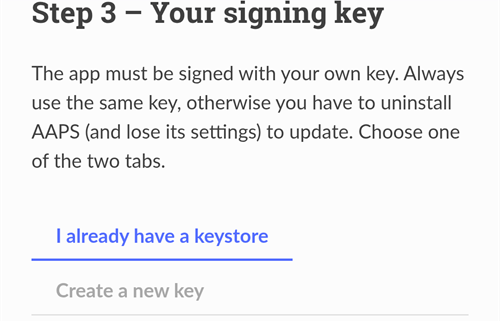
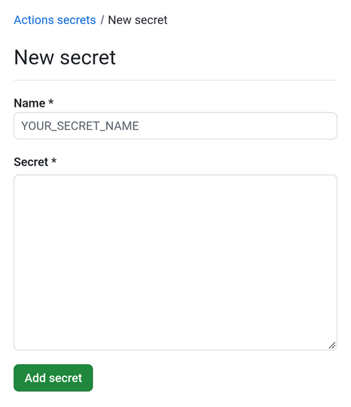

(aaps-builder)=

# Browser-Build mit dem AAPS Builder

```{note}
Das ist der empfohlene Weg, AAPS auf einem **Android-Smartphone** zu erstellen. Er funktioniert auch im Browser jedes Computers. Die anderen Wege für einen Computer oder ein iPhone findest Du in der Übersicht zum [Browser-Build](BrowserBuild.md).
```

```{contents} In this page
:backlinks: entry
:depth: 2
```

Der **AAPS Builder** erstellt die AAPS-App für Dich in GitHub, der kostenlosen Website zum Hosten von Code. Du musst nichts auf Deinem Smartphone installieren und keine Vorbereitungsdatei öffnen.

Eine Einrichtungsseite auf dieser Website führt Dich durch alles. Beim ersten Mal dauert es etwa 10 Minuten:

1. Lege ein leeres **privates** Repository in Deinem GitHub-Konto an: Die Einrichtungsseite öffnet GitHub mit allen Angaben schon ausgefüllt, Du bestätigst nur noch.
2. Füge den **Build-Workflow**, die Datei, die GitHub sagt, wie AAPS erstellt wird, hinzu.
3. Erstelle Deinen **Signaturschlüssel** (den Keystore) oder lade ihn hoch.
4. Übergib den Schlüssel als GitHub-**Secret** an Dein Repository.
5. **Erstelle** die App. Ein Build (Erstellprozess) dauert 15 bis 30 Minuten.
6. **Lade die App herunter und installiere** sie auf Deinem Smartphone.

Du musst AndroidAPS **nicht** „forken“: Der AAPS-Quellcode wird bei jedem Build aus dem offiziellen AndroidAPS-Repository heruntergeladen. Google Drive brauchst Du **auch nicht**: Du lädst die App direkt von GitHub herunter.

```{admonition} Where the code comes from
:class: note

Die Einrichtungsseite und der Build-Workflow sind Teil dieser Dokumentation: Sie werden zusammen mit ihr gepflegt und geprüft. Der <a href="../_static/aaps-builder/aaps-builder-build.yml">Workflow</a>, den Du zu Deinem Repository hinzufügst, ist kurz: Er führt die [Build-Schritte](https://github.com/openaps/AndroidAPSdocs/blob/dev/.github/workflows/aaps-builder.yml) aus, die im Repository der Dokumentation liegen, festgelegt auf eine geprüfte Version. Du kannst beide lesen, bevor Du sie nutzt. Beim Erstellen lädt der Workflow nur den offiziellen AAPS-Quellcode und GitHubs eigene Build-Werkzeuge herunter. Dein Keystore verlässt nie Deinen Browser und Dein privates Repository.
```

(aaps-builder-before-you-start)=

## Bevor Du anfängst

Du brauchst:

- Ein **GitHub-Konto** (kostenlos). Falls Du noch keins hast, leg es zuerst auf [github.com](https://github.com/signup) an.
- Einen **Webbrowser**: Chrome auf Deinem Smartphone oder einen beliebigen Browser auf einem Computer. Melde Dich vor dem Start in diesem Browser bei github.com an.
- **Die GitHub-App auf Deinem Smartphone?** Die kannst Du behalten. Einige Schaltflächen der Einrichtungsseite öffnen dann die App statt Chrome. Erstellen funktioniert in der App, aber die App **kann** das fertige AAPS <0>nicht herunterladen:</0> [Schritt 6](#aaps-builder-step6) zeigt, wie Du für den Download zu Chrome wechselst.
- Deinen **bestehenden Keystore** `(.jks`-Datei), sein Passwort und seinen Alias, falls Du AAPS schon einmal erstellt hast und es ohne Neuinstallation aktualisieren willst.

```{warning}
**Dein Build-Repository muss privat bleiben.** Alles, was ein Build erzeugt, ist für jeden sichtbar, der das Repository sehen kann. Die Einrichtungsseite legt für Dich ein privates Repository an. Stelle es niemals auf „öffentlich“ um.

Ein privates Repository bekommt 2000 kostenlose GitHub-Actions-Minuten pro Monat. Das reicht für mehrere Builds.
```

```{warning}
**Neuer oder vorhandener Schlüssel: Davon hängt ab, ob Du AAPS aktualisieren kannst.**

- **Du hast AAPS schon auf Deinem Smartphone, erstellt mit einem Keystore, den Du noch hast**: Wähle auf der Einrichtungsseite **I already have a keystore** und lade ihn hoch. Dein nächster Build aktualisiert AAPS dann direkt. Du hast AAPS mit dem bisherigen Browser-Build erstellt (Dein eigener Fork)? Dann liegt Dein Keystore in Deinem Fork: [Besorge Dir zuerst eine Kopie](#aaps-builder-from-fork) davon.
- **Du erstellst AAPS zum ersten Mal, oder Du hast Deinen Keystore oder sein Passwort verloren**: Wähle **Create a new key**. Eine App, die mit einem neuen Schlüssel signiert ist, kann kein AAPS aktualisieren, das mit einem anderen Schlüssel signiert wurde. Du musst Deine Einstellungen exportieren, die Datei vom Smartphone weg kopieren, das alte AAPS deinstallieren, das neue installieren und dann Deine Einstellungen importieren: siehe [Verlorener Keystore](#troubleshooting_androidstudio-lost-keystore).

Nutze danach immer denselben Schlüssel. Wenn Du einen neuen Schlüssel erstellst, lade die Sicherung herunter, die die Seite anbietet, und bewahre sie zusammen mit Passwort und Alias (`key0`) an einem sicheren Ort außerhalb Deines Smartphones auf.
```

(aaps-builder-from-fork)=

## Umstieg vom bisherigen Browser-Build (Fork)

Überspringe diesen Abschnitt, wenn Du AAPS nie mit dem bisherigen Browser-Build erstellt hast (Deine eigene Kopie bzw. Dein Fork von AndroidAPS in GitHub, mit Vorbereitungsdatei und Google Drive).

Dein Keystore ist als Secrets in Deinem Fork gespeichert. GitHub zeigt ein Secret nie wieder an, deshalb kannst Du es nicht in Dein neues Repository kopieren. Besorge Dir zuerst eine Kopie Deines Keystores und nutze sie dann in [Schritt 3](#aaps-builder-step3) mit **„Ich habe schon einen Keystore“**.

```{warning}
Wähle nicht **Create a new key**. Ein AAPS, das mit einem neuen Schlüssel erstellt wurde, kann das AAPS auf Deinem Smartphone nicht aktualisieren.
```

Welcher Fall trifft auf Dich zu?

- **Du hast Option 2 genutzt** (Du hast Deinen eigenen Keystore aus Android Studio hochgeladen), und Du hast die `.jks`-Datei, ihre Passwörter und ihren Alias noch: Dann musst Du hier nichts tun. Nutze diese Datei in Schritt 3.
- **Du hast Option 1 genutzt** (die Vorbereitungsdatei hat Deinen Schlüssel erzeugt), oder Du hast Deine Keystore-Datei nicht mehr: Exportiere sie wie unten beschrieben aus Deinem Fork.

So exportierst Du Deinen Keystore aus Deinem Fork:

1. Öffne in Deinem Fork **Settings** → **Secrets and variables** → **Actions** und lege ein Secret mit dem Namen `ZIP_PASSWORD` an. Wähle ein Passwort nur aus englischen Buchstaben und Ziffern. Es schützt die Datei, die Du gleich erzeugst.
2. Öffne den Tab **„Actions“** Deines Forks, tippe auf **„CI Keystore Export“** und dann auf **„Run workflow“**. Mehr dazu: [Keystore exportieren](#ci-keystore-export).
3. Sobald der Durchlauf ein grünes Häkchen hat, öffne Dein Google Drive: Die Datei `keystore.zip` liegt im Ordner **AAPS** → **KeyStore**. Schlägt der Durchlauf beim Google-Drive-Schritt fehl, ist der Google-Drive-Zugriff Deines Forks abgelaufen: siehe [Google refresh token expired](#aaps-ci-google-token-expired).
4. Lade `keystore.zip` herunter und öffne sie mit Deinem `ZIP_PASSWORD`: am Computer oder auf dem Smartphone mit einer Dateimanager-App, die passwortgeschützte ZIP-Dateien öffnen kann. Sie enthält:
   - `keystore.jks`: Deinen Keystore,
   - `keyStoreInfo.txt`: Dein `KEYSTORE_PASSWORD`, `KEY_PASSWORD` und `ALIAS` (meist `key0`).
5. Kopiere `keystore.jks` auf Dein Smartphone (oder in Dein Google Drive, damit Du sie dort auswählen kannst).

In [Schritt 3](#aaps-builder-step3) der Einrichtungsseite:

1. Tippe auf **I already have a keystore**.
2. Wähle unter **Keystore-Datei**, die Datei `keystore.jks`.
3. Gib unter **Keystore-Password** das `KEYSTORE_PASSWORD` aus `keyStoreInfo.txt` ein.
4. Wähle unter **Key Alias** den `ALIAS` aus `keyStoreInfo.txt` aus.
5. Unterscheiden sich `KEY_PASSWORD` und `KEYSTORE_PASSWORD`, entferne das Häkchen bei **Key password is the same as the keystore password** und gib das `KEY_PASSWORD` ein.

Bewahre `keystore.zip` und das `ZIP_PASSWORD` an einem sicheren Ort außerhalb Deines Smartphones auf: Das ist die Sicherung Deines Schlüssels.

Den Google-Drive-Zugriff Deines Forks kannst Du auch nicht kopieren. Wenn Du auch die Builds des AAPS Builders in Google Drive speichern willst, führe [Schritt 7](#aaps-builder-google-drive) aus. Deinen Fork kannst Du behalten, bis das mit dem AAPS Builder erstellte AAPS auf Deinem Smartphone installiert ist.

## Einrichtungsseite öffnen

**→ [AAPS-Builder-Einrichtungsseite öffnen](#aaps-builder-setup)**

Lass diese Dokumentationsseite geöffnet: Drücke lange auf den Link oben und wähle **In neuem Tab öffnen**. Die Schritte unten erklären jeden Teil der Einrichtungsseite ausführlicher.

Die Einrichtungsseite öffnet jede GitHub-Seite in einem neuen Chrome-Tab. Um zur Einrichtungsseite zurückzukehren, tippe auf die Tab-Schaltfläche neben der Adressleiste von Chrome (das Quadrat mit einer Zahl) und wähle die AAPS-Builder-Einrichtungsseite.

Die Einrichtungsseite läuft komplett in Deinem Browser: Dein Schlüssel und Deine Passwörter werden nirgendwohin gesendet, außer in das GitHub-Secret, in das Du sie selbst einfügst. Nur Dein GitHub-Benutzername geht an GitHub, um zu prüfen, ob es ihn gibt. Sie merkt sich Deinen GitHub-Benutzernamen und den Namen Deines Repositorys, sodass Du jederzeit zurückkommen kannst, um Deine Secrets-Seite oder Deine Builds wieder zu öffnen.


(aaps-builder-step1)=

## Schritt 1 – Dein privates Build-Repository anlegen

Dieser Schritt legt ein leeres privates Repository in Deinem GitHub-Konto an. Nur Du kannst es und die damit erstellten Apps sehen.

1. Stelle sicher, dass Du in diesem Browser bei github.com angemeldet bist.

2. Gib unter **Dein GitHub-Benutzername** Deinen GitHub-Benutzernamen ein, nicht Deine E-Mail-Adresse. Die Seite prüft ihn bei GitHub: **✓ GitHub user found** bedeutet, dass er stimmt.

3. Übernimm unter **Name Deines Repositorys** den Vorschlag `my-aaps`. Hast Du Dein Repository schon unter einem anderen Namen angelegt, gib genau diesen Namen ein.

   ```{tip}
   **Du hast schon selbst ein leeres privates Repository angelegt?** Gib hier seinen genauen Namen ein, tippe nicht auf **Create my private repository** und mach mit [Schritt 2](#aaps-builder-step2) weiter.
   ```

4. Prüfe die Zeile **Your repository:**. Dort steht `github.com/<your username>/my-aaps`.

5. Tippe auf **Create my private repository**.

   

6. GitHub öffnet sich in einem neuen Tab, mit Deinem Konto als **Owner** und dem Namen, den Du gewählt hast.

   

   Scrolle nach unten: **Private**, **No template** und **Add README: Off** sind schon ausgewählt. Ändere nichts und füge keine README oder andere Dateien hinzu.

7. Scrolle nach unten und tippe auf die grüne Schaltfläche **Create repository**.

   

   GitHub zeigt Dein neues, leeres Repository an. Wechsle für Schritt 2 **zurück in den Tab der Einrichtungsseite**: Tippe auf die Tab-Schaltfläche neben der Adressleiste von Chrome und wähle die Einrichtungsseite.

(aaps-builder-step2)=

## Schritt 2 – Build-Workflow hinzufügen

Der Build-Workflow ist eine kurze Textdatei, die GitHub sagt, wie AAPS erstellt wird. Die Einrichtungsseite fügt sie einmalig zu Deinem Repository hinzu, Du bestätigst nur.

1. Prüfe, dass die Seite **Workflow version … is ready** anzeigt, und tippe dann auf **Add the workflow to my repository**.

   

2. GitHub öffnet in Deinem Repository eine neue Datei, die schon `.github/workflows/build.yml` heißt und bereits ausgefüllt ist. Prüfe oben den Dateinamen: Er muss genau `.github/workflows/build.yml` lauten. Ändere nicht den Text.

3. Tippe auf **Commit changes…**

   

4. und im Fenster, das sich öffnet, noch einmal auf **Commit changes**.

   

   GitHub zeigt die neue Datei `build.yml` im Ordner `.github/workflows` Deines Repositorys an.

   

```{warning}
Drücke nicht die **Zurück**-Taste Deines Smartphones und ziehe die Seite nicht nach unten, solange der Datei-Editor geöffnet ist: GitHub lädt die Seite dann neu, und der Text verschwindet. Passiert das doch, tippe im blauen Banner auf **Restore**, oder geh zurück zur Einrichtungsseite und tippe noch einmal auf die Schaltfläche.
```

Ist das Textfeld leer, tippe in Schritt 2 der Einrichtungsseite unten auf **Workflow aktualisieren oder Textfeld leer?**: Tippe auf **Copy workflow** und füge ihn in das Textfeld ein (auf dem Smartphone lange drücken).

```{warning}
Nutze nur den Workflow von dieser Einrichtungsseite. Kopiere keinen Build-Workflow von einer anderen Website oder aus einem anderen Repository: Der Workflow läuft direkt neben Deinem Signaturschlüssel.
```

(aaps-builder-step3)=

## Schritt 3 – Dein Signaturschlüssel

Die App muss mit Deinem eigenen Schlüssel signiert werden. Wähle einen der beiden Tabs. Lies vorher den [Hinweis zu neuem oder vorhandenem Schlüssel](#aaps-builder-before-you-start).



### Ich habe schon einen Keystore

1. Tippe auf **I already have a keystore**.
2. Wähle unter **Keystore-Datei** Deine `.jks`-Datei (oder `.keystore`, `.p12`, `.pfx`). Auf dem Smartphone kopiere die Datei vorher auf das Smartphone oder in Dein Google Drive.
3. Gib unter **Keystore password** das Keystore-Passwort ein.
4. Wähle unter **Key Alias** Deinen Alias aus der Liste, oder tippe ihn ein, falls es keine Liste gibt. Bei Keystores aus Android Studio ist das meist `key0`.
5. Unterscheiden sich Dein Key-Passwort und Dein Keystore-Passwort, entferne das Häkchen bei **Key password is the same as the keystore password** und gib das Key-Passwort ein.
6. Tippe auf **Check and continue**.

Die Seite prüft Passwort und Alias auf Deinem Gerät. **Keystore OK! Continue with step 4.** bedeutet, dass alles stimmt. Steht dort, dass das Passwort erst beim Build geprüft wird, mach trotzdem weiter: Der Build meldet sich, falls etwas nicht stimmt.

### Neuen Schlüssel erstellen

1. Tippe auf **Create a new key**.

2. Wähle ein Passwort und gib es zweimal ein. Regeln: mindestens 8 Zeichen, nur die Buchstaben a–z und A–Z, die Ziffern 0–9 und Zeichen wie `! ? #`. Keine Leerzeichen, keine Umlaute oder Buchstaben mit Akzent und kein `|`.

3. Tippe auf **Create key**. Es dauert ein paar Sekunden, bis **Key created** erscheint.

   

4. Tippe auf **Download backup (aaps-keystore.jks)**. Fragt Chrome **Datei noch einmal herunterladen?**, liegt schon eine ältere Sicherung mit demselben Namen auf Deinem Smartphone: Tippe auf **Herunterladen**. Chrome speichert den neuen Schlüssel dann als `aaps-keystore (1).jks`. Das ist die Datei, die zu diesem Schlüssel gehört. Bewahre sie auf und verwechsle sie nicht mit der älteren.

   Bewahre diese drei Dinge zusammen an einem sicheren Ort außerhalb Deines Smartphones auf (zum Beispiel in Deinem eigenen Cloud-Speicher):

   - die Datei `aaps-keystore.jks`,
   - Dein Passwort
   - den Alias des Schlüssels: **`key0`**.

   Du brauchst alle drei, falls Du AAPS jemals auf anderem Weg erstellst, zum Beispiel mit Android Studio. Schlüssel, die mit einer früheren Version der Einrichtungsseite erstellt wurden, haben den Alias `aaps`.

   

(aaps-builder-step4)=

## Schritt 4 – Den Schlüssel an Dein Repository übergeben

Schritt 4 wird freigeschaltet, sobald Schritt 3 erledigt ist. Dein Schlüssel, seine Passwörter und sein Alias werden in einen einzigen Wert gepackt, das Secret `KEYSTORE_SET`.

1. Tippe auf **Open the secrets page**.


2. GitHub öffnet die Seite **New secret** Deines Repositorys. Auf dem Smartphone liegt sie unterhalb des Einstellungsmenüs: Scrolle nach unten.



3. Wechsle in den Tab der Einrichtungsseite und tippe auf **Copy name**. Wechsle zurück in den GitHub-Tab und füge den Namen in das kleine Feld **Name** ein. Der Name lautet `KEYSTORE_SET`.

4. Wechsle in den Tab der Einrichtungsseite und tippe auf **Copy secret**. Wechsle zurück in den GitHub-Tab und füge es in das große Feld **Secret** ein (auf dem Smartphone lange drücken). Das Secret ist ein sehr langer Code mit Tausenden Zeichen: Die Einrichtungsseite zeigt seine ersten Zeichen neben der Schaltfläche an. Füge dort nicht das Wort `KEYSTORE_SET` ein.

5. Tippe auf **Add secret**. `KEYSTORE_SET` erscheint jetzt unter **Repository secrets**.


Das musst Du nur einmal machen.

```{tip}
GitHub zeigt **Page not found** (404)? Prüfe zuerst, ob Du in diesem Browser bei github.com angemeldet bist: Bei privaten Repositorys zeigt GitHub 404 an, wenn Du nicht angemeldet bist. Andernfalls passt der Benutzername oder der Repository-Name aus Schritt 1 nicht zu Deinem Repository. Prüfe den Namen auf github.com, korrigiere ihn in Schritt 1 und tippe noch einmal auf die Schaltfläche.
```

(aaps-builder-step5)=

## Schritt 5 – App erstellen

1. Tippe auf der Einrichtungsseite auf **Open the build page**. GitHub öffnet die Seite **Build AAPS** Deines Repositorys.

   

   Öffnet sich stattdessen die **GitHub-App**: Tippe auf **RUN WORKFLOW**, prüfe Version und Variante und tippe noch einmal auf **RUN WORKFLOW**. Die App zeigt eventuell weiterhin **Nothing to see here**: Zieh die Liste nach unten, um sie zu aktualisieren und Deinen Build zu sehen. Mach dann mit Punkt 4 unten weiter.

2. Falls GitHub nachfragt, tippe auf die grüne Schaltfläche, um Workflows zu aktivieren.
3. Tippe auf **Run workflow**. Ein kleines Formular öffnet sich:
   - **Version**: Behalte `latest`, um die neueste AAPS-Version zu erstellen, oder gib eine Versionsnummer wie z. B. `3.3.2.1` ein.
   - **Variant**: Behalte `fullRelease` für die normale Nutzung mit einer Pumpe. Die anderen Varianten werden unter [Build-Varianten](#browserbuild-variant) erklärt. Wähle nicht `aapsclient3Release`aus: **AAPSClient3** gibt es erst ab **AAPS**-Version 4.0.
   - Tippe auf die grüne Schaltfläche **Run workflow**.

   

4. Der Build startet und zeigt **In progress**, mit zwei Teilen: **AAPS / Check**, dann **AAPS / Build AAPS**.

   

5. Warte 15 bis 30 Minuten. Ein grünes Häkchen bedeutet, dass der Build fertig ist. Ein rotes Kreuz bedeutet, dass er fehlgeschlagen ist: Öffne den Build, um die Meldung zu lesen, und schau dann unter [Problembehandlung](#aaps-builder-troubleshooting) nach.

   

   ```{tip}
   **E-Mail, wenn ein Build fertig ist:** GitHub schickt Dir nur dann eine E-Mail, wenn ein Build fehlschlägt. Damit Du auch bei Erfolg eine bekommst: Öffne auf github.com Dein Profilbild → **Settings** → **Notifications** → **System** → **Actions** und entferne das Häkchen bei **Only notify for failed workflows**.
   ```

Wenn es keine Schaltfläche **Build AAPS** oder **Run workflow** gibt:

- Öffne Dein Repository und prüfe, ob die Datei `.github/workflows/build.yml` vorhanden ist. Fehlt sie oder hat sie einen anderen Namen, wiederhole [Schritt 2](#aaps-builder-step2).
- Öffne den Tab **Actions**. Steht dort, dass Workflows deaktiviert sind, tippe auf die grüne Schaltfläche, um sie zu aktivieren, und dann in der Liste auf **Build AAPS**.

(aaps-builder-step6)=

## Schritt 6 – App auf dem Smartphone installieren

```{warning}
**Vor jedem Update** [exportiere Deine Einstellungen](#ExportImportSettings-Automating-Settings-Export) in AAPS und kopiere die Datei **weg vom Smartphone** (Google Drive, Dropbox …). Öffne auf Deinem Smartphone die Einrichtungsseite in Chrome.
```

1. Öffne auf Deinem Smartphone die Einrichtungsseite in **Chrome**. Melde Dich bei github.com an, falls Du gefragt wirst.
2. Tippe auf **Open my builds** und dann auf den neuesten Build mit grünem Häkchen.

   ```{admonition} The GitHub app opened instead of Chrome?
   :class: note

   Die GitHub-App kann keine Builds herunterladen. Öffne in der App den neuesten Build und tippe auf **Artifacts ↗**, oder tippe oben auf das Teilen-Symbol und wähle **Chrome** (bzw. **Link kopieren** und füge den Link in die Adressleiste von Chrome ein). Der Build öffnet sich in Chrome: Mach dort mit dem nächsten Schritt weiter.

   Damit GitHub-Links nicht mehr in der App geöffnet werden: Android-**Einstellungen** → **Apps** → **GitHub** → **Standardmäßig öffnen** → **Unterstützte Links öffnen** ausschalten.
   ```

   

3. Scrolle nach unten zur Build-Zusammenfassung und tippe auf den Link **Download AAPS**.

   

   ```{tip}
   Scrolle mit dem Finger auf dem Text, nicht auf dem Diagramm der Build-Schritte: Sonst verschiebt sich das Diagramm statt der Seite.
   ```

   Du kannst auch weiter nach unten zu **Artifacts** scrollen und auf das Download-Symbol neben `aaps-….apk` tippen.

   

4. Wenn der Download fertig ist, öffne das Chrome-Menü **⋮** → **Downloads**, tippe auf `aaps-….apk` und wähle **Installieren**. Falls Du gefragt wirst, erlaube die Installation von Apps aus dieser Quelle.

   

`aaps-wear-….apk` ist die Smartwatch-App. Nutzt Du keine Smartwatch, überspringe sie.

Die App bleibt **14 Tage** auf der Build-Seite. Sie erscheint nicht in Deinem Repository unter **Code**. Kopiere sie zusammen mit Deinen Einstellungsexporten an einen sicheren Ort außerhalb Deines Smartphones.

Weitere Wege, die App zu installieren, findest Du unter [AAPS übertragen und installieren](TransferringAndInstallingAaps.md).

```{note}
Seit September 2026 kann Googles [Android-Entwicklerverifizierung](#android-developer-verification) je nach Land verhindern, dass sich die APK durch Antippen der Datei installieren lässt. Free workarounds are explained on that page.
```

(aaps-builder-google-drive)=

## Schritt 7 (optional) – App zusätzlich in Google Drive speichern

You can also have each build saved to your Google Drive, in the folder `AAPS/<version>`. This is optional: the app is always available on the build page.

It needs one more secret, `GDRIVE_OAUTH2`. You get its value with the preparation file used by the other browser build methods:

1. On a **computer**, download the preparation file and open it as described in [Option 1 – Computer](BrowserBuildO1Computer.md). Skip the keystore part: you already have your key.
2. Follow [Step 3 – Authorize Google Drive](#aaps-ci-google-drive-auth) to get the `GDRIVE_OAUTH2` value.
3. On the setup page, step 7 opens your secrets page.

   

   Tap **Copy name**, then paste it into the small **Name** field (the name is `GDRIVE_OAUTH2`). Paste your `GDRIVE_OAUTH2` value into the big **Secret** box and tap **Add secret**.

From the next build, the APKs are also saved in Google Drive.

Google stops the access if you don't build for 6 months, or if you change your Google password. The build then tells you so: redo these steps. See [Google refresh token expired](#aaps-ci-google-token-expired).

(aaps-builder-updates)=

## Aktualisiere AAPS

Your repository never builds anything by itself: you decide when to build, which version and which variant. When a new AAPS version is released:

1. [Back up your settings](#aaps-builder-step6) as explained in step 6.
2. Build the new version as in [step 5](#aaps-builder-step5). Keep `latest`, or type the release number.
3. Download and install it as in [step 6](#aaps-builder-step6).

**Updates of the build workflow:** your repository never downloads a new workflow by itself, and the build steps it runs are pinned to one reviewed version. When the workflow changes, the [Docs updates & changes](../Maintenance/DocumentationUpdate.md) page says so. To update, open step 2 of the setup page, then tap **Updating the workflow, or the text area is empty?**:

1. Tap **Copy workflow**, then **Open my workflow file**.
2. Replace the whole text with the copied workflow (long press on a phone: **Select all**, then **Paste**).
3. Tap **Commit changes…**, then **Commit changes**.

The first line of the file shows its version.

(aaps-builder-troubleshooting)=

## Problembehandlung

To see why a build failed, open it from **Open my builds** on the setup page: the **Annotations** box below the diagram shows the error message. For the full log, tap the job with the red cross, then the step with the red cross.

- **To change a secret**: open your repository's **Settings** → **Secrets and variables** → **Actions**, tap the pencil next to the secret, paste the new value and tap **Update secret**.
- **To run the build again** after a fix: open the failed build, tap **⋯** at the top, then **Re-run all jobs**, or start a new build as in [step 5](#aaps-builder-step5).

- **The build stops with "This repository is PUBLIC"**: in your repository, open **Settings** → **General** → **Danger Zone** → **Change visibility** → **Private**, then build again.
- **"Secret KEYSTORE_SET is missing"**: do step 4 of the setup page.
- **"The secret is too short"**, **"The secret is not a valid code"** or **"The secret does not contain a keystore"**: the wrong text was pasted into the secret, often the word `KEYSTORE_SET` itself, or only part of the code. In your repository, open **Settings** → **Secrets and variables** → **Actions**, edit `KEYSTORE_SET` and paste the long code from **Copy secret** again (redo step 3 of the setup page first if you closed it).
- **"Keystore, password or alias is wrong"**: check your keystore's password and alias, then redo steps 3 and 4 of the setup page.
- **"Version … does not exist"**: the version you typed is not an AAPS release. Use `latest`, or check the release number.
- **"Page not found" (404) when the setup page opens GitHub**: log in to github.com in the same browser (GitHub shows 404 for private repositories when you are not logged in). If you are logged in, the username or repository name in step 1 of the setup page does not match your repository. Type the exact names.
- **"No GitHub user with this name"** in step 1: type your GitHub username, as shown in your GitHub profile, not your e-mail.
- **No Download link, or the GitHub app opened**: the GitHub app cannot download builds. Open the build in Chrome as explained in [step 6](#aaps-builder-step6). To stop GitHub links opening in the app: Android **Settings** → **Apps** → **GitHub** → **Open by default** → turn off **Open supported links**.
- **"Could not read the workflow file"** on the setup page: reload the page and tap the button again. The setup page must be opened from this documentation site.
- **GitHub says the file already exists** when you commit the workflow: your repository already has a workflow. Update it instead, as explained in [Updating AAPS](#aaps-builder-updates).
- **"Google Drive access has expired or was revoked"**: redo [step 7](#aaps-builder-google-drive) and update the `GDRIVE_OAUTH2` secret.

For other GitHub and Google Drive issues, see [Browser build troubleshooting](../GettingHelp/BrowserBuildTroubleshooting.md).

```{toctree}
:hidden:

AAPS-Builder-Einrichtungsseite <BrowserBuildAapsBuilderSetup.md>
```
