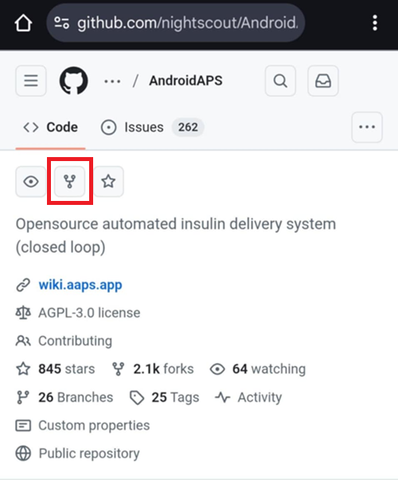
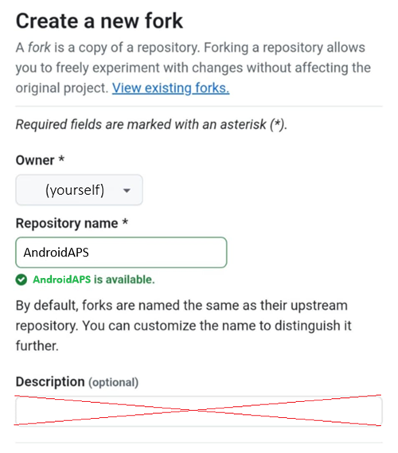
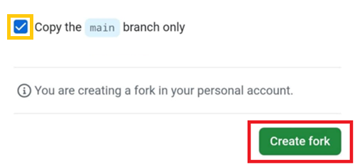

(github-fork)=

# Browser-Build – Schritt 1: Deinen GitHub-Fork erstellen

```{note}
Das ist **Schritt 1** des [Browser-Builds](BrowserBuild.md).
```

Du musst Deinen persönlichen Android Java Key und Deine Google-Drive-Informationen als Secrets in GitHub speichern (wie das geht, erklären wir später).

Da das im öffentlichen AAPS-Repository nicht möglich ist, musst Du Deine persönliche Kopie des Quellcodes erstellen (sog. „Fork“).

## GitHub-Konto

Wenn Du noch kein GitHub-Konto hast, musst Du zuerst ein [GitHub-Konto erstellen](https://github.com/signup).  
Du kannst Dich mit einer eMail-Adresse oder mit Google registrieren. Durchlaufe den Registrierungs- und Verifikationsprozess.

Hast Du bereits ein Konto, [logge Dich in GitHub ein](https://github.com/login).

## Fork AndroidAPS (neuen AAPS-Entwicklungsast bilden)

Öffne das offizielle AndroidAPS-Repository hinter [diesem Link](https://github.com/nightscout/AndroidAPS).

Tippe auf das Fork-Symbol. Das erstellt in Deinem eigenen Konto eine Kopie.



Scrolle auf dem nächsten Bildschirm nach unten und tippe auf **Create Fork**.



*Hinweis: Du kannst den Haken bei „Copy the master branch only“ **entfernen**, wenn Du Entwicklerversionen oder Anpassungen erstellen möchtest.*



```{note}
Du kannst keinen Fork erstellen und siehst das?<br/><br/>
**`No available destinations to fork this repository.`**<br/><br/>
<br/><br/>
Das bedeutet, dass Du bereits einen Fork von AndroidAPS hast.<br/>
Stelle sicher, dass er aktuell ist, und mach mit den Vorbereitungsschritten weiter.
```

```{warning}
**Lösche niemals Deinen Fork, ohne ein Backup Deiner „Secrets“ (Passwörter) gemacht zu haben!**
```

GitHub zeigt jetzt Deine persönliche Kopie von AndroidAPS an. Lasse diesen Tab des Web-Browsers geöffnet.


----

**Weiter: [Schritt 2 – Deinen Signatur-Keystore erstellen](BrowserBuildKeystore.md) →**
