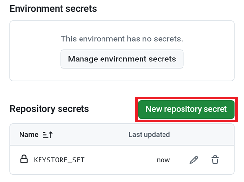
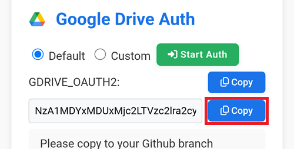

(aaps-ci-google-drive-auth)=

# Browser-Build – Schritt 3: Google Drive autorisieren

```{note}
Das ist **Schritt 3** des [Browser-Builds](BrowserBuild.md). Schließe zuerst [Schritt 2 – Deinen Signatur-Keystore erstellen](BrowserBuildKeystore.md) ab.
```

```{warning}
Egal, welcher der vorherigen Anleitungen Du gefolgt bist (Option 1 oder Option 2), Du MUSST die Google-Drive-Autorisierung hinzufügen, um den Browser Build erfolgreich zu nutzen.
```

Hinweis: Hast Du diesen Teil schon im Video erledigt, kannst Du jetzt direkt zu [Schritt 4 – Die APK erstellen](BrowserBuildAPK.md) springen.

```{warning}
Startet die Google-Autorisierung nicht oder schlägt die Vorbereitungsseite fehl, schließe die Vorbereitungsseite, öffne `aaps-ci-preparation.html` erneut auf die gleiche Weise wie in Schritt 2 und beginne diesen Schritt von vorn. Siehe [Fehlerbehebung](#aaps-ci-preparation-web).
```

Kehre zum Tab der Vorbereitungsseite zurück.

Scrolle bis zum „Google Drive Autorisierung“-Abschnitt herunter und tippe auf „Autorisierung starten“.


Wähle Dein Google-Konto aus.


Scrolle herunter und erlaube den Zugriff. Die Webseite benötigt ihn, um den Google Drive Authentifizierungsschlüssel zu bekommen.

Tippe auf „Weiter“.


Das Feld `GDRIVE_OAUTH2` wird ausgefüllt. Tippe auf die oberste „Kopieren“-Schaltfläche.


Wechsle zurück auf den GitHub-Tab.

Scrolle zu den „Repository Secrets“ herunter und tippe auf „New Repository Secret“.

Nutzt Du die Option 1, solltest Du Folgendes sehen:



Nutzt Du die Option 2, sind weitere Schlüssel notwendig:


Füge in das Namensfeld den gerade kopierten Text ein. Drücke lange auf die Textbox, um das „Einfügen-Menü“ anzuzeigen.


Wechsle zum Tab der Vorbereitungsseite.

Tippe auf den zweiten Kopieren-Knopf.



Wechsle zurück auf den GitHub-Tab.

1. Füge in das Secret-Feld den gerade kopierten Text ein. Drücke lange auf die Textbox, um das „Einfügen-Menü“ anzuzeigen.

2. Tippe auf „Add Secret“.


Du solltest nun entweder zwei (Option 1) oder fünf (Option 2) Repository-Secrets-Einträge haben.


GitHub wird ab jetzt in der Lage sein, die AAPS-APK-Datei in Deinem Google Drive zu speichern, sobald sie erstellt wurde.

----

**Weiter: [Schritt 4 – Die APK erstellen](BrowserBuildAPK.md) →**
