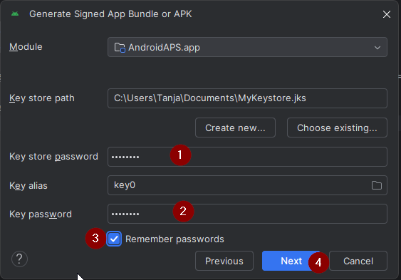

(aaps-ci-option2)=

# Option 2 – Deinen vorhandenen Keystore hochladen

```{note}
Das ist Teil von [Schritt 2 – Deinen Signatur-Keystore erstellen](BrowserBuildKeystore.md) des [Browser-Builds](BrowserBuild.md). Achte darauf, dass Du die [Entscheidung zwischen Option 1 und Option 2](#aaps-ci-preparation) gelesen hast.
```

Option 2 verwendet die JKS-Datei weiter, die Du bei einem früheren Build von AAPS auf einem Computer in Android Studio erstellt hast. Sie eignet sich für Anwender, die bereits eine JKS-Datei haben und deren Passwort und Alias kennen.

Gib für `KEYSTORE_PASSWORD`, `KEY_ALIAS` und `KEY_PASSWORD` in GitHub Dein tatsächliches Passwort und Deinen Alias ein – die aus Android Studio, siehe unten, wo Du sie verwendet hast.

```{warning}
**Passwörter mit Sonderzeichen.** Gib Deine Passwörter genau so ein, wie sie sind. Füge keinen Backslash und kein anderes Escape-Zeichen hinzu: Der Build-Workflow lässt jedes Zeichen unverändert, und ein hinzugefügter Backslash wird Teil des Passworts.

Scheitert der Build trotzdem beim Signieren und enthält Dein Passwort `$`, einen Backtick, `"` oder `\`, ist die Workflow-Datei in Deinem Fork veraltet. [Synchronisiere Deinen Fork](#Update-to-new-version-update-your-repo) mit dem neuesten dev und starte den Build erneut. Siehe [Fehlerbehebung beim Browser-Build](#aaps-ci-password-special-characters).
```

```{admonition} KEY + PASSWORDS
:class: dropdown


```

## Wähle Dein Gerät

```{tip}
Du erstellst auf einem **Android-Smartphone**? Verwende stattdessen [AAPS Builder](BrowserBuildAapsBuilder.md): Dafür brauchst Du keine Vorbereitungsdatei.
```

Folge der Seite, die zu dem Gerät passt, auf dem Du erstellst:

- **[Computer](BrowserBuildO2Computer.md)** – Windows, Mac oder Linux.

```{tip}
Du kannst das Gerät jederzeit wechseln – öffne einfach die passende Seite.
```

```{toctree}
:hidden:

Computer <BrowserBuildO2Computer.md>
```
